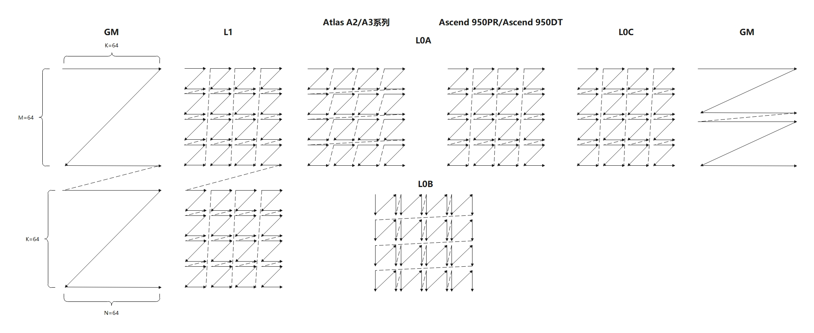
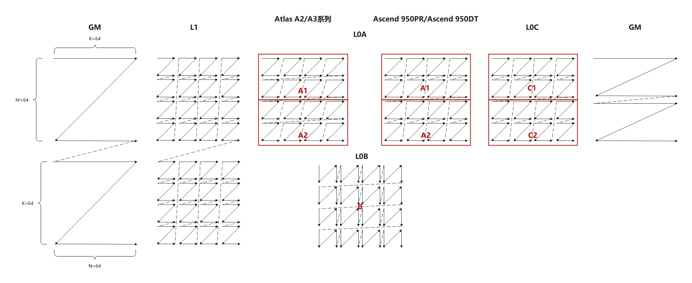

# pattern_transformation 兼容性样例

## 概述

本样例基于基础的mmad样例，演示了 L1 Buffer -> L0A Buffer 通路的分形转换逻辑，通过编译时宏 `__NPU_ARCH__` 隔离不同硬件实现。

- 在 Atlas A2/A3 系列产品中，L0A Buffer 的数据排布为 Zz 分形
  - 从 L1 Buffer 搬运到 L0A Buffer 时需要做 Nz -> Zz 的分形转换。
  - L0A复用场景，M轴切分时需要将A矩阵切分为多个Nz矩阵。
- 在 Ascend 950PR/Ascend 950DT 中，L0A Buffer 的数据排布变更为 Nz 分形，与 L1 Buffer 一致，不再需要做分形转换。

## 本样例支持的产品及CANN软件版本

| 产品 | CANN软件版本 |
|------|-------------|
| Ascend 950PR/Ascend 950DT | >= CANN 9.1.0 |
| Atlas A3 训练系列产品/Atlas A3 推理系列产品 | >= CANN 9.0.0 |
| Atlas A2 训练系列产品/Atlas A2 推理系列产品 | >= CANN 9.0.0 |

## 目录结构介绍

```
├── pattern_transformation
│   ├── scripts
│   │   ├── gen_data.py                    // 输入数据和真值数据生成脚本
│   │   └── verify_result.py               // 验证输出数据和真值数据是否一致的验证脚本
│   ├── CMakeLists.txt                     // 编译工程文件
│   ├── data_utils.h                       // 数据读入写出函数
│   ├── pattern_transformation.asc         // AscendC算子实现 & 调用样例
│   └── test.sh                            // 一键编译运行脚本
```

## 样例规格

<table>
<caption>样例规格表</caption>
<tr><td rowspan="1" align="center">类别</td><td align="center">name</td><td align="center">shape</td><td align="center">data type</td><td align="center">format</td></tr>
<tr><td rowspan="3" align="center">样例输入</td></tr>
<tr><td align="center">x</td><td align="center">[64, 64]</td><td align="center">half</td><td align="center">ND</td></tr>
<tr><td align="center">y</td><td align="center">[64, 64]</td><td align="center">half</td><td align="center">ND</td></tr>
<tr><td rowspan="1" align="center">样例输出</td><td align="center">z</td><td align="center">[64, 64]</td><td align="center">float</td><td align="center">ND</td></tr>
<tr><td rowspan="1" align="center">核函数名</td><td colspan="4" align="center">pattern_transformation</td></tr>
</table>

## 样例实现

***图1 L0A不复用场景概览***




***图2 L0A复用场景概览***



### GM->L1

GM到L1的搬运过程，**无需兼容性适配**，使用DataCopy接口将GM中的ND矩阵加载到L1，相关代码片段如下：

```cpp
__aicore__ inline void CopyIn(AscendC::LocalTensor<T> a1Local, AscendC::LocalTensor<U> b1Local)
{
    ...
    AscendC::DataCopy(a1Local, aGM, nd2nzA1Params);
    ...
    AscendC::DataCopy(b1Local, bGM, nd2nzB1Params);
}
```

DataCopy 将 GM 中 ND 格式的矩阵 x[M, K] 和 y[K, N] 分别搬运到 L1 Buffer 中，存储为 Nz 分形格式，供后续 Cube 运算使用。

### L1->L0A

Ascend 950PR/Ascend 950DT中，L0A 中的数据格式变为为 Nz 分形，以下分场景介绍兼容性差异。

#### L0A不复用场景

在 Atlas A2/A3 系列产品中，L1->L0A 需要由 Nz 分形转换成 Zz 分形，通过 Load2D 接口实现，相关代码如下：

```cpp
...
for (uint32_t i = 0; i < mBlocks; ++i) {
    constexpr uint32_t mBlocks = M / CUBE_BLOCK;
    constexpr uint32_t kBlocks = K * sizeof(T) / C0_SIZE;
    int srcOffset = 0;
    int dstOffset = 0;
    for (uint32_t i = 0; i < mBlocks; ++i) {
        AscendC::Load2DParams loadDataParams;
        loadDataParams.repeatTimes = kBlocks;
        loadDataParams.srcStride = mBlocks;
        loadDataParams.ifTranspose = false;
        AscendC::LoadData(a2[dstOffset], a1[srcOffset], loadDataParams);
        srcOffset += CUBE_BLOCK * CUBE_BLOCK;
        dstOffset += K * CUBE_BLOCK;
    }
}
```

在 Ascend 950PR/Ascend 950DT 中，L1->L0A需要不需要做分型转换，保持Nz分形，通过Load2D 接口实现，相关代码如下：

```cpp
constexpr uint32_t mBlocks = M / CUBE_BLOCK;
constexpr uint32_t kBlocks = K / CUBE_BLOCK;
int srcOffset = 0;
int dstOffset = 0;
for (uint32_t i = 0; i < kBlocks; ++i) {
    AscendC::Load2DParams loadDataParams;
    loadDataParams.repeatTimes = mBlocks;
    loadDataParams.srcStride = 1;
    loadDataParams.ifTranspose = false;
    AscendC::LoadData(a2[dstOffset], a1[srcOffset], loadDataParams);
    srcOffset += CUBE_BLOCK * CUBE_BLOCK * mBlocks;
    dstOffset += CUBE_BLOCK * CUBE_BLOCK * mBlocks;
}
```


#### L0A复用场景

在分析前，先介绍数学背景。对于矩阵乘法 C = A × B，当 A 可拆分为上下两块时：

$$
A = \begin{bmatrix} A_1 \\ A_2 \end{bmatrix}, \quad
A \cdot B = \begin{bmatrix} A_1 \\ A_2 \end{bmatrix} B
= \begin{bmatrix} A_1 B \\ A_2 B \end{bmatrix}
= \begin{bmatrix} C_1 \\ C_2 \end{bmatrix} = C
$$

即可以将 A 按行拆分为 A1 和 A2，分别与 B 相乘得到 C1 和 C2，最终拼接为 C。
在Atlas A2/A3系列产品中，由于L0A为Zz分形，因此切分M轴后，A1和A2依然连续，第二次mmad计算只需要修改A矩阵的偏移量即可。
在Ascend 950PR/Ascend 950DT中，由于L0A为Nz分形，切分M轴后A1和A2不连续，为了不改变mmad计算的逻辑及后续的流水排布，需要通过Load2D搬运指令，将整块Nz矩阵切分成两块子Nz矩阵，相关代码如下：

```cpp
// 搬运上半部分 Nz 分形
...
for (uint32_t i = 0; i < kBlocks; ++i) {
    ...
    AscendC::LoadData(a2[dstOffset], a1[srcOffset], loadDataParams);
    ...
}
// 搬运下半部分 Nz 分形
srcOffset = CUBE_BLOCK * CUBE_BLOCK * mBlocks / 2;  // 从下半开始
for (uint32_t i = 0; i < kBlocks; ++i) {
    ...
    AscendC::LoadData(a2[dstOffset], a1[srcOffset], loadDataParams);
    ...
}
```


#### L1->L0B

L1 到 L0B 的搬运，所有产品均使用 Load2D 完成 Nz 格式搬运，**无需兼容性适配**，相关代码如下：

```cpp
...
for (uint32_t i = 0; i < kBlocks; ++i) {
    AscendC::LoadData(b2[i * dstStride], b1[i * srcStride], loadDataParams);
}
```

### Compute

Compute 阶段使用 Mmad 接口完成矩阵乘法，采用 A 矩阵上下两半拆分的策略，分别计算 C1=A1×B 和 C2=A2×B，**无需兼容性适配**，相关代码如下：

```cpp
...
AscendC::Mmad(co1Local, a2, b2, mmadParams);
AscendC::Mmad(co1Local[M * N / 2], a2[M * K / 2], b2, mmadParams);  // 下半部分 A2[32, 64]
```

### L0C->GM

L0C 到 GM 的搬运，使用 Fixpipe 接口将 L0C 中的 float 结果写回 GM，同样采用上下两半拆分的策略，**无需兼容性适配**，搬运两块Nz矩阵：

```cpp
...
AscendC::Fixpipe(cGM, co1Local, fixpipeParams);
AscendC::Fixpipe(cGM[M * N / 2], co1Local[M * N / 2], fixpipeParams);
```

## 编译运行

在本样例根目录下执行如下步骤，编译并执行样例。

- 配置环境变量

  请根据当前环境上 CANN 开发套件包的[安装方式](../../../../docs/quick_start.md#prepare&install)，配置环境变量。
  ```bash
  source ${install_path}/cann/set_env.sh
  ```

  > **说明：** `${install_path}` 为 CANN 包安装目录，未指定安装目录时默认安装至 `/usr/local/Ascend` 下。

- 样例执行

  在本样例目录下执行如下命令。
  ```bash
  mkdir -p build && cd build
  cmake -DCMAKE_ASC_ARCHITECTURES=dav-2201 -DCASE_NUM=1 .. && make -j       # 编译（默认 NPU 模式）
  python3 ../scripts/gen_data.py                                # 生成测试输入数据
  ./demo                                                        # 执行编译生成的可执行程序
  python3 ../scripts/verify_result.py output/output.bin output/golden.bin  # 验证结果
  ```

  使用 CPU 调试或 NPU 仿真模式时，添加 `-DCMAKE_ASC_RUN_MODE=cpu` 或 `-DCMAKE_ASC_RUN_MODE=sim` 参数即可，示例如下：

  ```bash
  cmake -DCMAKE_ASC_RUN_MODE=cpu -DCMAKE_ASC_ARCHITECTURES=dav-2201 -DCASE_NUM=1 .. && make -j   # CPU 调试模式
  cmake -DCMAKE_ASC_RUN_MODE=sim -DCMAKE_ASC_ARCHITECTURES=dav-2201 -DCASE_NUM=1 .. && make -j   # NPU 仿真模式
  ```

  > **注意：** 切换编译模式前需清理 cmake 缓存，可在 build 目录下执行 `rm CMakeCache.txt` 后重新 cmake。

- 编译选项说明

  | 选项 | 可选值 | 说明 |
  |------|--------|------|
  | `CMAKE_ASC_RUN_MODE` | `npu`（默认）、`cpu`、`sim` | 运行模式：NPU 运行、CPU 调试、NPU 仿真 |
  | `CMAKE_ASC_ARCHITECTURES` | `dav-2201`（默认）、`dav-3510` | NPU 架构：dav-2201 对应 Atlas A2/A3 系列产品，dav-3510 对应 Ascend 950PR/Ascend 950DT |

- 执行结果

  执行结果如下，说明精度对比成功：

  ```bash
  test pass!
  ```
