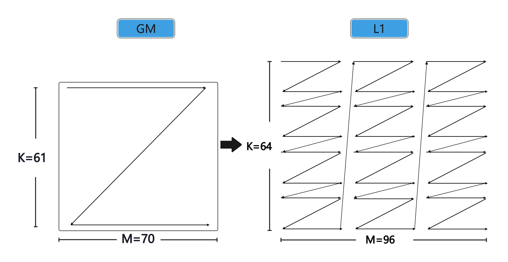
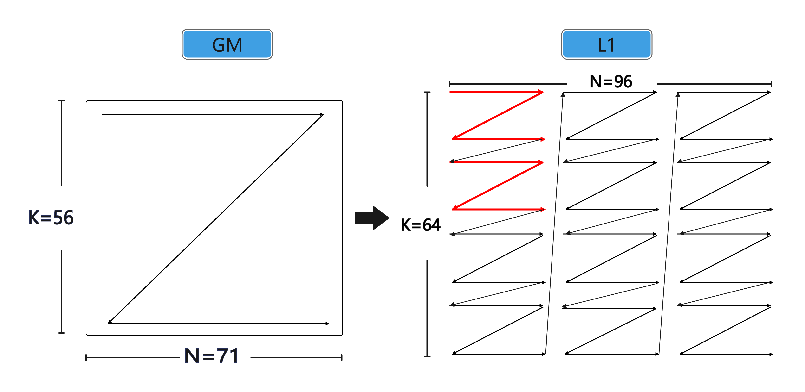

# fixpipe_co12gm_quantization_s322s8样例

## 概述

本样例介绍如何使用组合API Fixpipe或基础API Data将矩阵乘的结果从L0C搬出到GM，并支持随路NZ2ND、UnitFlag与随路量化、Relu能力组合，输入int8_t类型数据，输出由int32_t类型量化为int8_t类型。

完整的矩阵乘法流程涉及四个阶段的数据搬运和计算：
1. **GM → L1**：通过DataCopy随路转换ND2NZ指令，将A、B矩阵从GM搬运到L1，同时完成ND到NZ格式的转换
2. **L1 → L0A/L0B**：通过LoadData系列指令，将A、B矩阵从L1搬运到L0A/L0B，完成NZ到Zz/Zn格式的转换
3. **L0A × L0B → L0C**：通过Mmad指令执行矩阵乘法计算，结果存储在L0C中
4. **L0C → GM**：通过Fixpipe或DataCopy指令将结果从L0C搬出到GM，支持随路NZ2ND、量化、Relu等操作

## 支持的产品

- Atlas A3 训练系列产品/Atlas A3 推理系列产品
- Atlas A2 训练系列产品/Atlas A2 推理系列产品

## 目录结构介绍

```
├── fixpipe_co12gm_quantization_s322s8
│   ├── scripts
│   │   ├── gen_data.py             // 输入数据和真值数据生成脚本
│   │   └── verify_result.py        // 验证输出数据和真值数据是否一致的验证脚本
│   ├── CMakeLists.txt              // 编译工程文件
│   ├── data_utils.h                // 数据读入写出函数
│   └── fixpipe_co12gm_quantization_s322s8.asc     // Ascend C算子实现 & 调用样例
```

## 算子描述

### 算子功能

本样例中实现的是[M, N, K]固定为[128, 256, 128]的Matmul乘算子，对应的数学表达式为：
```
C = A * B
```
其中A的形状为[M, K], B的形状为[K, N], C的形状为[M, N]。

本样例中，A矩阵不转置，B矩阵不转置（逻辑上需要转置），因此：
- A矩阵：GM(ND) → L1(NZ) → L0A(Zz)
- B矩阵：GM(ND) → L1(NZ) → L0B(Zn) （需要通过LoadDataWithTranspose转置）
- C矩阵：L0C(Nz) → GM(ND/NZ)

### 算子规格

<table>
<tr><><td rowspan="1" align="center">算子类型(OpType)</td><td colspan="4" align="center">Matmul</td></tr>
<tr><td rowspan="3" align="center">算子输入</td><td align="center">name</td><td align="center">shape</td><td align="center">data type</td><td align="center">format</td></tr>
<tr><td align="center">A</td><td align="center">(128, 128)</td><td align="center">int8_t</td><td align="center">ND</td></tr>
<tr><td align="center">B</td><td align="center">(128, 256)</td><td align="center">int8_t</td><td align="center">ND</td></td>
</tr>
<tr><td rowspan="1" align="center">算子输出</td><td align="center">C</td><td align="center">(128, 256)</td><td align="center">int8_t</td><td align="center">ND/NZ</td></tr>
<tr><td rowspan="1" align="center">核函数名</td><td colspan="4" align="center">fixpipe_co12gm_s322s8</td></tr>
</table>

### 功能配置说明

本样例支持配置使用AscendC提供的组合API Fixpipe或基础API DataCopy与寄存器配置实现矩阵搬出到GM，并支持FIXPIPE指令多种随路能力组合：

| 配置项 | 取值 | 说明 |
|--------|------|------|
| OUTPUTFORMAT | 1 | C矩阵为ND输出，使能FIXPIPE指令随路NZ2ND能力 |
| OUTPUTFORMAT | 2 | C矩阵为NZ输出，int8_t输出默认开启channel merge能力 |
| PREQUANTMODE | 1 | Scalar量化模式，整个C矩阵使用一个量化参数 |
| PREQUANTMODE | 2 | Tensor/Vector量化模式，C矩阵的每一列使用一个量化参数 |
| PRERELUMODE | 0 | 不使能Relu |
| PRERELUMODE | 1 | 使能NormRelu能力 |
| ENUNITFLAG | true | 开启MMAD指令与FIXPIPE指令并行能力 |
| USEDATACOPY | true | 使用基础API DataCopy与寄存器配置实现矩阵搬出 |
| USEDATACOPY | false | 使用组合API Fixpipe实现矩阵搬出 |

**注意**：当使能UnitFlag时，MMAD与FIXPIPE需同时使能unitFlag，此时L0C上的LocalTensor不能用[TQue](https://www.hiascend.com/document/detail/zh/canncommercial/850/API/ascendcopapi/atlasascendc_api_07_0137.html)获取，需要改用[TBuf](https://www.hiascend.com/document/detail/zh/canncommercial/850/API/ascendcopapi/atlasascendc_api_07_0161.html)。

## 数据流详细说明

为了方便描述，在此对后续常用概念给出定义：

（1）CeilAlign:向上对齐操作，例如CeilAlign(M=30, 16)=32，表示将M轴向16对齐，对齐后M轴长度为32。
```cpp
__aicore__ inline uint16_t CeilAlign(uint16_t size, uint16_t alignValue) {
    return (size + alignValue - 1) / alignValue * alignValue;
}
```
（2）CeilDivision:向上取整除法，一般用于求解向上对齐后的循环次数。

### 阶段1: GM → L1 (ND2NZ)

通过DataCopy随路转换ND2NZ指令，将A、B矩阵从GM搬运到L1，同时完成ND到NZ格式的转换。[DataCopy随路转换ND2NZ搬运](https://www.hiascend.com/document/detail/zh/canncommercial/850/API/ascendcopapi/atlasascendc_api_07_00127.html)指令的Nd2NzParams结构体的成员，各个成员变量的具体含义这里不再赘述。其中需要注意的是，dstNzC0Stride的单位为32B，该参数取值为L1上NZ矩阵的对齐后的行数

**数据排布变化：**
- GM: ND格式，数据线性连续存储
- L1: NZ格式，数据按分形（16x32）Z字形排布

**A矩阵GM->L1示意图**
<p align="center">
  
</p>

<p align="center">
图1：A矩阵不转置，int8_t数据类型下GM-->L1数据排布示意图
</p>

**A矩阵配置示例：**
```cpp
AscendC::Nd2NzParams nd2nzA1Params;
nd2nzA1Params.ndNum = 1;                              // 传输ND矩阵的数目
nd2nzA1Params.nValue = m;                              // ND矩阵的高度
nd2nzA1Params.dValue = k;                              // ND矩阵的宽度
nd2nzA1Params.srcNdMatrixStride = 0;                   // 源操作数相邻ND矩阵起始地址间的偏移
nd2nzA1Params.srcDValue = k;                           // 源操作数D维度相邻元素起始地址间的偏移
nd2nzA1Params.dstNzC0Stride = CeilAlign(m, 16);       // 目的NZ矩阵中相邻行起始地址间的偏移
nd2nzA1Params.dstNzNStride = 1;                        // 目的NZ矩阵中Z型矩阵相邻行起始地址之间的偏移
nd2nzA1Params.dstNzMatrixStride = 0;                   // 目的NZ矩阵中相邻NZ矩阵起始起始地址间的偏移
AscendC::DataCopy(a1Local, aGM, nd2nzA1Params);
```

**B矩阵GM->L1示意图**

B矩阵在GM、L1上的数据排布分别是ND、NZ。如下图12所示，当输入数据类型为int8_t类型、B矩阵不转置时,将L1上数据排布为NZ、shape为[K，N]的B矩阵中分形沿着K轴两两合并为一个方块矩阵。合并为方块矩阵是为后续L1->L0B做准备，因为LoadDataWithTranspose接口一次只能转置一个方块矩阵。

<p align="center">
  
</p>

<p align="center">
图2：B矩阵不转置，int8_t数据类型下GM-->L1数据排布示意图
</p>

**B矩阵配置示例：**


```cpp
AscendC::Nd2NzParams nd2nzB1Params;
nd2nzB1Params.ndNum = 1;
nd2nzB1Params.nValue = k;
nd2nzB1Params.dValue = n;
nd2nzB1Params.srcNdMatrixStride = 0;
nd2nzB1Params.srcDValue = n;
nd2nzB1Params.dstNzC0Stride = CeilAlign(k, 32);        // K轴向32对齐
nd2nzB1Params.dstNzNStride = 1;
nd2nzB1Params.dstNzMatrixStride = 0;
AscendC::DataCopy(b1Local, bGM, nd2nzB1Params);
```

### 阶段2: L1 → L0A/L0B (LoadData系列)

#### L1 → L0A (A矩阵不转置)

A矩阵不转置，从L1(NZ)到L0A(Zz)不需要转置，使用[Load2D](https://www.hiascend.com/document/detail/zh/canncommercial/850/API/ascendcopapi/atlasascendc_api_07_00169.html)接口。

**数据排布变化：**
- L1: NZ格式，shape为[M, K]
- L0A: Zz格式，shape为[M, K]

**A矩阵L1->L0A示意图**

xxxxxxxxxxxxxxxxxx

xxxxxxxxxxxxxxxxxx


**参数配置示例：**

```cpp
uint32_t dstOffset = CeilDivision(k, 32) * 512;        // L0A上M轴方向每次循环的地址偏移
uint32_t srcOffset = 512;                               // L1上M轴方向每次循环的地址偏移

AscendC::LoadData2DParams loadDataParams;
loadDataParams.repeatTimes = CeilDivision(k, 32);       // K轴方向迭代次数
loadDataParams.srcStride = CeilDivision(m, 16);         // M轴方向相邻迭代间源操作数地址偏移
loadDataParams.dstGap = 0;                              // K轴方向相邻迭代间目的操作数地址偏移
loadDataParams.ifTranspose = false;                      // 不转置

for (int i = 0; i < CeilDivision(m, 16); ++i) {
    AscendC::LoadData(a2Local[i * dstOffset], a1Local[i * srcOffset], loadDataParams);
}
```

#### L1 → L0B (B矩阵不转置，逻辑上需要转置)

B矩阵不转置（逻辑上需要转置），从L1(NZ)到L0B(Zn)需要转置，使用[LoadDataWithTranspose](https://www.hiascend.com/document/detail/zh/canncommercial/850/API/ascendcopapi/atlasascendc_api_07_0239.html)接口。

**数据排布：**
- L1: NZ格式，shape为[K, N]
- L0B: Zn格式，shape为[K, N]

**关键点：**
- int8_t数据类型下，fractalShape为[16, 32]，需要2个连续分形合并为1个方块矩阵后转置
- N轴向32对齐（2*16）

**参数配置示例：**
```cpp
uint32_t dstOffset = CeilDivision(n, 32) * 512 * 2;   // L0B上K轴方向每次循环的地址偏移
uint32_t srcOffset = 512 * 2;                          // L1上K轴方向每次循环的地址偏移

AscendC::LoadData2dTransposeParams loadDataParams;
loadDataParams.startIndex = 0;                          // 搬运起始位置
loadDataParams.repeatTimes = CeilDivision(n, 32);       // N轴方向迭代次数
loadDataParams.srcStride = CeilDivision(k, 32);        // K轴方向相邻迭代间源操作数地址偏移
loadDataParams.dstGap = 1;                             // K轴方向相邻迭代间目的操作数地址偏移
loadDataParams.dstFracGap = 0;                         // 每个迭代内目的操作数转置前分形间隔

for (int i = 0; i < CeilDivision(k, 32); ++i) {
    AscendC::LoadDataWithTranspose(b2Local[i * dstOffset], b1Local[i * srcOffset], loadDataParams);
}
```

### 阶段3: L0A × L0B → L0C (Mmad)

通过[Mmad](https://www.hiascend.com/document/detail/zh/canncommercial/850/API/ascendcopapi/atlasascendc_api_07_0249.html)指令执行矩阵乘法计算，结果存储在L0C中。

**关键点：**
- 由于B矩阵转置过程中N轴向32对齐，非对齐场景可能会读取到填充的无效数据
- Mmad指令默认N轴向16对齐，如果设置mmadParams.n = n，会导致错误读入无效数据分形
- 解决方法：设置mmadParams.n = CeilAlign(n, 32)，让填充的分形参与计算，多搬多算，在Fixpipe搬出时跳过无效分形

**参数配置示例：**
```cpp
AscendC::MmadParams mmadParams;
mmadParams.m = m;                                    // M轴长度
mmadParams.n = CeilAlign(n, 32);                      // N轴长度（向32对齐）
mmadParams.k = k;                                    // K轴长度 reduce轴

// C矩阵初始化
if (kIndex == 0) {
    mmadParams.cmatrixInitVal = true;                  // 第一个K分块，初始化C矩阵
} else {
    mmadParams.cmatrixInitVal = false;                 // 后续K分块，累加到C矩阵
}

// UnitFlag配置
if constexpr (EN_UNIT_FLAG == true) {
    if (kIndex != K_ROUND - 1) {
        mmadParams.unitFlag = 2;                      // 非最后一个K分块
    } else {
        mmadParams.unitFlag = 3;                      // 最后一个K分块
    }
}

AscendC::Mmad(c, a, b, mmadParams);
```

### 阶段4: L0C → GM (Fixpipe/DataCopy + 随路操作)

通过[Fixpipe](https://www.hiascend.com/document/detail/zh/canncommercial/850/API/ascendcopapi/atlasascendc_api_07_0251.html)指令或[DataCopy](https://www.hiascend.com/document/detail/zh/canncommercial/850/API/ascendcopapi/atlasascendc_api_07_00130.html)指令将结果从L0C搬出到GM，支持随路NZ2ND、量化、Relu等操作。

## 随路能力组合说明

### 随路NZ2ND (OUTPUT_FORMAT=1)

通过设置FixpipeParams或DataCopyCO12DstParams的NZ2ND相关参数，实现L0C的Nz格式到GM的ND格式转换。

**Fixpipe配置：**
```cpp
fixpipeParams.nSize = n;                              // 源矩阵N轴长度
fixpipeParams.mSize = m;                              // 源矩阵M轴长度
fixpipeParams.dstStride = n;                          // 目的ND矩阵每一行的元素个数
fixpipeParams.srcStride = CeilAlign(m, CUBE_BLOCK);   // 源NZ矩阵中相邻Z排布的起始地址偏移
fixpipeParams.ndNum = 1;                              // L0c上源NZ矩阵的数目，也即传输转换成ND矩阵数目
fixpipeParams.srcNdStride = 0;                        // 不同NZ矩阵起始地址之间的间隔
fixpipeParams.dstNdStride = 0;                        // 目的ND矩阵相邻行起始地址间的偏移
```

**DataCopy配置：**
```cpp
intrarParams.nz2ndEn = true;                         // 使能NZ2ND
intrarParams.nSize = n;                              // 原始N轴长度
intriParams.mSize = m;                               // 源矩阵M轴长度            
intrarParams.dstStride = n;                          // 目的操作数相邻行起始地址间的偏移
intriParams.srcStride = CeilAlign(m, CUBE_BLOCK);    // 源NZ矩阵中相邻Z排布的起始地址偏移

uint16_t ndNum = 1;                                 // L0c上源NZ矩阵的数目，也即传输转换成ND矩阵数目
uint16_t srcNdStride = 0;                           // 不同NZ矩阵起始地址之间的间隔
uint16_t dstNdStride = 0;                           // 目的ND矩阵相邻行起始地址间的偏移
AscendC::SetFixpipeNz2ndFlag(ndNum, srcNdStride, dstNdStride);
```

### 随路量化 (PRE_QUANT_MODE)

#### Scalar量化模式 (PRE_QUANT_MODE=1)

整个C矩阵对应一个量化参数。

**Fixpipe配置：**
```cpp
fixpipeParams.quantPre = QuantMode_t::REQ8;
uint64_t deqScalar = static_cast<uint64_t>(*reinterpret_cast<int32_t *>(&quantScalar));
constexpr bool sign = (AscendC::IsSameType<outputType, int8_t>::value) ? true : false;
deqScalar = (deqScalar & ~(static_cast<uint64_t>(1) << 46)) | (static_cast<uint64_t>(sign) << 46);
fixpipeParams.deqScalar = deqScalar;
```

**DataCopy配置：**
```cpp
intrarParams.quantPre = QuantMode_t::REQ8;
uint64_t deqScalar = static_cast<uint64_t>(*reinterpret_cast<int32_t *>(&quantScalar));
constexpr bool sign = (AscendC::IsSameType<outputType, int8_t>::value) ? true : false;
deqScalar = (deqScalar & ~(static_cast<uint64_t>(1) << 46)) | (static_cast<uint64_t>(sign) << 46);
AscendC::SetFixpipePreQuantFlag(deqScalar);
```

#### Vector量化模式 (PRE_QUANT_MODE=2)

C矩阵的每一列对应一个量化参数。

**数据搬运流程：**
1. 量化参数从GM搬运到L1（需要128B对齐）
2. 量化参数从L1搬运到Fixpipe Buffer

**Fixpipe配置：**
```cpp
fixpipeParams.quantPre = QuantMode_t::VREQ8;
// 量化参数tensor作为第二个参数传入
AscendC::Fixpipe<outputType, l0cType, AscendC::CFG_ROW_MAJOR>(cGM, c, quantAlphaTensor, fixpipeParams);
```

**DataCopy配置：**
```cpp
intrarParams.quantPre = QuantMode_t::VREQ8;

// 量化参数从L1搬运到Fixpipe Buffer
AscendC::LocalTensor<uint64_t> fbTensor = inQueueFB.AllocTensor<uint64_t>();
inQueueFB.EnQue<uint64_t>(fbTensor);
fbTensor = inQueueFB.DeQue<uint64_t>();
uint16_t burstLen = CeilAlign(n * sizeof(uint64_t), 128) / 128;
AscendC::DataCopyParams dataCopyParams(1, burstLen, 0, 0);
AscendC::DataCopy(fbTensor, quantAlphaTensor, dataCopyParams);
AscendC::SetFixPipeConfig(fbTensor);
inQueueFB.FreeTensor(fbTensor);
```

### 随路Relu (PRE_RELU_MODE=1)

使能NormRelu能力，对输出结果进行Relu激活。

**Fixpipe配置：**
```cpp
fixpipeParams.reluEn = true;
```

**DataCopy配置：**
```cpp
intrarParams.reluPre = 1;
```

### UnitFlag并行能力 (EN_UNIT_FLAG=true)

开启MMAD指令与FIXPIPE指令并行能力，提升性能。

**关键点：**
1. MMAD和FIXPIPE都需要使能unitFlag
2. L0C上的LocalTensor需要用TBuf获取，不能用TQue
3. MMAD的unitFlag：最后一个K分块为3，其余为2
4. FIXPIPE的unitFlag：设置为3

**MMAD配置：**
```cpp
if constexpr (EN_UNIT_FLAG == true) {
    if (kIndex != K_ROUND - 1) {
        mmadParams.unitFlag = 2;                      // 非最后一个K分块
    } else {
        mmadParams.unitFlag = 3;                      // 最后一个K分块
    }
}
```

**FIXPIPE配置：**
```cpp
if constexpr (EN_UNIT_FLAG == true) {
    fixpipeParams.unitFlag = 3;
}
```

**L0C Tensor获取：**
```cpp
if constexpr (EN_UNIT_FLAG == true) {
    c = l0cBuf.Get<l0cType>();                      // 使用TBuf
} else {
    c = outQueueCO1.AllocTensor<l0cType>();          // 使用TQue
}
```

### Fixpipe与DataCopy搬出方式对比

| 对比项 | Fixpipe | DataCopy |
|--------|---------|----------|
| API类型 | 组合API | 基础API |
| 调用方式 | 一次调用完成搬出+随路操作 | 需要配合多个辅助接口 |
| 量化参数传递 | 直接作为函数参数 | 需要SetFixPipeConfig/SetFixpipePreQuantFlag |
| NZ2ND配置 | 直接在参数中配置 | 需要SetFixpipeNz2ndFlag |
| 代码简洁性 | 更简洁 | 需要更多配置步骤 |
| 灵活性 | 相对固定 | 更灵活 |

## 特殊场景说明

### K轴切分 (K_ROUND=2)

本样例支持K轴切分，将K维度分为多个分块进行计算，减少单次计算的数据量。

**实现方式：**
```cpp
uint32_t chunkSize = K_ROUND;                          // K轴切分数量
for (uint32_t kIndex = 0; kIndex < chunkSize; kIndex++) {
    CopyIn(kIndex);                                    // 搬入当前K分块数据
    SplitA(kIndex);                                   // A矩阵分块
    SplitB(kIndex);                                   // B矩阵分块
    Compute(kIndex, c);                               // 计算当前K分块
}
```

**关键点：**
- 第一个K分块：cmatrixInitVal = true（初始化C矩阵）
- 后续K分块：cmatrixInitVal = false（累加到C矩阵）
- 所有K分块计算完成后，统一搬出结果

### N轴对齐问题 (B矩阵转置场景)

由于B矩阵不转置（逻辑上需要转置），int8_t数据类型下需要2个连续分形合并为1个方块矩阵后转置，因此N轴向32对齐（2*16）

**解决方法：**
1. Mmad阶段：设置mmadParams.n = CeilAlign(n, 32)，让填充的分形参与计算
2. Fixpipe/DataCopy阶段：设置nSize = n，跳过无效分形参与计算的结果

**代码示例：**
```cpp
// Mmad阶段
mmadParams.n = CeilAlign(n, 32);                      // 向32对齐

// Fixpipe阶段
fixpipeParams.nSize = n;                              // 原始N轴长度
```

## 编译运行

在本样例根目录下执行如下步骤，编译并执行算子。

- 配置环境变量
  请根据当前环境上CANN开发套件包的[安装方式](../../../../docs/quick_start.md#prepare&install)，选择对应配置环境变量的命令。

  - 默认路径，root用户安装CANN软件包
    ```bash
    source /usr/local/Ascend/cann/set_env.sh
    ```

  - 默认路径，非root用户安装CANN软件包
    ```bash
    source $HOME/Ascend/cann/set_env.sh
    ```

  - 指定路径install_path，安装CANN软件包
    ```bash
    source ${install_path}/cann/set_env.sh
    ```

- 样例执行
  ```bash
  OUTPUTFORMAT=1 PREQUANTMODE=1 PRERELUMODE=0 ENUNITFLAG=false USEDATACOPY=false
  # OUTPUTFORMAT 1:ND 2:NZ; PREQUANTMODE 1:SCALAR 2:VECTOR; PRERELUMODE 0:disable 1:Norm relu
  mkdir -p build && cd build;      # 创建并进入build目录
  cmake .. -DOUTPUT_FORMAT=$OUTPUTFORMAT -DPRE_QUANT_MODE=$PREQUANTMODE -DPRE_RELU_MODE=$PRERELUMODE -DEN_UNIT_FLAG=$ENUNITFLAG -DUSE_DATA_COPY=$USEDATACOPY;
  make -j;    # 编译工程
  python3 ../scripts/gen_data.py -output_format=$OUTPUTFORMAT -pre_quant_mode=$PREQUANTMODE -pre_relu_mode=$PRERELUMODE; # 生成测试输入数据
  ./demo                           # 执行编译生成的可执行程序，执行样例
  python3 ../scripts/verify_result.py output/output.bin output/golden.bin   # 验证输出结果是否正确，确认算法逻辑正确
  ```
  执行结果如下，说明精度对比成功。
  ```bash
  test pass!
  ```
