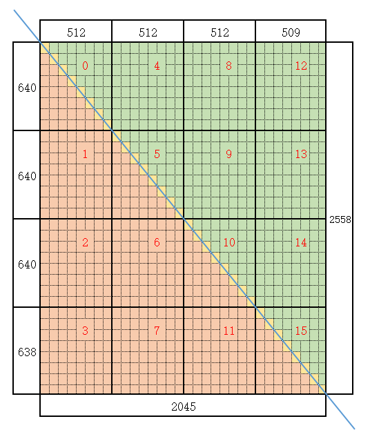

# Matmul算子三角模板策略直调样例
## 概述
本样例通过使用Matmul模板参数MatmulPolicy中TrianUpperMatmulPolicy（上三角模板策略）和TrianLowerMatmulPolicy（下三角模板策略），实现了上下三角矩阵计算的单算子。
## 支持的AI处理器
- Atlas A3 训练系列产品/Atlas A3 推理系列产品
- Atlas A2 训练系列产品/Atlas A2 推理系列产品
## 目录结构介绍
```
├── matmul_splitk
│   └── scripts
│       ├── gen_data.py         // 输入数据和真值数据生成脚本文件
│       └── verify_result.py    // 真值对比文件
│   ├── CMakeLists.txt          // 编译工程文件
│   ├── data_utils.h            // 数据读入写出函数
│   └── matmul.asc              // Ascend C算子实现 & 调用样例
```
## 算子描述
- 算子功能： 

  本样例中实现的是固定shape为[M, N, K] = [2558, 2045, 128], bias = [2045], [singleCoreM, singleCoreN, singleCoreK] = [640, 512, 128], [baseM, baseN, baseK] = [80, 64, 128]的MatmulTriangleCustom算子。  
  使用上三角模板策略时，index为0、5、10、15的核，使用上三角模板策略进行三角矩阵计算；index为4、8、9、12、13、14的核，进行常规的矩阵乘计算；index为1、2、3、6、7、11的核不执行计算。  
  使用下三角模板策略时，index为0、5、10、15的核，使用下三角模板策略进行三角矩阵计算；index为1、2、3、6、7、11的核，进行常规的矩阵乘计算；index为4、8、9、12、13、14的核不执行计算。

  

- 算子规格： 

  在核函数直调样例中，算子实现支持的shape为：M = 2558, N = 2045, K = 128
  <table>
  <tr><td rowspan="1" align="center">算子类型(OpType)</td><td colspan="4" align="center">Matmul</td></tr>
  </tr>
  <tr><td rowspan="4" align="center">算子输入</td><td align="center">name</td><td align="center">shape</td><td align="center">data type</td><td align="center">format</td></tr>
  <tr><td align="center">a</td><td align="center">M * K</td><td align="center">float16</td><td align="center">ND</td></tr>
  <tr><td align="center">b</td><td align="center">K * N</td><td align="center">float16</td><td align="center">ND</td></tr>
  <tr><td align="center">bias</td><td align="center">-</td><td align="center">-</td><td align="center">-</td></tr>
  </tr>
  </tr>
  <tr><td rowspan="1" align="center">算子输出</td><td align="center">c</td><td align="center">M * N</td><td align="center">float</td><td align="center">ND</td></tr>
  </tr>
  <tr><td rowspan="1" align="center">核函数名</td><td colspan="4" align="center">matmul_custom</td></tr>
  </table>
- 算子实现： 
 
  - Kernel实现
    - 关键步骤：
      - 创建Matmul对象，分别创建常规Matmul对象mmNormal，和使用上/下三角模板策略的Matmul对象mmTriangle。
        ```
        // 创建常规Matmul对象mmNormal
        AscendC::Matmul<AscendC::MatmulType<AscendC::TPosition::GM, CubeFormat::ND, AType>,
        AscendC::MatmulType<AscendC::TPosition::GM, CubeFormat::ND, BType>,
        AscendC::MatmulType<AscendC::TPosition::GM, CubeFormat::ND, CType>,
        AscendC::MatmulType<AscendC::TPosition::GM, CubeFormat::ND, BiasType>, CFG_NORM> mmNormal;
        // 创建使用上三角模板策略的Matmul对象mmTriangle，下三角模板策略使用AscendC::Impl::Detail::TrianLowerMatmulPolicy
        AscendC::Matmul<AscendC::MatmulType<AscendC::TPosition::GM, CubeFormat::ND, AType>,
        AscendC::MatmulType<AscendC::TPosition::GM, CubeFormat::ND, BType>,
        AscendC::MatmulType<AscendC::TPosition::GM, CubeFormat::ND, CType>,
        AscendC::MatmulType<AscendC::TPosition::GM, CubeFormat::ND, BiasType>,
        CFG_NORM, AscendC::MatmulCallBackFunc<nullptr, nullptr, nullptr>,
        AscendC::Impl::Detail::TrianUpperMatmulPolicy> mmTriangle;
        ```
      - 判断当前核执行三角矩阵计算或常规矩阵乘计算，使用mmTriangle或者mmNormal对象设置左矩阵A、右矩阵B、Bias。
        ```
        int32_t blockIdx = AscendC::GetBlockIdx();
        int32_t mSplit = 4;
        int32_t mIdx = blockIdx % mSplit;
        int32_t nIdx = blockIdx / mSplit;
        bool isTriangle = mIdx == nIdx; // 0, 5, 10, 15
        bool isNormal = mIdx > nIdx; // 上三角mIdx > nIdx：1, 2, 3, 6, 7, 11. 下三角mIdx < nIdx： 4, 8, 9, 12, 13, 14
        if (isTriangle) {
            mmTriangle.SetTensorA(aGlobal);
            mmTriangle.SetTensorB(bGlobal);
            if (tiling.isBias) {
                mmTriangle.SetBias(biasGlobal);
            }
            mmTriangle.IterateAll(cGlobal);
            mmTriangle.End();
        } else if (isNormal) {
            mmNormal.SetTensorA(aGlobal);
            mmNormal.SetTensorB(bGlobal);
            if (tiling.isBias) {
                mmNormal.SetBias(biasGlobal);
            }
            mmNormal.IterateAll(cGlobal);
            mmNormal.End();
        }
        ```

  - 调用实现  
    使用内核调用符<<<>>>调用核函数。

## 编译运行
在本样例根目录下执行如下步骤，编译并执行算子。
- 配置环境变量  
  请根据当前环境上CANN开发套件包的[安装方式](../../../../docs/quick_start.md#prepare&install)，选择对应配置环境变量的命令。
  - 默认路径，root用户安装CANN软件包
    ```bash
    source /usr/local/Ascend/ascend-toolkit/set_env.sh
    ```
  - 默认路径，非root用户安装CANN软件包
    ```bash
    source $HOME/Ascend/ascend-toolkit/set_env.sh
    ```
  - 指定路径install_path，安装CANN软件包
    ```bash
    source ${install_path}/ascend-toolkit/set_env.sh
    ```

- 样例执行  
  ```bash
  # -DTRIANGLE_MODE=0：使能上三角模板策略；
  # -DTRIANGLE_MODE=1：使能下三角模板策略；
  # -m=0：生成使能上三角模板策略的测试输入数据
  # -m=1：生成使能下三角模板策略的测试输入数据
  mkdir -p build && cd build;    # 创建并进入build目录
  cmake .. -DTRIANGLE_MODE=0;make -j;    # 编译工程，以使能上三角模板策略为例
  python3 ../scripts/gen_data.py -m=0    # 生成测试输入数据，以使能上三角模板策略为例
  ./demo                        # 执行编译生成的可执行程序，执行样例
  python3 ../scripts/verify_result.py output/output.bin output/golden.bin    # 验证输出结果是否正确，确认算法逻辑正确
  ```
  执行结果如下，说明精度对比成功。
  ```bash
  test pass
  ```