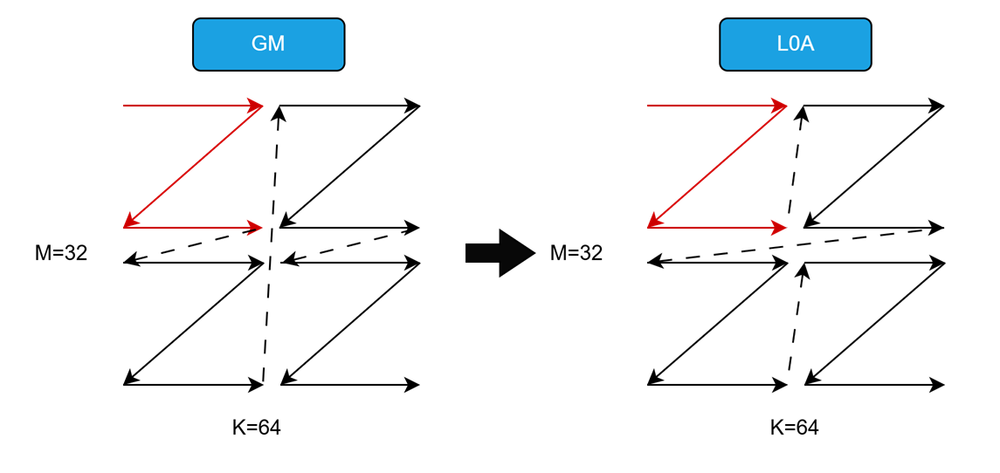
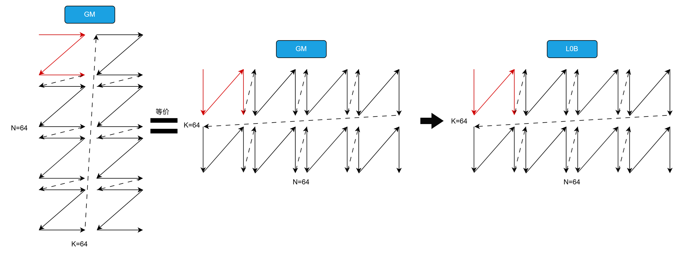

# 支持S8/F16/F32数据类型下，Load2D(GM->L0A/L0B)通路样例
## 概述
本样例介绍了在 int8_t / half / float 三种数据类型下，以及左、右矩阵均不转置共 3 种矩阵乘法场景中，相关Load2D指令的使用方法，其中 A 和 B 分别表示矩阵乘法的左右输入矩阵。

首先，介绍将矩阵 A 和 B 从 GM 搬运至 L0A / L0B 过程中，LoadData2D指令的具体调用方式。

在完成数据搬运后，说明如何通过 mmad 指令实现矩阵乘法计算（C = A × B），最后介绍如何使用 fixpipe 指令将结果矩阵 C 从 L0C 搬运回 GM。

各指令参数配置及执行指令前后各个矩阵数据排布变化，均配合示意图进行了说明。
## 支持的产品
- Atlas A3 训练系列产品/Atlas A3 推理系列产品
- Atlas A2 训练系列产品/Atlas A2 推理系列产品

## 目录结构介绍
```
├── 03_load2d_withoutl1
│   ├── scripts
│   │   ├── gen_data.py             // 输入数据和真值数据生成脚本
│   │   └── verify_result.py        // 验证输出数据和真值数据是否一致的验证脚本
│   ├── CMakeLists.txt              // 编译工程文件
│   ├── data_utils.h                // 数据读入写出函数
│   └── load2d_withoutl1.asc        // Ascend C算子实现 & 调用样例
```

## 算子描述
从概述可知一次完整的矩阵乘法涉及的数据搬运过程包括：GM-->L0A/L0B、L0C-->GM，其中A、B矩阵在不同存储单元的数据排布格式不同：
（1）在GM上，A、B矩阵为NZ排列。
（2）在L0A上，A矩阵为ZZ排列；在L0B上，B矩阵为ZN排列。


通常的矩阵乘法计算公式：C = A × B，其中A、B、C矩阵的需要满足的shape分别为[M,K]、[K,N]和[M,N]。当A矩阵需要转置才能参与矩阵乘法时，GM上输入的A矩阵shape为[K,M]，同理，当B矩阵需要转置才能参与矩阵乘法时, GM上输入的A矩阵shape为[N,K]。当输入数据类型分别取S8/F16/F32时，得到3种场景。下文将介绍上述3种场景下，A、B矩阵在完整矩阵乘法流程的各个阶段前后数据的排布方式、对齐要求、所调用的指令以及如何配置相应的参数。
由于本样例中的矩阵乘法不经过L1，因此GM上的A、B矩阵为NZ排列，需要在构造输入的时候就构造好NZ排列的数据。由于GM->L0A/L0B通路的Load2D不支持转置，因此A、B矩阵在GM上的shape分别为[M,K]和[N,K]。

为了方便描述，在此对后续常用概念给出定义：

（1）A矩阵和B矩阵：GM上A、B矩阵都是NZ排布的，其中的分形矩阵分别称为A矩阵和B矩阵。
 
（2）fractalShape(fS):A矩阵和B矩阵的shape为[16, 32/sizeof(T)],其中T表示输入数据类型。

（3）fractalSize:A矩阵或B矩阵中包含的元素个数=16 * 32/sizeof(T),当输入数据类型分别为S8/F16/F32时，该变量取值分别为512、256、128。

（4）CeilAlign:向上对齐操作，例如CeilAlign(M=30, 16)=32，表示将M轴向16对齐，对齐后M轴长度为32。


    __aicore__ inline uint16_t CeilAlign(uint16_t size, uint16_t alignValue) {
        return (size + alignValue - 1) / alignValue * alignValue;
    }

（5）CeilDivision:向上取整除法，一般用于求解向上对齐后的循环次数。

（6）mAlignValue:M轴向mAlignValue对齐，例如mAlignValue=32，代表M轴对齐到32，依次类推还有kAlignValue、nAlignValue。

（7）mAlignL0:A矩阵在L0A上时，M轴对齐后的值，虽然这两个值可能相同，但是为了逻辑清晰依然进行区分。依次类推还有kAlignL0、nAlignL0。

（8）srcoffset和dstoffset:在GM上，A/B矩阵外轴方向每循环一次时,GlobalTensor的地址偏移量；在L0A/L0B上，A/B矩阵外轴方向每循环一次时,LocalTensor的地址偏移量。
。注意，为了方便理解，本次样例全部默认将A矩阵的M轴和B矩阵的K轴作为外轴循环，暂不考虑将M轴与K轴中较长轴作为外轴的场景。

从GM-->L0通路，搬运指令只有LoadData2D指令，现在将上述场景下调用指令总结如下：

### 一.A矩阵不转置
#### 1.1. 输入数据类型为int8_t
A矩阵在GM和L0A上的数据排布分别是NZ和ZZ，如下图所示，当输入数据类型为int8_t类型、A矩阵不转置时,由于A矩阵在L0A上shape是[M,K]，因此从GM-->L0A过程下A矩阵不需要转置。

对齐要求方面，在L0A上A矩阵的M轴向fS[0]对齐、K轴向fS[0]对齐。
 

<p align="center">
  
</p>

<p align="center">
图1：A矩阵不转置，int8_t数据类型下，GM-->L0A 数据排布示意图
</p>


##### 1.1.1 GM到L0A
[Load2D](https://www.hiascend.com/document/detail/zh/canncommercial/850/API/ascendcopapi/atlasascendc_api_07_00169.html)指令的LoadData2DParams结构体的成员，各个成员变量的具体含义这里不再赘述。

如图1所示，以M轴方向作为外轴进行for循环，以K轴方向作为内轴来配置loadDataParams.repeatTimes。如图1所示，srcoffset和dstoffset的含义分别是:在GM上，A矩阵M轴方向每循环一次时,LocalTensor的地址偏移量；在L0A上，A矩阵M轴方向每循环一次时,LocalTensor的地址偏移量。


    __aicore__ inline void CopyAIn()
    {
        AscendC::LocalTensor<T> a2Local = inQueueA2.AllocTensor<T>();
        uint32_t dstOffset = CeilDivision(k, fractalShape[1]) * fractalSize;
        uint32_t srcOffset = fractalSize;
        // Nz -> Zz
        AscendC::LoadData2DParams loadDataParams;
        loadDataParams.repeatTimes = CeilDivision(k, fractalShape[1]);
        loadDataParams.srcStride = CeilDivision(m, fractalShape[0]);
        loadDataParams.dstGap = 0;
        loadDataParams.ifTranspose = false;
        for (int i = 0; i < CeilDivision(m, fractalShape[0]); ++i) {
            AscendC::LoadData(a2Local[i * dstOffset], aGM[i * srcOffset], loadDataParams);
        }
        inQueueA2.EnQue<T>(a2Local);
    }

### 二.B矩阵转置
#### 1.1. 输入数据类型为half
B矩阵在GM、L0B上的数据排布分别是NZ和ZN。如下图所示，当输入数据类型为int8_t类型、B矩阵转置时,GM上数据排布为NZ、shape为[N,K]的B矩阵与L0B上数据排布为ZN、shape为[K,N]的B矩阵是等价的（内存排布一致），因此从GM-->L0B过程中不需要再做转置。

对齐要求方面，在L0B上B矩阵的N轴都向fS[0]对齐、K轴都向fS[1]对齐。

<p align="center">
  
</p>

<p align="center">
图2：B矩阵转置，int8_t数据类型下，GM-->L0B 数据排布示意图
</p>


##### 1.1.1 GM到L0B
由于B矩阵转置时,LoadData过程就不需要转置，因此直接调用Load2D接口。下面将介绍如何配置
[Load2D](https://www.hiascend.com/document/detail/zh/canncommercial/850/API/ascendcopapi/atlasascendc_api_07_00169.html)指令的LoadData2DParams结构体的成员，各个成员变量的具体含义这里不再赘述。

如图2所示，以K轴方向作为外轴进行for循环，以N轴方向作为内轴来配置loadDataParams.repeatTimes。如图2所示，srcoffset和dstoffset的含义分别是:在GM上，B矩阵K轴方向每循环一次时,LocalTensor的地址偏移量；在L0B上，B矩阵K轴方向每循环一次时,LocalTensor的地址偏移量。由于GM上的B矩阵与L0B上的B矩阵等价，因此srcOffset和dstOffset相同。


    __aicore__ inline void CopyBIn()
    {
        AscendC::LocalTensor<T> b2Local = inQueueB2.AllocTensor<T>();
        uint32_t dstOffset = CeilDivision(n, fractalShape[0]) * fractalSize;
        uint32_t srcOffset = CeilDivision(n, fractalShape[0]) * fractalSize;
        // Zn -> Zn
        AscendC::LoadData2DParams loadDataParams;
        loadDataParams.repeatTimes = CeilDivision(n, fractalShape[0]);
        loadDataParams.srcStride = 1;
        loadDataParams.dstGap = 0;
        loadDataParams.ifTranspose = false;
        for (int i = 0; i < CeilDivision(k, fractalShape[1]); ++i) {
            AscendC::LoadData(b2Local[i * dstOffset], bGM[i * srcOffset], loadDataParams);
        }
        inQueueB2.EnQue<T>(b2Local);
    }

### 五.矩阵乘法（Mmad）

下面将介绍如何配置
[Mmad](https://www.hiascend.com/document/detail/zh/canncommercial/850/API/ascendcopapi/atlasascendc_api_07_0249.html)指令的MmadParams结构体的成员，各个成员变量的具体含义这里不再赘述。
其中，需要特别注意的是，mmadParams.kDirectionAlign仅在输入数据类型为float时生效。当A矩阵转置时，该参数需要设置为真，此时L0A上A矩阵在K方向向16对齐，矩阵计算单元从L0A读取数据会跳过填充的无效数据，其余场景下该参数取默认值为假，此时L0A上A矩阵在K方向向8对齐。

        AscendC::MmadParams mmadParams;
        mmadParams.m = m;
        mmadParams.n = n;
        mmadParams.k = k;
        if constexpr (AscendC::IsSameType<T, float>::value && AscendC::IsSameType<U, float>::value) {
            if (isAtranspose) {
                mmadParams.kDirectionAlign = true;
            }
        }

### 六.L0C到GM(Fixpipe)
下面将介绍如何配置
[Fixpipe](https://www.hiascend.com/document/detail/zh/canncommercial/850/API/ascendcopapi/atlasascendc_api_07_0251.html)指令的MmadParams结构体的成员，各个成员变量的具体含义这里不再赘述。其中，fixpipeParams.srcStride的单位是32/sizeof(T)个元素，其含义是源NZ矩阵中相邻Z排布的起始地址偏移（ND矩阵中同一行的元素在源NZ矩阵中处于相邻的Z排布
），该参数的取值是L0C上C矩阵M轴向16对齐后的长度。

        AscendC::FixpipeParamsV220 fixpipeParams;
        fixpipeParams.nSize = n;
        fixpipeParams.mSize = m;

        // 源操作数来源于L0c，因此m只需要向16对齐，与数据类型无关
        //源NZ矩阵中相邻Z排布的起始地址偏移
        fixpipeParams.srcStride = CeilAlign(m, fractalShape[0]);
        fixpipeParams.dstStride = n;

        fixpipeParams.ndNum = 1;
        fixpipeParams.srcNdStride = 0;
        fixpipeParams.dstNdStride = 0;


## 编译运行
在本样例根目录下执行如下步骤，编译并执行算子。
- 配置环境变量  
  请根据当前环境上CANN开发套件包的[安装方式](../../../../docs/quick_start.md#prepare&install)，选择对应配置环境变量的命令。
  - 默认路径，root用户安装CANN软件包
    ```bash
    source /usr/local/Ascend/cann/set_env.sh
    ```

  - 默认路径，非root用户安装CANN软件包
    ```bash
    source $HOME/Ascend/cann/set_env.sh
    ```

  - 指定路径install_path，安装CANN软件包
    ```bash
    source ${install_path}/cann/set_env.sh
    ```

- 样例执行
  ```bash
  mkdir -p build && cd build;      # 创建并进入build目录
  cmake .. -DTILING_KEY=1 -DM_SIZE=32 -DK_SIZE=64 -DN_SIZE=64;make -j;    # 编译工程
  python3 ../scripts/gen_data.py -key=1 -m=32 -k=64 -n=64   # 生成测试输入数据
  ./demo                           # 执行编译生成的可执行程序，执行样例
  python3 ../scripts/verify_result.py -key=1 output/output.bin output/golden.bin   # 验证输出结果是否正确，确认算法逻辑正确
  ```
  执行结果如下，说明精度对比成功。
  ```bash
  test pass!
  ```