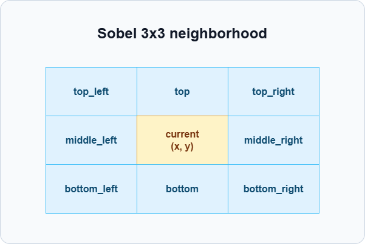

# SIMT实现Sobel边缘检测样例

## 概述

本样例以Sobel边缘检测为例，展示SIMT编程方式下使用warp shuffle指令复用相邻lane中的像素值以计算边缘幅值，并结合`asc_ballot`实现边缘像素紧凑输出的方法。

## 支持的产品

- Ascend 950PR/Ascend 950DT

## 支持的CANN软件版本

- \>= CANN 9.1.0

## 目录结构介绍

```text
├── sobel_warp_shfl
│   ├── figures                // README中的图片资源
│   ├── CMakeLists.txt         // cmake编译文件
│   ├── sobel_warp_shfl.asc    // Sobel边缘检测实现 & 调用样例
│   └── README.md
```

## 背景知识

Sobel是一种常用的图像边缘检测算法，用于根据像素周围的灰度变化计算该像素的边缘幅值。对于图像中坐标为(x, y)的非边界像素，Sobel使用该像素周围的3×3邻域分别计算水平梯度`Gx`和垂直梯度`Gy`：

<p align="center">
  
</p>

`Gx`和`Gy`的计算方式如下：

```text
Gx = -top_left + top_right - 2 * middle_left + 2 * middle_right - bottom_left + bottom_right
Gy = -top_left - 2 * top - top_right + bottom_left + 2 * bottom + bottom_right
```

该像素的边缘幅值为：

```text
strength = |Gx| + |Gy|
```

## 算法分析

本样例中，图像边界像素不计算3×3邻域，幅值置为0。非边界像素计算得到strength后，仅将满足阈值条件的边缘像素坐标和幅值写入紧凑列表edge_list。

### warp内邻居像素获取

在SIMT编程模型中，一个warp由32个线程组成。本样例将一个warp映射到图像同一行连续的32个像素，每个线程负责其中一个像素。

计算Sobel幅值时，每个线程负责输出像素(x, y)，并先从Global Memory读取同一x坐标上的上、中、下三个像素值，分别保存为top、middle和bottom。这三个值对应当前像素3×3邻域的中间一列；左右两列若由同一个warp内的相邻lane负责，则通过`asc_shfl_up`和`asc_shfl_down`从相邻lane获取，避免再次从Global Memory读取。

```cpp
// 每个线程先读取当前像素所在列的上、中、下三个像素。
int top = in_image ? input[(y - 1) * width + x] : 0;
int mid = in_image ? input[y * width + x] : 0;
int bot = in_image ? input[(y + 1) * width + x] : 0;

// 从相邻lane获取左右两列数据。
int shfl_top_left = asc_shfl_up(top, 1, WARP_SIZE);
int shfl_top_right = asc_shfl_down(top, 1, WARP_SIZE);
int shfl_mid_left = asc_shfl_up(mid, 1, WARP_SIZE);
int shfl_mid_right = asc_shfl_down(mid, 1, WARP_SIZE);
int shfl_bot_left = asc_shfl_up(bot, 1, WARP_SIZE);
int shfl_bot_right = asc_shfl_down(bot, 1, WARP_SIZE);
```

对于需要参与Sobel计算的非边界像素，warp边界处的lane需要特殊处理：lane 0的左邻居和lane 31的右邻居不在当前warp内，因此需要回退到Global Memory读取真实邻居：

```cpp
// warp边界处无法通过shuffle获取邻居，需要从Global Memory读取。
int top_left = (lane == 0) ? input[(y - 1) * width + (x - 1)] : shfl_top_left;
int top_right = (lane == 31) ? input[(y - 1) * width + (x + 1)] : shfl_top_right;
int mid_left = (lane == 0) ? input[y * width + (x - 1)] : shfl_mid_left;
int mid_right = (lane == 31) ? input[y * width + (x + 1)] : shfl_mid_right;
int bot_left = (lane == 0) ? input[(y + 1) * width + (x - 1)] : shfl_bot_left;
int bot_right = (lane == 31) ? input[(y + 1) * width + (x + 1)] : shfl_bot_right;
```

### asc_ballot实现紧凑输出

紧凑输出需要将满足阈值条件的边缘像素连续写入edge_list。对于同一个warp，可能只有部分lane满足阈值条件，如果每个边缘lane都单独执行`asc_atomic_add`申请输出位置，一个warp内最多会产生32次原子操作。

本样例使用`asc_ballot`收集warp内各lane是否满足阈值条件，并生成edge_mask。edge_mask中第i位为1，表示lane i的边缘幅值满足阈值条件：

```cpp
// edge_mask中第i位为1，表示lane i的边缘幅值满足阈值条件。
uint32_t edge_mask = asc_ballot(strength >= THRESHOLD);
```

edge_mask用于完成两个操作：

- lane 0通过`__popc(edge_mask)`统计本warp内边缘lane数量，并通过一次`asc_atomic_add`为整个warp申请连续输出位置。
- 每个边缘lane根据edge_mask计算自己在warp内的局部偏移，写入edge_list中的对应位置。

lane 0申请输出位置后，通过`asc_shfl`将起始位置广播给warp内所有lane：

```cpp
uint32_t warp_base = 0;
if (lane == 0) {
    // lane 0为本warp中的所有边缘lane一次性申请输出位置。
    warp_base = asc_atomic_add(edge_count, static_cast<uint32_t>(__popc(edge_mask)));
}
warp_base = asc_shfl(warp_base, 0, WARP_SIZE);
```

每个边缘lane再根据edge_mask计算自己在warp内的局部偏移，将`{x, y, strength}`写入edge_list：

```cpp
if (edge_mask & lanemask_eq()) {
    // 统计当前lane之前有多少个边缘lane，得到本warp内的紧凑写入偏移。
    uint32_t lower_mask = edge_mask & lanemask_lt();
    int local_idx = __popc(lower_mask);
    edge_list[warp_base + local_idx] = {
        static_cast<uint16_t>(x),
        static_cast<uint16_t>(y),
        strength
    };
}
```

其中，`lanemask_eq()`只生成当前lane对应的掩码，用于判断当前lane是否在edge_mask中置位；`lanemask_lt()`生成当前lane之前所有lane的掩码，配合`__popc`得到当前边缘lane在本warp内的紧凑写入偏移。

相比每个边缘lane独立执行一次`asc_atomic_add`，该方式将一个warp内最多32次原子操作压缩为1次原子操作。

## 样例描述

- 样例功能：  
  本样例计算输入灰度图像的边缘幅值，并将满足阈值条件的边缘像素输出到紧凑列表edge_list。edge_list中每行包含边缘像素的x坐标、y坐标和strength。

- 样例规格：

  <table>
  <tr><td rowspan="1" align="center">样例类型(OpType)</td><td colspan="4" align="center">sobel_edge_detect</td></tr>
  <tr><td rowspan="2" align="center">样例输入</td><td align="center">name</td><td align="center">shape</td><td align="center">data type</td><td align="center">format</td></tr>
  <tr><td align="center">input</td><td align="center">[1025,1023]</td><td align="center">uint8_t</td><td align="center">ND</td></tr>
  <tr><td rowspan="1" align="center">样例输出</td><td align="center">edge_list</td><td align="center">[N,3]</td><td align="center">uint16_t</td><td align="center">ND</td></tr>
  <tr><td rowspan="1" align="center">核函数名</td><td colspan="4" align="center">sobel_edge_detect</td></tr>
  </table>

- 样例实现：  
  sobel_edge_detect中，输入图像按行优先展开为一维数组，width表示图像每行的像素数。一个warp对应图像同一行连续的32个像素，每个线程负责一个像素(x, y)。线程先读取并持有`input[(y - 1) * width + x]`、`input[y * width + x]`和`input[(y + 1) * width + x]`三个值（分别对应当前像素3×3邻域中间列的上、中、下三个像素），再通过warp shuffle指令从相邻lane获取左右列数据，用于计算Sobel边缘幅值；随后通过`asc_ballot`筛选满足阈值条件的lane，并将结果紧凑写入edge_list。

- 调用实现：  
  使用内核调用符`<<<>>>`调用核函数。

## 编译运行

在本样例根目录下执行如下步骤，编译并执行样例。

- 配置环境变量

  请根据当前环境上CANN开发套件包的[安装方式](../../../../docs/quick_start.md#prepare&install)，选择对应配置环境变量的命令。

  - 默认路径，root用户安装CANN软件包
    ```bash
    source /usr/local/Ascend/cann/set_env.sh
    ```

  - 默认路径，非root用户安装CANN软件包
    ```bash
    source $HOME/Ascend/cann/set_env.sh
    ```

  - 指定路径 install_path，安装CANN软件包
    ```bash
    source ${install_path}/cann/set_env.sh
    ```

- 样例执行

  ```bash
  mkdir -p build && cd build;                              # 创建并进入build目录
  cmake -DCMAKE_ASC_ARCHITECTURES=dav-3510 ..; make -j;   # 编译工程
  ./demo                                                   # 执行样例
  ```

  编译选项说明

  | 选项 | 可选值 | 说明 |
  |------|--------|------|
  | `CMAKE_ASC_ARCHITECTURES` | `dav-3510` | NPU 架构：本样例仅支持 dav-3510（Ascend 950PR/Ascend 950DT） |

  执行结果如下。输出中会打印图像尺寸、阈值、紧凑边缘列表中的有效边缘像素数量，以及edge_list前10个元素；最后一行说明精度对比成功。
  ```
  Image: 1023x1025  threshold: 200
  === compact edge list ===
  total pixels: 1048575  edge pixels: 72356  ratio: 6.9%
  first 10 entries:
  x      y      strength
  69     556    448
  70     556    960
  71     556    1476
  72     556    1476
  73     556    960
  74     556    448
  231    559    444
  232    559    952
  233    559    1460
  234    559    1460
  [Success] Case accuracy is verification passed.
  ```
