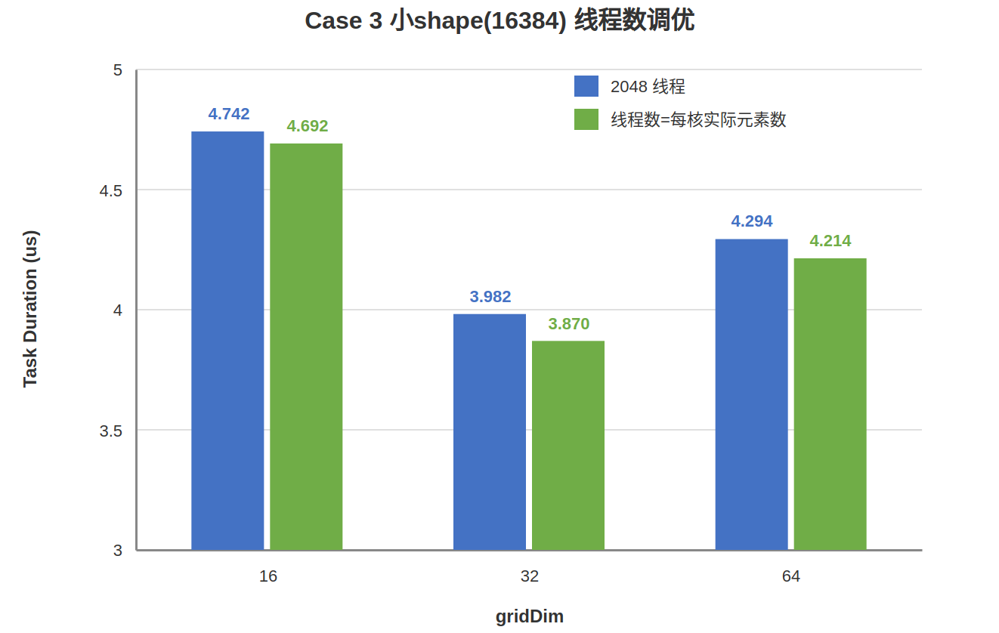

# gridDim配置性能调优样例

## 概述

本样例以Gather采集计算为例，介绍Ascend C SIMT编程方式下的gridDim配置调优思路。

## 支持的产品

- Ascend 950PR/Ascend 950DT

## 目录结构介绍

```text
├── grid_dim_config
│   ├── figures                // README中的图片资源
│   ├── CMakeLists.txt         // 编译工程文件
│   └── grid_config.asc        // Ascend C算子实现 & 调用样例
```

## 样例描述

- 计算公式：

  $$
  output[i][j] = input[index[i][j]]
  $$

  - input为输入张量，形状为[2100000]，数据类型为float
  - index为索引张量，数据类型为uint32，索引范围为[0,2100000)；大shape为[1024,2048]，中shape为[64,2048]，小shape为[8,2048]
  - output为输出张量，数据类型为float；大shape为[1024,2048]，中shape为[64,2048]，小shape为[8,2048]
  - 计算过程：根据index[i][j]索引从input中采集对应位置的数据，写入output[i][j]位置

- 样例规格：

  <table>
  <tr><td rowspan="1" align="center">样例类型(OpType)</td><td colspan="4" align="center">Gather</td></tr>
  <tr><td rowspan="3" align="center">样例输入</td><td align="center">name</td><td align="center">shape</td><td align="center">data type</td><td align="center">format</td></tr>
  <tr><td align="center">input</td><td align="center">[2100000]</td><td align="center">float</td><td align="center">ND</td></tr>
  <tr><td align="center">index</td><td align="center">大shape: [1024,2048]<br>中shape: [64,2048]<br>小shape: [8,2048]</td><td align="center">uint32</td><td align="center">ND</td></tr>
  <tr><td rowspan="1" align="center">样例输出</td><td align="center">output</td><td align="center">大shape: [1024,2048]<br>中shape: [64,2048]<br>小shape: [8,2048]</td><td align="center">float</td><td align="center">ND</td></tr>
  <tr><td rowspan="1" align="center">核函数名</td><td colspan="4" align="center">empty_kernel / gather_naive_kernel / gather_strided_kernel</td></tr>
  </table>

## 样例实现

### Case实现说明

本样例将20个`SCENARIO_NUM`归为4类Case，先建立调度基线，再分别观察大shape、中shape和小shape下的gridDim选择。

| Case   | SCENARIO_NUM   | Shape / 规模                      | 核函数                                  | 对比目的                                  |
| ------ | -------------- | --------------------------------- | --------------------------------------- | ----------------------------------------- |
| Case 0 | 1 / 2 / 3 / 4 / 5 | 大shape，[1024,2048]           | empty_kernel                            | 测1 / 32 / 64 / 128 / 1024核的空核调度开销 |
| Case 1 | 6 / 7 / 8      | 大shape，[1024,2048]              | gather_naive_kernel / gather_strided_kernel | 大shape，gridDim.x设置1024、64、32，对比性能差异 |
| Case 2 | 9 / 10 / 11 / 12 | 中shape，[64,2048]=131072        | gather_strided_kernel                   | 在中shape下，gridDim.x设置16 / 32 / 64 / 128，对比性能差异|
| Case 3 | 13 / 14 / 15 / 16 / 17 / 18 / 19 / 20 | 小shape，[8,2048]=16384 | gather_strided_kernel | 在小shape下：①gridDim.x设置4 / 8 / 16 / 32 / 64对比性能差异；②固定核数16 / 32 / 64，把每block线程数从2048调到每核实际元素数(1024 / 512 / 256)对比性能差异 |

### 性能指标说明

| 指标                | 说明                                                                                      |
| ------------------- | ----------------------------------------------------------------------------------------- |
| Task Duration(us)   | Task整体耗时，包含调度到加速器的时间、加速器上的执行时间以及响应结束时间                  |

### Case 0: 空核函数调度基线

**样例目标**：用空核函数建立不同gridDim下的Task调度耗时基线。

**核心实现**：

- 核函数`empty_kernel`函数体为空，仅承担Task调度开销
- 通过`SCENARIO_NUM=1~5`控制五种gridDim配置：1 / 32 / 64 / 128 / 1024
- Host侧先通过`aclrtMemcpy(DEVICE_TO_DEVICE)`把input拷贝到output，保证精度校验通过，再启动空kernel仅测调度开销

**关键代码**：

```cpp
__global__ __launch_bounds__(THREAD_NUM) void empty_kernel(
    float* input, uint32_t* index, float* output,
    uint32_t input_total_length, uint32_t index_total_length)
{
}

// gridDim 由 SCENARIO_NUM 选择：1 / 32 / 64 / 128 / 1024，每block线程数固定2048
empty_kernel<<<num_blocks, THREAD_NUM, 0, stream>>>(
    input_device, index_device, output_device,
    input_total_length, index_total_length);
```

**性能数据**：

| SCENARIO_NUM | Block Dim | Task Duration(us) |
| :----------: | :-------: | :---------------: | 
|      1       |     1     |       1.410       | 
|      2       |    32     |       1.666       | 
|      3       |    64     |       2.149       | 
|      4       |    128    |       3.034       | 
|      5       |   1024    |      16.312       | 


#### 从gridDim到逻辑核/物理核

在SIMT kernel启动时，`gridDim.x`决定本次任务要启动多少个block。对于本样例的一维grid配置，可以直接把`gridDim.x`理解为要启动的**逻辑核数量**：例如`SCENARIO_NUM=2`启动32个block，`SCENARIO_NUM=5`启动1024个block。

但这些逻辑核最终要落到硬件实际存在的Vector Core上执行，因此需要引入两个概念：

- **逻辑核**：由`gridDim.x`配置出来的block数量，是软件侧希望启动的并行任务数
- **物理核**：硬件实际拥有的Vector Core数量，本样例环境运行时实测为64，查询方法参考[运行期如何查询物理核数](#运行期查询物理核数)

两者的关系会影响调度开销：当`gridDim.x ≤ 64`时，所有逻辑核可以一次占满物理核并行执行；当`gridDim.x > 64`时，超出64的逻辑核必须等待前面的逻辑核执行完、让出物理核后才能被调度，等待开销会随超出的逻辑核数量增加而上升。

#### 调度头开销总结

| 对比         | Block Dim 变化   | Task Duration 变化      | 现象                              |
| ------------ | ---------------- | ----------------------- | --------------------------------- |
| 1 → 32       | 32×              | 1.410 → 1.666（1.18×）  | 逻辑核数 ≪ 物理核，均在物理核内，仅启动更多核的微小固定开销 |
| 32 → 64      | 2×               | 1.666 → 2.149（1.29×）  | 逻辑核数 ≤ 物理核，一次占满，涨幅平缓 |
| 64 → 128     | 2×               | 2.149 → 3.034（1.41×）  | 逻辑核数超物理核，出现等待，开始上升 |
| 128 → 1024   | 8×               | 3.034 → 16.312（5.38×） | 逻辑核数 ≫ 物理核，等待开销陡增 |

可以总结出俩条规律：

1. **逻辑核数 ≤ 物理核数时调度时间基本不变**：1核、32核、64核都在物理核数以内、无需等待，Task Duration从1.410us缓慢升到2.149us。
2. **逻辑核数超过物理核数后调度开销随等待量增长**：128核有64个、1024核有960个逻辑核必须等待物理核空闲后才能被调度，调度耗时随需要等待的逻辑核数量近似线性增加。

#### 运行期查询物理核数

样例中`AIV_CORE_NUM = 64`是按照下面的代码实际获取到的，为了保证编程界面的统一，代码中未直接体现：

```cpp
#include "acl/acl.h"

int32_t device_id = 0;
int64_t physical_aiv_core_num = 0;
aclError ret = aclrtGetDeviceInfo(
    static_cast<uint32_t>(device_id),
    ACL_DEV_ATTR_VECTOR_CORE_NUM,
    &physical_aiv_core_num);
if (ret == ACL_SUCCESS) {
    printf("Physical AIV (Vector Core) num: %ld\n", physical_aiv_core_num);
}
```

调用前需先完成`aclInit`与`aclrtSetDevice`。

`aclrtDevAttr`枚举值说明：

| 枚举值                          | 含义                  |
| ------------------------------- | --------------------- |
| `ACL_DEV_ATTR_VECTOR_CORE_NUM`  | Vector Core (AIV) 数量 |

---

### Case 1: 大shape场景，Gather配置不同gridDim性能对比（SCENARIO_NUM=6/7/8）

**样例目标**：对比同一大shape下执行Gather操作，配置不同gridDim的性能差异。

#### 1024核Gather（SCENARIO_NUM=6）

**核心实现**：

- 核函数`gather_naive_kernel`：每个线程用全局线程号`blockIdx.x * blockDim.x + threadIdx.x`定位唯一一个元素，从GM上的`index[]`取下标，再从GM上的`input[]`乱序读取数据写入`output[]`
- gridDim配置为1024、每block 2048线程，`gridDim.x * blockDim.x = 1024 * 2048 = 2097152`恰好等于元素总数。`blockIdx.x`对应[1024,2048]张量的一行、`threadIdx.x`对应一列，每个线程刚好覆盖1个元素，**无需for循环**

**关键代码**：

```cpp
// 最朴素写法：每个线程只处理1个元素，无for循环
uint32_t global_idx = blockIdx.x * blockDim.x + threadIdx.x;

uint32_t gather_idx = index[global_idx];
if (gather_idx >= input_total_length) { gather_idx = 0; }
output[global_idx] = input[gather_idx];
```

**性能数据**：

| Task Duration(us) |
| :---------------: |
|      75.834       |


#### 如何优化这种写法

当前写法的瓶颈不在gather计算本身，而在"线程号 = 元素号"这条隐式约束——它强制gridDim等于元素总数/单核线程数，核数被数据规模绑死。优化思路是**解耦逻辑核数与元素总数**：

1. **先确定逻辑核数**：把`gridDim`直接设为物理核数（本样例64），而不是由元素总数倒推。这样逻辑核与物理核一一对应、一次铺满，既不会像1024核那样超出物理核排队等待，也不会少于物理核让硬件闲置。大shape数据量足够大，64核下每核仍分到32768个元素的充足工作量，因此打满物理核不会浪费。
2. **每核改为处理一段元素**：核数降下来后，每个block要负责的元素数`rows_per_block = 元素总数 / gridDim.x`随之增大（`2097152 / 64 = 32768`）。
3. **用stride循环遍历这一段**：block内的`blockDim.x`个线程，以`blockDim.x`为步长跨步循环，覆盖本block负责的全部元素。这样既不漏元素，相邻线程访问的也是相邻地址（访存合并友好）。每block仍取2048线程，每个线程stride循环`32768 / 2048 = 16`次。

```cpp
// 优化写法：每个线程以 blockDim.x 为步长跨步处理多个元素
uint32_t rows_per_block = index_total_length / gridDim.x;
uint32_t index_start = blockIdx.x * rows_per_block;

for (uint32_t local_idx = threadIdx.x; local_idx < rows_per_block; local_idx += blockDim.x) {
    uint32_t gather_idx = index[index_start + local_idx];
    if (gather_idx >= input_total_length) { gather_idx = 0; }
    output[index_start + local_idx] = input[gather_idx];
}
```

这套改写就是`SCENARIO_NUM=7`采用的写法。

#### 64核Gather（SCENARIO_NUM=7）

**优化目标**：在gather语义不变的前提下，改用"解耦核数 + stride循环"写法，将逻辑核数与物理核数对齐

**核心实现**：

- 核函数`gather_strided_kernel`：采用上一节给出的优化写法，逻辑核数固定为物理核数64
- 每个block负责的元素数从2048扩展到`2097152 / 64 = 32768`，block内每个线程以`blockDim.x`为步长stride循环
- 每block线程数与`SCENARIO_NUM=6`一致，同为硬件上限2048，每个线程stride循环`32768 / 2048 = 16`次

**关键代码**：

```cpp
uint32_t rows_per_block = index_total_length / gridDim.x;
uint32_t index_start = blockIdx.x * rows_per_block;

for (uint32_t local_idx = threadIdx.x; local_idx < rows_per_block; local_idx += blockDim.x) {
    uint32_t gather_idx = index[index_start + local_idx];
    if (gather_idx >= input_total_length) { gather_idx = 0; }
    output[index_start + local_idx] = input[gather_idx];
}
```

**优化手段**：

- 将逻辑核数从1024调整为64，匹配物理核数，消除多余逻辑核的等待（这是`SCENARIO_NUM=6→7`唯一变化的变量）

**性能数据**：

| Task Duration(us) |
| :---------------: |
|      56.902       |

**分析**：

- 相比`SCENARIO_NUM=6`的朴素写法（1024核），Task Duration从75.834us降低到56.902us，耗时下降约25.0%，整体性能提升约1.33倍
- **gather读写总量并没有变，每block线程数也没变**：提升完全来自唯一变化的变量——逻辑核数从1024降到64，分两部分体现
  - **调度开销**：`SCENARIO_NUM=6`的1024核中有960个逻辑核要等待物理核空闲，调度基线约16.1us（见Case 0的1024核档）；`SCENARIO_NUM=7`的64核一次占满物理核无需等待，调度基线约2.2us（见Case 0的64核档），仅这一项就省下约14us
  - **访存延迟更容易被掩盖**：gather是memory-bound，延迟靠"同一时刻有大量线程的访存请求在途"来掩盖——某个线程的GM请求还没返回时，硬件调度同block内其他就绪线程发起各自的GM请求，多个请求的等待相互重叠。

#### 32核Gather（SCENARIO_NUM=8）

**核心实现**：

- 核函数与`SCENARIO_NUM=7`完全相同（`gather_strided_kernel`，每block 2048线程），唯一变化的变量是把逻辑核数从64进一步降到32，即只用一半物理核
- 每核处理的元素总量 = `2097152 / 32 = 65536`元素，stride循环`65536 / 2048 = 32`次

**性能数据**：

| Task Duration(us) |
| :---------------: |
|      110.419      |

**分析**：

- 32核的Task Duration为110.419us，比64核（56.902us）慢约94%，几乎是其两倍——**核数减半，并行度也减半，每核工作量翻倍**，而调度开销在32/64核档相差无几（见Case 0：32核1.666us、64核2.149us），慢的部分几乎全是计算并行度不足
- 更关键的是：**32核（110.419us）比1024核（75.834us）还慢**。这说明大shape场景下，"逻辑核数 < 物理核数"的代价（一半物理核闲置、单核工作量翻倍）比"逻辑核数 ≫ 物理核数"的代价（排队等待）更大


**Case 1 三种场景性能对比**：

| SCENARIO_NUM | 写法 | Block Dim | Task Duration(us) | 说明 |
| :----------: | :--: | :-------: | :---------------: | ---- |
| SCENARIO_NUM=8 | strided | 32 | 110.419 | 逻辑核 < 物理核，并行度不足 |
| **SCENARIO_NUM=7** | **strided** | **64** | **56.902** | **逻辑核 = 物理核，最优** |
| SCENARIO_NUM=6 | naive | 1024 | 75.834 | 逻辑核 ≫ 物理核，排队等待 |


---
### Case 2: 中shape场景，Gather配置不同gridDim性能对比（SCENARIO_NUM=9/10/11/12）

**样例目标**：对比同一中shape下执行Gather操作，配置不同gridDim的性能差异。

**核心实现**：

- 核函数与`SCENARIO_NUM=7`完全相同，只把shape换成`64*2048=131072`个元素。主样例通过`SCENARIO_NUM=9/10/11/12`设置16 / 32 / 64 / 128核
- 每核处理的元素数量 = `131072 / 核数`：16核8192、32核4096、64核2048、128核1024。相比小shape的几百元素，单核工作量仍然可观

**性能数据**：

| SCENARIO_NUM    | Block Dim | Elements per block | Task Duration(us) | 说明                       |
| --------------- | :-------: | :-------: | :---------------: | -------------------------- |
| SCENARIO_NUM=9  |    16     |   8192    |      16.753       | 核数偏少，单核工作量重     |
| SCENARIO_NUM=10 |    32     |   4096    |      10.127       | 继续加核仍明显收益         |
| SCENARIO_NUM=11 |  **64**   | **2048**  |     **7.753**     | **最优，逻辑核数=物理核**  |
| SCENARIO_NUM=12 |    128    |   1024    |       9.857       | 越过物理核，反而变慢 |


**分析**：
- 16 → 32 → 64：核数翻倍时Task Duration持续下降（16.753 → 10.127 → 7.753），说明数据量较大、每核工作量（≥2048元素）足够，加到物理核上限前增加并行的核数的收益始终明显
- 64 → 128：核数翻倍越过64物理核，Task Duration 从 7.753us 升到 9.857us，**反而变慢约 27.1%**。多出的64个逻辑核必须排队等物理核空闲
- **结论**：较大shape应打满物理核（64），但**打满≠越多越好**——核数超过物理核数，超出的逻辑核只能排队等待，必须以物理核数为上限

---

### Case 3: 小shape场景，Gather配置不同gridDim性能对比（SCENARIO_NUM=13/14/15/16/17）

**样例目标**：小shape下每核工作量很小，启动更多核带来的调度头开销会反超有效计算的收益，必须按shape实测选核数。

**核心实现**：

- 核函数与`SCENARIO_NUM=7`完全相同，只把shape换成小shape `8*2048=16384`个元素。主样例通过`SCENARIO_NUM=13/14/15/16/17`设置4 / 8 / 16 / 32 / 64核
- 每核工作集 = `16384 / 核数`：4核4096、8核2048、16核1024、32核512、64核256。相比Case 2的131072，工作量小了一个数量级

**性能数据**：

| SCENARIO_NUM    | Block Dim | Elements per block | Task Duration(us) | 说明                     |
| --------------- | :-------: | :-------: | :---------------: | ------------------------ |
| SCENARIO_NUM=13 |     4     |   4096    |      10.792       | 核数太少，单核工作量重   |
| SCENARIO_NUM=14 |     8     |   2048    |       6.676       | 继续加核仍明显收益       |
| SCENARIO_NUM=15 |    16     |   1024    |       4.742       | 核数偏少，单核工作量偏重 |
| SCENARIO_NUM=16 |  **32**   |  **512**  |     **3.982**     | **最低点，最优核数**     |
| SCENARIO_NUM=17 |    64     |    256    |       4.294       | 打满物理核，头开销反超   |


**分析**：

- 折线呈"先降后升"的谷形，**较优核数 = 32（物理核数的一半）**，并非打满64核
- 32 → 64：核数翻倍，Task Duration 从 3.982us 升到 4.294us，**反而变慢约 7.8%**。多核场景下，每个核的任务量较小，导致计算时间较小，反而带来的调度开销会显著影响整体性能
- 4 → 8 → 16 → 32：核数增加时Task Duration持续下降（10.792 → 6.676 → 4.742 → 3.982），说明小核数下，单核的计算量大会影响整体性能
- 与Case 2的131072对照：同样的kernel与线程数，shape小到一定程度后最优核数从64退回到32，说明"最优核数"随shape缩小而变化，必须实测
- **结论**：小shape无法照搬"打满物理核"的经验，必须像本case一样设置核数实测。更小的数据量最优核数要小于最大物理核数，本样例环境下16384的最低点在32核

#### 线程数调优：把每block线程数调到每核实际元素数（SCENARIO_NUM=18/19/20）

**样例目标**：在Case 3固定核数的基础上，进一步说明小shape下每block的线程数也应按实际工作量设置——把线程数从硬件上限2048调到每核实际处理的元素数，可消除空转线程、性能更优。

**核心实现**：

- 核函数仍是`gather_strided_kernel`，逻辑完全不变；唯一变化的变量是**每block线程数 = 每核实际元素数**（`SMALL_SHAPE_TOTAL_LENGTH / 核数`）：16核→1024线程、32核→512线程、64核→256线程
- 此时`rows_per_block == blockDim.x`，每个线程stride循环恰好1次，没有任何线程空转
- `__launch_bounds__(2048)`是线程数上限而非定值，启动时给小于上限的线程数合法

**关键代码**：

```cpp
// 把每block线程数设为每核实际元素数，而不是固定2048
uint32_t threads_per_block = SMALL_SHAPE_TOTAL_LENGTH / num_blocks;  // 16核→1024 / 32核→512 / 64核→256
gather_strided_kernel<<<num_blocks, threads_per_block, 0, stream>>>(
    input_device, index_device, output_device,
    input_total_length, index_total_length);
```

**性能数据**：

| 核数 | 每核元素数 | 2048线程 Task Duration(us) | 线程数=元素/核 Task Duration(us) | 提升 |
| :--: | :--------: | :------------------------: | :------------------------------: | :--: |
| 16   | 1024       | 4.742（SCENARIO_NUM=15）   | 4.692（SCENARIO_NUM=18，1024线程） | ↓1.1% |
| 32   | 512        | 3.982（SCENARIO_NUM=16）   | 3.870（SCENARIO_NUM=19，512线程）  | ↓2.8% |
| 64   | 256        | 4.294（SCENARIO_NUM=17）   | 4.214（SCENARIO_NUM=20，256线程）  | ↓1.9% |

下图为同核数下2048线程与"线程数=每核实际元素数"的Task Duration对比：



**分析**：

- 三档核数下，线程数调到每核实际元素数后Task Duration均小幅下降。
- **结论**：小shape下不仅核数要按shape实测，每block线程数也应按每核实际元素数设置。当每核元素数小于硬件线程上限2048时，把线程数从2048调到实际需要值即可去掉空转线程，性能更优；只有当每核元素数 ≥ 2048（如大shape/中shape）时才取满2048线程

---

## 性能对比总结

### Ascend 950PR性能数据

**调度开销随核数变化（Case 0）**：

| SCENARIO_NUM | Block Dim | Task Duration(us) | 说明                                  |
| ------------ | --------- | ----------------- | ------------------------------------- |
| 1            | 1         | 1.410             | 调度基线，单核启动开销                |
| 2            | 32        | 1.666             | 核数 < 物理核                         |
| 3            | 64        | 2.149             | 核数 = 物理核，调度耗时基本持平       |
| 4            | 128       | 3.034             | 核数 > 物理核（2×），调度开始上升     |
| 5            | 1024      | 16.312            | 核数 ≫ 物理核（16×），调度开销主导    |

**实际计算场景匹配物理核的收益（Case 1）**：

| 配置项                  | SCENARIO_NUM=6           | SCENARIO_NUM=7           | SCENARIO_NUM=8           |
| ----------------------- | ------------------------ | ------------------------ | ------------------------ |
| 写法                    | 朴素，每线程1元素，无循环 | 优化，每核跨步处理一段   | 优化，每核跨步处理一段   |
| 逻辑核数                | 1024                     | 64                       | 32                       |
| 每block线程数           | 2048                     | 2048                     | 2048                     |
| 每核处理元素数          | 2048                     | 32768                    | 65536                    |
| Task Duration(us)       | 75.834                   | **56.902**               | 110.419                  |

- `SCENARIO_NUM=7`相比`SCENARIO_NUM=6`耗时下降约25.0%，整体性能提升约1.33倍。核数降到64后，每个block分到的元素从2048增加到32768：一方面64核无需排队、调度开销远低于1024核；另一方面gather的访存延迟靠大量线程的请求来掩盖（某线程GM请求未返回时，硬件调度其他就绪线程发起各自请求、等待相互重叠）。
- `SCENARIO_NUM=8`把核数继续降到32（仅用一半物理核），Task Duration反而升到110.419us，比64核慢约94%、甚至比1024核还慢：大shape下"逻辑核数 < 物理核数"导致一半物理核闲置、单核工作量翻倍，代价比"逻辑核数 ≫ 物理核数"排队等待更大。可见逻辑核=物理核才是大shape的最优核数

**中shape的最优核数（Case 2）**：

| 核数 | rows/core | Task Duration(us) |
| :--: | :-------: | :---------------: |
| 16   | 8192      | 16.753            |
| 32   | 4096      | 10.127            |
| **64** | **2048** | **7.753**        |
| 128  | 1024      | 9.857             |

- 最优在 **64核**；16→32→64 单调下降，gridDim在增加到物理核上限过程中持续受益
- 64→128：核数越过物理核上限，128个逻辑核中有64个排队等待，反而慢约27.1%
- **较大shape优先考虑打满物理核**：较大shape应把核数提到物理核数为止，超过物理核数排队等待开销会显著影响性能

**小shape的最优核数（Case 3）**：

| 核数 | rows/core | Task Duration(us) |
| :--: | :-------: | :---------------: |
| 4    | 4096      | 10.792            |
| 8    | 2048      | 6.676             |
| 16   | 1024      | 4.742             |
| **32** | **512** | **3.982**         |
| 64   | 256       | 4.294             |

- 最低点在 **32核**（物理核数一半），不是打满的64核；32→64 反而慢约7.8%
- 与Case 2对照：同样的kernel与线程数，shape小到一定程度后最优核数从64退回到32，说明"最优核数"是随shape变化的，必须实测
- 多shape规律：数据量越大最优核数越靠近物理核上限

**小shape的线程数调优（Case 3）**：

在选定核数后，进一步把每block线程数从硬件上限2048调到每核实际元素数（每核元素数 = `16384 / 核数`），消除空转线程：

| 核数 | 每核元素数 | 2048线程 Task Duration(us) | 线程数=元素/核 Task Duration(us) | 提升 |
| :--: | :--------: | :------------------------: | :------------------------------: | :--: |
| 16   | 1024       | 4.742（SCENARIO_NUM=15）   | 4.692（SCENARIO_NUM=18）           | ↓1.1% |
| 32   | 512        | 3.982（SCENARIO_NUM=16）   | 3.870（SCENARIO_NUM=19）           | ↓2.8% |
| 64   | 256        | 4.294（SCENARIO_NUM=17）   | 4.214（SCENARIO_NUM=20）           | ↓1.9% |

- 三种核数下，线程数调到每核实际元素数后Task Duration均小幅下降。

## 调优建议

1. **大shape / 中shape，优先匹配物理核数**：逻辑核数应尽量等于物理核数，避免逻辑核不足（工作量重）或超过物理核排队等待两种代价。
2. **小shape需实测核数性能**：当数据量较小、每核工作量很小时，启动更多核带来的调度头开销会反超收益，最优核数不一定是最大物理核数。应像Case 3那样设置核数、用msprof Task Duration找最低点。数据量越大最优核数越靠近物理核数。
3. **小shape下线程数按每核实际元素数设置**：每block线程数不必固定在硬件上限2048。当每核处理的元素数小于2048时，stride循环边界会让多出的线程完全空转，把线程数调到每核实际元素数即可去掉空转、性能更优（见Case 3 SCENARIO_NUM=18/19/20）。

## 编译运行

在本样例根目录下执行如下步骤，编译并执行样例。

- 配置环境变量
  请根据当前环境上CANN开发套件包的[安装方式](../../../../../docs/quick_start.md#prepare&install)，选择对应配置环境变量的命令。

  - 默认路径，root用户安装CANN软件包

    ```bash
    source /usr/local/Ascend/cann/set_env.sh
    ```

  - 默认路径，非root用户安装CANN软件包

    ```bash
    source $HOME/Ascend/cann/set_env.sh
    ```

  - 指定路径install_path，安装CANN软件包

    ```bash
    source ${install_path}/cann/set_env.sh
    ```

- 样例执行

  ```bash
  SCENARIO_NUM=7                       # 选择执行场景，可选1-20
  mkdir build && cd build;          # 创建并进入build目录
  cmake -DCMAKE_ASC_ARCHITECTURES=dav-3510 -DSCENARIO_NUM=$SCENARIO_NUM ..;make -j;  # 编译工程
  ./grid_config                        # 执行样例
  ```

- 编译选项说明

  | 选项                       | 可选值      | 说明                                                          |
  | -------------------------- | ----------- | ------------------------------------------------------------- |
  | `CMAKE_ASC_ARCHITECTURES`  | `dav-3510`  | NPU架构：本样例仅支持dav-3510（Ascend 950PR/Ascend 950DT）    |
  | `SCENARIO_NUM`             | `1`-`20`    | 样例类型，默认为1                                             |

  执行结果如下，说明精度对比成功。

  ```text
  [Success] Case accuracy is verification passed.
  ```

## 性能分析

使用`msprof`工具获取详细性能数据：

```bash
msprof op ./grid_config   # 分析case的性能
```

命令完成后，会在默认目录下生成以"OPPROF_{timestamp}_XXX"命名的文件夹，性能数据文件夹结构示例如下：

```text
├──dump                       # 原始的性能数据，用户无需关注
├──ArithmeticUtilization.csv  # cube/vector指令cycle占比
├──L2Cache.csv                # L2 Cache命中率
├──Memory.csv                 # UB，L1和主存储器读写带宽速率
├──MemoryL0.csv               # L0A，L0B，和L0C读写带宽速率
├──MemoryUB.csv               # Vector和Scalar到UB的读写带宽速率
├──OpBasicInfo.csv            # 算子基础信息
├──PipeUtilization.csv        # 采集计算单元和搬运单元耗时和占比
├──ResourceConflictRatio.csv  # UB上的bank group、bank conflict和资源冲突率在所有指令中的占比
└──visualize_data.bin         # MindStudio Insight呈现文件
```
