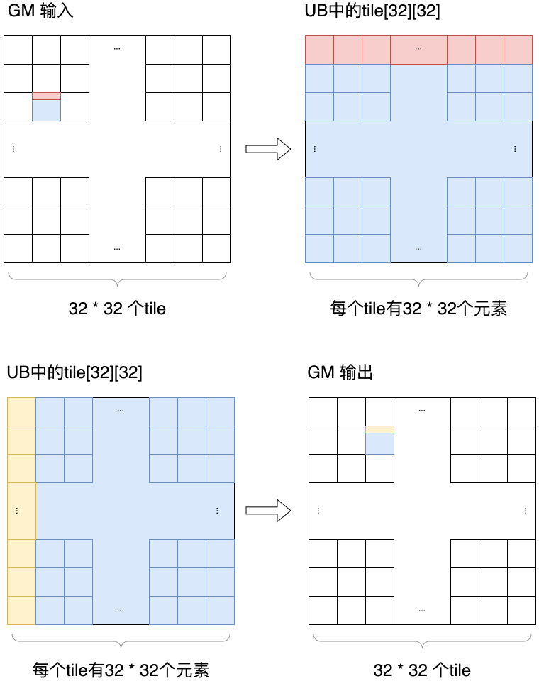
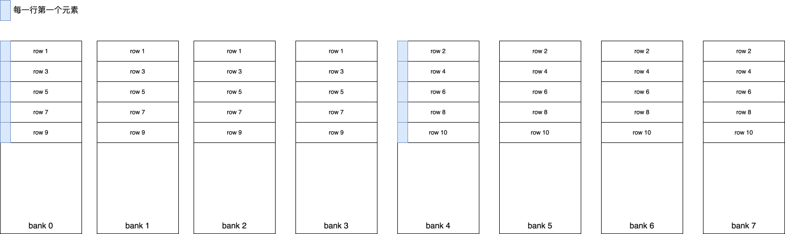
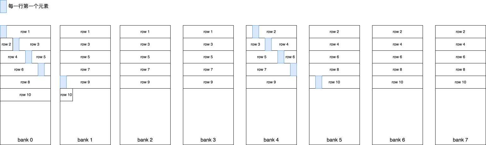

# MatrixTranspose性能调优样例

## 概述

本样例以矩阵转置为例，介绍基于Ascend C SIMT编程方式的性能调优思路。样例包含一个测试性能上限的基准版本以及3个逐步优化的kernel版本，从最基础的数据复制与直接转置开始，逐步引入UB中转、全局访存合并以及通过padding降低UB Bank Conflict的优化方法，展示SIMT编程方式的调优思路。

**优化路径**：

- Case 0：矩阵复制版本（基准）
- Case 1：直接索引转置版本
- Case 2：UB中转 + 全局访存合并实现转置
- Case 3：UB中转 + 全局访存合并 + 避免UB Bank冲突

## 支持的产品

- Ascend 950PR/Ascend 950DT

## 目录结构介绍

```text
├── martrix_transpose
│   ├── matrix_transpose.asc       // Ascend C样例实现（包含4个case）
│   └── README.md                  // 本说明文档
```

## 样例描述

**样例功能**：

样例实现的功能是固定shape为1024×1024的的矩阵转置

矩阵转置的计算公式为：

$$
output(x, y) = input(y, x)
$$

- input：输入矩阵，默认形状为[1024,1024]，数据类型为float
- output：输出矩阵，形状为[1024,1024]，数据类型为float

## 样例实现

### 计算映射与线程切分

对矩阵转置这类二维规则计算，采用tile方式组织数据可以将大矩阵分解为若干局部子块，使每个block只处理一个局部区域，便于索引计算和线程协作。本样例中的4个kernel都基于同一套tile切分方式组织计算，便于比较不同kernel在相同切分方式下的访存行为差异。

本样例中子块tile大小取32×32，主要是因为SIMT执行模型中一个warp包含32个线程。同一warp的线程可处理tile中同一行的32个连续元素。这样在访问GM时，一个warp能够按行读取连续数据，有利于形成连续的全局访存模式。

**整体切分方式**：

- 将整个输入矩阵进行tile划分，每个tile大小固定是32×32，一个block对应处理输入矩阵中的一个大小为32×32的tile
- grid配置为(matrix_width/32,matrix_height/32,1)

**block与线程组织**：

- block配置固定为(32,32,1)，单个block总线程数为32×32=1024，每个线程只处理1个数据元素，覆盖完整的一个tile
- threadIdx.x方向有32个线程，对应tile内的列索引
- threadIdx.y方向有32个线程，对应tile内的行索引

**以一个block为例的映射关系**：

下图给出了一个更直观的映射示意。左侧表示GM矩阵被切成32×32个tile，右侧表示其中一个block需要处理的一个tile，其大小为32×32。


以图中绿色元素为例，可以直接用kernel里的内置变量来推导它在GM中的input坐标。

- 图中绿色元素所在的tile坐标是(2,1)，对应：
  - blockIdx.y = 2
  - blockIdx.x = 1
- 图中绿色元素在tile内的局部坐标是(2,29)，对应：
  - threadIdx.y = 2
  - threadIdx.x = 29

结合代码中的索引计算：

```cpp
int x_index = blockIdx.x * TILE_DIM + threadIdx.x;
int y_index = blockIdx.y * TILE_DIM + threadIdx.y;
int index = x_index + width * y_index;
```

代入本例中的变量值：

- x_index = blockIdx.x × TILE_DIM + threadIdx.x = 1 × 32 + 29 = 61
- y_index = blockIdx.y × TILE_DIM + threadIdx.y = 2 × 32 + 2 = 66

因此，该线程在GM中处理的输入元素坐标就是：

- input[y_index,x_index] = input[66,61]

如果继续代入一维地址公式，则有：

- index = x_index + width × y_index = 61 + 1024 × 66

为方便对比各个版本的性能差异，本样例的所有版本均采用完全一致的线程布局配置：

- 每个tile的大小TILE_DIM=32
- grid配置为(matrix_width/32,matrix_height/32,1)，每个block处理一个tile
- block配置为(32,32,1)，每个线程处理tile内1个元素

### 性能指标说明

**表1 MatrixTranspose性能指标字段说明表**

|        字段名        | 字段含义                                                                   |
| :------------------: | :------------------------------------------------------------------------- |
|  Task Duration(μs)  | Task整体耗时，包含调度到加速器的时间、加速器上的执行时间以及响应结束时间。 |
|       aiv_time       | Task在AI Vector Core上的理论执行时间，单位为μs。                          |
|  aiv_vec_time(μs)  | vec类型指令（向量类运算指令）耗时，单位μs。                               |
|    aiv_vec_ratio    | vec类型指令（向量类运算指令）的cycle数在total cycle数中的占用比。          |
| aiv_scalar_time(μs) | scalar类型指令（标量类运算指令）耗时，单位μs。                            |
|   aiv_scalar_ratio   | scalar类型指令（标量类运算指令）的cycle数在total cycle数中的占用比。       |
|  aiv_mte2_time(μs)  | mte2类型指令（GM->UB搬运类指令）耗时，单位μs。                            |
|    aiv_mte2_ratio    | mte2类型指令（GM->UB搬运类指令）的cycle数在total cycle数中的占用比。       |
|  aiv_mte3_time(μs)  | mte3类型指令（UB->GM搬运类指令）耗时，单位μs。                            |
|    aiv_mte3_ratio    | mte3类型指令（UB->GM搬运类指令）的cycle数在total cycle数中的占用比。       |

### Case 0：矩阵复制版本

**实现方式**：对应样例中copy_kernel()函数

该版本不做转置，只做相同位置的数据复制，用于给后续实现转置的版本提供带宽上界参考。由于它不包含坐标交换，GM访存也是连续的，可以作为后续所有优化版本的性能参照。

**关键代码**：

```cpp
int x_index = blockIdx.x * TILE_DIM + threadIdx.x;
int y_index = blockIdx.y * TILE_DIM + threadIdx.y;
int index = x_index + width * y_index;

output[index] = input[index];
```

**实现过程拆解**：

1. block根据blockIdx定位到当前32×32 tile
2. 线程根据threadIdx定位到tile内的一个元素
3. 线程从GM读取input[index]
4. 线程把数据直接写回output[index]

整个过程中没有坐标交换，也没有UB参与。

**实现分析**：

- 该版本不涉及矩阵转置，每个线程按输入与输出相同坐标进行读写，用于提供带宽基线
- 对同一个warp中的相邻线程来说，GM读写方向一致，内存访问模式连续，通常可作为性能上界参考

**性能数据**：

| Task Duration(μs) | aiv_time(μs) | aiv_vec_time(μs) | aiv_vec_ratio | aiv_scalar_time(μs) | aiv_scalar_ratio | aiv_mte2_time(μs) | aiv_mte2_ratio | aiv_mte3_time(μs) | aiv_mte3_ratio |
| :----------------: | :-----------: | :---------------: | :-----------: | :------------------: | :--------------: | :----------------: | :------------: | :----------------: | :------------: |
|                    |              |                  |              |                      |                  |                    |                |                    |                |

**性能优化建议**：

> 💡 **先建立copy基线，再观察transpose优化收益**
>
> 在分析访存类算子性能时，建议先测量copy场景带宽，再用实际算子的吞吐与其做对比。

---

### Case 1：直接索引转置版本

**实现方式**：对应样例中transpose_naive_kernel()函数

该版本直接按照转置公式计算输出坐标，是最直接的transpose实现版本。

**关键代码**：

```cpp
int index_in = x_index + width * y_index;
int index_out = y_index + height * x_index;

output[index_out] = input[index_in];
```

**实现过程拆解**：

1. 线程先按原坐标读取输入元素
2. 线程计算该元素转置后的输出位置
3. 线程把数据直接写到转置后的GM地址

下图展示了Case 2的数据流，其中标红展示了一个warp在读取GM和写入GM时处理的元素。对于同一个warp的线程会读取GM输入中tile的一行元素，写回到GM输出中tile的一列。在读取GM输入时，相邻线程访问的元素地址连续，为连续读，在写回到输出时，相邻线程却被拆散到输出矩阵的不同行上，为不连续写。因此，这一版的核心问题是转置后的写回地址不再连续，这通常会显著影响整体吞吐。


**性能数据**：

| Task Duration(μs) | aiv_time(μs) | aiv_vec_time(μs) | aiv_vec_ratio | aiv_scalar_time(μs) | aiv_scalar_ratio | aiv_mte2_time(μs) | aiv_mte2_ratio | aiv_mte3_time(μs) | aiv_mte3_ratio |
| :----------------: | :-----------: | :---------------: | :-----------: | :------------------: | :--------------: | :----------------: | :------------: | :----------------: | :------------: |
|                    |              |                  |              |                      |                  |                    |                |                    |                |

**性能分析**：

- 该版本可作为最直接转置实现的基准
- 输入读取通常仍较规整，但输出写回变成跨步访问

**性能优化建议**：

> ⚠️ **naive transpose通常受限于非连续写访存**
>
> 可以使用UB中数据中转，把不连续的访问转移到UB内，保证GM读写的连续行从而提高性能

---

### Case 2：全局访存合并的转置版本

**实现方式**：参考transpose_coalesced_kernel()函数实现

该版本通过UB中转将GM的读写改为连续的访问模式，使得全局访存合并。

**关键代码**：

```cpp
tile[threadIdx.y][threadIdx.x] = input[index_in];
asc_syncthreads();

x_index = blockIdx.y * TILE_DIM + threadIdx.x;
y_index = blockIdx.x * TILE_DIM + threadIdx.y;
int index_out = x_index + y_index * height;

output[index_out] = tile[threadIdx.x][threadIdx.y];
```

**实现过程拆解**：

1. 每个线程从GM读取tile中的1个元素，一个warp会读取一个tile的一行元素
2. 按原坐标把元素写入UB中的tile，一个warp会将读取的一行写入到UB中的tile的一行
3. 同步，保证整个tile已经完整写入UB
4. 每个线程从UB中取数，一个warp会读取UB中tile的一列元素
5. 把取出的值写回GM中的转置位置，一个warp会将读取UB的一列元素写入到GM输出中tile的一行。

下图展示了Case 2的数据流，其中标红和标黄的元素展示了一个warp的线程在读取GM和写入GM时处理的元素。读取GM输入时，整个tile会按照按照GM的排布搬到UB，在写入GM输出时一个warp的线程会读取UB上的一列元素写回到其对应的转置后的位置。



与Case 1不同的是，Case 1中线程是“直接把输入元素写到转置后的GM位置”，所以相邻线程会被打散到输出矩阵的不同行上，而Case 2中，线程先把数据放到UB里，把原来不连续的全局写访问转移到UB内的不连续读。因此，这一版的核心收益是：虽然增加了一次UB读写和一次同步，但换来了GM侧“读连续、写也连续”的访问模式，整体吞吐通常会明显好于Case 2。

**性能数据**：

| Task Duration(μs) | aiv_time(μs) | aiv_vec_time(μs) | aiv_vec_ratio | aiv_scalar_time(μs) | aiv_scalar_ratio | aiv_mte2_time(μs) | aiv_mte2_ratio | aiv_mte3_time(μs) | aiv_mte3_ratio |
| :----------------: | :-----------: | :---------------: | :-----------: | :------------------: | :--------------: | :----------------: | :------------: | :----------------: | :------------: |
|                    |              |                  |              |                      |                  |                    |                |                    |                |

**优化效果分析**：

- 相比naive transpose，通常可明显提升GM访存效率，解决的是全局写不连续的问题

**性能优化建议**：

> 💡 **先解决全局访存合并，再处理UB bank conflict**
>
> 在SIMT编程中，全局访存模式通常是第一层瓶颈，先让GM访问连续，再继续细化UB中的访问冲突。

---

### Case 3：避免UB Bank Conflict的转置版本

**实现方式**：参考transpose_avoid_bank_conflicts_kernel()函数实现

该版本在全局访存合并版本的基础上，对UB tile增加+1 padding，用于降低转置读阶段的bank冲突。

**关键代码**：

```cpp
__ubuf__ float tile[TILE_DIM][TILE_DIM + 1];
```

```cpp
output[index_out] = tile[threadIdx.x][threadIdx.y];
```

**实现过程拆解**：

1. GM到UB阶段与Case 2完全一致
2. 差异只在UB布局，从32×32改成32×33
3. 同步后，从UB写回到GM与Case 2完全一致

这一版没有改变算法路径，也没有改变block和线程切分，只是调整了UB中的物理布局。

**Bank Conflict详解**：

下面以Ascend 950PR/Ascend 950DT的UB划分规则为例，说明本样例中Bank Conflict是如何产生的，以及Case 1和Case 2理论上的冲突强度差异。

UB中的bank划分
下图展示了Ascend 950PR/Ascend 950DT的UB划分规则，UB总大小为256KB，可以看成前后两行，每行128KB，前128KB对应bank0到bank7，后128KB对应bank8到bank15。bank0和bank8属于同一个group，bank1和bank9属于同一个group，依此类推。


对SIMT来说，最关键的是同一条UB访问指令下，同一warp的并发线程是否会集中访问少数几个bank。

- **读写冲突**：读操作和写操作同时尝试访问同一个bank。
- **写写冲突**：多个写操作同时尝试访问同一个bank group。
- **读读冲突**：两个读操作同时尝试访问同一个bank，或者两个以上读操作同时尝试访问同一个bank group。

由于本样例中的tile很小：

- `32×32×4B = 4096B`
- `32×33×4B = 4224B`

远小于128KB，所以一个tile通常只会落在前128KB区域内。在本文分析里，可以把它近似看成只使用 `bank0~bank7`。

**内存布局优化**：

case 2中UB 的tile的前10行元素按照行优先存储的排布图如下，每行32个float数据会恰好跨越4个bank存储，其中每行第一个元素用了蓝色标记。在case 2中，一个warp的线程会读取tile的一列元素写回到GM输出，在访问UB时，32个线程会集中访问两个bank，也就是一个bank会有16个线程同时访问，产生大量的读冲突。



case 3中对UB中的tile增加一列padding，由每行32个元素改为33个元素，其在UB上的排列如下图所示。由于每行有33个元素跨越5个bank存储，此时同一列的元素会被错开排布在不同的bank。case 3中在访问UB时，32个线程的访问会被分布到8个bank中，也就是一个bank会有4个线程同时访问，大大降低了冲突的规模。

**性能数据**：

| Task Duration(μs) | aiv_time(μs) | aiv_vec_time(μs) | aiv_vec_ratio | aiv_scalar_time(μs) | aiv_scalar_ratio | aiv_mte2_time(μs) | aiv_mte2_ratio | aiv_mte3_time(μs) | aiv_mte3_ratio |
| :----------------: | :-----------: | :---------------: | :-----------: | :------------------: | :--------------: | :----------------: | :------------: | :----------------: | :------------: |
|                    |              |                  |              |                      |                  |                    |                |                    |                |

**优化效果分析**：

- 相比transpose_coalesced_kernel，

**性能优化建议**：

> 💡 **对数据进行重新排布是解决UB冲突的常见手段**
>

---

## 编译运行

在本样例根目录下执行如下步骤，编译并执行算子。

- 配置环境变量请根据当前环境上CANN开发套件包的[安装方式](../../../../../docs/quick_start.md#prepare&install)，选择对应配置环境变量的命令。

  - 默认路径，root用户安装CANN软件包

    ```bash
    source /usr/local/Ascend/cann/set_env.sh
    ```
  - 默认路径，非root用户安装CANN软件包

    ```bash
    source $HOME/Ascend/cann/set_env.sh
    ```
  - 指定路径install_path，安装CANN软件包

    ```bash
    source ${install_path}/cann/set_env.sh
    ```
- 样例执行

  ```bash
  mkdir -p build && cd build;   # 创建并进入build目录
  cmake ..; make -j;            # 编译工程
  ./matrix_transpose            # 执行样例
  ```

  执行结果如下，说明精度对比成功：

  ```text
  [Success] Case 0 accuracy is verification passed.
  [Success] Case 1 accuracy is verification passed.
  [Success] Case 2 accuracy is verification passed.
  [Success] Case 3 accuracy is verification passed.
  ```

## 后续优化方向

- 结合目标芯片的UB bank/group规则，继续分析transpose_avoid_bank_conflicts_kernel的实际冲突程度
- 尝试在保持block切分不变的前提下，对GM到UB搬运引入float2或float4向量化，评估其对UB写冲突和整体吞吐的影响
- 结合硬件profiling工具，进一步定位瓶颈位于GM访存、UB冲突还是同步开销
- 在后续扩展版本中，也可以尝试更细粒度的子块重排、warp级分工或不同tile形状，进一步比较“冲突减少”和“线程利用率下降”之间的平衡
