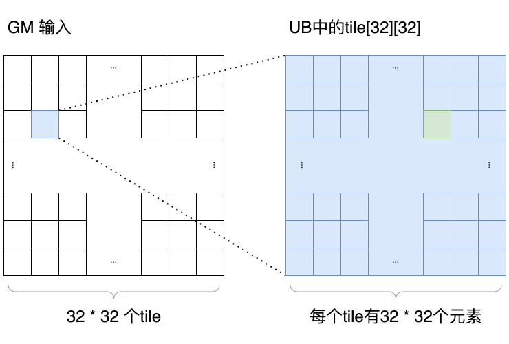
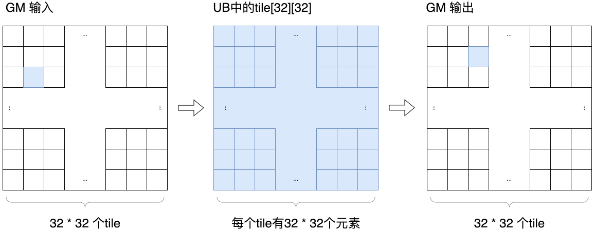
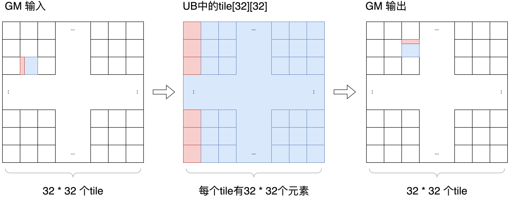

# MatrixTranspose性能调优样例

## 概述

本样例以矩阵转置为例，介绍基于Ascend C SIMT编程方式的性能调优思路。样例包含5个逐步优化的kernel版本，从最基础的数据复制与直接转置开始，逐步引入UB中转、全局访存合并以及通过padding降低UB Bank Conflict的优化方法，展示矩阵转置从“先做对”到“逐步做快”的完整优化路径。

本样例均采用32×32的tile切分方式，并统一使用32×32线程块。即每个block启动1024个线程处理一个32×32的tile，每个线程只负责1个数据元素。这样的组织方式更直观，便于直接观察“一个线程对应一个元素”时，各版本kernel在GM访问、UB中转、UB转置读阶段的差异。

**优化路径**：

- Case 0：基准数据复制版本
- Case 1：UB中转的数据复制版本
- Case 2：直接索引转置版本
- Case 3：UB中转 + 全局访存合并实现转置
- Case 4：UB中转 + 全局访存合并 + 避免UB Bank Conflict

## 支持的产品

- Ascend 950PR/Ascend 950DT

## 目录结构介绍

```text
├── martrix_transpose
│   ├── matrix_transpose.asc       // Ascend C样例实现（包含5个优化case）
│   └── README.md                  // 本说明文档
```

## 样例描述

**样例功能**：

样例实现的是float类型矩阵转置性能对比，并在Host侧对不同kernel的吞吐与结果正确性进行统一验证。样例默认矩阵大小为1024×1024，内部采用固定32×32 tile组织方式，每个kernel在相同输入、相同benchmark框架下运行，便于直接比较优化收益。

矩阵转置的计算公式为：

$$
out(x, y) = in(y, x)
$$

- input：输入矩阵，默认形状为[1024,1024]，数据类型为float
- output：输出矩阵，形状为[1024,1024]，数据类型为float

## 样例实现

### 计算映射与线程切分

本样例中的5个kernel都基于同一套tile切分方式组织计算。

**整体切分方式**：

- 将整个输入矩阵按照32×32的tile进行划分
- grid配置为(matrix_width/32,matrix_height/32,1)
- 因此一个block对应处理输入矩阵中的一个大小为32×32的tile

**block与线程组织**：

- block配置固定为(32,32,1)
- threadIdx.x方向有32个线程，对应tile内的列索引
- threadIdx.y方向有32个线程，对应tile内的行索引
- 单个block总线程数为32×32=1024，每个线程只处理1个数据元素，恰好覆盖完整的一个tile

**以一个block为例的映射关系**：

下图给出了一个更直观的映射示意。左侧表示GM矩阵被切成32×32个tile，右侧表示其中一个block需要处理的一个tile，其大小为32×32。


以图中绿色元素为例，可以直接用kernel里的内置变量来推导它在GM中的input坐标。

- 图中绿色元素所在的tile坐标是(2,1)，对应：
  - blockIdx.y = 2
  - blockIdx.x = 1
- 图中绿色元素在tile内的局部坐标是(2,29)，对应：
  - threadIdx.y = 2
  - threadIdx.x = 29

结合代码中的索引计算：

```cpp
int x_index = blockIdx.x * TILE_DIM + threadIdx.x;
int y_index = blockIdx.y * TILE_DIM + threadIdx.y;
int index = x_index + width * y_index;
```

代入本例中的变量值：

- x_index = blockIdx.x × TILE_DIM + threadIdx.x = 1 × 32 + 29 = 61
- y_index = blockIdx.y × TILE_DIM + threadIdx.y = 2 × 32 + 2 = 66

因此，该线程在GM中处理的输入元素坐标就是：

- input[y_index,x_index] = input[66,61]

如果继续代入一维地址公式，则有：

- index = x_index + width × y_index = 61 + 1024 × 66

需要注意两层粒度：

- 整个GM矩阵是1024×1024元素
- 它按32×32元素切分后，每个方向共有32个tile，总计32×32个tile
- 一个block只负责其中一个32×32 tile
- 在这个tile内部，再由32×32个线程一一对应地处理32×32个元素

**为什么采用这种切分方式**：

- 一个线程对应一个数据，索引关系最直接，便于理解矩阵转置的地址映射
- 所有版本都使用完全一致的线程布局，便于把性能差异归因到“是否使用UB”“是否做访存合并”“是否消除UB冲突”

### 性能指标说明

**表1 MatrixTranspose性能指标字段说明表**

|      字段名      | 字段含义                                     |
| :--------------: | :------------------------------------------- |
| Throughput(GB/s) | 有效带宽，按一次完整读入和一次完整写回统计。 |
|     Time(ms)     | 单次kernel平均执行时间。                     |
|      Result      | 结果校验是否通过。                           |

本章节性能数据请根据实际运行环境补充。建议结合Throughput、Time和profiling工具中的GM搬运、UB访问、同步开销等指标，综合判断每个case的瓶颈来源。

### Case 0：基准数据复制版本

**实现方式**：参考copy_kernel()函数实现

该版本不做转置，只做相同位置的数据复制，用于给后续transpose kernel提供带宽上界参考。由于它不包含坐标交换，因此可以近似视作“理想访存模式”的参考基线，也是后续所有优化版本的性能参照。

**关键代码**：

```cpp
int x_index = blockIdx.x * TILE_DIM + threadIdx.x;
int y_index = blockIdx.y * TILE_DIM + threadIdx.y;
int index = x_index + width * y_index;

output[index] = input[index];
```

**样例配置**：

- TILE_DIM=32
- grid配置为(matrix_width/32,matrix_height/32,1)
- block配置为(32,32,1)
- 每个block处理一个32×32 tile
- 每个线程处理tile内1个元素
- 单个block总线程数为32×32=1024

**性能数据**：

| Throughput(GB/s) | Time(ms) | Result |
| :--------------: | :------: | :----: |
|                  |          |        |

**实现过程拆解**：

1. block根据blockIdx定位到当前32×32 tile
2. 线程根据threadIdx定位到tile内的一个元素
3. 线程从GM读取input[index]
4. 线程把数据直接写回output[index]

整个过程中没有坐标交换，也没有UB参与，因此路径最短。

**优化效果分析**：

- 该版本不涉及矩阵转置，仅用于提供copy带宽基线
- 全局内存访问模式连续、规则，通常可作为性能上界参考
- 若该版本与后续优化版本差距很大，通常说明瓶颈不在纯搬运带宽，而在转置引入的地址重排或UB访问模式

**原理说明**：

- 每个线程按输入与输出相同坐标进行读写
- 不存在转置，不存在重排，不存在同步
- 对同一个warp中的相邻线程来说，GM读写方向一致，地址通常连续
- 因此它反映的是“只做搬运、不做重排”时的理想带宽水平

**性能优化建议**：

> 💡 **先建立copy基线，再观察transpose优化收益**
>
> 在分析矩阵转置性能时，建议先测量copy场景带宽，再用transpose的吞吐与其做对比，更容易判断当前瓶颈来自全局访存还是UB访问模式。

---

### Case 1：UB中转的数据复制版本

**实现方式**：参考copy_shared_mem_kernel()函数实现

该版本在基准数据复制基础上引入UB中转，评估数据经过UB staging后的开销。它不改变全局访存方向，只是在GM与GM之间增加了一次UB读写与一次同步，用于隔离UB中转本身的成本。

**关键代码**：

```cpp
__ubuf__ float tile[TILE_DIM][TILE_DIM];

tile[threadIdx.y][threadIdx.x] = input[index];
asc_syncthreads();
output[index] = tile[threadIdx.y][threadIdx.x];
```

**样例配置**：

- UB tile大小为32×32
- grid配置与Case 0相同
- block配置仍为(32,32,1)
- 每个线程仍处理1个元素
- 一个block仍完整覆盖一个32×32 tile，只是多了一次tile级别的UB落地与回写

**性能数据**：

| Throughput(GB/s) | Time(ms) | Result |
| :--------------: | :------: | :----: |
|                  |          |        |

**实现过程拆解**：

1. 每个线程先从GM读1个元素
2. 把该元素写入UB中的tile[threadIdx.y][threadIdx.x]
3. 所有线程通过asc_syncthreads()等待整个tile写完
4. 每个线程再从UB原坐标读回同一个元素
5. 最后写回GM中相同坐标的位置

下图展示了Case1的数据流，这里每个tile会按照在input里的排布读取到UB，再写回到output相同的位置。


**优化效果分析**：

- 该版本可用于评估UB读写与同步的固定成本
- 若其带宽接近基准copy，说明UB staging开销较低
- 若其性能明显低于基线copy，则说明后续transpose即使消除了Bank Conflict，UB中转本身仍可能成为不可忽略的固定开销

**原理说明**：

- 它的关键价值不在于变快，而在于把“GM直接复制”和“经过UB再复制”拆开比较
- 由于读UB和写UB时都沿原坐标访问，所以它不体现转置重排的收益，只体现UB参与后的成本
- 这一版使用32×32的UB tile，更接近“最基础的UB中转copy”实现，便于单独观察UB读写与同步本身带来的开销

**性能优化建议**：

> 💡 **先隔离UB中转开销，再引入转置访问**
>
> 这样可以将“UB本身的成本”和“转置引入的访存代价”拆开观察，便于定位瓶颈来源。

---

### Case 2：直接索引转置版本

**实现方式**：参考transpose_naive_kernel()函数实现

该版本直接按照转置公式计算输出坐标，不使用UB做重排，是最直接的transpose实现版本。它的价值在于提供“最简单、最容易理解”的转置基线，也便于观察矩阵转置最典型的性能问题。

**关键代码**：

```cpp
int index_in = x_index + width * y_index;
int index_out = y_index + height * x_index;

output[index_out] = input[index_in];
```

**样例配置**：

- grid配置与Case 0相同
- block配置为(32,32,1)
- 不使用UB
- 每个线程处理1个输出元素
- 输出索引直接通过index_out = y_index + height * x_index计算得到
- 一个block仍对应一个输入32×32 tile，但输出写回已经变成转置后的目标tile

**性能数据**：

| Throughput(GB/s) | Time(ms) | Result |
| :--------------: | :------: | :----: |
|                  |          |        |

**实现过程拆解**：

1. 线程先按原坐标读取输入元素
2. 线程计算该元素转置后的输出位置
3. 线程把数据直接写到转置后的全局地址

线程直接从GM输入读出一个元素后，立刻把它写到转置后的GM目标位置，没有任何UB重排，因此最容易出现“读较规整、写不规整”的情况。这里“读较规整、写不规整”，关键要看同一批相邻线程访问的GM地址是否连续。

- 读取输入时的地址：
  - `index_in = x_index + width * y_index`
  - 在同一个warp内的相邻线程满足 `threadIdx.y`相同、`threadIdx.x`连续增加，那么 `y_index`保持不变，`x_index`按1递增
  - 这时 `index_in`也按1递增，这些线程读取的是输入矩阵同一行上的连续元素，即访问连续
- 写回输出时的地址：
  - `index_out = y_index + height * x_index`
  - 对同一批相邻线程来说，`y_index`仍保持不变，但 `x_index`按1递增
  - 这时 `index_out`不是按1递增，而是每次增加 `height`，即这些线程写回的不是连续元素，而是跨行、跨大步长地写到输出矩阵中

可以把它理解成：

- 读输入时，相邻线程在输入矩阵的一行上并排取数
- 写输出时，相邻线程却被拆散到输出矩阵的不同行上

因此，这一版的核心问题是转置后的写回地址不再连续，这通常会显著影响整体吞吐。

**优化效果分析**：

- 该版本可作为最直接转置实现的基准
- 输入读取通常仍较规整，但输出写回变成跨步访问

**原理说明**：

- 这版没有借助UB做中间重排，因此线程写回的目标地址不再按原顺序排列
- 对同一批线程来说，读访问可能还是连续的，但写访问通常不再连续
- 所以它清楚地说明：矩阵转置的主要难点通常不在“计算转置坐标”，而在“如何把转置后的写回也组织成高效访存”

**性能优化建议**：

> ⚠️ **naive transpose通常受限于非连续写访存**
>
> 即使计算逻辑简单，若输出写地址跨步过大，也会显著影响实际吞吐。

---

### Case 3：全局访存合并的转置版本

**实现方式**：参考transpose_coalesced_kernel()函数实现

该版本通过UB中转将GM的读写改造成更规整的访问模式，先解决全局访存合并问题。它是矩阵转置中非常典型的一步优化：先把“全局写不连续”变成“GM连续读 + UB内转置 + GM连续写”。

**关键代码**：

```cpp
tile[threadIdx.y][threadIdx.x] = input[index_in];
asc_syncthreads();

x_index = blockIdx.y * TILE_DIM + threadIdx.x;
y_index = blockIdx.x * TILE_DIM + threadIdx.y;
int index_out = x_index + y_index * height;

output[index_out] = tile[threadIdx.x][threadIdx.y];
```

**样例配置**：

- UB tile大小为32×32
- 通过UB完成tile内转置
- grid配置与Case 0相同
- block配置仍为(32,32,1)
- 每个线程先将1个输入元素写入UB，再从UB的转置坐标读取1个元素写回输出
- 从block映射上看，一个block仍然只负责一个32×32 tile，但tile内数据会先在UB中完成一次坐标交换

**性能数据**：

| Throughput(GB/s) | Time(ms) | Result |
| :--------------: | :------: | :----: |
|                  |          |        |

**实现过程拆解**：

1. 每个线程从GM读取tile中的1个元素
2. 按原坐标把元素写入UB中的tile[threadIdx.y][threadIdx.x]
3. 同步，保证整个tile已经完整落入UB
4. 每个线程从UB中按转置坐标从tile[threadIdx.x][threadIdx.y]取数
5. 把取出的值写回GM中的转置位置。

这一版之所以能比Case 2更快，关键在于它把“写不规整”的问题转移到了UB内部，使GM访问重新变得规整。对于一个warp的32个线程来说，会将GM中tile的一行元素读取到UB中，然后再读取UB中tile的一列写回到GM中的一行，以此来完成转置。具体的GM访问地址分析如下：

- 读取输入时的地址：
  - `index_in = x_index + y_index * width`
  - 在同一个warp内的相邻线程满足 `threadIdx.y`相同、`threadIdx.x`连续增加，那么 `y_index`保持不变，`x_index`按1递增
  - 这时 `index_in`也按1递增，这些线程读取的仍然是输入矩阵同一行上的连续元素，即访问连续
- 写回输出时的地址：
  - 在同步之后，代码重新计算了输出位置：
    - `x_index = blockIdx.y * TILE_DIM + threadIdx.x`
    - `y_index = blockIdx.x * TILE_DIM + threadIdx.y`
    - `index_out = x_index + y_index * height`
  - 对同一个warp内的相邻线程来说，`threadIdx.y`不变，`threadIdx.x`连续增加，因此新的 `y_index`保持不变，新的 `x_index`按1递增
  - 这时 `index_out`也按1递增，这些线程写回的是输出矩阵同一行上的连续元素，即写回重新变得连续

可以把它理解成：

- Case 2中，线程是“直接把输入元素写到转置后的GM位置”，所以相邻线程会被打散到输出矩阵的不同行上
- Case 3中，线程先把数据放到UB里，把原来不连续的全局写访问转移到UB内的不连续读

因此，这一版的核心收益是：虽然增加了一次UB读写和一次同步，但换来了GM侧“读连续、写也连续”的访问模式，整体吞吐通常会明显好于Case 2。

下图展示了Case 3的数据流。它的关键在于先把输入tile按原坐标写入UB，再通过读取tile[threadIdx.x][threadIdx.y]完成tile内转置，最后写回GM中的目标tile。


**优化效果分析**：

- 相比naive transpose，通常可明显提升GM访存效率
- 它首先解决的是“全局写不规整”的问题
- 但UB转置读阶段仍可能存在bank conflict
- 若profiling显示GM相关指标已有明显改善，而整体吞吐未继续逼近copy基线，则后续瓶颈往往会落在UB列访问冲突上

**原理说明**：

- 这版的关键思想是：先让GM访问规整，再把坐标交换动作放到UB中完成
- GM到UB阶段按原布局读入，访问方向自然规整
- 写回GM时，由于block坐标和UB内索引已经交换，所以全局写回也被重新组织成更适合硬件的方式
- 但问题也随之转移到了UB内部：从tile[threadIdx.x][threadIdx.y]这种“按列取数”的访问方式，可能会在UB上形成bank冲突

**性能优化建议**：

> 💡 **先解决全局访存合并，再处理UB bank conflict**
>
> 在矩阵转置优化中，全局访存模式通常是第一层瓶颈，先让GM访问规整，再继续细化UB访问冲突。

---

### Case 4：避免UB Bank Conflict的转置版本

**实现方式**：参考transpose_avoid_bank_conflicts_kernel()函数实现

该版本在全局访存合并版本的基础上，对UB tile增加+1 padding，用于降低转置读阶段的bank conflict，是本样例的最终优化版本。

**关键代码**：

```cpp
__ubuf__ float tile[TILE_DIM][TILE_DIM + 1];
```

```cpp
output[index_out] = tile[threadIdx.x][threadIdx.y];
```

**样例配置**：

- UB tile大小为32×33
- grid配置与Case 0相同
- block配置为(32,32,1)
- 保留与coalesced版本相同的整体执行路径，仅修改UB布局
- 每个block仍处理一个32×32 tile，每个线程仍处理1个元素
- 因此这一版非常适合和Case 3做一一对照，便于观察“只改UB布局”所带来的性能变化

**性能数据**：

| Throughput(GB/s) | Time(ms) | Result |
| :--------------: | :------: | :----: |
|                  |          |        |

**实现过程拆解**：

1. GM到UB阶段与Case 3完全一致
2. 差异只在UB布局，从32×32改成32×33
3. 同步后，每个线程仍按tile[threadIdx.x][threadIdx.y]读取转置后的数据
4. 最终写回GM中的转置位置

可以看到，这一版没有改变算法路径，也没有改变block和线程切分，只是调整了UB中的物理布局。

**Bank Conflict详解**：

下面以Ascend 950PR/Ascend 950DT的UB划分规则为例，说明本样例中Bank Conflict是如何产生的，以及Case 3和Case 4理论上的冲突强度差异。

1. UB中的bank划分
下图展示了Ascend 950PR/Ascend 950DT的UB划分规则，UB总大小为256KB，可以看成前后两行，每行128KB，前128KB对应bank0~bank7，后128KB对应bank8~bank15。`bank0`和`bank8`属于同一个group，`bank1`和`bank9`属于同一个group，依此类推。

由于本样例中的tile很小：

- `32×32×4B = 4096B`
- `32×33×4B = 4224B`

远小于128KB，所以一个tile通常只会落在前128KB区域内。这样在本文分析里，可以把它近似看成只使用`bank0~bank7`。

1. 什么情况下会冲突

对SIMT来说，最关键的是同一条UB访问指令下，同一warp的并发线程是否会集中访问少数几个bank。

- **读写冲突**：读操作和写操作同时尝试访问同一个bank。
- **写写冲突**：多个写操作同时尝试访问同一个bank group。
- **读读冲突**：两个读操作同时尝试访问同一个bank，或者两个以上读操作同时尝试访问同一个bank group。

因此，分析Bank Conflict的关键，就是看同一批线程的地址映射到哪些bank，以及这些bank分布得是否均匀。

1. Case 3的冲突分析

Case 3的关键读操作是：

```cpp
output[index_out] = tile[threadIdx.x][threadIdx.y];
```

对一个warp中的线程，若固定`threadIdx.y = c`，令`threadIdx.x = t`，其中`t = 0~31`，那么它们从UB读取的地址可写成：

```text
addr_case3(t) = B + 4 * (32t + c)
```

其中：

- `B`表示tile在UB中的起始地址
- `4`表示float占4字节
- `32t`表示跨行访问，因为这里访问的是`tile[t][c]`

在UB的前128KB区域内，可以用下面的近似公式分析bank编号：

```text
bank_case3(t) = floor(addr_case3(t) / 32) mod 8
              = (4t + floor(c / 8)) mod 8
```

由于`4t mod 8`只会在`0`和`4`之间来回跳变，所以对固定的`c`来说，这32个线程只会打到2个bank上。

例如当`c = 0`时，bank序列为：

```text
0,4,0,4,0,4,0,4,...
```

这意味着：

- 32个线程只命中2个bank
- 平均每个bank要承受16个线程的访问
- 因此Case 3在UB转置读阶段，可以近似看成16-way量级的冲突

也就是说，Case 3虽然已经把GM写回整理成连续访问，但新的瓶颈转移到了UB内部的列读冲突上。

1. Case 4的冲突分析

Case 4只改了一件事：把UB tile从`32×32`改成`32×33`，即：

```cpp
__ubuf__ float tile[TILE_DIM][TILE_DIM + 1];
```

对应同样的转置读操作，固定`threadIdx.y = c`、令`threadIdx.x = t`时，地址变成：

```text
addr_case4(t) = B + 4 * (33t + c)
```

对应的bank编号近似为：

```text
bank_case4(t) = floor(addr_case4(t) / 32) mod 8
              = (4t + floor((t + c) / 8)) mod 8
```

相比Case 3，多出来的这一列padding让地址步长从`128B`变成了`132B`，打破了原来固定落在少数bank上的周期性。

例如当`c = 0`时，bank序列会扩展成：

```text
0,4,0,4,0,4,0,4,
1,5,1,5,1,5,1,5,
2,6,2,6,2,6,2,6,
3,7,3,7,3,7,3,7
```

这意味着：

- 32个线程会覆盖8个bank
- 平均每个bank约承受4个线程的访问
- 因此Case 4在UB转置读阶段，可以近似看成4-way量级的冲突

5. Case 3和Case 4的理论对比

- Case 3：32个线程主要集中到2个bank，约16-way冲突
- Case 4：32个线程分散到8个bank，约4-way冲突

因此，从理论上看，Case 4并不是“完全没有冲突”，而是把Case 3中很重的UB列读冲突，降低成了明显更轻的冲突。


**内存布局优化**：

**优化效果分析**：

- 相比coalesced transpose，重点优化UB读阶段冲突
- 是本样例当前的最终优化版本
- 若这版性能已明显逼近copy基线，说明全局访存与UB冲突两层主要问题都已被较好处理

**原理说明**：

- +1 padding改变了UB每一行的跨度
- 原本容易周期性落到同一组bank上的转置列读，在加入padding后会被打散
- 这样做不会改变线程处理逻辑，也不会改变输出结果，只是在UB内部把热点访问分散开
- 因此它是一种“小改动、收益稳定、工程上很常见”的优化方式

**性能优化建议**：

> 💡 **对二维tile增加padding是处理transpose类UB冲突的常见手段**
>
> 当共享内存列访问成为瓶颈时，可优先尝试tile[M][N+1]一类布局，通常改动小、收益稳定。

---

## 编译与运行

### 编译方式

```bash

```

### 运行方式

```bash

```

## 结果说明

运行后程序会依次输出各个kernel的：

- Throughput
- Time
- Result

其中：

- copy与copy_shared_mem的结果会与输入直接对比
- transpose_*版本会与Host侧compute_transpose_gold()生成的参考结果对比
- 所有kernel共用相同输入矩阵和统一timing逻辑，因此结果可直接横向比较

建议重点关注以下几组对比关系：

- copy与copy_shared_mem：用于观察UB中转本身的固定成本
- transpose_naive与transpose_coalesced：用于观察全局访存合并带来的收益
- transpose_coalesced与transpose_avoid_bank_conflicts：用于观察UB Bank Conflict优化带来的收益
- transpose_avoid_bank_conflicts与copy：用于判断最终版本距离理想搬运带宽还有多大差距

## 后续优化方向

- 结合目标芯片的UB bank/group规则，继续分析transpose_avoid_bank_conflicts_kernel的实际冲突程度
- 尝试在保持block切分不变的前提下，对GM到UB搬运引入float2或float4向量化，评估其对UB写冲突和整体吞吐的影响
- 结合硬件profiling工具，进一步定位瓶颈位于GM访存、UB冲突还是同步开销
- 在后续扩展版本中，也可以尝试更细粒度的子块重排、warp级分工或不同tile形状，进一步比较“冲突减少”和“线程利用率下降”之间的平衡
