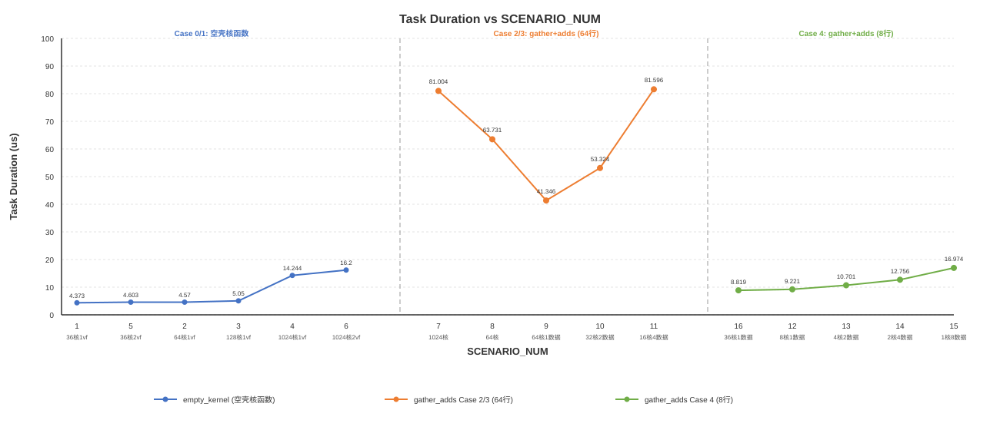

# gridDim配置与vf调用优化样例

## 概述

本样例以Gather+Adds融合计算为例，介绍Ascend C SIMD与SIMT混合编程方式下的gridDim配置和vf函数调用优化思路。样例包含2个空壳核函数场景以及1个逐步优化的实际计算场景。

## 支持的产品

- Ascend 950PR/Ascend 950DT

## 目录结构介绍

```text
├── 02_simt_grid_config
│   ├── CMakeLists.txt         // 编译工程文件
│   ├── grid_config.asc        // 样例实现
│   ├── figures                // 性能曲线图
│   └── README.md
```

## 样例描述

- 计算公式：

  $$output[i][j] = input[index[i][j]] + 1.0$$

  - input为输入张量，数据类型为float，形状因Case不同而异：Case 0/1/2为[2200000]，Case 3为[200000]，Case 4为[20000]
  - index为索引张量，数据类型为uint32，形状因Case不同而异：Case 0/1/2为[1024, 2048]，Case 3为[64, 2048]，Case 4为[8, 2048]，索引范围为[0, input_total_length)
  - output为输出张量，数据类型为float，形状与index相同
  - 计算过程：根据index[i][j]索引从input中采集对应位置的数据，加1.0后写入output[i][j]位置

- 样例规格：

  <table>
  <tr><td rowspan="1" align="center">样例类型(OpType)</td><td colspan="4" align="center">GatherAdds</td></tr>
  <tr><td rowspan="2" align="center">样例输入</td><td align="center">name</td><td align="center">shape</td><td align="center">data type</td><td align="center">format</td></tr>
  <tr><td align="center">input</td><td align="center">[2200000]/[200000]/[20000]</td><td align="center">float</td><td align="center">ND</td></tr>
  <tr><td rowspan="2" align="center">样例输入</td><td align="center">name</td><td align="center">shape</td><td align="center">data type</td><td align="center">format</td></tr>
  <tr><td align="center">index</td><td align="center">[1024,2048]/[64,2048]/[8,2048]</td><td align="center">uint32</td><td align="center">ND</td></tr>
  <tr><td rowspan="2" align="center">样例输出</td><td align="center">name</td><td align="center">shape</td><td align="center">data type</td><td align="center">format</td></tr>
  <tr><td align="center">output</td><td align="center">[1024,2048]/[64,2048]/[8,2048]</td><td align="center">float</td><td align="center">ND</td></tr>
  <tr><td rowspan="1" align="center">核函数名</td><td colspan="4" align="center">empty_kernel / gather_adds_kernel</td></tr>
  </table>

## 样例实现

### Case实现说明

本样例通过4个Case展示不同的gridDim配置与vf调用策略，每个Case包含多个场景（SCENARIO_NUM）。

| Case   | SCENARIO_NUM | 实现特点                                           | 使用的核函数                          | 优化特性                                |
| ------ | ------------ | -------------------------------------------------- | ------------------------------------- | --------------------------------------- |
| Case 0 | 1-4          | 不同逻辑核个数（36/64/128/1024），1次vf调用       | empty_kernel                         | 展示逻辑核个数对头开销的影响            |
| Case 1 | 5-6          | 不同vf调用次数（1次/2次），36核和1024核            | empty_kernel                         | 展示vf调用次数对头开销的影响            |
| Case 2 | 7-8          | 1024核 vs 64核，每个线程处理1/16个数据             | gather_adds_kernel                   | gridDim配置优化路径                     |
| Case 3 | 9-11         | 64/32/16核，每个线程处理1/2/4个数据                | gather_adds_kernel                   | 线程数据分布对性能的影响                |
| Case 4 | 12-16        | 36/8/4/2/1核，每个线程处理1/2/4/8个数据            | gather_adds_kernel                   | 线程数据分布对性能的影响                |

#### 核心概念：vf循环位置优化

在SIMD与SIMT混合编程模型中，vf函数调用存在一定开销。对于需要多次处理数据的场景，有两种实现方式：

- **vf循环在vf函数外**：核函数内部通过for循环多次调用vf函数，每次调用处理一部分数据（分配的线程数，即`blockDim.x`）
- **vf循环在vf函数内**：vf函数内部通过for循环处理多个数据，每个逻辑核只调用一次vf函数

本样例所有gather+adds场景均采用vf循环在vf函数内的方式，通过`vf_loop_times`参数控制每个线程处理的数据量。

### 性能指标说明

| 指标                | 说明                                                                                      |
| ------------------- | ----------------------------------------------------------------------------------------- |
| Task Duration(us)   | Task整体耗时，包含调度到加速器的时间、加速器上的执行时间以及响应结束时间                  |

### Case 0: 逻辑核个数对头开销的影响

**样例目标**：测试不同逻辑核个数下的调度头开销，展示逻辑核数远超可用核数时头开销显著提升

**核心实现**：

- 核函数`empty_kernel`仅调用空壳vf函数`simt_empty`和`simd_empty`
- 空壳vf函数内部无实际计算逻辑，用于隔离测试gridDim配置带来的开销
- 场景1-4分别启动36、64、128、1024个逻辑核，每次调用1次vf

**关键代码**：

```cpp
__simt_vf__ __launch_bounds__(THREAD_NUM) inline void simt_empty(...)
{
}

__simd_vf__ inline void simd_empty(...)
{
}

__global__ __vector__ void empty_kernel(...)
{
    for (uint32_t vf_idx = 0; vf_idx < vf_call_times; vf_idx++) {
        asc_vf_call<simt_empty>(...);
        asc_vf_call<simd_empty>(...);
    }
}
```

**性能数据**：

| SCENARIO_NUM | 逻辑核数 | Task Duration(us) |
| :----------: | :------: | :---------------: |
|  1           | 36       |      4.373        |
|  2           | 64       |      4.57         |
|  3           | 128      |      5.05         |
|  4           | 1024     |      14.244       |

**分析**：

- 逻辑核数从36增加到1024（约28倍），Task Duration从4.373us增长到14.244us（约3.27倍），说明当逻辑核数远超可用核数时，头开销显著提升
- 36核耗时最低（4.373us），1024核耗时最高（14.244us），核数配置对调度开销影响显著

---

### Case 1: vf调用次数对头开销的影响

**样例目标**：测试不同vf调用次数下的调度头开销，展示vf调用次数对Task Duration影响相对较小

**核心实现**：

- 与Case 0使用相同的空壳核函数`empty_kernel`
- 场景5：36核，2次vf调用；场景6：1024核，2次vf调用
- 与Case 0对应场景对比：场景1（36核1次vf）vs场景5（36核2次vf），场景4（1024核1次vf）vs场景6（1024核2次vf）

**性能数据**：

| SCENARIO_NUM | 逻辑核数 | vf调用次数 | Task Duration(us) |
| :----------: | :------: | :--------: | :---------------: |
|  5           | 36       | 2          |      4.603        |
|  6           | 1024     | 2          |      16.2         |

**分析**：

- 36核下：1次vf调用耗时4.373us（场景1），2次vf调用耗时4.603us（场景5），增长约5%
- 1024核下：1次vf调用耗时14.244us（场景4），2次vf调用耗时16.2us（场景6），增长约14%
- vf调用次数对Task Duration影响相对较小，核数配置是影响调度开销的主要因素

---

### Case 2: Gather+Adds计算场景的gridDim配置优化

**样例目标**：通过调整gridDim配置，展示Gather+Adds融合计算场景的性能优化路径

**核心实现**：

两个场景均使用核函数`gather_adds_kernel`，差异在于逻辑核个数和每个线程处理的数据量：

| 配置项 | 场景7 | 场景8 |
| ------ | ------ | ------ |
| 逻辑核数 | 1024 | 64 |
| 每个线程处理数据量 | 1 | 16 |

- 场景7：启动1024个逻辑核，每个线程处理1个数据
- 场景8：启动64个逻辑核，每个线程处理16个数据

**关键代码**：

两个场景使用相同的核函数`gather_adds_kernel`和vf函数`simt_gather`、`simd_adds`，关键差异在于gridDim配置和vf_loop_times参数：

```cpp
// simt_gather: SIMT vf函数关键点 —— vf_loop_times控制循环次数
// vf_loop_times=1时处理单个数据段（场景7），vf_loop_times>1时循环处理多个数据段（场景8）
for (uint32_t vf_idx = 0; vf_idx < vf_loop_times; vf_idx++) {
    uint32_t idx = threadIdx.x + index_start + vf_idx * THREAD_NUM;
    uint32_t gather_idx = index[idx];
    gather_output[threadIdx.x + vf_idx * THREAD_NUM] = input[gather_idx];
}

// gather_adds_kernel: 核函数统一调用vf，通过vf_loop_times适配不同场景
asc_vf_call<simt_gather>(dim3(THREAD_NUM), ..., vf_loop_times);
asc_vf_call<simd_adds>(...);
AscendC::DataCopy(output_global, adds_output, rows_per_block);
```

**性能数据**：

| SCENARIO_NUM | Case | Task Duration(us) |
| :----------: | :--: | :---------------: |
|  7           |  2   |      81.004       |
|  8           |  2   |      63.731       |

**分析**：

- 场景7作为基础场景，逻辑核数较多（1024），各逻辑核串行等待执行，Task Duration高达81.004us
- 场景7→场景8：将逻辑核数从1024调整为64，Task Duration从81.004us降低到63.731us，性能提升约1.27倍

**优化手段**：

- **减少逻辑核数**：将逻辑核数从1024调整为64，减少串行等待开销

---

### Case 3: 线程数据分布对性能的影响（64行场景）

**样例目标**：探索不同逻辑核个数与每个线程处理数据量对Gather+Adds融合计算性能的影响

**核心实现**：

三个场景均使用核函数`gather_adds_kernel`，差异在于逻辑核个数和每个线程处理的数据量：

- input形状为[200000]，index和output形状为[64, 2048]，线程数为2048

| 配置项 | 场景9 | 场景10 | 场景11 |
| ------ | ------ | ------ | ------ |
| 逻辑核数 | 64 | 32 | 16 |
| 每个线程处理数据量 | 1 | 2 | 4 |

- 场景9：64逻辑核，每个线程处理1个数据
- 场景10：32逻辑核，每个线程处理2个数据
- 场景11：16逻辑核，每个线程处理4个数据

三个场景的总数据量相同（64×2048=131072），通过调整逻辑核个数和每个线程处理的数据量，探索不同gridDim配置下的性能差异。

**性能数据**：

| SCENARIO_NUM | Case | Task Duration(us) |
| :----------: | :--: | :---------------: |
|  9           |  3   |      41.346       |
|  10          |  3   |      53.324       |
|  11          |  3   |      81.596       |

**分析**：

- 64核（41.346us）→32核（53.324us）→16核（81.596us），逻辑核数减少，Task Duration增加
- 64核配置下性能最优，减少逻辑核数会导致每个核处理更多数据，计算时间增加

---

### Case 4: 线程数据分布对性能的影响（8行场景）

**样例目标**：探索不同逻辑核个数配置下每个线程处理数据量对Gather+Adds融合计算性能的影响

**核心实现**：

五个场景均使用核函数`gather_adds_kernel`，差异在于逻辑核个数和每个线程处理的数据量：

- input形状为[20000]，index和output形状为[8, 2048]，线程数为2048

| 配置项 | 场景16 | 场景12 | 场景13 | 场景14 | 场景15 |
| ------ | ------ | ------ | ------ | ------ | ------ |
| 逻辑核数 | 36 | 8 | 4 | 2 | 1 |
| 每个线程处理数据量 | 1 | 1 | 2 | 4 | 8 |

- 场景16：36逻辑核，每个线程处理1个数据
- 场景12：8逻辑核，每个线程处理1个数据
- 场景13：4逻辑核，每个线程处理2个数据
- 场景14：2逻辑核，每个线程处理4个数据
- 场景15：1逻辑核，每个线程处理8个数据

五个场景的总数据量相同（8×2048=16384），通过调整逻辑核个数和每个线程处理的数据量，探索不同配置下的性能差异。

**性能数据**：

| SCENARIO_NUM | Case | Task Duration(us) |
| :----------: | :--: | :---------------: |
|  16          |  4   |      8.819        |
|  12          |  4   |      9.221        |
|  13          |  4   |      10.701       |
|  14          |  4   |      12.756       |
|  15          |  4   |      16.974       |

**分析**：

- 36核（8.819us）→8核（9.221us）→4核（10.701us）→2核（12.756us）→1核（16.974us），逻辑核数减少，Task Duration增加
- 36核配置下性能最优（8.819us），即使逻辑核数超过可用核数，增加并行度仍能提升性能
- 数据量较小时（8×2048=16384），增加逻辑核数带来的并行收益大于调度开销

---

## 性能对比总结

### Ascend 950PR性能数据

| Case | SCENARIO_NUM | Task Duration(us) | 逻辑核数 | 每个线程处理数据量 | 说明 |
| ---- | ------------ | ----------------- | -------- | ------------------ | ---- |
| Case 0 | 1 | 4.373 | 36 | - | 36核空壳基线 |
| Case 0 | 2 | 4.57 | 64 | - | 64核空壳基线 |
| Case 0 | 3 | 5.05 | 128 | - | 128核空壳基线 |
| Case 0 | 4 | 14.244 | 1024 | - | 1024核空壳基线 |
| Case 1 | 5 | 4.603 | 36 | - | 36核2次vf |
| Case 1 | 6 | 16.2 | 1024 | - | 1024核2次vf |
| Case 2 | 7 | 81.004 | 1024 | 1 | 1024核基础场景 |
| Case 2 | 8 | 63.731 | 64 | 16 | 64核优化场景 |
| Case 3 | 9 | 41.346 | 64 | 1 | 64行64核 |
| Case 3 | 10 | 53.324 | 32 | 2 | 64行32核 |
| Case 3 | 11 | 81.596 | 16 | 4 | 64行16核 |
| Case 4 | 16 | 8.819 | 36 | 1 | 8行36核 |
| Case 4 | 12 | 9.221 | 8 | 1 | 8行8核 |
| Case 4 | 13 | 10.701 | 4 | 2 | 8行4核 |
| Case 4 | 14 | 12.756 | 2 | 4 | 8行2核 |
| Case 4 | 15 | 16.974 | 1 | 8 | 8行1核 |

**关键发现**：

1. **逻辑核数对调度开销的影响**（Case 0）：36核→1024核，Task Duration增长约3.27倍
2. **逻辑核数对计算性能的影响**：增加逻辑核数（至一定范围内）可提升并行度，降低Task Duration
   - Case 2：1024核→64核，Task Duration降低约21%
   - Case 3：64核最优（41.346us），减少核数导致性能下降
   - Case 4：36核最优（8.819us），减少核数导致性能下降
3. **数据量与核数的匹配**：数据量较大时（Case 2/3），核数过多会导致串行等待；数据量较小时（Case 4），增加核数提升并行收益

### 性能曲线图

下图展示了16个场景的Task Duration变化趋势，按Case分组排列，蓝色为空壳核函数场景，橙色为64行数据场景，绿色为8行数据场景：



**性能曲线分析**：

1. **逻辑核个数对头开销的影响（Case 0）**：
   - 36核（4.373us）→64核（4.57us）→128核（5.05us）→1024核（14.244us）
   - 核数从36增加到1024（约28倍），Task Duration增长约3.27倍
   - 当逻辑核数远超可用核数时，头开销显著提升

2. **vf调用次数对头开销的影响（Case 0 vs Case 1）**：
   - 36核下，场景1（1vf, 4.373us）→场景5（2vf, 4.603us），增长约5%
   - 1024核下，场景4（1vf, 14.244us）→场景6（2vf, 16.2us），增长约14%
   - 说明vf调用切换开销相对较小

3. **逻辑核数对计算性能的影响（Case 2/3）**：
   - 场景7（1024核, 81.004us）→场景8（64核, 63.731us），减少核数降低Task Duration约21%
   - Case 3中64核最优（41.346us），减少核数导致Task Duration增加
   - 核数减少使每核负载增加，计算时间上升

4. **数据量与核数匹配（Case 4）**：
   - 36核（8.819us）最优，8核（9.221us）→4核（10.701us）→2核（12.756us）→1核（16.974us）
   - 数据量较小时，增加核数提升并行收益大于调度开销

## 调优建议

1. **合理配置逻辑核数**：逻辑核数量不宜过多，避免过多逻辑核串行执行带来的调度开销；也不宜过少，需保证足够的并行度
2. **匹配数据量与核数**：数据量较大时适当减少核数，数据量较小时适当增加核数，以平衡并行收益与调度开销
3. **优化线程数据分布**：通过调整每个线程处理的数据量，在核数与并行度之间找到最优平衡点

## 编译运行

在本样例根目录下执行如下步骤，编译并执行样例。

- 配置环境变量
  请根据当前环境上CANN开发套件包的[安装方式](../../../../docs/quick_start.md#prepare&install)，选择对应配置环境变量的命令。

  - 默认路径，root用户安装CANN软件包

    ```bash
    source /usr/local/Ascend/cann/set_env.sh
    ```

  - 默认路径，非root用户安装CANN软件包

    ```bash
    source $HOME/Ascend/cann/set_env.sh
    ```

  - 指定路径install_path，安装CANN软件包

    ```bash
    source ${install_path}/cann/set_env.sh
    ```

- 样例执行

  ```bash
  SCENARIO_NUM=7                       # 选择执行场景，可选1-16
  mkdir -p build && cd build;          # 创建并进入build目录
  cmake -DSCENARIO_NUM=$SCENARIO_NUM ..;make -j;  # 编译工程
  ./grid_config                        # 执行样例
  ```

- 编译选项说明

  | 选项             | 可选值      | 说明              |
  | ---------------- | ----------- | ----------------- |
  | `SCENARIO_NUM` | `1`-`16` | 样例类型，默认为1 |

  执行结果如下，说明精度对比成功。

  ```text
  [Success] Case accuracy is verification passed.
  ```

## 性能分析

使用 `msprof` 工具获取详细性能数据：

```bash
msprof ./grid_config   # 分析性能
```

当前目录下会生成PROF_前缀的文件夹，`mindstudio_profiler_output`目录保存Host和各个Device的性能数据汇总，性能数据分析推荐查看该目录下文件

```bash
PROF_xxxx_XXXXXX
├── device_{id}
└── host
└── mindstudio_profiler_log
└── mindstudio_profiler_output    # 保存Host和各个Device的性能数据汇总
    ├── msprof_*.json
    ├── xx_*.csv
    └── README.txt
```
查看具体的性能分析结果：
```
# 查看Task Duration 以及各项数据
cat ./PROF_*/mindstudio_profiler_output/op_summary_*.csv
```