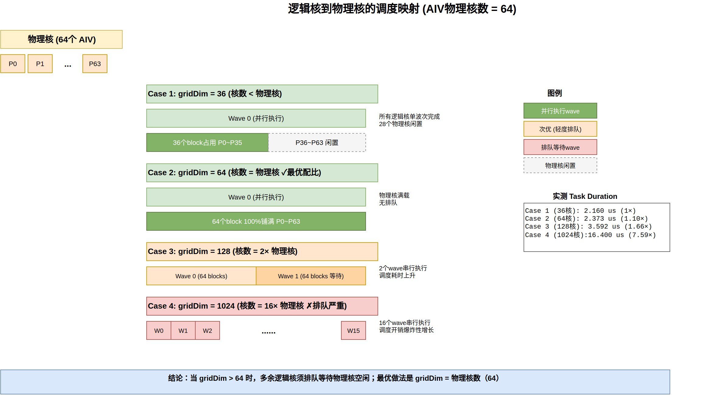
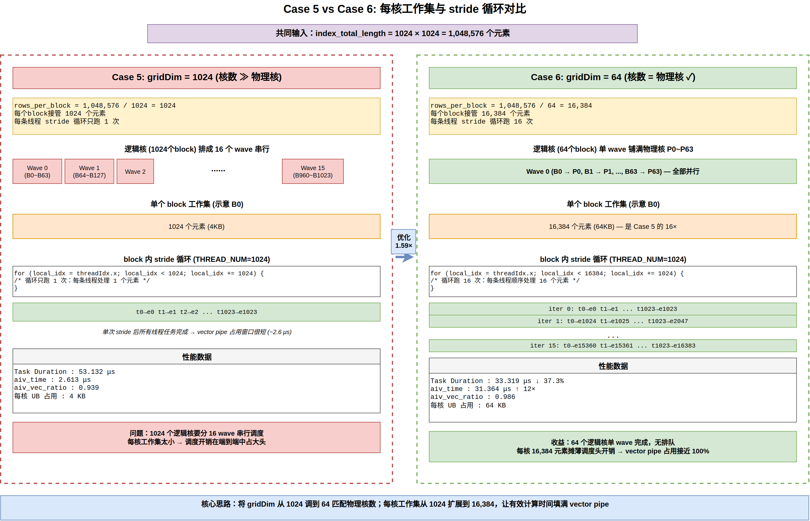

# gridDim配置性能调优样例

## 概述

本样例以Gather+Adds融合计算为例，介绍Ascend C SIMT编程方式下的gridDim配置调优思路。样例包含4个空核函数场景（对比启动不同核数的头开销）以及2个实际计算场景（对比逻辑核数与物理核数匹配前后的性能差异），从核数远超物理核的基础配置，逐步优化至逻辑核数匹配最大物理核的最优配置。

## 支持的产品

- Ascend 950PR/Ascend 950DT

## 目录结构介绍

```text
├── 02_simt_grid_config
│   ├── figures                // README中的图片资源
│   ├── CMakeLists.txt         // 编译工程文件
│   ├── grid_config.asc        // gridDim配置样例实现
```

## 样例描述

- 计算公式：

  $$
  output[i][j] = input[index[i][j]] + 1.0
  $$

  - input为输入张量，形状为[1100000]，数据类型为float
  - index为索引张量，形状为[1024,1024]，数据类型为uint32，索引范围为[0,1100000)
  - output为输出张量，形状为[1024,1024]，数据类型为float
  - 计算过程：根据index[i][j]索引从input中采集对应位置的数据，加1.0后写入output[i][j]位置

- 样例规格：

  <table>
  <tr><td rowspan="1" align="center">样例类型(OpType)</td><td colspan="4" align="center">GatherAdds</td></tr>
  <tr><td rowspan="3" align="center">样例输入</td><td align="center">name</td><td align="center">shape</td><td align="center">data type</td><td align="center">format</td></tr>
  <tr><td align="center">input</td><td align="center">[1100000]</td><td align="center">float</td><td align="center">ND</td></tr>
  <tr><td align="center">index</td><td align="center">[1024,1024]</td><td align="center">uint32</td><td align="center">ND</td></tr>
  <tr><td rowspan="1" align="center">样例输出</td><td align="center">output</td><td align="center">[1024,1024]</td><td align="center">float</td><td align="center">ND</td></tr>
  <tr><td rowspan="1" align="center">核函数名</td><td colspan="4" align="center">empty_kernel / gather_adds_kernel</td></tr>
  </table>

## 样例实现

### Case实现说明

本样例通过6个独立场景展示不同的gridDim配置策略，每个场景通过`SCENARIO_NUM`选择。

| Case   | 实现特点                                  | 使用的核函数        | 优化特性                          |
| ------ | ----------------------------------------- | ------------------- | --------------------------------- |
| Case 1 | 36核，启动空的核函数                          | empty_kernel        | 调度基线，逻辑核数 < 物理核           |
| Case 2 | 64核，启动空的核函数               | empty_kernel        | 调度基线，逻辑核数 = 物理核           |
| Case 3 | 128核，启动空的核函数                          | empty_kernel        | 调度基线，逻辑核数 > 物理核（2×）     |
| Case 4 | 1024核，启动空的核函数                         | empty_kernel        | 调度基线，逻辑核数 ≫ 物理核（16×）    |
| Case 5 | 1024核，每核1024个元素，进行gather+adds计算       | gather_adds_kernel  | 逻辑核数 ≫ 物理核           |
| Case 6 | 64核，每核16384个元素，进行gather+adds计算         | gather_adds_kernel  | 逻辑核数 = 物理核（最优）   |

#### 物理核与逻辑核

在SIMT编程模型中：

- **物理核**：硬件实际拥有的物理核数，本样例环境运行时实测核数为64
- **逻辑核**：通过gridDim配置启动的逻辑核数量，即`gridDim.x`
- **核数匹配原则**：当逻辑核数量小于等于物理核数量时，各核可并行执行；当逻辑核数量超过物理核数量时，多余逻辑核需要等待执行

下图展示了Case 1~Case 4四种gridDim配置下，逻辑核到物理核的调度映射关系。当`gridDim ≤ 64`时所有逻辑核单wave并行；当`gridDim > 64`时多余逻辑核需要分多个wave执行，调度耗时随wave数量成倍上升。

> **wave**：一次同时驻留并并行执行的一组逻辑核（block）。当`gridDim ≤ 物理核数`时，全部逻辑核可在 1 个 wave 内并行；当`gridDim > 物理核数`时，多余逻辑核须等前一个 wave 让出物理核才能被调度上来，形成多个 wave 执行。本样例的 wave 数 ≈ ⌈ `gridDim` / 物理核数 ⌉，例如 Case 4 的 1024 核需 16 个 wave。

> **注意**：wave只是分析模型，非硬件实际执行逻辑。



本样例通过Case 1-4建立调度开销基线，Case 5与Case 6对比1024核与64核两种配置下的实际计算性能。

#### 运行期查询物理核数

样例中`AIV_CORE_NUM = 64`是按照下面的代码实际获取到的，为了保证程序界面的风格统一，并未体现。在实际工程中，建议通过AscendC Runtime API在运行期向硬件查询，避免硬编码：

```cpp
#include "acl/acl.h"

int32_t device_id = 0;
int64_t physical_aiv_core_num = 0;
aclError ret = aclrtGetDeviceInfo(
    static_cast<uint32_t>(device_id),
    ACL_DEV_ATTR_VECTOR_CORE_NUM,
    &physical_aiv_core_num);
if (ret == ACL_SUCCESS) {
    printf("Physical AIV (Vector Core) num: %ld\n", physical_aiv_core_num);
}
```

调用前需先完成`aclInit`与`aclrtSetDevice`。

`aclrtDevAttr`枚举值说明：

| 枚举值                          | 含义                  |
| ------------------------------- | --------------------- |
| `ACL_DEV_ATTR_VECTOR_CORE_NUM`  | Vector Core (AIV) 数量 |

#### 线程块布局

所有场景共用同一套线程块布局：

- block配置固定为`(THREAD_NUM, 1, 1)`，其中`THREAD_NUM = 1024`，单个block总线程数为1024
- grid配置由`SCENARIO_NUM`决定，取值为36 / 64 / 128 / 1024
- 计算场景中，每个block处理的数据量`rows_per_block`由`总数据量 / 逻辑核数`得到，即`index_total_length / gridDim.x`
- 每个线程在`[threadIdx.x, rows_per_block)`区间按`THREAD_NUM`跨步处理元素

```cpp
uint32_t rows_per_block = index_total_length / gridDim.x;
uint32_t index_start = blockIdx.x * rows_per_block;

for (uint32_t local_idx = threadIdx.x; local_idx < rows_per_block; local_idx += THREAD_NUM) {
    // 当前线程处理 index_start + local_idx 这个元素
}
```

### 性能指标说明

| 指标                | 说明                                                                                      |
| ------------------- | ----------------------------------------------------------------------------------------- |
| Task Duration(us)   | Task整体耗时，包含调度到加速器的时间、加速器上的执行时间以及响应结束时间                  |
| aiv_time(us)        | Task在AI Vector Core上的理论执行时间，单位为us                                            |
| aiv_total_cycles    | 该Task被分配到每个AI Vector Core计算单元上后，每个AI Vector Core计算单元上的执行cycle总数 |
| aiv_vec_time(us)    | vec类型指令（向量类运算指令）耗时，单位为us                                               |
| aiv_vec_ratio       | vec类型指令（向量类运算指令）的cycle数在total cycle数中的占用比                           |
| aiv_scalar_time(us) | scalar类型指令（标量类运算指令）耗时，单位为us                                            |
| aiv_scalar_ratio    | scalar类型指令（标量类运算指令）的cycle数在total cycle数中的占用比                        |

除Task Duration外，本例中其余指标均展示的为所有block上性能指标的平均值。

### Case 1: 36核空核函数

**样例目标**：建立"核数 < 物理核"配置下的Task调度耗时基线

**核心实现**：

- 核函数`empty_kernel`函数体为空，仅承担Task调度开销
- gridDim配置为36，逻辑核数小于物理核数（64）
- Host侧先通过`aclrtMemcpy(DEVICE_TO_DEVICE)`把input拷贝到output，保证精度校验通过，再启动空kernel仅测调度开销

**关键代码**：

```cpp
__global__ __launch_bounds__(THREAD_NUM) void empty_kernel(
    float* input, uint32_t* index, float* output,
    uint32_t input_total_length, uint32_t index_total_length)
{
}
```

**性能数据**：

| Task Duration(us) | aiv_time(us) | aiv_total_cycles | aiv_vec_time(us) | aiv_vec_ratio | aiv_scalar_time(us) | aiv_scalar_ratio |
| :---------------: | :----------: | :--------------: | :--------------: | :-----------: | :-----------------: | :--------------: |
|       2.160       |    0.397     |      655.7       |      0.000       |     0.000     |        0.374        |      0.936       |

**分析**：

- Case 1的Task Duration为2.160us，作为"核数 < 物理核"场景下的调度耗时基线
- 由于核函数为空，aiv_vec_ratio为0，aiv_scalar_ratio接近0.94，Task整体由标量调度路径主导
- 后续Case 2~4将在此基线上观察核数变化对调度耗时的影响

---

### Case 2: 64核空核函数

**样例目标**：观察"核数 = 物理核"配置下的Task调度耗时

**核心实现**：

- 核函数与Case 1完全相同，仅gridDim从36改为64
- 逻辑核数等于物理核数，所有逻辑核可在物理核上一次性铺满

**关键代码**：

```cpp
empty_kernel<<<64, THREAD_NUM, 0, stream>>>(
    input_device, index_device, output_device,
    input_total_length, index_total_length);
```

**性能数据**：

| Task Duration(us) | aiv_time(us) | aiv_total_cycles | aiv_vec_time(us) | aiv_vec_ratio | aiv_scalar_time(us) | aiv_scalar_ratio |
| :---------------: | :----------: | :--------------: | :--------------: | :-----------: | :-----------------: | :--------------: |
|       2.373       |    0.461     |      760.5       |      0.000       |     0.000     |        0.438        |      0.941       |

**分析**：

- 相比Case 1，Block Dim从36增加到64（约1.78×），Task Duration从2.160us增加到2.373us（约1.10×）
- 逻辑核数仍在物理核范围内，所有逻辑核并行执行，Task Duration涨幅平缓
- 随着启动的逻辑核数的增加，调度开销也随之增加，但逻辑核数 < 物理核数，无排队等待时间，调度开销增加不显著

---

### Case 3: 128核空核函数

**样例目标**：观察"核数 = 2 × 物理核"配置下的Task调度耗时

**核心实现**：

- 核函数与Case 1相同，gridDim配置为128
- 逻辑核数为物理核数的2倍，每个物理核需要承担2个逻辑核的调度

**关键代码**：

```cpp
empty_kernel<<<128, THREAD_NUM, 0, stream>>>(
    input_device, index_device, output_device,
    input_total_length, index_total_length);
```

**性能数据**：

| Task Duration(us) | aiv_time(us) | aiv_total_cycles | aiv_vec_time(us) | aiv_vec_ratio | aiv_scalar_time(us) | aiv_scalar_ratio |
| :---------------: | :----------: | :--------------: | :--------------: | :-----------: | :-----------------: | :--------------: |
|       3.592       |    0.309     |      509.4       |      0.000       |     0.000     |        0.286        |      0.901       |

**分析**：

- 相比Case 2，Block Dim从64增加到128（2×），Task Duration从2.373us增加到3.592us（约1.51×）
- 逻辑核数超过物理核数，多余逻辑核需要等待物理核空闲才能执行，调度耗时开始出现明显上升

---

### Case 4: 1024核空核函数

**样例目标**：观察"核数 ≫ 物理核"配置下的Task调度耗时上限

**核心实现**：

- 核函数与Case 1相同，gridDim配置为1024
- 逻辑核数为物理核数的16倍，每个物理核需要承担16个逻辑核的调度

**关键代码**：

```cpp
empty_kernel<<<1024, THREAD_NUM, 0, stream>>>(
    input_device, index_device, output_device,
    input_total_length, index_total_length);
```

**性能数据**：

| Task Duration(us) | aiv_time(us) | aiv_total_cycles | aiv_vec_time(us) | aiv_vec_ratio | aiv_scalar_time(us) | aiv_scalar_ratio |
| :---------------: | :----------: | :--------------: | :--------------: | :-----------: | :-----------------: | :--------------: |
|      16.400       |    0.169     |      279.3       |      0.000       |     0.000     |        0.146        |      0.848       |

**分析**：

- 相比Case 3，Block Dim从128增加到1024（8×），Task Duration从3.592us增加到16.400us（约4.57×）
- 逻辑核数显著超过物理核数后，多余逻辑核等待执行的开销占据主导，Task Duration出现陡增
- 1024核配置下的调度耗时已是Case 2（64核）的6.91×，体现出大量逻辑核排队等待的开销


---

### Case 5: 1024核Gather+Adds计算

**样例目标**：在"核数 ≫ 物理核"配置下完成实际Gather+Adds计算，作为计算场景的对比基线

**核心实现**：

- 核函数`gather_adds_kernel`：每个线程从GM上的`index[]`取下标，从GM上的`input[]`乱序读取数据，加常数1后顺序写入GM上的`output[]`
- gridDim配置为1024，每个block处理`1048576 / 1024 = 1024`个元素
- block内1024个线程处理当前block的数据，每个线程处理1个元素，stride循环只跑1次

**关键代码**：

```cpp
    uint32_t rows_per_block = index_total_length / gridDim.x;
    uint32_t index_start = blockIdx.x * rows_per_block;

    for (uint32_t local_idx = threadIdx.x; local_idx < rows_per_block; local_idx += THREAD_NUM) {
        uint32_t gather_idx = index[index_start + local_idx];
        if (gather_idx >= input_total_length) { gather_idx = 0; }
        output[index_start + local_idx] = input[gather_idx] + ADDS_ADDEND;
    }
```

**性能数据**：

| Task Duration(us) | aiv_time(us) | aiv_total_cycles | aiv_vec_time(us) | aiv_vec_ratio | aiv_scalar_time(us) | aiv_scalar_ratio |
| :---------------: | :----------: | :--------------: | :--------------: | :-----------: | :-----------------: | :--------------: |
|      53.132       |    2.613     |     4310.9       |      2.449       |     0.939     |        0.152        |      0.056       |

**分析**：

- Case 5的Task Duration为53.132us，作为"核数 ≫ 物理核"配置下实际计算场景的耗时基线
- 1024个逻辑核要在64个物理核上分16个wave排队下发，与Case 4（1024核空核函数，16.400us）对比可知，仅"调度+排队等待"这一项就贡献了约16us头开销
- 扣除调度基线后，实际"gather+adds+store"约36.7us。虽然aiv_vec_ratio已经到0.939，但单block工作集仅1024元素、每线程stride循环只跑1次，gather读GM的延迟没有足够的循环可供pipe掩盖，单核aiv_time仅2.613us、aiv_total_cycles仅4310.9

---

### Case 6: 64核Gather+Adds计算

**优化目标**：将逻辑核数与物理核数对齐，消除多余逻辑核排队等待

**核心实现**：

- 核函数与Case 5完全一致，仅gridDim从1024改为64
- 每个block接管的元素数从1024增加到`1048576 / 64 = 16384`，每个线程在`THREAD_NUM = 1024`步长下stride循环16次
- 逻辑核数等于物理核数，所有block在物理核上一次铺满，无后续排队

**关键代码**：

```cpp
gather_adds_kernel<<<64, THREAD_NUM, 0, stream>>>(
    input_device, index_device, output_device,
    input_total_length, index_total_length);
```

**优化手段**：

- 将逻辑核数从1024调整为64，匹配物理核数，消除多余逻辑核的等待
- 每核工作集从1024扩展到16384元素，把原本被调度开销摊薄掉的有效计算时间填回来
- block内stride循环从1次增加到16次，使vector pipe在更长时间窗内保持高占用

**性能数据**：

| Task Duration(us) | aiv_time(us) | aiv_total_cycles | aiv_vec_time(us) | aiv_vec_ratio | aiv_scalar_time(us) | aiv_scalar_ratio |
| :---------------: | :----------: | :--------------: | :--------------: | :-----------: | :-----------------: | :--------------: |
|      33.319       |    31.364    |     51750.9      |     30.919       |     0.986     |        0.434        |      0.014       |

**分析**：

- 相比Case 5的1024核配置，Task Duration从53.132us降低到33.319us，耗时下降约37.3%，整体性能提升约1.59倍
- **GM读写总量并没有变**：两个case都对`input[]`做了1M次gather+adds、对`output[]`做了1M次写入，访问的元素总量完全一致。差异来自两点
  - **调度开销**：Case 5需要16个wave排队，调度基线约16.4us（见Case 4）；Case 6单wave无需排队，调度基线约2.4us（见Case 2），仅这一项就省下约14us
  - **访存延迟掩盖**：每核工作集从1024扩到16384后，stride循环从1次增加到16次，gather读GM的高延迟可以被更长的循环窗口覆盖，单核aiv_total_cycles从4310.9提升到51750.9（约12×）、aiv_time从2.613us提升到31.364us（约12×），pipe不再被频繁打断
- 与Case 2（64核空核函数）的2.373us调度基线相比，Case 6的33.319us中约30.9us为有效vector计算时间，调度头开销占比已不到10%

下图对比了Case 5与Case 6在block排布、单核工作集与stride循环结构上的差异：左侧Case 5的1024个block被切分为16个wave执行，每核工作集仅1024元素（4KB），stride循环只跑1次；右侧Case 6的64个block单wave占满物理核，每核工作集扩展到16384元素（64KB），stride循环跑16次。



---

## 性能对比总结

### Ascend 950PR性能数据

**调度开销随核数变化（Case 1~4，empty_kernel）**：

| Case version | Block Dim | Task Duration(us) | 相对Case 1调度耗时 | 说明                                  |
| ------------ | --------- | ----------------- | ------------------ | ------------------------------------- |
| Case 1       | 36        | 2.160             | **1×**             | 调度基线，核数 < 物理核               |
| Case 2       | 64        | 2.373             | **1.10×**          | 核数 = 物理核，调度耗时基本持平       |
| Case 3       | 128       | 3.592             | **1.66×**          | 核数 > 物理核（2×），调度开始上升     |
| Case 4       | 1024      | 16.400            | **7.59×**          | 核数 ≫ 物理核（16×），调度开销主导    |

**实际计算场景核数匹配物理核的收益（Case 5 → Case 6）**：

| 配置项               | Case 5             | Case 6             |
| -------------------- | ------------------ | ------------------ |
| 逻辑核数             | 1024               | 64                 |
| 每核处理元素数       | 1024               | 16384              |
| Task Duration(us)    | 53.132             | **33.319**         |
| aiv_vec_ratio        | 0.939              | 0.986              |
| Task Duration相对Case 5 | **1×**          | **0.63×**          |

- Case 6相比Case 5耗时下降约37.3%，整体性能提升约1.59倍
- 逻辑核数从1024降到64匹配物理核，消除了多余逻辑核的等待开销
- 每核工作集从1024扩到16384后，调度头开销摊薄到更多有效计算上，aiv_vec_ratio从0.939提升到0.986

## 调优建议

1. **优先匹配物理核数**：逻辑核数应尽量等于物理核数，避免多余逻辑核排队带来的调度开销。Case 4的1024核相对Case 2的64核多出约6.91×的调度耗时即为典型代价。
2. **加大每核工作集摊薄头开销**：核数下调后，每核处理的元素数会成倍增加，让调度头开销在更多有效计算上分摊。
3. **运行期查询物理核数**：避免硬编码`AIV_CORE_NUM`，建议使用`aclrtGetDeviceInfo(ACL_DEV_ATTR_VECTOR_CORE_NUM, ...)`在运行期获取，提升样例在不同硬件上的可移植性。
4. **先以空核函数建立调度基线**：在分析grid配置类调优问题时，建议先用`empty_kernel`测得相同核数下的调度基线，再用实际算子的Task Duration与其对比，区分调度开销和真实计算耗时。

## 编译运行

在本样例根目录下执行如下步骤，编译并执行样例。

- 配置环境变量
  请根据当前环境上CANN开发套件包的[安装方式](../../../../docs/quick_start.md#prepare&install)，选择对应配置环境变量的命令。

  - 默认路径，root用户安装CANN软件包

    ```bash
    source /usr/local/Ascend/cann/set_env.sh
    ```

  - 默认路径，非root用户安装CANN软件包

    ```bash
    source $HOME/Ascend/cann/set_env.sh
    ```

  - 指定路径install_path，安装CANN软件包

    ```bash
    source ${install_path}/cann/set_env.sh
    ```

- 样例执行

  ```bash
  SCENARIO_NUM=6                       # 选择执行场景，可选1-6
  mkdir -p build && cd build;          # 创建并进入build目录
  cmake -DCMAKE_ASC_ARCHITECTURES=dav-3510 -DSCENARIO_NUM=$SCENARIO_NUM ..;make -j;  # 编译工程
  ./grid_config                        # 执行样例
  ```

- 编译选项说明

  | 选项                       | 可选值      | 说明                                                          |
  | -------------------------- | ----------- | ------------------------------------------------------------- |
  | `CMAKE_ASC_ARCHITECTURES`  | `dav-3510`  | NPU架构：本样例仅支持dav-3510（Ascend 950PR/Ascend 950DT）    |
  | `SCENARIO_NUM`             | `1`-`6`     | 样例类型，默认为1                                             |

  执行结果如下，说明精度对比成功。

  ```text
  [Success] Case accuracy is verification passed.
  ```

## 性能分析

使用`msprof`工具获取详细性能数据：

```bash
msprof op ./grid_config   # 分析case的性能
```

命令完成后，会在默认目录下生成以"OPPROF_{timestamp}_XXX"命名的文件夹，性能数据文件夹结构示例如下：

```text
├──dump                       # 原始的性能数据，用户无需关注
├──ArithmeticUtilization.csv  # cube/vector指令cycle占比
├──L2Cache.csv                # L2 Cache命中率
├──Memory.csv                 # UB，L1和主存储器读写带宽速率
├──MemoryL0.csv               # L0A，L0B，和L0C读写带宽速率
├──MemoryUB.csv               # Vector和Scalar到UB的读写带宽速率
├──OpBasicInfo.csv            # 算子基础信息
├──PipeUtilization.csv        # 采集计算单元和搬运单元耗时和占比
├──ResourceConflictRatio.csv  # UB上的bank group、bank conflict和资源冲突率在所有指令中的占比
└──visualize_data.bin         # MindStudio Insight呈现文件
```
