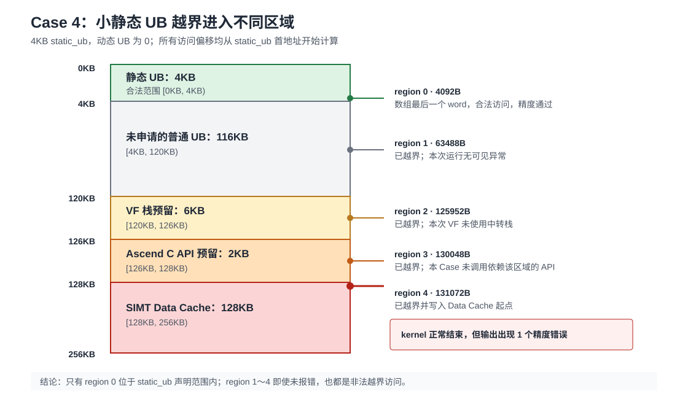

# SIMD与SIMT混合编程UB越界定位样例

## 概述

本样例以逐元素计算算子的UB访问越界问题为例，介绍SIMD与SIMT混合编程场景下UB访问越界的定位方法。样例通过多个Case分析不同VF配置下的可用UB大小、静态UB与动态UB的布局关系，以及越界访问不同UB区域时的运行表现。

通过编译选项`SCENARIO_NUM`选择需要运行的Case。每次构建只编译并运行一个Case，各Case使用独立的Kernel、动态UB配置、输出Buffer和运行状态，彼此之间不存在依赖关系。

## 本样例支持的产品及CANN软件版本

| 产品 | CANN软件版本 |
| --- | --- |
| Ascend 950PR/Ascend 950DT | >= CANN 9.2.0 |

## 目录结构介绍

```text
├── simd_simt_ub_usage_limit
│   ├── CMakeLists.txt         // 编译工程文件
│   ├── ub_usage_limit.asc     // Ascend C样例实现
│   ├── figures                // README引用的示意图
│   ├── README.md              // 中文说明
│   └── README_en.md           // 英文说明
```

## 样例描述

本样例包含5个Case。Case 0复现静态UB越界写入Data Cache导致的精度问题；Case 1~3分别验证不同VF配置下的可用UB边界，以及混合编程场景下静态UB和动态UB的布局关系；Case 4进一步访问不同UB区域，观察越界访问的实际表现。

| Case | 场景 | 验证内容 | 编译选项 |
| --- | --- | --- | --- |
| Case 0 | 静态UB越界写入Data Cache | 越界写破坏SIMT访问GM时缓存的数据，并导致输出精度异常 | `SCENARIO_NUM=0` |
| Case 1 | 无SIMT VF时的可用UB大小 | 对比不调用SIMD VF、默认调用SIMD VF和关闭VF栈预留三种配置 | `SCENARIO_NUM=1` |
| Case 2 | 包含SIMT VF时的可用UB大小 | 分别使用静态UB和动态UB探针验证可用UB上限 | `SCENARIO_NUM=2` |
| Case 3 | MainScalar、SIMD VF和SIMT VF混合使用UB | 验证静态UB累加关系和动态UB首地址关系 | `SCENARIO_NUM=3` |
| Case 4 | 小静态UB越界写入不同UB区域 | 对比未申请UB、6KB VF栈预留、2KB Ascend C API预留和Data Cache中的运行表现 | `SCENARIO_NUM=4` |

> **UB访问越界说明**
>
> UB申请总量未超过容量上限，并不代表每次访问都合法。静态数组只能访问其声明范围，动态UB只能访问Kernel启动时配置的范围。访问超出对应范围后，可能落入未申请UB、VF栈预留、Ascend C API预留或Data Cache。此类越界访问不一定立即触发运行错误，需要结合地址范围、运行日志和输出精度进行定位。

## 样例实现

本节按照“问题复现、边界验证、布局分析、越界观察”的顺序介绍各Case。Case 0给出问题场景及修复方法，Case 1~4用于说明问题定位过程中需要掌握的UB容量和布局规则。

### Case 0：静态UB越界踩入Data Cache导致精度失败

**样例目标**：复现静态数组下标越界后写入SIMT Data Cache，并导致算子输出精度异常的问题；同时通过下标检查验证修复效果。

**核心实现**：

Case 0实现逐元素加一计算。1024个SIMT线程从GM读取`input[index]`，计算`output[index] = input[index] + 1`。Kernel申请216KB静态UB，不配置动态UB。剩余空间包括6KB VF栈预留、2KB Ascend C API预留和最小32KB Data Cache，布局如下：

```text
低地址 0
├── 静态UB      216KB
├── VF栈预留      6KB
├── Ascend C预留  2KB
└── Data Cache   32KB
高地址 256KB
```

SIMT VF第一次读取GM输入，使输入数据进入Data Cache。随后，MainScalar通过运行时下标访问相对静态数组首地址偏移224KB的位置。该访问跨过216KB静态UB和8KB预留空间，写入Data Cache起始位置：

```cpp
__ubuf__ uint32_t static_ub[216 * 1024 / sizeof(uint32_t)];
uint32_t faulty_index = (216 * 1024 + 8 * 1024) / sizeof(uint32_t);
__ubuf__ volatile uint32_t* static_data = static_ub;
static_data[faulty_index] = 0xDEADBEEF;
```

SIMT VF再次读取相同的GM输入并执行加一计算。被破坏的缓存数据参与计算后，对应输出变为`0xDEADBEF0`，Host侧与Golden数据比较时检测到精度异常。受Data Cache映射和替换状态影响，发生错误的输出下标可能变化，因此样例只校验是否存在不匹配元素，不将错误位置固定为`output[0]`。

**执行结果**：

问题模式不检查访问下标，用于复现越界：

```bash
cmake -S . -B build_case0_fault -DCMAKE_ASC_ARCHITECTURES=dav-3510 \
  -DSCENARIO_NUM=0 -DCASE0_ENABLE_FIX=OFF
cmake --build build_case0_fault -j
./build_case0_fault/ub_usage_limit
```

实测输出：

```text
[Case0] mode=fault, static_bytes=221184, dynamic_bytes=0, reserved_bytes=8192, dcache_bytes=32768, faulty_byte_offset=229376
[Case0] mismatch_count=1
[Case0] first_mismatch_index=896, expected=0xc0000381, actual=0xdeadbef0
[Case0] precision_check=FAILED (fault reproduced)
```

修复模式在写静态数组前检查运行时下标，越界时不执行写入：

```cpp
if (faulty_index < CASE0_STATIC_WORDS) {
    static_data[faulty_index] = CASE0_CORRUPTED_VALUE;
}
```

```bash
cmake -S . -B build_case0_fixed -DCMAKE_ASC_ARCHITECTURES=dav-3510 \
  -DSCENARIO_NUM=0 -DCASE0_ENABLE_FIX=ON
cmake --build build_case0_fixed -j
./build_case0_fixed/ub_usage_limit
```

```text
[Case0] mode=fixed, static_bytes=221184, dynamic_bytes=0, reserved_bytes=8192, dcache_bytes=32768, faulty_byte_offset=229376
[Case0] mismatch_count=0
[Case0] precision_check=PASSED (out-of-bounds write blocked)
```

**问题分析与结论**：

UB越界不一定触发Kernel启动或运行错误。当错误访问落入Data Cache时，可能破坏SIMT访问GM时缓存的数据，并最终表现为精度异常。因此，定位和修复此类问题时，不仅要检查UB申请总量，还要检查每次访问使用的实际下标是否位于对应数组范围内。

## UB边界与布局分析

### Case 1：无SIMT场景的可用UB大小

**样例目标**：验证无SIMT VF时，是否调用SIMD VF以及是否关闭VF栈预留对可用UB大小的影响。

**核心实现**：

Case 1包含三种编译配置：不调用SIMD VF、使用默认配置调用SIMD VF，以及调用SIMD VF并关闭VF栈预留。样例使用静态数组作为容量探针，逐步调整`static_ub`大小，以“当前配置运行成功，增加4B后Kernel启动失败”确定边界。静态数组仅用于探测容量，最终结论是各VF配置对应的可用UB大小。

探针数组长度、是否调用SIMD VF以及是否传递编译选项都在编译期确定，无法通过运行时分支完成三组有效对照，因此每种场景需要分别构建`SCENARIO_NUM=1`。

Kernel声明一段大小可配置的`static_ub`和一段固定的32B静态结果区：

```cpp
__ubuf__ uint32_t static_ub[BOUNDARY_STATIC_WORDS];
__ubuf__ uint32_t result[8];
```

`UB_BOUNDARY_STATIC_BYTES`控制第一段静态数组的字节数，配置值必须是4B的整数倍。

#### 场景1：不调用SIMD VF

```bash
cmake -S . -B build_boundary_no_vf \
  -DCMAKE_ASC_ARCHITECTURES=dav-3510 \
  -DSCENARIO_NUM=1 \
  -DUB_BOUNDARY_NO_SIMD_VF=ON \
  -DUB_BOUNDARY_STATIC_BYTES=262112
cmake --build build_boundary_no_vf -j
./build_boundary_no_vf/ub_usage_limit
```

#### 场景2：调用SIMD VF，使用默认编译配置

```bash
cmake -S . -B build_boundary_simd \
  -DCMAKE_ASC_ARCHITECTURES=dav-3510 \
  -DSCENARIO_NUM=1 \
  -DUB_BOUNDARY_STATIC_BYTES=253920
cmake --build build_boundary_simd -j
./build_boundary_simd/ub_usage_limit
```

#### 场景3：调用SIMD VF并关闭VF栈预留空间

```bash
cmake -S . -B build_boundary_flag \
  -DCMAKE_ASC_ARCHITECTURES=dav-3510 \
  -DSCENARIO_NUM=1 \
  -DUB_BOUNDARY_DISABLE_RESERVED=ON \
  -DUB_BOUNDARY_STATIC_BYTES=260064
cmake --build build_boundary_flag -j
./build_boundary_flag/ub_usage_limit
```

**执行结果**：

在CANN 9.2.0、`dav-3510`真实NPU上的执行结果如下。表中同时列出每种配置下能够成功运行的最大`static_ub`大小，以及增加一个`uint32_t`元素（4B）后的运行结果：

| 场景 | `static_ub`大小 | 结果 |
| --- | ---: | --- |
| 不调用SIMD VF | 262112B | 通过；与32B结果区合计256KB |
| 不调用SIMD VF | 262116B | Kernel启动失败 |
| 调用SIMD VF，默认配置 | 253920B | 通过 |
| 调用SIMD VF，默认配置 | 253924B | Kernel启动失败 |
| 调用SIMD VF，关闭VF栈预留 | 260064B | 通过 |
| 调用SIMD VF，关闭VF栈预留 | 260068B | Kernel启动失败 |

`static_ub`不是Kernel中唯一的UB对象，固定的32B结果区也需要计入UB总量。因此，当前Kernel实现中的可用UB总量为“`static_ub`探针上限 + 32B结果区”：

| 场景 | `static_ub`探针上限 | 包含32B结果区后的可用UB总量 |
| --- | --- | --- |
| 不调用SIMD VF | 262112B | 262144B（256KB） |
| 调用SIMD VF，默认配置 | 253920B | 253952B（248KB） |
| 调用SIMD VF，关闭VF栈预留 | 260064B | 260096B |

三种场景均按4B粒度完成边界验证，即表中上限值运行成功，增加4B后Kernel启动失败。本Case使用静态数组探测边界，不用于比较静态UB和动态UB的容量差异。

三种通过场景的关键输出如下：

```text
# 不调用SIMD VF，静态数组为262112B
[Case1] mode=without SIMD VF, static_bytes=262112
[Case1] launch_ret=0, sync_ret=0, result=PASSED

# 调用SIMD VF，使用默认编译配置，静态数组为253920B
[Case1] mode=with SIMD VF, static_bytes=253920
[Case1] launch_ret=0, sync_ret=0, result=PASSED

# 调用SIMD VF并关闭VF栈预留空间，静态数组为260064B
[Case1] mode=with SIMD VF, static_bytes=260064
[Case1] launch_ret=0, sync_ret=0, result=PASSED
```

超过对应边界时，关键输出如下：

```text
# 不调用SIMD VF，静态数组为262116B
[Case1] mode=without SIMD VF, static_bytes=262116
[Case1] launch_ret=107000, sync_ret=107000, result=FAILED

# 调用SIMD VF，使用默认编译配置，静态数组为253924B
[Case1] mode=with SIMD VF, static_bytes=253924
[Case1] launch_ret=107000, sync_ret=107000, result=FAILED

# 调用SIMD VF并关闭VF栈预留空间，静态数组为260068B
[Case1] mode=with SIMD VF, static_bytes=260068
[Case1] launch_ret=107000, sync_ret=107000, result=FAILED
```

**问题分析与结论**：

默认配置下调用SIMD VF时，共有8KB空间不作为普通用户UB使用，其中6KB为VF栈预留，2KB为Ascend C API预留。`--cce-disable-vf-stack-reserved-ubuf`只关闭6KB VF栈预留，不会释放2KB Ascend C API预留。该选项虽然能够改变可用UB边界，但不表示调用SIMD VF的Kernel可以使用完整的256KB UB，还需要考虑编译器生成的其他UB占用和具体VF实现。关闭VF栈预留前，需要确认VF不依赖该区域保存函数调用中转数据或寄存器溢出数据。

### Case 2：有SIMT VF场景的可用UB大小

**样例目标**：分别使用静态UB和动态UB探针，验证包含SIMT VF时当前Kernel的可用UB上限。

**核心实现**：

Case 2用于验证包含SIMT VF时的可用UB大小。Kernel固定包含32B结果区。根据包含SIMT VF时用户UB不超过216KB的约束，容量探针上限计算如下：

```text
容量探针上限 = 216KB - 32B = 221152B
```

`CASE2_UB_BYTES`用于配置容量探针大小，`CASE2_USE_STATIC_UB`用于选择静态或动态声明方式。两种模式下，SIMT线程均写满整个探针区，MainScalar读取首尾元素并由Host侧校验，确保最后一个`uint32_t`元素被实际访问。动态模式通过Kernel启动参数配置动态UB大小，静态模式不配置动态UB。

动态探针模式：

```bash
cmake -S . -B build_case2_dynamic -DCMAKE_ASC_ARCHITECTURES=dav-3510 \
  -DSCENARIO_NUM=2 -DCASE2_UB_BYTES=221152 -DCASE2_USE_STATIC_UB=OFF
cmake --build build_case2_dynamic -j
./build_case2_dynamic/ub_usage_limit
```

静态探针模式：

```bash
cmake -S . -B build_case2_static -DCMAKE_ASC_ARCHITECTURES=dav-3510 \
  -DSCENARIO_NUM=2 -DCASE2_UB_BYTES=221152 -DCASE2_USE_STATIC_UB=ON
cmake --build build_case2_static -j
./build_case2_static/ub_usage_limit
```

**执行结果**：

静态和动态两种模式在221152B均运行通过：

```text
[Case2] ub_type=dynamic, max_ub_bytes=221152, configured_ub_bytes=221152
Case 2 (SIMT VF usable UB): PASSED

[Case2] ub_type=static, max_ub_bytes=221152, configured_ub_bytes=221152
Case 2 (SIMT VF usable UB): PASSED
```

两种模式均增加一个`uint32_t`元素，将探针大小调整为221156B，此时Kernel启动失败：

```text
[Case2] ub_type=dynamic, max_ub_bytes=221152, configured_ub_bytes=221156
[ERROR] [Bisheng] Launch kernel failure! ret 107000
Case 2 (SIMT VF usable UB): FAILED

[Case2] ub_type=static, max_ub_bytes=221152, configured_ub_bytes=221156
[ERROR] [Bisheng] Launch kernel failure! ret 107000
Case 2 (SIMT VF usable UB): FAILED
```

**结论**：当前Kernel实现的可用UB实测上限为216KB。扣除固定的32B结果区后，静态和动态容量探针的上限均为221152B。

### Case 3：静态UB和动态UB共用资源池

**样例目标**：验证MainScalar、SIMD VF和SIMT VF中的静态UB需要累加统计，并验证三处动态UB声明指向同一段启动时配置的空间。

**核心实现**：

Case 3分别在MainScalar、SIMD VF和SIMT VF中声明静态UB。MainScalar包含1KB的`main_static_ub`，以及`simt_result`、`simd_result`和`result`三个32B结果数组，共占用1120B；SIMD VF声明2KB静态UB，SIMT VF声明4KB静态UB。不同执行位置声明的静态UB分别占用空间，需要累加计入当前Kernel的静态UB总量。三个执行位置均访问各自静态数组的末元素，避免相关声明被编译器优化。SIMT VF由负责末元素的线程读取并返回该值，避免依赖未同步的跨线程数据：

```text
静态UB总量 = 1KB + 96B + 2KB + 4KB = 7264B
动态UB上限 = 216KB - 7264B = 213920B
```

动态UB采用不同的管理方式，其空间大小仅在Kernel启动时通过`CASE3_DYNAMIC_BYTES`配置一次。MainScalar、SIMD VF和SIMT VF分别在各自代码位置声明名称不同的外部动态UB数组：

```cpp
// MainScalar
extern __ubuf__ uint32_t main_dynamic_ub[];
// SIMD VF
extern __ubuf__ uint32_t simd_dynamic_ub[];
// SIMT VF
extern __ubuf__ uint32_t simt_dynamic_ub[];
```

三个执行位置分别将动态UB数组的首地址转换为整数并写入结果区，Host侧打印并比较三个地址，用于验证这些数组是否从同一地址开始。样例还通过首元素依次写入`0xC0030001`、`0xC0030002`和`0xC0030003`，并在三个执行位置读取动态区末元素，用于验证跨执行位置读写和整个配置范围。打印的地址属于AICore UB地址空间，仅用于比较三者是否相等。

Case 3验证以下两条规则：不同执行位置声明的静态UB需要累加统计；MainScalar、SIMD VF和SIMT VF中分别声明的动态UB数组首地址相同，共同对应Host侧在Kernel启动时配置的动态UB空间。

**执行结果**：

理论上限213920B运行通过：

```text
[Case3] static_total_bytes=7264, max_dynamic_bytes=213920, configured_dynamic_bytes=213920
[Case3] main_dynamic_ub=0x1c60, simd_dynamic_ub=0x1c60, simt_dynamic_ub=0x1c60
Case 3 usage: static_total_bytes=7264, dynamic_bytes=213920, same_start_address=YES
Case 3 (mixed UB): PASSED
```

增加一个`uint32_t`元素，将动态UB大小调整为213924B后，Kernel启动失败：

```text
[Case3] static_total_bytes=7264, max_dynamic_bytes=213920, configured_dynamic_bytes=213924
[ERROR] [Bisheng] Launch kernel failure! ret 107000
Case 3 (mixed UB): FAILED
```

**结论**：当前Kernel实现中的7264B静态UB从用户UB资源中统一扣除，动态UB实测可用上限为213920B。三个执行位置声明的动态UB名称不同，但首地址相同，共用Host侧在Kernel启动时配置的动态UB空间。

### Case 4：小静态UB越界进入不同UB区域

**样例目标**：从一块4KB静态UB出发，分别访问静态数组合法范围、未申请UB、6KB VF栈预留、2KB Ascend C API预留和Data Cache，观察各区域的运行时与精度表现。

**核心实现**：

Case 4仅申请4KB静态UB，不配置动态UB。由于用户UB占用较小，Data Cache达到128KB上限，并位于UB高地址端。根据[3510架构规格](../../../../docs/zh/guide/编程指南/高级编程/硬件实现/架构规格/NPU架构版本3510.md#compile-options-description)和[SIMT内存层级](../../../../docs/zh/guide/编程指南/编程模型/AI-Core-SIMT编程/内存层级.md)，Data Cache之前还包含8KB预留空间，其中6KB用于VF栈预留，2KB用于Ascend C API预留。Case 4的UB布局计算如下：

```text
Data Cache大小 = min(256KB - 4KB - 0KB - 8KB, 128KB) = 128KB
Data Cache起点 = 256KB - 128KB = 128KB
预留空间起点 = 128KB - 8KB = 120KB
未申请UB大小 = 120KB - 4KB = 116KB
```



`static_ub`的合法访问范围为前4KB。`CASE4_ACCESS_REGION`在编译期选择目标区域，Host侧在运行时将对应下标传入Kernel，避免编译器消除用于复现问题的写操作：

| 配置值 | 目标区域 | 相对静态数组首地址的访问偏移 |
| ---: | --- | ---: |
| `0` | 静态UB合法范围的最后一个`uint32_t`元素 | 4092B |
| `1` | 未申请的普通UB范围中部 | 63488B |
| `2` | 6KB VF栈预留区中部 | 125952B |
| `3` | 2KB Ascend C API预留区中部 | 130048B |
| `4` | Data Cache起始位置 | 131072B |

Kernel首先调用SIMT VF读取GM输入并写出逐元素加一结果，使GM输入进入Data Cache。随后，MainScalar以4KB静态数组的首地址为基址，通过运行时下标写入目标区域；最后再次调用同一个SIMT VF读取GM并执行计算。Host侧将第二次计算结果与Golden数据比较，用于观察Kernel是否报告运行错误以及缓存数据是否被破坏：

```cpp
__ubuf__ uint32_t static_ub[1024];
__ubuf__ volatile uint32_t* static_data = static_ub;
static_data[access_index] = 0xDEADBEEF;
```

以下命令以访问Data Cache为例进行构建和运行：

```bash
cmake -S . -B build_case4_dcache -DCMAKE_ASC_ARCHITECTURES=dav-3510 \
  -DSCENARIO_NUM=4 -DCASE4_ACCESS_REGION=4
cmake --build build_case4_dcache -j
./build_case4_dcache/ub_usage_limit
```

**执行结果**：

在CANN 9.2.0、`dav-3510`真实NPU上的实测结果如下：

| 目标区域 | 启动/同步结果 | 精度结果 | 观察结果 |
| --- | --- | --- | --- |
| 静态UB合法范围 | 成功 | 通过 | 合法访问 |
| 未申请的普通UB范围 | 成功 | 通过 | 已越界，但本次运行无可见异常 |
| 6KB VF栈预留 | 成功 | 通过 | 已越界，本次VF未使用函数调用中转栈，未观察到异常 |
| 2KB Ascend C API预留 | 成功 | 通过 | 已越界，本Case未调用依赖该预留区的API，未观察到异常 |
| Data Cache | 成功 | 失败，1个元素不匹配 | 缓存数据被破坏，但未报告运行错误 |

五种访问配置的关键输出如下。`launch_ret=0`和`sync_ret=0`表示Kernel启动和同步均未报告错误；`precision_check`表示输出是否与Golden数据一致：

```text
# 静态UB合法范围
[Case4] region=static_ub, static_bytes=4096, dynamic_bytes=0, access_offset_bytes=4092
[Case4] mismatch_count=0
[Case4] precision_check=PASSED
[Case4] launch_ret=0, sync_ret=0, observation=COMPLETED

# 未申请的普通UB范围
[Case4] region=unallocated_ub, static_bytes=4096, dynamic_bytes=0, access_offset_bytes=63488
[Case4] mismatch_count=0
[Case4] precision_check=PASSED
[Case4] launch_ret=0, sync_ret=0, observation=COMPLETED

# 6KB VF栈预留区
[Case4] region=vf_stack_6kb, static_bytes=4096, dynamic_bytes=0, access_offset_bytes=125952
[Case4] mismatch_count=0
[Case4] precision_check=PASSED
[Case4] launch_ret=0, sync_ret=0, observation=COMPLETED

# 2KB Ascend C API预留区
[Case4] region=asc_reserved_2kb, static_bytes=4096, dynamic_bytes=0, access_offset_bytes=130048
[Case4] mismatch_count=0
[Case4] precision_check=PASSED
[Case4] launch_ret=0, sync_ret=0, observation=COMPLETED

# Data Cache
[Case4] region=data_cache, static_bytes=4096, dynamic_bytes=0, access_offset_bytes=131072
[Case4] mismatch_count=1
[Case4] first_mismatch_index=896, expected=0xc0040381, actual=0xdeadbef0
[Case4] precision_check=FAILED
[Case4] launch_ret=0, sync_ret=0, observation=COMPLETED
```

**问题分析与结论**：

精度校验通过不表示未申请UB或预留区可以访问。越界写是否产生可见异常，取决于目标区域当时是否保存有效数据：6KB区域可能用于VF函数调用中转或保存寄存器溢出数据，2KB区域可能由部分Ascend C API使用，Data Cache用于缓存SIMT访问的GM数据。即使Kernel正常结束且本次精度校验通过，超出静态数组声明范围的访问仍然属于错误。Case 4中只有`CASE4_ACCESS_REGION=0`对应合法访问，配置为`1~4`时均会发生静态数组越界。

## 容量计算

在包含SIMT VF的默认编译模式下，单个Vector Core的256KB UB由静态UB、动态UB、8KB预留空间和Data Cache组成。8KB预留空间进一步划分为6KB VF栈预留和2KB Ascend C API预留。两部分用途不同，均不能作为普通用户UB访问：

```text
Data Cache = min(256KB - 静态UB - 动态UB - 8KB, 128KB)
8KB预留空间 = 6KB VF栈预留 + 2KB Ascend C API预留
```

Data Cache最小为32KB，因此用户UB容量需要满足以下约束：

```text
静态UB + 动态UB <= 216KB
实际动态UB访问范围 <= Kernel启动参数配置的动态UB大小
```

统计静态UB时，需要包含MainScalar、SIMD VF和SIMT VF中的全部声明。实际访问必须同时满足UB总容量限制和各数组的具体访问边界。

## 编译运行

```bash
source ${install_path}/cann/set_env.sh
cmake -S . -B build -DCMAKE_ASC_ARCHITECTURES=dav-3510 -DSCENARIO_NUM=<0~4>
cmake --build build -j
./build/ub_usage_limit
```

`${install_path}`为CANN开发套件包的安装目录。本样例要求CANN版本不低于9.2.0，仅支持`dav-3510`架构。

例如选择`SCENARIO_NUM=3`时，预期输出：

```text
[Case3] static_total_bytes=7264, max_dynamic_bytes=213920, configured_dynamic_bytes=213920
[Case3] main_dynamic_ub=0x1c60, simd_dynamic_ub=0x1c60, simt_dynamic_ub=0x1c60
Case 3 usage: static_total_bytes=7264, dynamic_bytes=213920, same_start_address=YES
Case 3 (mixed UB): PASSED
```

各Case专用的编译选项如下：

| 选项 | 默认值 | 说明 |
| --- | --- | --- |
| `CASE0_ENABLE_FIX` | `OFF` | Case 0是否启用静态数组运行时下标检查，阻止越界写入Data Cache |
| `UB_BOUNDARY_STATIC_BYTES` | `253920` | Case 1 Kernel中的静态UB数组大小，单位为B |
| `UB_BOUNDARY_NO_SIMD_VF` | `OFF` | 不调用SIMD VF，由MainScalar直接访问静态UB |
| `UB_BOUNDARY_DISABLE_RESERVED` | `OFF` | 传递`--cce-disable-vf-stack-reserved-ubuf` |
| `CASE2_UB_BYTES` | `221152` | Case 2静态或动态容量探针的大小，单位为B |
| `CASE2_USE_STATIC_UB` | `OFF` | `ON`使用静态UB探针，`OFF`使用动态UB探针 |
| `CASE3_DYNAMIC_BYTES` | `213920` | Case 3配置并实际访问的动态UB大小，单位为B |
| `CASE4_ACCESS_REGION` | `0` | Case 4访问区域，可选`0`静态UB、`1`未申请UB、`2`为6KB VF栈预留、`3`为2KB Ascend C预留、`4`为Data Cache |

通用编译选项如下：

| 选项 | 默认值 | 说明 |
| --- | --- | --- |
| `CMAKE_ASC_ARCHITECTURES` | `dav-3510` | NPU架构，支持Ascend 950PR/Ascend 950DT |
| `SCENARIO_NUM` | `1` | 编译并运行的Case编号，可选`0`、`1`、`2`、`3`、`4` |

## 定位方法

1. 统计MainScalar、SIMD VF和SIMT VF中的全部静态UB，并确认Kernel启动时配置的动态UB大小。
2. 存在SIMT VF时，按`min(256KB - 静态UB - 动态UB - 8KB, 128KB)`计算Data Cache大小，再由UB高地址端反推Data Cache起点。
3. 从Data Cache起点向低地址依次划分2KB Ascend C API预留和6KB VF栈预留；剩余低地址空间再区分已申请用户UB和未申请普通UB。
4. 根据每个静态或动态UB指针的起始偏移和最大访问下标，计算实际访问范围，并将访问地址归入用户UB、未申请UB、VF栈预留、Ascend C API预留或Data Cache。
5. 只有位于对应声明或配置范围内的用户UB访问才合法；落入未申请UB、任一预留区或Data Cache都属于越界。
6. Kernel启动后检查`aclrtGetLastError`，并检查`aclrtSynchronizeStream`返回值。
7. 即使运行时没有报错或精度暂时通过，也必须修复所有超过已配置范围的访问。
