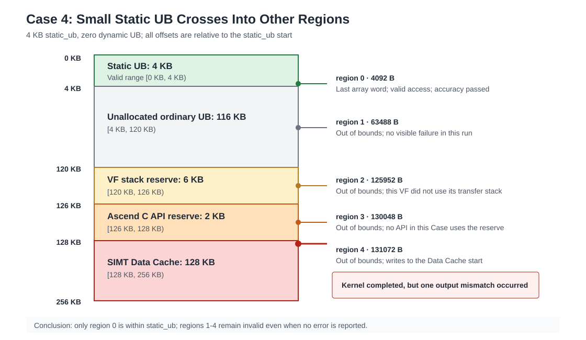

# UB Out-of-Bounds Troubleshooting Sample for SIMD and SIMT Hybrid Programming

## Overview

This sample uses an out-of-bounds UB access in an element-wise operator to demonstrate how to troubleshoot UB access errors in SIMD and SIMT hybrid programming. The Cases cover usable UB capacity under different VF configurations, the layout of static and dynamic UB, and the behavior of out-of-bounds accesses to different UB regions.

Use `SCENARIO_NUM` to select a Case. Each build compiles and runs exactly one Case. The Cases use separate kernels, dynamic UB configurations, output buffers, and runtime states, and therefore do not depend on one another.

## Supported Products and CANN Versions

| Product | CANN Version |
| --- | --- |
| Ascend 950PR/Ascend 950DT | >= CANN 9.2.0 |

## Directory Structure

```text
|-- simd_simt_ub_usage_limit
    |-- CMakeLists.txt         // Example build script
    |-- ub_usage_limit.asc     // Ascend C sample implementation
    |-- figures                // Figures referenced by the README files
    |-- README.md              // Chinese documentation
    `-- README_en.md           // English documentation
```

## Example Description

This sample contains five Cases. Case 0 reproduces an accuracy issue caused by a static UB write into Data Cache. Cases 1 through 3 verify usable UB boundaries under different VF configurations and the layout relationship between static and dynamic UB. Case 4 accesses different UB regions to observe the behavior of out-of-bounds writes.

| Case | Scenario | What It Verifies | Build Option |
| --- | --- | --- | --- |
| Case 0 | Static UB overwrites Data Cache | The write corrupts GM data cached by SIMT and causes an output mismatch | `SCENARIO_NUM=0` |
| Case 1 | Usable UB without a SIMT VF | Comparison among no SIMD VF, default SIMD VF, and disabled VF stack reservation | `SCENARIO_NUM=1` |
| Case 2 | Usable UB with a SIMT VF | The usable UB limit verified with static and dynamic probes | `SCENARIO_NUM=2` |
| Case 3 | UB used by MainScalar, a SIMD VF, and a SIMT VF | Static UB accumulation and dynamic UB start-address relationships | `SCENARIO_NUM=3` |
| Case 4 | Small static UB crosses into other UB regions | Behavior in unallocated UB, the 6 KB VF stack reserve, the 2 KB Ascend C API reserve, and Data Cache | `SCENARIO_NUM=4` |

> **UB out-of-bounds access**
>
> Keeping the total UB allocation within the capacity limit does not make every access valid. A static array can only be accessed within its declared range, and dynamic UB can only be accessed within the size configured at kernel launch. An access beyond those ranges may reach unallocated UB, the VF stack reserve, the Ascend C API reserve, or Data Cache. Such an access may not immediately cause a runtime error, so troubleshoot it by checking address ranges, runtime logs, and output accuracy together.

## Example Implementation

The Cases follow a problem reproduction, boundary verification, layout analysis, and out-of-bounds observation sequence. Case 0 reproduces the issue and verifies its fix. Cases 1 through 4 describe the UB capacity and layout rules required to troubleshoot the issue.

### Case 0: Static UB Overwrites the Data Cache

**Objective**: Reproduce an operator accuracy failure when a static-array access crosses into the SIMT Data Cache, and verify the fix by checking the runtime index.

**Core implementation**:

Case 0 performs an element-wise add-one operation. The kernel uses 216 KB of static UB and zero dynamic UB. The remaining space contains a 6 KB VF stack reserve, a 2 KB Ascend C API reserve, and the minimum 32 KB SIMT Data Cache. The first SIMT VF reads the GM input and populates Data Cache. MainScalar then writes at an offset of 224 KB from the static-array start, crossing the static UB and both reserved regions to reach the first Data Cache word. The second SIMT VF reads the same GM input and computes `output[index] = input[index] + 1`.

In fault mode, the corrupted cached value produces at least one Golden mismatch. The affected index may vary with cache mapping and replacement state, so the sample does not require a fixed mismatch position.

**Execution result**:

```bash
cmake -S . -B build_case0_fault -DCMAKE_ASC_ARCHITECTURES=dav-3510 \
  -DSCENARIO_NUM=0 -DCASE0_ENABLE_FIX=OFF
cmake --build build_case0_fault -j
./build_case0_fault/ub_usage_limit
```

```text
[Case0] mode=fault, static_bytes=221184, dynamic_bytes=0, reserved_bytes=8192, dcache_bytes=32768, faulty_byte_offset=229376
[Case0] mismatch_count=1
[Case0] first_mismatch_index=896, expected=0xc0000381, actual=0xdeadbef0
[Case0] precision_check=FAILED (fault reproduced)
```

Fix mode checks the runtime index before writing the static array and blocks the invalid access:

```bash
cmake -S . -B build_case0_fixed -DCMAKE_ASC_ARCHITECTURES=dav-3510 \
  -DSCENARIO_NUM=0 -DCASE0_ENABLE_FIX=ON
cmake --build build_case0_fixed -j
./build_case0_fixed/ub_usage_limit
```

```text
[Case0] mode=fixed, static_bytes=221184, dynamic_bytes=0, reserved_bytes=8192, dcache_bytes=32768, faulty_byte_offset=229376
[Case0] mismatch_count=0
[Case0] precision_check=PASSED (out-of-bounds write blocked)
```

**Analysis and conclusion**:

This Case demonstrates that a UB out-of-bounds access can corrupt SIMT Data Cache without causing a kernel launch or runtime error. Troubleshooting and fixing the issue requires validating each actual access index, not only the total UB allocation.

## UB Boundary and Layout Analysis

### Case 1: Usable UB Capacity Without a SIMT VF

**Objective**: Determine how a SIMD VF and the VF stack-reservation compiler option affect usable UB capacity when no SIMT VF is present.

**Core implementation**:

Case 1 compares three compile-time configurations: no SIMD VF call, a SIMD VF call with default compilation, and a SIMD VF call with the VF stack reservation disabled. A static array serves as the capacity probe. Its size is adjusted until the listed value runs successfully and adding 4 bytes causes kernel launch to fail. The static array is only a measurement tool; the result is the usable UB capacity for each VF configuration.

The probe size, the presence of the SIMD VF call, and the compiler option are compile-time choices, so each comparison requires a separate build with `SCENARIO_NUM=1`.

The kernel declares a configurable static UB array and a 32-byte result array. `UB_BOUNDARY_STATIC_BYTES` must be a multiple of four bytes.

Without a SIMD VF:

```bash
cmake -S . -B build_boundary_no_vf \
  -DCMAKE_ASC_ARCHITECTURES=dav-3510 \
  -DSCENARIO_NUM=1 \
  -DUB_BOUNDARY_NO_SIMD_VF=ON \
  -DUB_BOUNDARY_STATIC_BYTES=262112
cmake --build build_boundary_no_vf -j
./build_boundary_no_vf/ub_usage_limit
```

With a SIMD VF and default compilation:

```bash
cmake -S . -B build_boundary_simd \
  -DCMAKE_ASC_ARCHITECTURES=dav-3510 \
  -DSCENARIO_NUM=1 \
  -DUB_BOUNDARY_STATIC_BYTES=253920
cmake --build build_boundary_simd -j
./build_boundary_simd/ub_usage_limit
```

With a SIMD VF and the reservation disabled:

```bash
cmake -S . -B build_boundary_flag \
  -DCMAKE_ASC_ARCHITECTURES=dav-3510 \
  -DSCENARIO_NUM=1 \
  -DUB_BOUNDARY_DISABLE_RESERVED=ON \
  -DUB_BOUNDARY_STATIC_BYTES=260064
cmake --build build_boundary_flag -j
./build_boundary_flag/ub_usage_limit
```

**Execution result**:

Results on a real `dav-3510` NPU with CANN 9.2.0:

The table lists both the largest `static_ub` size that runs successfully for each configuration and the failure observed after adding one `uint32_t` (4 B):

| Configuration | `static_ub` Size | Result |
| --- | ---: | --- |
| No SIMD VF | 262112 B | Passed; 256 KB including the 32-byte result array |
| No SIMD VF | 262116 B | Kernel launch failed |
| SIMD VF, default | 253920 B | Passed |
| SIMD VF, default | 253924 B | Kernel launch failed |
| SIMD VF, reservation disabled | 260064 B | Passed |
| SIMD VF, reservation disabled | 260068 B | Kernel launch failed |

These results establish the usable limit of the `static_ub` array in the current kernel layout. `static_ub` is not the only static UB object in the kernel: the fixed 32-byte result array is also static UB and must be included in the total static UB usage. Each row therefore follows `total static UB = usable static_ub limit + 32-byte result array`:

| Configuration | `static_ub` Probe Limit | Total Usable UB Including the 32-byte Result Array |
| --- | --- | --- |
| No SIMD VF | 262112 B | 262144 B (256 KB) |
| SIMD VF, default | 253920 B | 253952 B (248 KB) |
| SIMD VF, reservation disabled | 260064 B | 260096 B |

All three upper limits were verified at four-byte granularity: the listed value passed and adding four bytes failed. This Case uses a static array to probe the boundary; it does not compare static and dynamic UB capacity.

Key output from the three passing configurations:

```text
# No SIMD VF, 262112-byte static array
[Case1] mode=without SIMD VF, static_bytes=262112
[Case1] launch_ret=0, sync_ret=0, result=PASSED

# SIMD VF with default compilation, 253920-byte static array
[Case1] mode=with SIMD VF, static_bytes=253920
[Case1] launch_ret=0, sync_ret=0, result=PASSED

# SIMD VF with the reservation disabled, 260064-byte static array
[Case1] mode=with SIMD VF, static_bytes=260064
[Case1] launch_ret=0, sync_ret=0, result=PASSED
```

Key output when the corresponding boundaries are exceeded:

```text
# No SIMD VF, 262116-byte static array
[Case1] mode=without SIMD VF, static_bytes=262116
[Case1] launch_ret=107000, sync_ret=107000, result=FAILED

# SIMD VF with default compilation, 253924-byte static array
[Case1] mode=with SIMD VF, static_bytes=253924
[Case1] launch_ret=107000, sync_ret=107000, result=FAILED

# SIMD VF with the reservation disabled, 260068-byte static array
[Case1] mode=with SIMD VF, static_bytes=260068
[Case1] launch_ret=107000, sync_ret=107000, result=FAILED
```

**Analysis and conclusion**:

With a SIMD VF, 8 KB is unavailable as ordinary user UB by default: 6 KB is reserved for the VF stack and 2 KB for Ascend C APIs. `--cce-disable-vf-stack-reserved-ubuf` disables only the 6 KB VF stack reservation; it does not release the 2 KB Ascend C API reserve. The option changes the usable boundary, but it does not imply that a kernel calling a SIMD VF can use the entire 256 KB. Compiler-generated UB usage and the VF implementation still matter. When the VF stack reservation is disabled, confirm that the VF does not depend on that region for function-call transfer data or register spills.

### Case 2: Usable UB Capacity with a SIMT VF

**Objective**: Verify the usable UB limit of the current kernel with both static and dynamic probes when a SIMT VF is present.

**Core implementation**:

Case 2 verifies usable UB capacity when a SIMT VF is present. The kernel has a fixed 32-byte result array, so the capacity-probe limit is `216 KB - 32 B = 221152 B`. `CASE2_UB_BYTES` controls the probe size, while `CASE2_USE_STATIC_UB` selects a static or dynamic declaration. SIMT threads fill the complete probe region, and the Host verifies its first and last words.

Dynamic probe:

```bash
cmake -S . -B build_case2_dynamic -DCMAKE_ASC_ARCHITECTURES=dav-3510 \
  -DSCENARIO_NUM=2 -DCASE2_UB_BYTES=221152 -DCASE2_USE_STATIC_UB=OFF
cmake --build build_case2_dynamic -j
./build_case2_dynamic/ub_usage_limit
```

Static probe:

```bash
cmake -S . -B build_case2_static -DCMAKE_ASC_ARCHITECTURES=dav-3510 \
  -DSCENARIO_NUM=2 -DCASE2_UB_BYTES=221152 -DCASE2_USE_STATIC_UB=ON
cmake --build build_case2_static -j
./build_case2_static/ub_usage_limit
```

**Execution result**:

Both probe modes pass at 221152 bytes:

```text
[Case2] ub_type=dynamic, max_ub_bytes=221152, configured_ub_bytes=221152
Case 2 (SIMT VF usable UB): PASSED

[Case2] ub_type=static, max_ub_bytes=221152, configured_ub_bytes=221152
Case 2 (SIMT VF usable UB): PASSED
```

Adding one `uint32_t` element increases the probe size to 221156 bytes and causes kernel launch to fail in both modes:

```text
[Case2] ub_type=dynamic, max_ub_bytes=221152, configured_ub_bytes=221156
[ERROR] [Bisheng] Launch kernel failure! ret 107000
Case 2 (SIMT VF usable UB): FAILED

[Case2] ub_type=static, max_ub_bytes=221152, configured_ub_bytes=221156
[ERROR] [Bisheng] Launch kernel failure! ret 107000
Case 2 (SIMT VF usable UB): FAILED
```

**Conclusion**: The measured usable UB capacity is 216 KB. After subtracting the fixed 32-byte result array, both static and dynamic probes have a 221152-byte limit.

### Case 3: Shared Static and Dynamic UB Capacity

**Objective**: Verify that static UB declarations in MainScalar, a SIMD VF, and a SIMT VF accumulate, while the three dynamic UB declarations refer to one region configured at kernel launch.

**Core implementation**:

Case 3 declares static UB separately in MainScalar, a SIMD VF, and a SIMT VF. MainScalar uses a 1 KB `main_static_ub` array and three 32-byte result arrays named `simt_result`, `simd_result`, and `result`, for a total of 1120 bytes. The SIMD VF declares 2 KB and the SIMT VF declares 4 KB. Static UB declarations at different execution positions occupy separate space and accumulate in the current kernel. Each position accesses the end of its static array so that the compiler cannot eliminate the declared storage. In the SIMT VF, the thread responsible for the last element reads and reports that value itself, avoiding an unsynchronized cross-thread dependency. The total is 7264 bytes, giving a calculated dynamic limit of `216 KB - 7264 B = 213920 B`.

Dynamic UB is different: `CASE3_DYNAMIC_BYTES` configures its size once when the kernel is launched. MainScalar, the SIMD VF, and the SIMT VF each declare an external dynamic UB array with a different name at their respective code locations: `main_dynamic_ub`, `simd_dynamic_ub`, and `simt_dynamic_ub`. Each context converts its array start address to an integer and returns it through the result area; the Host prints and compares the three values directly. The sample also writes `0xC0030001`, `0xC0030002`, and `0xC0030003` in sequence through element 0 and checks the last configured element from all three contexts, verifying cross-context data access and the complete configured range. The printed values belong to the AICore UB address space and are used only for equality comparison.

Case 3 therefore verifies two rules: static UB from different execution positions must be accumulated, while dynamic UB arrays declared separately in MainScalar, a SIMD VF, and a SIMT VF have the same starting address and correspond to the same dynamic UB region configured at kernel launch.

**Execution result**:

The calculated limit passes:

```text
[Case3] static_total_bytes=7264, max_dynamic_bytes=213920, configured_dynamic_bytes=213920
[Case3] main_dynamic_ub=0x1c60, simd_dynamic_ub=0x1c60, simt_dynamic_ub=0x1c60
Case 3 usage: static_total_bytes=7264, dynamic_bytes=213920, same_start_address=YES
Case 3 (mixed UB): PASSED
```

Adding one `uint32_t` element increases the dynamic UB size to 213924 bytes and causes kernel launch to fail:

```text
[Case3] static_total_bytes=7264, max_dynamic_bytes=213920, configured_dynamic_bytes=213924
[ERROR] [Bisheng] Launch kernel failure! ret 107000
Case 3 (mixed UB): FAILED
```

**Conclusion**: After subtracting 7264 bytes of static UB, the measured dynamic UB upper limit is 213920 bytes. The three dynamic arrays have different names but the same start address and share the region configured by the Host at kernel launch.

### Case 4: Small Static UB Crosses Into Different UB Regions

**Objective**: Starting from a 4 KB static UB array, access its valid range, unallocated UB, the 6 KB VF stack reserve, the 2 KB Ascend C API reserve, and Data Cache, then compare runtime and accuracy behavior.

**Core implementation**:

Case 4 declares only 4 KB of static UB and configures zero dynamic UB. Because user UB usage is small, Data Cache reaches its 128 KB maximum and occupies the high-address half of UB. According to the [3510 architecture specification](../../../../docs/zh/guide/编程指南/高级编程/硬件实现/架构规格/NPU架构版本3510.md#compile-options-description) and [SIMT memory hierarchy](../../../../docs/zh/guide/编程指南/编程模型/AI-Core-SIMT编程/内存层级.md), the 8 KB reserved region consists of a 6 KB VF stack reserve and a 2 KB Ascend C API reserve immediately before Data Cache. The resulting layout is:

```text
Data Cache size = min(256 KB - 4 KB - 0 KB - 8 KB, 128 KB) = 128 KB
Data Cache start = 256 KB - 128 KB = 128 KB
Reserved-region start = 128 KB - 8 KB = 120 KB
Unallocated UB size = 120 KB - 4 KB = 116 KB
```



Only the first 4 KB is a valid range for the static array. `CASE4_ACCESS_REGION` selects one runtime access position at compile time:

| Value | Target Region | Offset From the Static Array Start |
| ---: | --- | ---: |
| `0` | Last `uint32_t` element inside static UB | 4092 B |
| `1` | Middle of unallocated ordinary UB | 63488 B |
| `2` | Middle of the 6 KB VF stack reserve | 125952 B |
| `3` | Middle of the 2 KB Ascend C API reserve | 130048 B |
| `4` | Start of Data Cache | 131072 B |

The kernel first calls a SIMT VF to read GM input and write element-wise add-one output, populating Data Cache. MainScalar then performs the selected write through the start of the 4 KB static array and a runtime index. The same SIMT VF reads GM and computes again, and the Host compares the second output with Golden data to observe both runtime errors and cache corruption:

```cpp
__ubuf__ uint32_t static_ub[1024];
__ubuf__ volatile uint32_t* static_data = static_ub;
static_data[access_index] = 0xDEADBEEF;
```

For example, build the Data Cache target with:

```bash
cmake -S . -B build_case4_dcache -DCMAKE_ASC_ARCHITECTURES=dav-3510 \
  -DSCENARIO_NUM=4 -DCASE4_ACCESS_REGION=4
cmake --build build_case4_dcache -j
./build_case4_dcache/ub_usage_limit
```

**Execution result**:

Results on a real `dav-3510` NPU with CANN 9.2.0:

| Target Region | Launch/Sync | Accuracy | Observation |
| --- | --- | --- | --- |
| Valid static UB | Succeeded | Passed | Valid access |
| Unallocated ordinary UB | Succeeded | Passed | Out of bounds, but no visible failure in this run |
| 6 KB VF stack reserve | Succeeded | Passed | The simple VF did not use the transfer stack, so no visible failure occurred |
| 2 KB Ascend C API reserve | Succeeded | Passed | This Case calls no API that uses the reserve, so no visible failure occurred |
| Data Cache | Succeeded | Failed with one mismatch | Cached data was corrupted without a runtime error |

Key output from all five targets follows. `launch_ret=0` and `sync_ret=0` mean that neither launch nor synchronization reported an error; `precision_check` only reports whether output matches the Golden data:

```text
# Valid static UB
[Case4] region=static_ub, static_bytes=4096, dynamic_bytes=0, access_offset_bytes=4092
[Case4] mismatch_count=0
[Case4] precision_check=PASSED
[Case4] launch_ret=0, sync_ret=0, observation=COMPLETED

# Unallocated ordinary UB
[Case4] region=unallocated_ub, static_bytes=4096, dynamic_bytes=0, access_offset_bytes=63488
[Case4] mismatch_count=0
[Case4] precision_check=PASSED
[Case4] launch_ret=0, sync_ret=0, observation=COMPLETED

# 6 KB VF stack reserve
[Case4] region=vf_stack_6kb, static_bytes=4096, dynamic_bytes=0, access_offset_bytes=125952
[Case4] mismatch_count=0
[Case4] precision_check=PASSED
[Case4] launch_ret=0, sync_ret=0, observation=COMPLETED

# 2 KB Ascend C API reserve
[Case4] region=asc_reserved_2kb, static_bytes=4096, dynamic_bytes=0, access_offset_bytes=130048
[Case4] mismatch_count=0
[Case4] precision_check=PASSED
[Case4] launch_ret=0, sync_ret=0, observation=COMPLETED

# Data Cache
[Case4] region=data_cache, static_bytes=4096, dynamic_bytes=0, access_offset_bytes=131072
[Case4] mismatch_count=1
[Case4] first_mismatch_index=896, expected=0xc0040381, actual=0xdeadbef0
[Case4] precision_check=FAILED
[Case4] launch_ret=0, sync_ret=0, observation=COMPLETED
```

**Analysis and conclusion**:

Passing the accuracy check does not make the unallocated or reserved ranges valid to access. Whether an invalid write causes a visible failure depends on whether the target currently holds live data. The 6 KB region may hold VF function-call transfer or register-spill data, the 2 KB region may be used by certain Ascend C APIs, and Data Cache holds cached GM data. An access outside the declared static array remains invalid even when the kernel completes and the current accuracy check passes. In Case 4, only `CASE4_ACCESS_REGION=0` is valid; values `1` through `4` all cause actual static-array out-of-bounds accesses.

## Capacity Rules

With a SIMT VF in the default compilation mode, the 256 KB UB contains static memory, dynamic memory, an 8 KB reserved region, and Data Cache. The reserved region must be split into a 6 KB VF stack reserve and a 2 KB Ascend C API reserve; they have different purposes and neither is ordinary user-accessible UB:

```text
Data Cache = min(256 KB - static UB - dynamic UB - 8 KB, 128 KB)
8 KB reserved = 6 KB VF stack reserve + 2 KB Ascend C API reserve
static UB + dynamic UB <= 216 KB
actual dynamic UB access range <= configured dynamic UB size
```

The static total includes declarations in MainScalar, SIMD VFs, and SIMT VFs. Both the total capacity rule and the direct dynamic access boundary must hold.

## Build and Run

```bash
source ${install_path}/cann/set_env.sh
cmake -S . -B build -DCMAKE_ASC_ARCHITECTURES=dav-3510 -DSCENARIO_NUM=<0-4>
cmake --build build -j
./build/ub_usage_limit
```

`${install_path}` is the CANN development kit installation directory. This sample requires CANN 9.2.0 or later and supports only the `dav-3510` architecture.

For example, with `SCENARIO_NUM=3`, the expected output is:

```text
[Case3] static_total_bytes=7264, max_dynamic_bytes=213920, configured_dynamic_bytes=213920
[Case3] main_dynamic_ub=0x1c60, simd_dynamic_ub=0x1c60, simt_dynamic_ub=0x1c60
Case 3 usage: static_total_bytes=7264, dynamic_bytes=213920, same_start_address=YES
Case 3 (mixed UB): PASSED
```

Case-specific build options:

| Option | Default | Description |
| --- | --- | --- |
| `CASE0_ENABLE_FIX` | `OFF` | Enables the Case 0 runtime index check that blocks writes outside static UB |
| `UB_BOUNDARY_STATIC_BYTES` | `253920` | Static UB array size for Case 1, in bytes |
| `UB_BOUNDARY_NO_SIMD_VF` | `OFF` | Uses MainScalar instead of a SIMD VF to fill static UB |
| `UB_BOUNDARY_DISABLE_RESERVED` | `OFF` | Passes `--cce-disable-vf-stack-reserved-ubuf` |
| `CASE2_UB_BYTES` | `221152` | Static or dynamic capacity-probe size for Case 2, in bytes |
| `CASE2_USE_STATIC_UB` | `OFF` | Uses a static probe when `ON` and a dynamic probe when `OFF` |
| `CASE3_DYNAMIC_BYTES` | `213920` | Dynamic UB size configured and accessed by Case 3, in bytes |
| `CASE4_ACCESS_REGION` | `0` | Case 4 target: `0` static UB, `1` unallocated UB, `2` 6 KB VF stack reserve, `3` 2 KB Ascend C reserve, or `4` Data Cache |

General build option:

| Option | Default | Description |
| --- | --- | --- |
| `CMAKE_ASC_ARCHITECTURES` | `dav-3510` | NPU architecture for Ascend 950PR/Ascend 950DT |
| `SCENARIO_NUM` | `1` | Case number to compile and run; valid values are `0`, `1`, `2`, `3`, and `4` |

## Troubleshooting Procedure

1. Count every static UB declaration in MainScalar, SIMD VFs, and SIMT VFs, and identify the dynamic UB size configured at kernel launch.
2. When a SIMT VF is present, calculate Data Cache size as `min(256 KB - static UB - dynamic UB - 8 KB, 128 KB)`, then derive its start from the high-address end of UB.
3. Below the Data Cache, identify the 2 KB Ascend C API reserve followed by the 6 KB VF stack reserve; divide the remaining low-address range into allocated user UB and unallocated ordinary UB.
4. Calculate the actual access range from each static or dynamic UB pointer offset and maximum index, then classify each address as user UB, unallocated UB, VF stack reserve, Ascend C API reserve, or Data Cache.
5. Only an access within its declared or configured user-UB range is valid. Any access into unallocated UB, either reserve, or Data Cache is out of bounds.
6. Check both `aclrtGetLastError` after launch and `aclrtSynchronizeStream`.
7. Fix every access outside the configured range even when no runtime error is reported or the current accuracy check passes.
