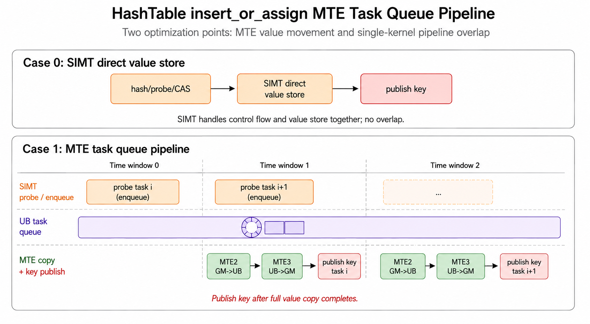
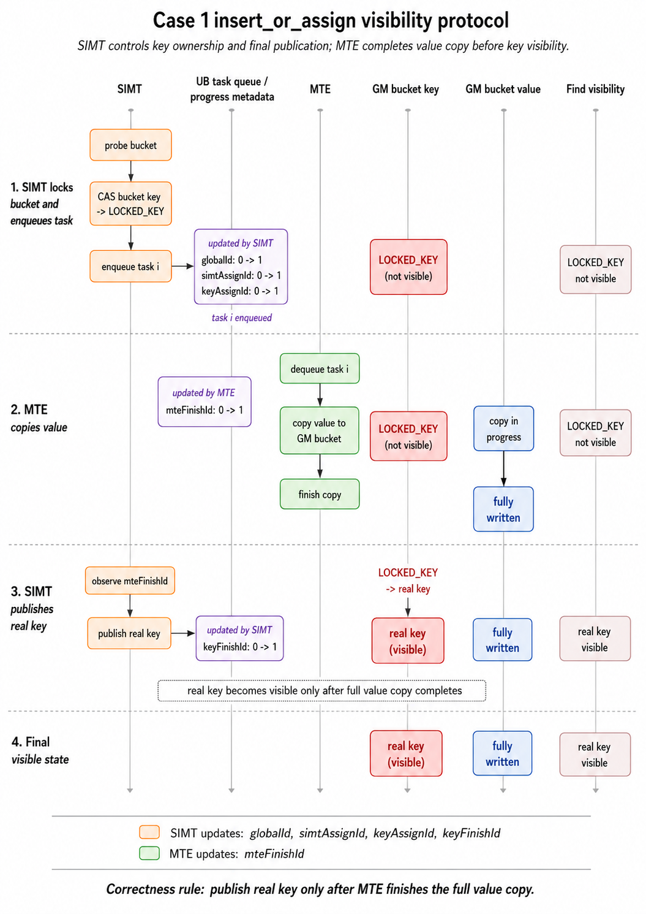

# SIMD与SIMT混合编程HashTable MTE队列优化样例

## 概述

本样例比较HashTable `insert_or_assign` 的两种value写入路径：SIMT warp直接写value，以及单kernel内使用MTE任务队列写value。样例实现一个固定容量、教学用途的C++风格HashTable，只保留本次对比需要的语义和数据结构。

**优化路径**：

| Case | SCENARIO_NUM | 实现方式 | 说明 |
|:---|:---:|:---|:---|
| Case 0 | 0 | SIMT warp直接写value | 一个warp完成hash/probe/CAS后，由warp内线程分片写入一条value向量，作为对照实现。 |
| Case 1 | 1 | MTETaskQueue搬运value | 单kernel内使用task-id ring queue，SIMT持续生产UB任务，MTE按任务批量搬运value，并与后续SIMT探测形成流水。 |

两种Case的数据处理流水如下图。



## 本样例支持的产品及CANN软件版本

| 产品 | CANN软件版本 |
|------|-------------|
| Ascend 950PR/Ascend 950DT | > CANN 9.0.0 |

## 目录结构介绍

```
├── simd_simt_hash_table_mte_queue
│   ├── CMakeLists.txt                // 编译工程文件
│   ├── figures
│   │   └── hash_table_mte_pipeline.png // 两种Case的数据处理流水图
│   ├── hash_table_mte_queue.asc  // Ascend C样例实现
│   ├── README.md                     // 样例说明文档
│   └── scripts
│       └── run.sh                    // 编译并使用msprof op采集两种Case性能数据
```

## 样例描述

**样例功能**：

样例实现一个固定容量HashTable，支持 `insert_or_assign` 语义：key已存在时更新value，key不存在时插入key/value。Hash冲突通过线性探测处理，bucket中保存key；每个bucket对应一条长度为 `dim` 的value向量，所有value按 `[bucket_count, dim]` 的二维布局连续存放，其中 `dim` 为运行时参数。

本样例仅覆盖与本次优化直接相关的路径，不包含score、evict、digest、动态容量管理等扩展能力。

bucket的key字段同时承载占用信息：

| key字段取值 | 含义 |
|:---|:---|
| `EMPTY_KEY` | 空bucket，可以被插入流程CAS锁定。 |
| `LOCKED_KEY` | bucket正在插入或更新，其他线程需要等待key发布后重新判断。 |
| 真实key | bucket已发布，对find可见。 |

插入或更新过程中，kernel先将目标bucket的key从 `EMPTY_KEY` 或真实key CAS为 `LOCKED_KEY`，再写入value，最后发布真实key。find只匹配真实key，因此不会观察到“key已经可见但value尚未写完”的中间结果。

HashTable插入流程如下：

$$
bucket = hash(key) \& (capacity - 1)
$$

$$
bucket = (bucket + 1) \& (capacity - 1), \quad \text{when collision occurs}
$$

**样例规格**：

<table>
<tr><td rowspan="1" align="center">样例类型(OpType)</td><td colspan="4" align="center">HashTable insert_or_assign</td></tr>
<tr><td rowspan="3" align="center">样例输入</td><td align="center">name</td><td align="center">shape</td><td align="center">data type</td><td align="center">format</td></tr>
<tr><td align="center">keys</td><td align="center">[128 * 1024]</td><td align="center">int64</td><td align="center">ND</td></tr>
<tr><td align="center">values</td><td align="center">[128 * 1024, dim]</td><td align="center">float32</td><td align="center">ND</td></tr>
<tr><td rowspan="2" align="center">样例输出</td><td align="center">table keys</td><td align="center">[256 * 1024]</td><td align="center">int64</td><td align="center">ND</td></tr>
<tr><td align="center">table values</td><td align="center">[256 * 1024, dim]</td><td align="center">float32</td><td align="center">ND</td></tr>
<tr><td rowspan="2" align="center">核函数名</td><td align="center">SCENARIO_NUM=0</td><td colspan="3" align="center"><code>insert_or_assign_warp_store_kernel</code></td></tr>
<tr><td align="center">SCENARIO_NUM=1</td><td colspan="3" align="center"><code>insert_or_assign_mte_task_queue_kernel</code></td></tr>
</table>

样例参数如下：

| 参数 | 值 |
|:---|---:|
| `HASH_TABLE_CAPACITY` | 256 * 1024 |
| `KEY_NUM` | 128 * 1024 |
| 负载因子 | 0.5 |
| `TEST_DIMS` | 16, 32, 64, 128, 256 |
| `BLOCK_DIM` | 64 |
| `THREAD_COUNT` | 512 |
| `WARP_SIZE` | 32 |
| `PROFILE_REPEAT_TIMES` | 默认30，`run.sh`采集性能时设置为1 |

## 样例实现

性能对比以 `msprof op` 输出的 `Task Duration(μs)` 为准。

### Case 0：SIMT warp直接写value

**实现方式**：参考 `insert_or_assign_warp_store_vf()` 函数实现。

该实现中，每个warp处理一条key。lane 0执行hash、线性探测和CAS锁定bucket，warp内线程通过 `asc_shfl` 获取目标bucket index，并按 `WARP_SIZE` 分片写入value向量。value搬运由SIMT线程直接访问GM完成。

写入顺序为：CAS锁定目标bucket，warp内线程写value，执行 `asc_threadfence()`，最后由lane 0发布真实key。

**关键代码**：

```cpp
__simt_vf__ inline void insert_or_assign_warp_store_vf(__gm__ Bucket* table,
    __gm__ float* tableValues, __gm__ const int64_t* keys, __gm__ const float* values, uint32_t keyNum,
    uint32_t capacity, uint32_t dim, uint32_t blockIndex, uint32_t blockNum)
{
    const uint32_t laneId = static_cast<uint32_t>(threadIdx.x) % WARP_SIZE;
    ...
    if (laneId == 0) {
        int64_t oldKey = asc_atomic_cas(keyAddr, EMPTY_KEY, LOCKED_KEY);
        if (oldKey == LOCKED_KEY) {
            oldKey = wait_until_unlocked(keyAddr);
        }
        ...
    }
    ...
    for (uint32_t j = laneId; j < dim; j += WARP_SIZE) {
        tableValues[dstBase + j] = values[srcBase + j];
    }
    asc_threadfence();
    if (laneId == 0) {
        (void)asc_atomic_exch(&table[bucketIdx].key, key);
    }
}
```

**性能数据**：

| Case | 实现方式 | dim | 核数 | Task Duration(μs) |
|:---|:---|---:|:---:|---:|
| 0 | SIMT warp直接写value | 16 | 64 | 218.724 |
| 0 | SIMT warp直接写value | 32 | 64 | 209.406 |
| 0 | SIMT warp直接写value | 64 | 64 | 259.107 |
| 0 | SIMT warp直接写value | 128 | 64 | 364.805 |
| 0 | SIMT warp直接写value | 256 | 64 | 555.497 |

**性能数据分析**：

- 随着 `dim` 增大，SIMT线程逐元素写value的耗时明显上升。`dim=256` 时，value搬运已经成为该路径的主要开销。

**原理说明**：

HashTable插入包含hash、线性探测、CAS和冲突处理等离散控制流，适合用SIMT实现。value向量是连续内存，SIMT线程逐元素访问GM时，通常不如MTE连续搬运高效。

**优化方向**：

Case 0中，控制流和值写入均由同一组SIMT线程完成。Case 1将value写入阶段切换为MTE执行，并在单kernel内与SIMT探测并行推进。

### Case 1：MTETaskQueue搬运value

**实现方式**：参考 `MTETaskQueue` 和 `insert_or_assign_mte_task_queue_kernel()` 函数实现。

该实现仍由SIMT线程执行hash/probe/CAS，但不再把完整任务列表写入GM。每个Vector Core维护一个UB task-id ring queue，SIMT producer把成功锁定的任务写入ring，任务中记录输入value源地址、HashTable value目的地址、待发布key和key地址；MTE consumer按ring中的任务批量搬运value，value写完后由SIMT drain路径发布真实key。`globalId`、`simtAssignId`、`mteFinishId`、`keyAssignId` 和 `keyFinishId` 分别跟踪任务分配、MTE可见范围、value搬运完成进度、key发布认领范围和最终发布进度。bucket key在value写完前保持 `LOCKED_KEY`，真实key只在完整value向量写回GM后发布。

下图给出Case 1中单个任务的可见性时序。`globalId`、`simtAssignId`、`keyAssignId` 和 `keyFinishId` 由SIMT路径推进，`mteFinishId` 由MTE路径推进。



**关键代码**：

```cpp
class MTETaskQueue {
public:
    __simt_callee__ inline void AssignWarpTask(
        uint64_t srcAddr, uint64_t dstAddr, int64_t key, uint64_t keyAddr, bool needAssign)
    {
        uint32_t writeMask = asc_ballot(needAssign ? 1 : 0);
        uint32_t warpWriteCount = __popc(writeMask);
        uint32_t taskStartId = (laneid() == 0) ? ApplyId(warpWriteCount) : 0;
        taskStartId = asc_shfl(taskStartId, 0);
        Drain(taskStartId + warpWriteCount);
        if (needAssign) {
            uint32_t laneOffset = __popc(writeMask & lanemask_lt());
            FillTaskInfo(taskStartId + laneOffset, srcAddr, dstAddr, key, keyAddr);
        }
        asc_threadfence();
        if (laneid() == 0) {
            AssignTask(taskStartId, taskStartId + warpWriteCount);
        }
    }

    __aicore__ inline void RunTask() const
    {
        while (true) {
            uint32_t simtAssignId = *reinterpret_cast<__ubuf__ volatile uint32_t*>(simtAssignId_);
            uint32_t procCount = min(maxProcBatch, simtAssignId - mteFinishId);
            ...
            asc_copy_gm2ub_align(valueLocal_, srcAddr, 1, valueBytes, 0, 0, true, valuesCacheMode_, 0, 0);
            asc_sync_notify(PIPE_MTE2, PIPE_MTE3, EVENT_ID0);
            asc_sync_wait(PIPE_MTE2, PIPE_MTE3, EVENT_ID0);
            asc_copy_ub2gm_align(dstAddr, valueLocal_, 1, valueBytes, tableValuesCacheMode, 0, 0);
            asc_sync_notify(PIPE_MTE3, PIPE_S, EVENT_ID0);
            asc_sync_wait(PIPE_MTE3, PIPE_S, EVENT_ID0);
            *reinterpret_cast<__ubuf__ volatile uint32_t*>(mteFinishId_) = mteFinishId + procCount;
        }
    }
};
```

**性能数据**：

| Case | 实现方式 | dim | 核数 | Task Duration(μs) |
|:---|:---|---:|:---:|---:|
| 1 | MTETaskQueue搬运value | 16 | 64 | 129.149 |
| 1 | MTETaskQueue搬运value | 32 | 64 | 112.526 |
| 1 | MTETaskQueue搬运value | 64 | 64 | 111.761 |
| 1 | MTETaskQueue搬运value | 128 | 64 | 130.760 |
| 1 | MTETaskQueue搬运value | 256 | 64 | 201.567 |

**性能数据分析**：

- Case 1把长value搬运从SIMT线程中拆出，在单kernel内由SIMT producer和MTE consumer并行推进。
- 相比Case 0，Case 1在五组dim上均取得加速；`dim=128` 时加速比最高，约2.79x。

## 性能对比总结

### Ascend 950PR性能对比

各dim配置下的性能数据如下：

| dim | Case 0 SIMT warp直接写value(μs) | Case 1 MTETaskQueue(μs) | Case 1加速比 |
|---:|---:|---:|---:|
| 16 | 218.724 | 129.149 | 1.69x |
| 32 | 209.406 | 112.526 | 1.86x |
| 64 | 259.107 | 111.761 | 2.32x |
| 128 | 364.805 | 130.760 | 2.79x |
| 256 | 555.497 | 201.567 | 2.76x |

### 优化要点总结

| 优化手段 | 核心原理 | 样例体现 |
|:---|:---|:---|
| 用MTE替代SIMT逐元素写value | 把长value向量的写入从SIMT线程中拆出，改为MTE执行GM->UB->GM批量搬运，减少SIMT线程直接访问GM的开销 | Case 0由warp线程分片写value，Case 1改为MTE消费任务并完成value搬运 |
| 单kernel任务队列流水化 | 在单kernel内用UB task-id ring queue连接SIMT探测和MTE搬运，让后续key的探测与前序value的搬运并行推进 | Case 1使用 `MTETaskQueue` 组织producer/consumer流水，在同一kernel内重叠SIMT探测与MTE搬运 |

---

## 编译运行

在本样例根目录下执行如下步骤，编译并执行样例。

- 切换Case

  在cmake编译时通过 `-DSCENARIO_NUM=N` 指定要编译的Case，各Case说明：
  - `0`: SIMT warp直接写value
  - `1`: MTETaskQueue搬运value

  示例：
  ```bash
  cmake .. -DCMAKE_ASC_ARCHITECTURES=dav-3510 -DSCENARIO_NUM=1
  ```

- 配置环境变量

  请根据当前环境上CANN开发套件包的[安装方式](../../../../../docs/quick_start.md#prepare&install)，配置环境变量。
  ```bash
  source ${install_path}/cann/set_env.sh
  ```

  > **说明：** `${install_path}` 为CANN包安装目录，未指定安装目录时默认安装至 `/usr/local/Ascend` 下。

- 样例执行

  在样例目录下执行如下命令。
  ```bash
  SCENARIO_NUM=1                                                       # 选择执行场景
  mkdir -p build && cd build;                                          # 创建并进入 build 目录
  cmake -DSCENARIO_NUM=$SCENARIO_NUM -DCMAKE_ASC_ARCHITECTURES=dav-3510 ..;make -j;  # 编译工程
  ./hash_table_mte_queue 128                                      # 执行单组dim并验证结果
  ```

  也可以直接运行对比脚本，编译两种Case并采集 `16/32/64/128/256` 五组dim的性能数据。
  ```bash
  ./scripts/run.sh
  ```

- 编译选项说明

  | 选项 | 可选值 | 说明 |
  |:---|:---|:---|
  | `CMAKE_ASC_ARCHITECTURES` | `dav-3510` | NPU架构，对应 Ascend 950PR/Ascend 950DT |
  | `SCENARIO_NUM` | `0`、`1` | Case编号：0=SIMT warp直接写value，1=MTETaskQueue搬运value |
  | `PROFILE_REPEAT_TIMES` | 正整数 | 单次进程中重复执行 `insert_or_assign` 的次数。对比脚本设置为1，使 `msprof op` 采集一次完整insert路径。 |

- 执行结果

  执行结果如下，表示HashTable插入结果和值校验通过。
  ```bash
  Verification PASSED
  ```

### 性能分析

使用 `msprof op` 获取性能数据。对比脚本会先执行一次样例并检查 `Verification PASSED`，确认结果正确后再使用 `msprof op --kill=on` 采集目标kernel，避免profiler采集结束后的状态影响结果校验。

Case 0测试方式如下：

```bash
cmake -DSCENARIO_NUM=0 -DPROFILE_REPEAT_TIMES=1 -DCMAKE_ASC_ARCHITECTURES=dav-3510 ..
make -j
./hash_table_mte_queue 128
msprof op --warm-up=0 --kill=on ./hash_table_mte_queue 128
```

Case 1测试方式如下：

```bash
cmake -DSCENARIO_NUM=1 -DPROFILE_REPEAT_TIMES=1 -DCMAKE_ASC_ARCHITECTURES=dav-3510 ..
make -j
./hash_table_mte_queue 128
msprof op --warm-up=0 --kill=on ./hash_table_mte_queue 128
```

当前目录下会生成 `OPPROF_` 前缀的文件夹，保存当前kernel的性能分析数据。

```bash
OPPROF_xxxx_XXXXXXXX
├── ArithmeticUtilization.csv
├── L2Cache.csv
├── Memory.csv
├── MemoryL0.csv
├── MemoryUB.csv
├── OpBasicInfo.csv
├── PipeUtilization.csv
└── ResourceConflictRatio.csv
```

查看具体的性能分析结果：
```bash
# 查看Task Duration等基础信息
cat ./OPPROF_*/OpBasicInfo.csv

# 查看Vector/MTE等流水耗时和占比
cat ./OPPROF_*/PipeUtilization.csv
```
