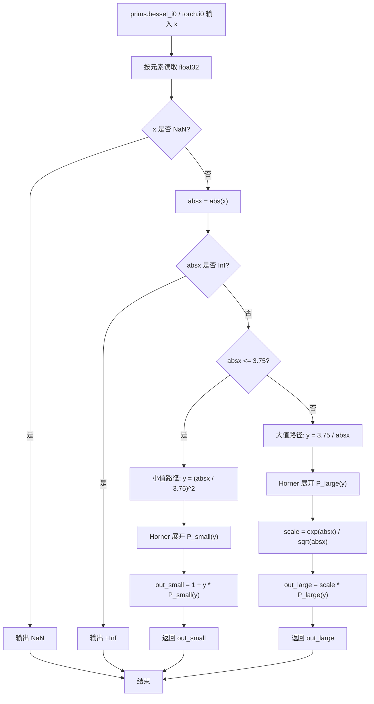
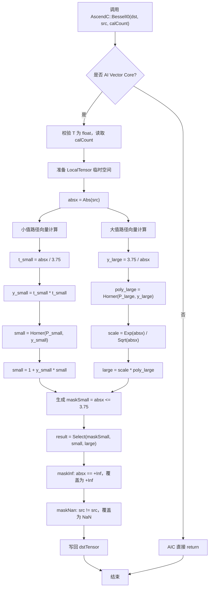
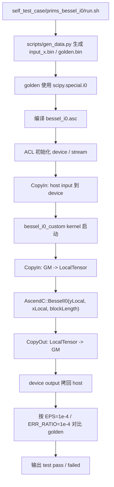

# prims.bessel_i0 API 开发方案

## 需求背景

### 需求来源

- 社区任务文档：`04_tasks\01_community-task-2026\docs\202607\prims_bessel_i0_task_doc.md`
- 自验证样例：`04_tasks\01_community-task-2026\docs\202607\self_test_case\prims_bessel_i0`
- 目标开源仓：`asc-devkit`
- 适配硬件：Ascend 950PR
- 开发语言：Ascend C

### 背景介绍

`prims.bessel_i0` 对齐 PyTorch IR 中的 `torch.i0` 语义，用于计算第一类零阶修正贝塞尔函数：

```text
I0(x) = sum_{k=0..inf} ((x / 2) ^ (2k)) / ((k!) ^ 2)
```

本任务要求在 `asc-devkit` 中新增 Ascend C 高阶 API，输入输出数据类型为 `float32`，数据格式沿用原 API 的逐元素 ND 语义。实现需覆盖泛化 shape、NaN/Inf、大值输入稳定性，性能需达到 Vector Bound，即 `aiv_vec` 流水占比超过 90%。精度要求为 float 双万分之一：1 万个数据中误差超过 `1e-4` 的元素不超过 1 个。

## 需求详细设计

### 使能方式

在 `asc-devkit` 的高阶数学 API 目录中新增 `BesselI0` 接口，接口形态对齐已有 `Erf` / `Digamma`：

```cpp
template <typename T, bool isReuseSource = false>
__aicore__ inline void BesselI0(
    const LocalTensor<T>& dstTensor,
    const LocalTensor<T>& srcTensor,
    const uint32_t calCount);

template <typename T, bool isReuseSource = false>
__aicore__ inline void BesselI0(
    const LocalTensor<T>& dstTensor,
    const LocalTensor<T>& srcTensor);
```

若实现过程中需要复用更多临时向量，可补充带 `sharedTmpBuffer` 的重载，并同步提供 `GetBesselI0MaxMinTmpSize` / `GetBesselI0TmpBufferFactorSize` 形式的 tiling 辅助接口。首版建议优先支持 `float`，与任务书保持一致。

### 输入输出

| 参数名 | 类别 | 描述 | 数据类型 | 数据格式 |
| --- | --- | --- | --- | --- |
| `srcTensor` | 输入 | 输入张量 | `float` | ND |
| `dstTensor` | 输出 | 输出张量，shape 与输入一致 | `float` | ND |
| `calCount` | 输入 | 本次处理元素个数 | `uint32_t` | 标量 |

### 算法选择

本方案不依赖仓库已有实现，按 PyTorch/SciPy/Cephes 常用分段逼近实现：

1. 由于 `I0(x)` 是偶函数，先计算 `absx = Abs(x)`。
2. 当 `absx <= 3.75` 时，使用小值区间多项式：

```text
y = (x / 3.75)^2
I0(x) ~= 1 + y * P_small(y)
```

3. 当 `absx > 3.75` 时，使用大值渐近式：

```text
y = 3.75 / absx
I0(x) ~= exp(absx) / sqrt(absx) * P_large(y)
```

4. 两条路径均以向量方式计算，最后通过 `Compare + Select` 根据 `absx <= 3.75` 的掩码合并结果。
5. 特殊值语义：
   - `NaN -> NaN`。
   - `+Inf/-Inf -> +Inf`。
   - 大值溢出由 `Exp(absx)` 自然产生 `Inf`。
   - `0 -> 1` 由小值多项式自然满足。

## 原始参考算法流程

### 原始参考算法流程图



### 原始参考算法说明

原始 CPU 参考实现通常按元素执行分支，标量路径清晰，但不适合直接搬到 Ascend C 高阶 API 中。Ascend C 侧应避免在元素级频繁分支，改为整 tile 同时计算小值路径和大值路径，再用比较掩码选择结果，以保持向量流水连续。

## Ascend C 实现方案

### host / 调用侧设计

1. 在 `include/adv_api/math` 增加 `bessel_i0.h`，暴露高阶 API 声明与轻量 wrapper。
2. 在 `impl/adv_api/detail/math/bessel_i0` 增加实现头文件，内部实现 `BesselI0Compute`。
3. 若需要临时空间，按 `Erf` / `Digamma` 风格增加 tiling 辅助接口；若首版复用源和少量中间 LocalTensor 即可完成，可先不暴露复杂 tiling API。
4. 在 API 文档中明确：
   - 仅支持 AI Vector Core。
   - `srcTensor` / `dstTensor` 需满足 LocalTensor 32B 对齐要求。
   - `srcTensor`、`dstTensor`、`sharedTmpBuffer` 不允许非法重叠。
   - `calCount` 为本次参与计算的有效元素数，尾部 padding 不参与输出语义。

### kernel 侧计算设计

1. `BesselI0<T, false>` 入口校验模板类型，首版只开放 `float`。
2. 申请或复用临时向量，至少覆盖 `absx`、`maskSmall`、`smallResult`、`largeResult`、`result` 等逻辑数据。
3. 计算 `absx = Abs(src)`。
4. 小值路径：
   - `t = absx / 3.75`。
   - `y = t * t`。
   - 使用 Horner 形式计算小值多项式。
5. 大值路径：
   - `y = 3.75 / absx`。
   - 使用 Horner 形式计算大值多项式。
   - `largeResult = Exp(absx) * Rsqrt(absx) * polyLarge`，或使用 `Sqrt + Div` 等价实现。
6. 合并路径：
   - `maskSmall = Compare(absx, 3.75, LE)`。
   - `result = Select(maskSmall, smallResult, largeResult)`。
7. 特殊值处理：
   - `maskInf = IsInf(absx)` 时选择 `+Inf`。
   - `maskNan = IsNan(src)` 时选择 `NaN`。
   - 若无直接 `IsNan/IsInf` 高阶接口，可通过 `x != x` 识别 NaN，通过与 `inf` 常量比较识别 Inf。
8. 将结果写入 `dstTensor`。

### AscendC 方案流程图



### 测试用例调用链流程图



## 与原始参考算法差异点和原因

1. 原始参考算法按元素分支，Ascend C 方案按 tile 同时计算大小值路径，再使用 `Compare + Select` 合并，目的是提升向量流水占比。
2. 原始参考算法依赖 CPU 标量 `isnan/isinf/exp/sqrt`，Ascend C 方案需要使用 LocalTensor 向量 API 和掩码选择完成特殊值覆盖。
3. 原始参考算法不关心 UB 空间与 32B 对齐，Ascend C 方案需要显式规划临时 LocalTensor，避免 src/dst/tmp 非法重叠。
4. 大值路径中的 `Exp(absx)` 可能溢出，Ascend C 方案应保持与 PyTorch/SciPy 一致的 `Inf` 结果，不做饱和截断。

## 支持硬件

| 产品 | 是否支持 | 说明 |
| :--- | :---: | :--- |
| Ascend 950PR | √ | 社区任务指定适配硬件，按 AI Vector Core 高阶 API 方案实现 |
| 其他 Ascend 产品 | - | 非本任务验收目标，不作为首版承诺范围 |

## API 原型

| 参数名 | 类别 | 描述 | 数据类型 | 数据格式 | shape |
| :--- | :--- | :--- | :--- | :--- | :--- |
| `srcTensor` | 输入 LocalTensor | 输入数据 `x` | `float` | ND | all |
| `dstTensor` | 输出 LocalTensor | 输出 `I0(x)`，shape 与输入一致 | `float` | ND | all |
| `sharedTmpBuffer` | 可选输入 LocalTensor | 复杂中间计算临时空间，若实现采用无显式 buffer 重载则由接口内部规划 | `uint8_t` | - | 按 tiling 辅助接口计算 |
| `calCount` | 输入标量 | 本次计算元素个数 | `uint32_t` | - | - |

建议接口形式：

```cpp
template <typename T, bool isReuseSource = false>
__aicore__ inline void BesselI0(
    const LocalTensor<T>& dstTensor,
    const LocalTensor<T>& srcTensor,
    const uint32_t calCount);

template <typename T, bool isReuseSource = false>
__aicore__ inline void BesselI0(
    const LocalTensor<T>& dstTensor,
    const LocalTensor<T>& srcTensor);
```

## 算子约束限制

1. 首版仅支持 `float32` 输入输出，`T` 取 `float`；不承诺 `float16`、`bfloat16`、整数和 bool。
2. 输入和输出 shape 必须一致，API 按逐元素 ND 语义处理，不支持 broadcast。
3. `calCount` 必须小于等于 `srcTensor` / `dstTensor` 有效元素数；padding 区域不参与语义计算。
4. `srcTensor`、`dstTensor`、临时 LocalTensor 需满足 Ascend C LocalTensor 32B 对齐要求。
5. `srcTensor` 与 `dstTensor` 是否允许复用由 `isReuseSource` 和具体实现约定决定；默认 `isReuseSource=false` 不修改输入。
6. `srcTensor`、`dstTensor`、`sharedTmpBuffer` 不允许出现违反 Ascend C API 约束的地址重叠。
7. 仅在 AI Vector Core 路径执行；AIC 路径直接返回，不产生有效计算。
8. 特殊值语义必须与 PyTorch `torch.i0` 对齐：`NaN -> NaN`，`+Inf/-Inf -> +Inf`，大值溢出输出 `Inf`。

## 精度标准/性能标准

1. 精度标准：按照任务书 float 双万分之一要求，1 万个数据中误差超过 `1e-4` 的元素不超过 1 个。
2. 精度基准：功能测试 golden 使用 `scipy.special.i0` 或 PyTorch `torch.i0` 生成。
3. 性能标准：作为 vector 类高阶 API，需要达到 Vector Bound，`aiv_vec` 流水占比超过 90%。
4. 小 shape 等特殊场景若无法达到流水占比要求，需要在自验证报告中提供性能仿真图和分析结论。
5. 性能验收数据需覆盖任务自测建议规模，至少包含 `1K / 4K / 8K / 16K / 32K / 64K`。

## 精度与性能方案

### 精度方案

1. 使用 Cephes/PyTorch 常见系数作为首版基线，并用 SciPy `special.i0` 作为 golden。
2. 样例覆盖：
   - 常规值：`[-10, -3.75, -1, 0, 1, 3.75, 10]`。
   - 小值密集区：`[-3.75, 3.75]`。
   - 大值区：`[3.75, 90]`，覆盖接近 float32 溢出的区域。
   - 特殊值：`NaN`、`+Inf`、`-Inf`。
3. 验收指标按任务书执行：误差超过 `1e-4` 的元素比例不超过 `1e-4`。

### 性能方案

1. 所有元素采用同一向量化流水，不在元素级做 scalar branch。
2. 多项式使用 Horner 形式减少乘加次数和临时变量生命周期。
3. 对小 shape 无法达到 `aiv_vec > 90%` 的情况，在自验证报告中单独给出仿真图和原因说明。
4. 性能样例覆盖任务自测目录中建议的 `1K / 4K / 8K / 16K / 32K / 64K` 数据规模。

## 自验证与交付

### 自验证样例状态

1. `tests/self_test/bessel_i0.asc` 已将原始占位数学 API 调用替换为当前 API：

```cpp
AscendC::BesselI0<T, false>(yLocal, xLocal, this->blockLength);
```

2. `tests/self_test/scripts/gen_data.py` 的 golden 生成逻辑已更新为：

```python
scipy.special.i0(input_x).astype(np.float32)
```

3. 保留 `TEST_MODE=1` 做精度验证、`TEST_MODE=2` 做纯搬运基线、`TEST_MODE=3` 做循环计算性能放大。

### 交付内容

- API 实现代码。
- API README 文档。
- API 设计文档。
- UT 与功能测试。
- 自验证报告，包含功能日志、边界用例、性能截图和 Vector Bound 分析。
