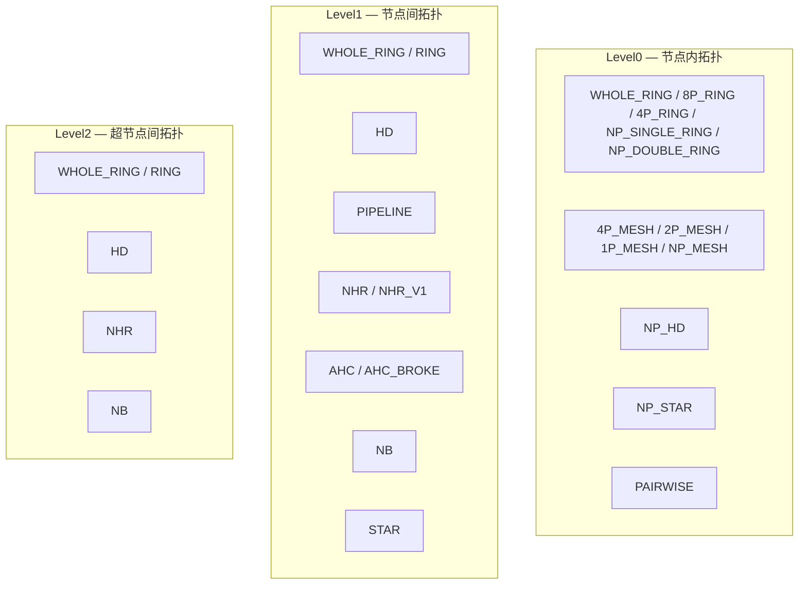

<!--
@source: impl/adv_api/detail/hccl/cc/src/common/alg_type.h
@source: impl/adv_api/detail/hccl/cc/src/ops/op_common/selector/auto_selector_base.h
-->

# 算法类型体系

## HcclAlgoType — 通信算法类型

> 定义见 `impl/.../cc/src/common/alg_type.h:19-33`。

| 枚举值 | 说明 |
|--------|------|
| `HCCL_ALGO_TYPE_DEFAULT` | 默认算法，使用 HCCL 内藏算法选择逻辑 |
| `HCCL_ALGO_TYPE_RING` | Ring 算法 |
| `HCCL_ALGO_TYPE_PIPELINE` | Pipeline 算法 |
| `HCCL_ALGO_TYPE_FULLMESH` | FullMesh 算法 |
| `HCCL_ALGO_TYPE_HDR` | HDR（Halving-Doubling Recursive）算法 |
| `HCCL_ALGO_TYPE_PAIRWISE` | Pairwise 算法 |
| `HCCL_ALGO_TYPE_NHR` | NHR（Non-uniform Halving Recursive）算法 |
| `HCCL_ALGO_TYPE_NHR_V1` | NHR V1 算法 |
| `HCCL_ALGO_TYPE_NB` | NB（Non-Blocking）算法 |
| `HCCL_ALGO_TYPE_NULL` | 空算法 |
| `HCCL_ALGO_TYPE_NA` | 不适用 |
| `HCCL_ALGO_TYPE_AHC` | AHC 算法 |
| `HCCL_ALGO_TYPE_AHC_BROKE` | AHC Broke 算法 |

## 三级算法类型

HCCL 将通信拓扑分为三级，每级独立选择算法：



### AlgTypeLevel0

> `alg_type.h:36-50`

| 枚举值 | 名称映射 | 说明 |
|--------|----------|------|
| `ALG_LEVEL0_WHOLE_RING` | ring | 所有 level 组成大环 |
| `ALG_LEVEL0_8P_RING` | ring | 8P Ring，4 个固定 stream |
| `ALG_LEVEL0_4P_MESH` | fullmesh | 4P Mesh，3 个固定 stream |
| `ALG_LEVEL0_2P_MESH` | fullmesh | 2P Mesh |
| `ALG_LEVEL0_1P_MESH` | fullmesh | 1P Mesh |
| `ALG_LEVEL0_4P_RING` | ring | 4P Ring |
| `ALG_LEVEL0_NP_SINGLE_RING` | ring | N 卡单 Ring |
| `ALG_LEVEL0_NP_DOUBLE_RING` | ring | N 卡双 Ring（910_93） |
| `ALG_LEVEL0_NP_MESH` | fullmesh | 3~8P Mesh |
| `ALG_LEVEL0_NP_HD` | HD | HD 算法 |
| `ALG_LEVEL0_NP_STAR` | star | Star 算法 |
| `ALG_LEVEL0_PAIRWISE` | — | Pairwise 算法 |

### AlgTypeLevel1

> `alg_type.h:52-64`

| 枚举值 | 名称映射 |
|--------|----------|
| `ALG_LEVEL1_WHOLE_RING` | ring |
| `ALG_LEVEL1_HD` | H-D |
| `ALG_LEVEL1_RING` | ring |
| `ALG_LEVEL1_PIPELINE` | pipeline |
| `ALG_LEVEL1_NHR` | NHR |
| `ALG_LEVEL1_NHR_V1` | NHR_V1 |
| `ALG_LEVEL1_AHC` | AHC |
| `ALG_LEVEL1_AHC_BROKE` | AHC_BROKE |
| `ALG_LEVEL1_NB` | NB |

### AlgTypeLevel2

> `alg_type.h:66-73`

| 枚举值 | 名称映射 |
|--------|----------|
| `ALG_LEVEL2_WHOLE_RING` | ring |
| `ALG_LEVEL2_HD` | H-D |
| `ALG_LEVEL2_RING` | ring |
| `ALG_LEVEL2_NHR` | NHR |
| `ALG_LEVEL2_NB` | NB |

## AlgType 结构体

> `alg_type.h:75-136`

```cpp
struct AlgType {
    AlgTypeLevel0 algoLevel0;
    AlgTypeLevel1 algoLevel1;
    AlgTypeLevel2 algoLevel2;
};
```

提供多种构造方式，可指定部分 level，未指定 level 默认为 `WHOLE_RING`。

## 算法名称映射

### 默认算法映射表

> `auto_selector_base.h:32-61`

HCCL 为不同执行模式预设了默认算法映射：

**AICPU 单独执行模式**（`OP_TYPE_TO_AICPU_SOLE_ALG_MAP`）：

| HcclCMDType | 默认算法名 |
|-------------|-----------|
| AllGather | `InsAllGatherMesh` |
| ReduceScatter | `InsReduceScatterNHR` |
| AllReduce | `InsAllReduceNHR` |
| AlltoAll | `InsAlltoAllMesh` |
| AlltoAllV | `InsAlltoAllvMesh` |
| AlltoAllVC | `InsAlltoAllvcMesh` |

**CCU 1D 算法映射**（`OP_TYPE_TO_CCU_1D_ALG_MAP`）：

| HcclCMDType | 默认算法名 |
|-------------|-----------|
| AllGather | `CcuAllGatherMesh1D` |
| ReduceScatter | `CcuReduceScatterMesh1D` |
| AllReduce | `CcuAllReduceMesh1D` |
| Reduce | `CcuReduceMesh1D` |
| AlltoAll | `CcuAlltoAllMesh1D` |
| AlltoAllV | `CcuAlltoAllVMesh1D` |
| HalfAlltoAllV | `CcuHalfAll2AllVMesh1D` |

**CCU 2D 算法映射**（`OP_TYPE_TO_CCU_2D_ALG_MAP`）：

| HcclCMDType | 默认算法名 |
|-------------|-----------|
| AllGather | `CcuAllGatherMesh2D` |
| ReduceScatter | `CcuReduceScatterMesh2D` |
| AllReduce | `CcuAllReduceMesh2DOneShot` |
| Reduce | `CcuReduceMesh2D` |
| AlltoAll | `CcuAlltoAllMesh2D` |

### 资源复用算法映射

> `auto_selector_base.h:63-69`

部分算法共享同一资源类：

| 算法名 | 资源类 |
|--------|--------|
| `InsReduceScatterMesh1D` | `InsReduceScatterMeshClass` |
| `InsReduceScatterMesh1DMeshChunk` | `InsReduceScatterMeshClass` |
| `InsAllReduceMesh1DOneShot` | `InsAllReduceMeshClass` |
| `InsAllReduceMesh1DTwoShot` | `InsAllReduceMeshClass` |
| `InsSend` | `InsSendRecv` |
| `InsRecv` | `InsSendRecv` |

## TemplateType — 模板类型

> `alg_template_base.h:47-58`

| 枚举值 | 说明 |
|--------|------|
| `TEMPLATE_SCATTER_MESH` (0) | ScatterMesh 模板 |
| `TEMPLATE_SCATTER_RING` (1) | ScatterRing 模板 |
| `TEMPLATE_SCATTER_NB` (2) | ScatterNB 模板 |
| `TEMPLATE_SCATTER_NHR` (3) | ScatterNHR 模板 |
| `TEMPLATE_SCATTER_RING_DIRECT` (4) | ScatterRingDirect 模板 |
| `TEMPLATE_NATIVE_MAX_NUM` | 内置模板最大值 |
| `TEMPLATE_CUSTOM_BEGIN` (1000) | 用户自定义模板起始值 |
| `TEMPLATE_CUSTOM_MAX_NUM` (2000) | 用户自定义模板最大值 |
