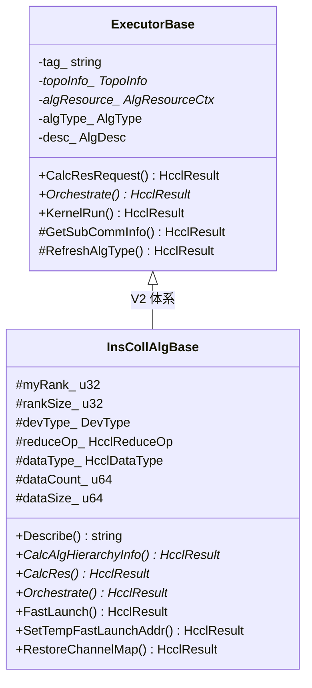
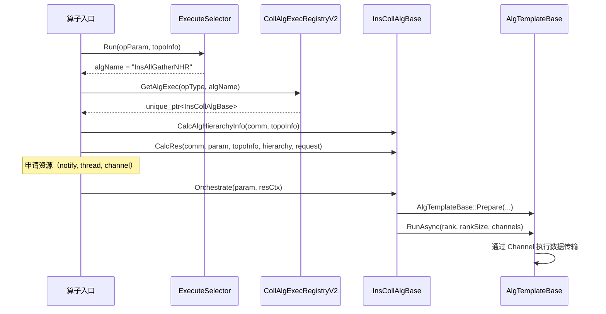

<!--
@source: impl/adv_api/detail/hccl/cc/src/ops/op_common/executor/executor_base.h
@source: impl/adv_api/detail/hccl/cc/src/ops/op_common/executor/executor_v2_base.h
@source: impl/adv_api/detail/hccl/cc/src/ops/op_common/executor/registry/coll_alg_v2_exec_registry.h
@source: impl/adv_api/detail/hccl/cc/src/ops/op_common/inc/alg_param.h
-->

# 执行器注册与调度

## 执行器层次结构



### ExecutorBase（V1 执行器基类）

> `executor_base.h:43-66`

V1 执行器基类，提供资源计算和编排接口：

| 方法 | 说明 |
|------|------|
| `CalcResRequest` | 资源计算：计算算子所需的 notify、thread、channel 等资源 |
| `Orchestrate` | 算法编排：纯虚函数，子类实现具体的算法执行流程 |
| `KernelRun` | Kernel 执行 |
| `GetAlgDesc` | 获取算法描述（支持的算法列表、是否 zero-copy 等） |

### InsCollAlgBase（V2 执行器基类）

> `executor_v2_base.h:27-72`

V2 执行器基类，支持序列化资源上下文和快速下发：

| 方法 | 说明 |
|------|------|
| `CalcAlgHierarchyInfo` | 计算算法分层信息（纯虚） |
| `CalcRes` | 计算资源需求（纯虚） |
| `Orchestrate` | 算法编排（纯虚），接收 `AlgResourceCtxSerializable` |
| `FastLaunch` | 快速下发（CCU 场景） |
| `SetTempFastLaunchAddr` | 设置模板快速下发地址 |
| `RestoreChannelMap` | 恢复通道映射 |

## CollAlgExecRegistryV2 — 执行器注册表

> `coll_alg_v2_exec_registry.h:31-40`

```cpp
class CollAlgExecRegistryV2 {
public:
    static CollAlgExecRegistryV2& Instance();
    HcclResult Register(const HcclCMDType type, const std::string& tag,
                        const CollExecCreatorV2& collExecCreator);
    std::unique_ptr<InsCollAlgBase> GetAlgExec(const HcclCMDType type, const std::string& tag);
};
```

**注册键**：`(HcclCMDType opType, std::string algName)` 二元组。

**查找**：根据算法选择阶段返回的 `algName`，从注册表获取对应的执行器实例。

## 注册宏

### 基础注册宏

```cpp
// 基础注册（无模板参数）
REGISTER_EXECUTOR_IMPL(opType, algName, ExecutorClass)

// 无拓扑匹配的注册（带一个模板参数）
REGISTER_EXECUTOR_IMPL_NO_TOPOMATCH(opType, algName, ExecutorClass, InsAlgTemplate)

// 按拓扑匹配注册
REGISTER_EXECUTOR_BY_TOPO(opType, algName, ExecutorClass, AlgTopoMatch)
```

### 多模板注册宏

```cpp
// 两个模板
REGISTER_EXECUTOR_BY_TWO_TEMPS(opType, algName, ExecutorClass, AlgTopoMatch, Template0, Template1)

// 四个模板
REGISTER_EXECUTOR_BY_FOUR_TEMPS(opType, algName, ExecutorClass, AlgTopoMatch, T0, T1, T2, T3)

// 完整版本
REGISTER_EXEC_V2(opType, algName, ExecutorClass, AlgTopoMatch, InsAlgTemplate)
```

**宏展开原理**（以 `REGISTER_EXEC_V2` 为例）：

```cpp
// 注册：在程序启动时通过静态变量初始化
static HcclResult g_func_algName_N = 
    CollAlgExecRegistryV2::Instance().Register(
        opType, std::string("algName"),
        DefaultExecCreatorV2<ExecutorClass<AlgTopoMatch, InsAlgTemplate>>());
```

## 执行器调用流程



## AlgDesc — 算法描述

> `alg_param.h:554-562`

```cpp
struct AlgDesc {
    bool isZeroCopy = false;
    bool isAivMode = false;
    std::vector<AlgTypeLevel0> level0SupportedAlgos;
    std::vector<AlgTypeLevel1> level1SupportedAlgos;
    std::vector<AlgTypeLevel2> level2SupportedAlgos;
};
```

执行器通过 `GetAlgDesc()` 声明支持的算法列表。若外部传入的 `algType` 不在支持列表中，则重定向为列表第一个元素。

## 执行器资源计算

`CalcResRequest` / `CalcRes` 计算算子所需的资源：

```cpp
struct AlgResourceRequest {
    u32 notifyNumOnMainThread = 0;      // 主流 notify 数量
    u32 slaveThreadNum = 0;             // 从流数量
    std::vector<u32> notifyNumPerThread; // 每个线程的 notify 数量
    std::vector<std::vector<HcclChannelDesc>> channels; // 通信通道
    std::vector<CcuKernelInfo> ccuKernelInfos;          // CCU Kernel 信息
    std::vector<u32> ccuKernelNum;
};
```

> 定义见 `alg_param.h:315-322`。

## ExecMem — 执行内存

> `executor_base.h:34-41`

```cpp
struct ExecMem {
    u64 count = 0;
    HcclMem inputMem;   // 单算子模式: InCCLMem, 图模式: InUserMem
    HcclMem outputMem;  // 单算子模式: OutCCLMem, 图模式: OutUserMem
    HcclMem scratchMem;
    void* inputPtr;     // InUserMem 地址（图模式时与 inputMem 相同）
    void* outputPtr;    // OutUserMem 地址（图模式时与 outputMem 相同）
};
```
