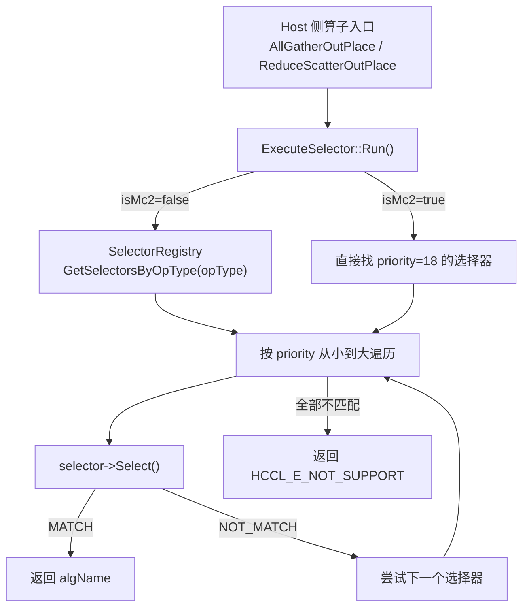
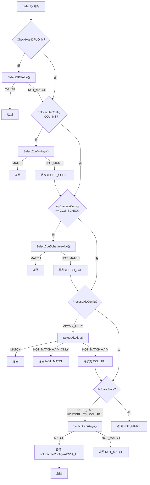

<!--
@source: impl/adv_api/detail/hccl/cc/src/ops/op_common/selector/auto_selector_base.h
@source: impl/adv_api/detail/hccl/cc/src/ops/op_common/selector/auto_selector_base.cc
@source: impl/adv_api/detail/hccl/cc/src/ops/op_common/selector/execute_selector.cc
@source: impl/adv_api/detail/hccl/cc/src/ops/op_common/selector/selector_registry.h
-->

# 算法选择机制

## 总体架构

HCCL 的算法选择通过 **选择器注册 + 优先级遍历** 机制实现。此过程发生在 **Host 侧**（算子入口函数中），AICPU 服务端不经过选择器。



> 入口见 `execute_selector.cc:21-68`。

## ExecuteSelector::Run

> `execute_selector.cc:21-68`

```cpp
HcclResult ExecuteSelector::Run(OpParam& opParam, TopoInfoWithNetLayerDetails* topoInfo,
                                std::string& selectAlgName) const;
```

**执行逻辑**：

1. 如果 `UseCannBridge(opParam)` 为 true，走 CANN Bridge 选择路径
2. 如果 `opParam.isMc2` 为 true，直接使用 priority=18 的选择器（MC2 模式）
3. 否则，从 `SelectorRegistry` 获取该 `opType` 注册的所有选择器
4. 按 priority 从小到大遍历，第一个返回 `MATCH` 的选择器胜出

## SelectorRegistry — 选择器注册表

> `selector_registry.h:20-32`

```cpp
class SelectorRegistry {
public:
    static SelectorRegistry* Global();
    HcclResult Register(u32 priority, AutoSelectorBase* selector);
    HcclResult RegisterByOpType(const HcclCMDType opType, u32 priority, AutoSelectorBase* selector);
    std::map<u32, AutoSelectorBase*> GetAllSelectors();
    std::map<u32, AutoSelectorBase*> GetSelectorsByOpType(const HcclCMDType opType);
};
```

### 注册宏

```cpp
// 全局注册（按 priority）
REGISTER_SELECTOR(priority, SelectorClass)

// 按 opType 注册
REGISTER_SELECTOR_BY_OPTYPE(opType, priority, SelectorClass)
```

宏内部通过静态变量初始化实现自动注册。

## AutoSelectorBase::Select — 核心选择逻辑

> `auto_selector_base.cc:15-91`

这是算法选择的核心方法，按以下 fallback 链尝试匹配：



### IsStarsState 判断

> `auto_selector_base.cc:93-98`

```cpp
bool AutoSelectorBase::IsStarsState(const OpExecuteConfig& opExecuteConfig) const {
    return opExecuteConfig == OpExecuteConfig::AICPU_TS ||
           opExecuteConfig == OpExecuteConfig::HOSTCPU_TS ||
           opExecuteConfig == OpExecuteConfig::CCU_FAIL;
}
```

当执行模式为 AICPU_TS、HOSTCPU_TS 或 CCU_FAIL（CCU 匹配失败后的降级状态）时，尝试 AICPU 算法。

## 数据量判断

> `auto_selector_base.h:21-22` / `auto_selector_base.cc:105-107`

```cpp
constexpr uint64_t SMALL_COUNT_512KB = 512 * 1024;    // 小数据边界
constexpr uint64_t LARGE_COUNT_1024KB = 1024 * 1024;  // 大数据边界

bool IsSmallData(const u64 dataSize) const { return dataSize < SMALL_COUNT_512KB; }
bool IsLargeData(const u64 dataSize) const { return dataSize >= LARGE_COUNT_1024KB; }
```

算法选择时，根据数据量大小选择不同算法。例如 AllGather 在 UBX 机型上：
- 数据量 > 512KB：选择并发算法
- 数据量 <= 512KB：选择基础 Mesh 算法

## HostDPU 判断

> `auto_selector_base.cc:160-234`

`CheckHostDPUOnly` 检查是否仅使用 Host DPU 传输：

1. 单 server 时不使用 DPU
2. 检查最高 level 网络层的拓扑类型是否为 `COMM_TOPO_CLOS`
3. 检查端点位置类型：如果有 device 端点则不使用 HostDPU；如果仅有 host 端点则使用 HostDPU

## 拓扑判断辅助方法

| 方法 | 说明 |
|------|------|
| `IsLayerAllConnetedWithTopo` | 检查某层是否全部连接为指定拓扑类型 |
| `CheckMeshNumEqualToClosNum` | 检查 Mesh 数量是否等于 CLOS 数量 |
| `CheckClosNumMultipleOfMeshNum` | 检查 CLOS 数量是否为 Mesh 数量的整数倍 |
| `IsTwoLevelNetLayer` | 检查是否为两级网络层 |
| `IsInputOutputOverlap` | 检查输入输出内存是否重叠 |

## 选择器注册示例

以 AllGather 为例：

```cpp
// all_gather_auto_selector.cc:275
REGISTER_SELECTOR_BY_OPTYPE(HcclCMDType::HCCL_CMD_ALLGATHER, 18, AllGatherAutoSelector);
```

这行代码在程序启动时自动将 `AllGatherAutoSelector` 注册到 `SelectorRegistry`，关联 `HCCL_CMD_ALLGATHER` 类型，优先级为 18。

## 子选择器调用顺序

每个算子的 `AutoSelectorBase::Select` 内部调用子选择器的顺序由 `opExecuteConfig` 决定：

| opExecuteConfig | 调用的子选择器 |
|-----------------|---------------|
| `HOSTCPU`（HostDPU 场景） | `SelectDPUAlgo` |
| `CCU_MS` | `SelectCcuMsAlgo` → 失败降级 `SelectCcuScheduleAlgo` → 失败降级 `SelectAicpuAlgo` |
| `CCU_SCHED` | `SelectCcuScheduleAlgo` → 失败降级 `SelectAicpuAlgo` |
| `AIV` / `AIV_ONLY` | `SelectAivAlgo` → 失败降级（AIV_ONLY 不降级） |
| `AICPU_TS` / `HOSTCPU_TS` | `SelectAicpuAlgo` |
| `CCU_FAIL` | `SelectAicpuAlgo` |
