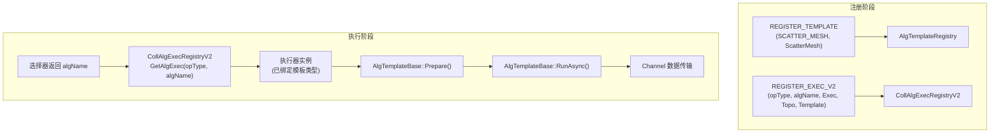

<!--
@source: impl/adv_api/detail/hccl/cc/src/ops/op_common/template/alg_template_base.h
@source: impl/adv_api/detail/hccl/cc/src/ops/op_common/template/registry/alg_template_register.h
-->

# 模板注册机制

## AlgTemplateBase — 算法模板基类

> 定义见 `impl/.../cc/src/ops/op_common/template/alg_template_base.h:103-203`。

算法模板是集合通信算法的最底层执行单元，封装了具体的数据传输逻辑（Scatter/Gather/Reduce 等操作）。

### 核心接口

```cpp
class AlgTemplateBase {
public:
    virtual HcclResult RunAsync(const u32 rank, const u32 rankSize,
                                std::vector<ChannelInfo>& channels);

    virtual HcclResult Prepare(HcclMem& inputMem, HcclMem& outputMem,
        HcclMem& scratchMem, const u64 count, const HcclDataType dataType,
        ThreadHandle thread, const HcclReduceOp reductionOp = HCCL_REDUCE_RESERVED,
        const u32 root = INVALID_VALUE_RANKID,
        const std::vector<Slice>& slices = std::vector<Slice>(ZERO_SLICE),
        const u64 baseOffset = 0, const bool disableDMAReduce = false);

    virtual HcclResult Prepare(PrepareData& param);
    virtual HcclResult Prepare(u32 interRank, u32 interRankSize);
    virtual HcclResult Prepare(HcomCollOpInfo* opInfo, ...);
};
```

| 方法 | 说明 |
|------|------|
| `RunAsync` | 异步执行算法（虚函数，子类实现具体传输逻辑） |
| `Prepare` | 准备参数（多个重载，适配不同算子场景） |
| `PrepareSliceData` | 静态方法：计算数据切片 |
| `PrepareSliceMeshStreams` | 静态方法：计算 Mesh 多流切片 |
| `CalcLinksRelation` | 静态方法：计算 Halving-Doubling 链路关系 |
| `ExecuteBarrier` | 执行同步屏障 |
| `DataUnitSize` | 获取数据类型大小 |
| `ByteOffset` / `SliceOffset` | 计算偏移 |

### 成员变量

| 变量 | 类型 | 说明 |
|------|------|------|
| `inputMem_` | `HcclMem` | 输入内存 |
| `outputMem_` | `HcclMem` | 输出内存 |
| `scratchMem_` | `HcclMem` | 草稿内存 |
| `count_` | `u64` | 每块内存数据总个数 |
| `dataBytes_` | `u64` | 数据字节数 |
| `dataType_` | `HcclDataType` | 数据类型 |
| `reductionOp_` | `HcclReduceOp` | 规约操作 |
| `root_` | `u32` | Root rank |
| `unitSize_` | `u32` | 数据单元大小 |
| `disableDMAReduce_` | `bool` | 禁止 DMA 规约 |
| `baseOffset_` | `u64` | 基础偏移 |
| `thread_` | `ThreadHandle` | 执行线程 |
| `barrierSwitchOn_` | `bool` | 屏障开关 |
| `multRingsSlices_` | `vector<vector<Slice>>` | 多环切片（91093 aligned double ring） |

### 关键常量

> `alg_template_base.h:22-47`

| 常量 | 值 | 说明 |
|------|-----|------|
| `HCCL_CHUNK_SIZE` | 1GB | 数据块大小上限 |
| `HCCL_MIN_PIPLINE_SLICE_ALIGN` | 512 | 流水线切片最小对齐 |
| `HCCL_MIN_SLICE_ALIGN_910B` | 16384 | 910B 最小切片对齐 |
| `HCCL_MIN_SLICE_ALIGN_910_93` | 16384 | 910_93 最小切片对齐 |
| `HCCL_NIC_MAX_NUM` | 8 | 最大 NIC 数 |
| `DOUBLE_RING_NUM` | 2 | 双环数量 |
| `HCCL_SPLIT_SIZE_INTER_SERVER` | 8MB | 服务器间通信量切分边界 |

## TemplateType — 模板类型枚举

> `alg_template_base.h:47-58`

```cpp
enum class TemplateType {
    TEMPLATE_SCATTER_MESH = 0,        // ScatterMesh
    TEMPLATE_SCATTER_RING = 1,        // ScatterRing
    TEMPLATE_SCATTER_NB = 2,          // ScatterNB
    TEMPLATE_SCATTER_NHR = 3,         // ScatterNHR
    TEMPLATE_SCATTER_RING_DIRECT = 4, // ScatterRingDirect
    TEMPLATE_NATIVE_MAX_NUM,          // 内置模板最大值
    TEMPLATE_CUSTOM_BEGIN = 1000,     // 用户自定义起始值
    TEMPLATE_CUSTOM_MAX_NUM = 2000    // 用户自定义最大值
};
```

## RunStage — 执行阶段

> `alg_template_base.h:66`

```cpp
enum class RunStage {
    RUN_PREPARE,
    RUN_REDUCE_SCATTER,
    RUN_ALLGATHER,
    RUN_ALLREDUCE,
    RUN_DEFAULT
};
```

AllReduce 算法通常分解为 `ReduceScatter` + `AllGather` 两个阶段。

## HalvingDoublingType — HD 算法子类型

> `alg_template_base.h:62`

```cpp
enum class HalvingDoublingType {
    BINARY_BLOCK_HALVING_DOUBLING,
    RECURSIVE_HALVING_DOUBLING,
    RESERVED_ALGORITHM_TYPE
};
```

## AlgTemplateRegistry — 模板注册表

> `alg_template_register.h:29-39`

```cpp
class AlgTemplateRegistry {
public:
    static AlgTemplateRegistry& Instance();
    HcclResult Register(const TemplateType type, const AlgTemplateCreator& algTemplateCreator);
    std::unique_ptr<AlgTemplateBase> GetAlgTemplate(const TemplateType type);
private:
    std::vector<AlgTemplateCreator> tempCreators_;
};
```

### 注册宏

```cpp
REGISTER_TEMPLATE(TemplateType, TemplateClass)
```

**展开**：

```cpp
static HcclResult g_func_TemplateClass_N =
    AlgTemplateRegistry::Instance().Register(
        TemplateType, DefaultTemplateCreator<TemplateClass>());
```

`DefaultTemplateCreator<P>()` 是一个工厂函数，返回 `new P()`。

## 模板与执行器关系



### 模板在执行器中的使用

执行器通过模板类型参数绑定具体的算法模板。例如，一个执行器可以绑定 1~4 个模板：

```cpp
// 单模板执行器
InsCollAlgBase<AlgTopoMatch, InsAlgTemplate>

// 双模板执行器（如 AllReduce = ReduceScatter + AllGather）
InsCollAlgBase<AlgTopoMatch, Template0, Template1>

// 四模板执行器
InsCollAlgBase<AlgTopoMatch, T0, T1, T2, T3>
```

## Slice — 数据切片

> `alg_template_base.h:60` / `alg_param.h:564-567`

```cpp
struct Slice {
    u64 offset{0};  // 相对偏移（字节）
    u64 size{0};    // 数据大小（字节）
};
```

模板通过 `PrepareSliceData` 计算数据切片，将大数据分块传输以实现流水线并发。

```cpp
static HcclResult PrepareSliceData(
    u64 dataCount, u32 unitSize, u32 sliceNum,
    u64 piplineOffset, std::vector<Slice>& dataSlice);
```
