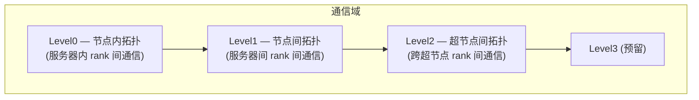
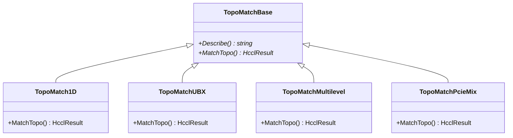
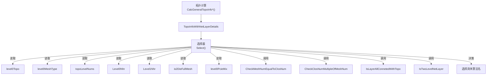

<!--
@source: impl/adv_api/detail/hccl/cc/src/ops/op_common/inc/alg_param.h
@source: impl/adv_api/detail/hccl/cc/src/ops/op_common/topo/topo.h
@source: impl/adv_api/detail/hccl/cc/src/ops/op_common/topo/topo_match_base.h
@source: impl/adv_api/detail/hccl/cc/src/ops/op_common/topo/topo_match_1d.h
@source: impl/adv_api/detail/hccl/cc/src/ops/op_common/topo/topo_match_ubx.h
@source: impl/adv_api/detail/hccl/cc/src/ops/op_common/topo/topo_match_multilevel.h
@source: impl/adv_api/detail/hccl/cc/src/ops/op_common/topo/topo_match_pcie_mix.h
-->

# 拓扑识别与匹配

## 拓扑层级模型

HCCL 将通信拓扑分为最多 4 级（`HCCL_LOGIC_TOPO_LEVEL_NUM = 4`）：



> 常量定义见 `alg_param.h:324`。

## TopoType — 拓扑类型

> `alg_param.h:81-95`

| 枚举值 | 说明 |
|--------|------|
| `TOPO_TYPE_COMMON` | 普通拓扑（默认单层） |
| `TOPO_TYPE_8P_RING` | 8P Ring（4 个逻辑环） |
| `TOPO_TYPE_4P_MESH` | 4P Mesh |
| `TOPO_TYPE_2P_MESH` | 2P Mesh |
| `TOPO_TYPE_1P_MESH` | 1P Mesh |
| `TOPO_TYPE_4P_RING` | 4P Ring |
| `TOPO_TYPE_NP_SINGLE_RING` | N 卡单 Ring |
| `TOPO_TYPE_8P_MESH` | 8P RDMA Mesh |
| `TOPO_TYPE_NP_MESH` | 3~8P Mesh |
| `TOPO_TYPE_NP_DOUBLE_RING` | N 卡双 Ring（910_93） |
| `TOPO_TYPE_HETEROG` | 异构拓扑 |
| `TOPO_TYPE_ES_MESH` | ES Mesh |

## Level0Shape — Level0 拓扑形状

> `alg_param.h:113-117`

| 枚举值 | 说明 |
|--------|------|
| `CLOS` | CLOS 拓扑 |
| `MESH_1D` | 1D Mesh 拓扑 |
| `MESH_1D_CLOS` | 1D Mesh + CLOS 混合（UBX 机型） |

## Level0MeshType — Mesh 子类型

> `alg_param.h:119-124`

| 枚举值 | 说明 |
|--------|------|
| `NOT_MESH` | 非 Mesh |
| `SINGLE_DIE` | 单 Die |
| `TWO_DIE_REGULAR` | 双 Die 规则 |
| `TWO_DIE_NOT_REGULAR` | 双 Die 非规则 |

## TopoMatchBase — 拓扑匹配基类

> `topo_match_base.h:54-63`

```cpp
class TopoMatchBase {
public:
    virtual std::string Describe() const = 0;
    virtual HcclResult MatchTopo(
        const HcclComm comm, TopoInfoWithNetLayerDetails* topoInfo,
        AlgHierarchyInfoForAllLevel& algHierarchyInfo);
};
```

### 拓扑匹配器实现

| 匹配器 | 文件 | 说明 |
|--------|------|------|
| `TopoMatch1D` | `topo_match_1d.{h,cc}` | 1D Mesh 拓扑匹配 |
| `TopoMatchUBX` | `topo_match_ubx.{h,cc}` | UBX 机型（Mesh + CLOS 混合） |
| `TopoMatchMultilevel` | `topo_match_multilevel.{h,cc}` | 多层级拓扑匹配 |
| `TopoMatchPcieMix` | `topo_match_pcie_mix.{h,cc}` | PCIe 混合拓扑 |



## 拓扑计算接口

> `topo.h:22-32`

| 函数 | 说明 |
|------|------|
| `CalcGeneralTopoInfoForA2` | Atlas A2 平台拓扑计算 |
| `CalcGeneralTopoInfoForA3` | Atlas A3 平台拓扑计算 |
| `CalcGeneralTopoInfoForComm` | 通用拓扑计算 |
| `GetUserRankBySubCommRank` | 通过子通信 rank 获取用户 rank |
| `GetSubCommRankByUserRank` | 通过用户 rank 获取子通信 rank |
| `CalGCD` | 计算最大公约数（用于 NHR 判断） |

## 拓扑信息结构

### TopoInfo

> `alg_param.h:141-159`

基础拓扑信息：

| 字段 | 说明 |
|------|------|
| `userRank` | 当前 rank ID |
| `userRankSize` | 通信域 rank 总数 |
| `serverIdx` | Server 在 ranktable 中的序号 |
| `superPodIdx` | SuperPod 序号 |
| `deviceType` | 硬件类型 |
| `deviceNumPerModule` | 每个 module 的卡数 |
| `serverNumPerSuperPod` | 每个超节点的服务器数 |
| `serverNum` | 服务器总数 |
| `superPodNum` | 超节点数 |
| `moduleIdx` | Module ID |
| `isHCCSSWNumEqualToTwiceSIONum` | A3 Server 内链路属性 |

### TopoInfoWithNetLayerDetails

> `alg_param.h:162-264`

继承 `TopoInfo`，增加网络层级详情：

| 字段 | 说明 |
|------|------|
| `topoLevelNums` | 拓扑层级数 |
| `level0Topo` | Level0 拓扑形状 |
| `Level0Nhr` / `Level1Nhr` | 是否为 NHR 拓扑（GCD==1 时为 true） |
| `is2DieFullMesh` | 是否为 2Die 全连接 Mesh |
| `level0PcieMix` | 是否为 PCIe 混合拓扑 |
| `level0BigClosRange` | 是否为大 CLOS 范围 |
| `level0MeshType` | Mesh 子类型 |
| `netLayerDetails` | 网络层级详情 |
| `topoInstDetailsOfLayer` | 各层拓扑实例详情 |

### NetLayerDetails

> `alg_param.h:126-132`

```cpp
struct NetLayerDetails {
    u32 netLayerNum;
    std::vector<u32> netLayers;
    std::vector<u32> netInstNumOfLayer;
    std::vector<std::vector<u32>> instSizeListOfLayer;
    std::vector<u32> localNetInsSizeOfLayer;
};
```

### TopoInstDetails

> `alg_param.h:133-139`

```cpp
struct TopoInstDetails {
    u32 topoInstNum;
    std::vector<u32> sizeOfTopo;
    std::vector<CommTopo> typeOfTopo;
    std::vector<std::vector<u32>> ranksInTopo;
    std::map<CommTopo, std::vector<u32>> rankNumForTopoType;
};
```

## 拓扑匹配在算法选择中的作用



## 910A 服务器特殊拓扑

> `topo_match_base.h:35-52`

910A 平台有特殊的 4P Ring 序列和有效 4P rank 组合：

- `SERVER_910A_4_RING_SEQUENCE`：4 组 8 卡 Ring 序列
- `SERVER_910A_VALID_4P_RANKS`：8 组有效的 4P rank 组合
- `SERVER_910A_4P_SEQUENCE`：4P 排列顺序 `{0, 1, 3, 2}`
