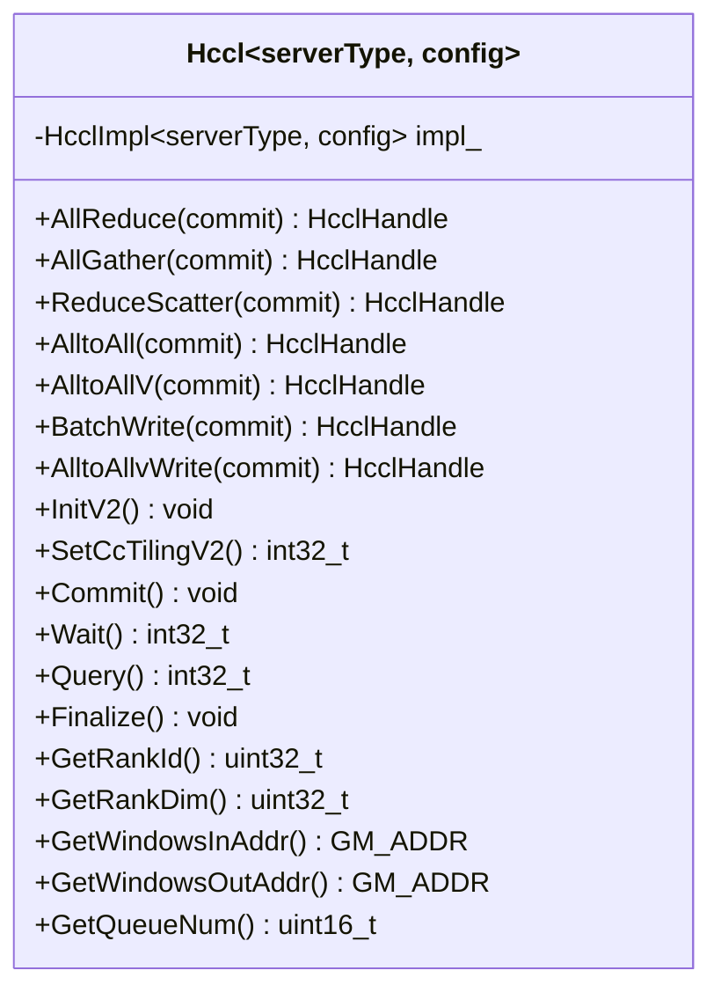

<!--
@source: include/adv_api/hccl/hccl.h
@source: include/adv_api/hccl/hccl_common.h
@source: impl/adv_api/detail/hccl/impl/hccl_impl.h
-->

# Hccl 模板类

> 定义见 `include/adv_api/hccl/hccl.h:52-415`。

## 类声明

```cpp
template <HcclServerType serverType = HcclServerType::HCCL_SERVER_TYPE_AICPU,
          const auto& config = DEFAULT_CFG>
class Hccl;
```

## 模板参数

| 参数 | 类型 | 默认值 | 说明 |
|------|------|--------|------|
| `serverType` | `HcclServerType` | `HCCL_SERVER_TYPE_AICPU` | 服务端类型 |
| `config` | `const HcclServerConfig&` | `DEFAULT_CFG` | 服务端配置 |

### HcclServerType 枚举

> `hccl_common.h:65`

| 值 | 说明 |
|----|------|
| `HCCL_SERVER_TYPE_AICPU` (0) | AICPU 服务端（当前主要支持） |
| `HCCL_SERVER_TYPE_CCU` (5) | CCU 通信计算单元服务端 |

### HcclServerConfig 结构

> `hccl_common.h:69-72`

```cpp
struct HcclServerConfig {
    CoreType type;      // 核心类型：DEFAULT / ON_AIV / ON_AIC
    int64_t blockId;    // 工作块 ID
};
```

### DEFAULT_CFG

> `hccl.h:33`

```cpp
static constexpr HcclServerConfig DEFAULT_CFG = {CoreType::DEFAULT, 0};
```

## 类继承关系



## 方法转发机制

`Hccl` 类的所有方法均为内联转发到 `impl_` 成员，并附加 DFX 守卫：

```cpp
template <bool commit>
__aicore__ inline HcclHandle Hccl<serverType, config>::AllReduce(
    GM_ADDR sendBuf, GM_ADDR recvBuf, uint64_t count,
    HcclDataType dataType, HcclReduceOp op, uint8_t repeat)
{
    DFX_MAKE_GUARD(HcclApiOperType::ALL_REDUCE_PREPARE,
        GetRankDim(), repeat, count, dataType, sendBuf, 0U, recvBuf, 0U);
    return impl_.template AllReduce<commit>(sendBuf, recvBuf, count, dataType, op, repeat);
}
```

> 见 `impl/adv_api/detail/hccl/impl/hccl_impl.h:29-35`。

所有方法的转发逻辑均遵循此模式：DFX 守卫 → 委托给 `impl_`。

## DFX 守卫类型

每个 API 调用都通过 `DFX_MAKE_GUARD` 记录操作类型，用于 profiling 和诊断：

| API | DFX 操作类型 |
|-----|-------------|
| AllReduce | `ALL_REDUCE_PREPARE` |
| AllGather | `ALL_GATHER_PREPARE` |
| AlltoAll | `ALL_TO_ALL_PREPARE` |
| AlltoAllV | `ALL_TO_ALL_V_PREPARE` |
| ReduceScatter | `REDUCE_SCATTER_PREPARE` |
| BatchWrite | `BATCH_WRITE_PREPARE` |
| Init / InitV2 | `INIT` |
| SetCcTiling / SetCcTilingV2 | `SET_CCTILING` |
| Commit | `COMMIT` |
| Wait | `WAIT` |
| Query | `QUERY` |
| Finalize | `FINALIZE` |
| InterHcclGroupSync | `GROUP_SYNC` |
| QueueBarrier | `BARRIER` |
| Iterate | `ITERATE` |

## 使用示例

```cpp
#include "hccl.h"

// 1. 创建实例（AICPU 服务端，指定在 AIC 上执行，blockId=0）
Hccl<HCCL_SERVER_TYPE_AICPU, {CoreType::ON_AIC, 0}> hccl;

// 2. 初始化
hccl.InitV2(contextGM, &initTiling);
hccl.SetCcTilingV2(tilingOffset);

// 3. 下发 AllReduce 任务（commit=true 自动提交）
HcclHandle handle = hccl.AllReduce<true>(sendBuf, recvBuf, count, HCCL_DATA_TYPE_FP16, HCCL_REDUCE_SUM);

// 4. 等待完成
hccl.Wait(handle);

// 5. 结束
hccl.Finalize();
```

> 注：`commit` 模板参数为 `true` 时，Prepare 接口内部自动调用 Commit，无需用户手动调用。
