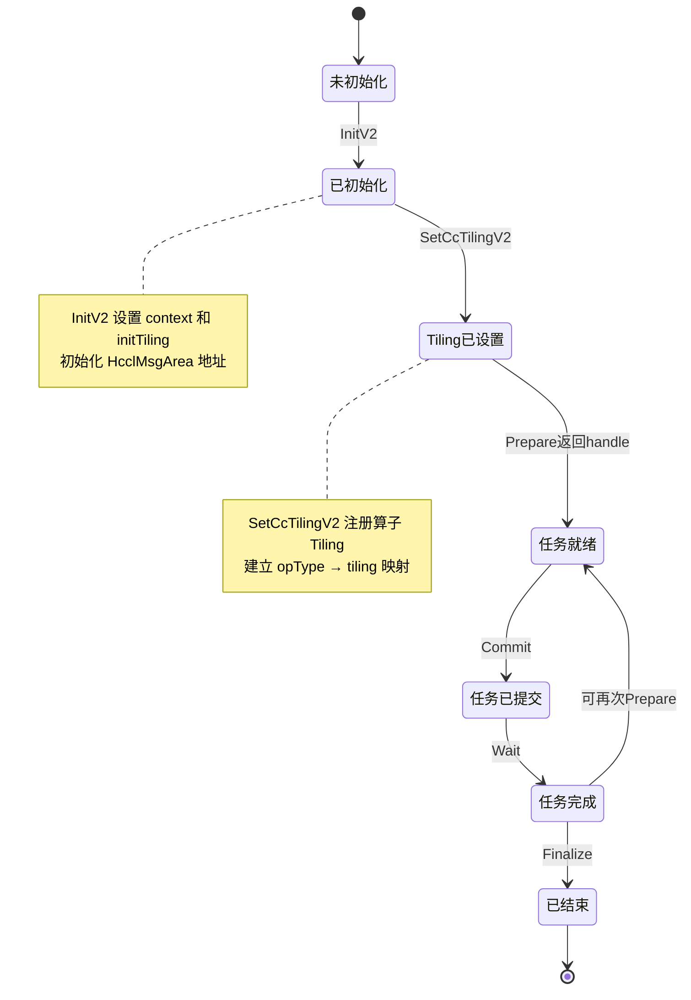
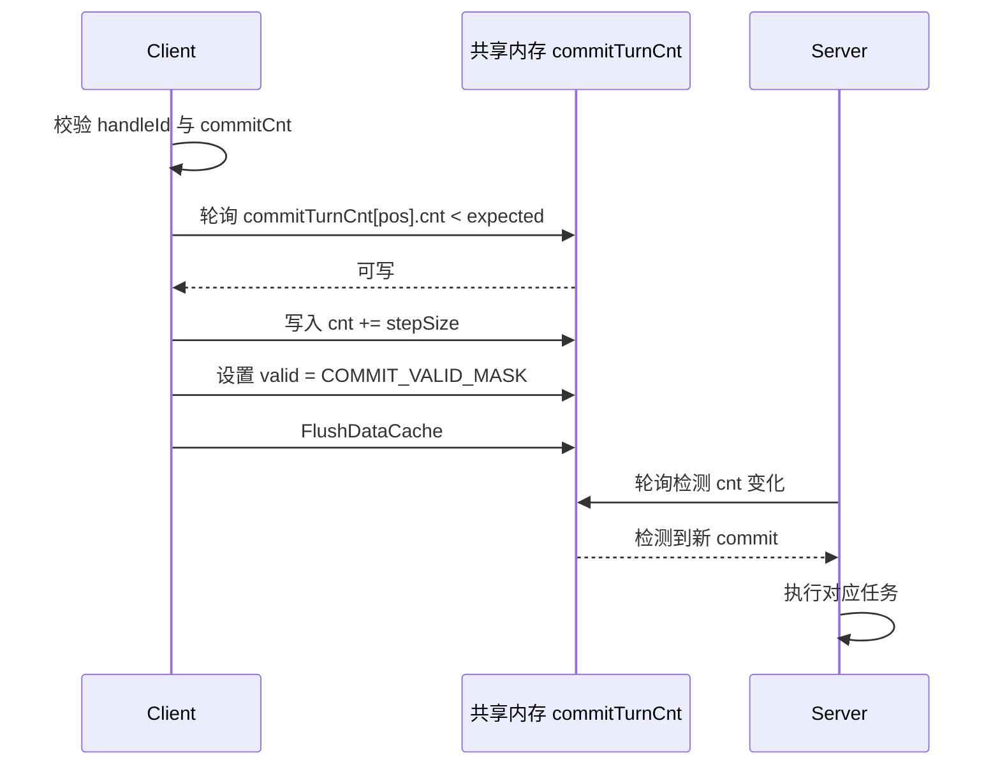
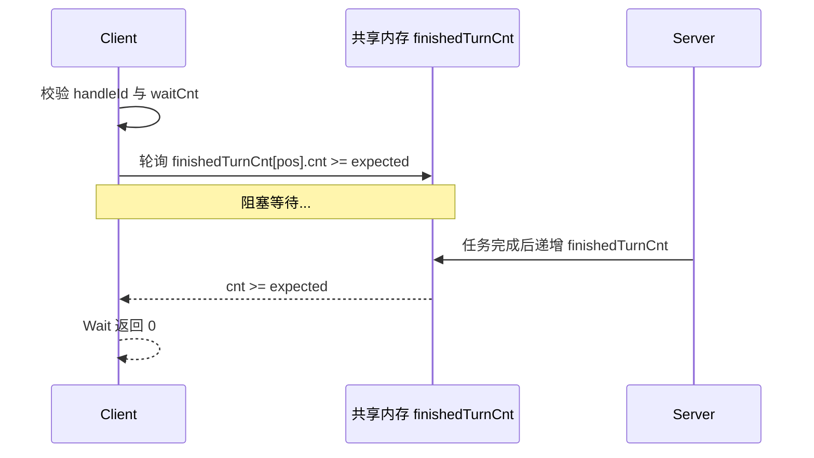

<!--
@source: include/adv_api/hccl/hccl.h
@source: impl/adv_api/detail/hccl/common/hccl_aicpu_impl.h
@source: impl/adv_api/detail/hccl/impl/platform_v310/hccl_aicpu.h
-->

# 生命周期 API

HCCL 实例的生命周期管理接口：初始化 → Tiling 设置 → Prepare → Commit → Wait → Finalize。



## InitV2

> `include/adv_api/hccl/hccl.h:293`

```cpp
__aicore__ inline void InitV2(GM_ADDR context, const void* initTiling);
```

**功能**：初始化 Hccl 实例。必须在其他接口之前调用。

**参数**：

| 参数 | 说明 |
|------|------|
| `context` | Hccl context，提供 workspace、rankId、rankSize 等，对应 `OpResCtx` 结构 |
| `initTiling` | InitTilingData 地址，对应 `Mc2InitTilingInner` 结构 |

**实现**（V310 平台，`impl/platform_v310/hccl_aicpu.h:30-45`）：

1. 从 `initTiling` 读取 `debugMode`、`devType`，记录 tiling 基地址
2. 将 `context` 转换为 `OpResCtx*`，获取 workspace 地址
3. 调用 `InitInner(workspace, CONTEXT_DECOUPLE_VERSION)`：
   - 512B 对齐 workspace 地址
   - 设置 `hcclMsgArea_` 指针
   - 初始化 Handle 表 `handleIdMsgPosition_` 为 -1
   - 调用 `InitWorkingFlag()` 设置工作核心标志

> 废弃接口 `Init` 见 `hccl.h:284`，使用 `InitV2` 代替。

## SetCcTilingV2

> `include/adv_api/hccl/hccl.h:274`

```cpp
__aicore__ inline int32_t SetCcTilingV2(uint64_t offset);
```

**功能**：设置集合通信算子的 Tiling 数据。必须在 `InitV2` 之后调用。

**参数**：

| 参数 | 说明 |
|------|------|
| `offset` | Tiling 数据相对于 tiling 基地址的偏移 |

**返回值**：0 成功，-1 失败。

**实现**（V310 平台，`impl/platform_v310/hccl_aicpu.h:48-65`）：

1. 从 `tilingBaseAddr_ + offset` 读取 `Mc2CcTilingInner`
2. 提取 `opType`，校验有效性
3. 建立 `ccOpTilingDataTable_[opType] = offset` 映射
4. 匹配 `hcclContext_->algInfo` 中的算法信息，建立 `ccOpParamTable_[opType]` 映射

> 废弃接口 `SetCcTiling` 见 `hccl.h:265`，使用 `SetCcTilingV2` 代替。

## Commit

> `include/adv_api/hccl/hccl.h:304`

```cpp
__aicore__ inline void Commit(HcclHandle handleId);
```

**功能**：通知服务端执行 `handleId` 对应的任务。每次调用使服务端执行一次，调用次数应与 Prepare 的 `repeat` 参数一致。

**实现**（`hccl_aicpu_impl.h:457-480`）：

1. 校验 `handleId` 有效性
2. 检查 Commit 次数不超过 `repeat * stepCntsPerRepeat`
3. 调用 `SetCommitTurnCntToGm()` 递增共享内存中的 commit 计数



## Wait

> `include/adv_api/hccl/hccl.h:316`

```cpp
__aicore__ inline int32_t Wait(HcclHandle handleId);
```

**功能**：阻塞等待 `handleId` 对应的任务完成一次。调用次数应与 Commit 次数一致。

**返回值**：0 成功，-1 失败。

**实现**（`hccl_aicpu_impl.h:415-454`）：

1. 校验 `handleId` 和 `waitCnt` 不超过 `commitCnt`
2. 记录 waitStats 到 `apiStats`
3. 调用 `WaitFinishCntFromGm()` 轮询 `finishedTurnCnt`，直到达到预期



## Query

> `include/adv_api/hccl/hccl.h:326`

```cpp
__aicore__ inline int32_t Query(HcclHandle handleId);
```

**功能**：查询 `handleId` 对应的已完成任务数。最大查询值为 `repeat`。

**返回值**：已完成任务数（最大为 repeat），-1 表示失败。

**实现**（`hccl_aicpu_impl.h:397-413`）：非阻塞调用 `WaitFinishCntFromGm(curMsgPos, 0)`，返回当前完成计数。

## Finalize

> `include/adv_api/hccl/hccl.h:367`

```cpp
template <bool sync = true>
__aicore__ inline void Finalize();
```

**功能**：
1. 通知服务端不再有后续任务
2. 等待最后一个任务完成（当 `sync=true`）
3. 清理 `finishedTurnCnt`

**参数**：

| 参数 | 说明 |
|------|------|
| `sync` | true：同步等待服务端完全退出；false：异步发送 Finalize 消息 |

**实现**（`hccl_aicpu_impl.h:482-539`）：

1. 当 `sync=true`：等待最后一个 Handle 的所有任务完成
2. 发送 `HCCL_CMD_FINALIZE` 控制消息到所有队列
3. 当 `sync=true`：等待 `finishedTurnCnt == FINALIZE_FINISH_CNT`，然后重置计数
4. 更新控制消息计数和 API 快照
