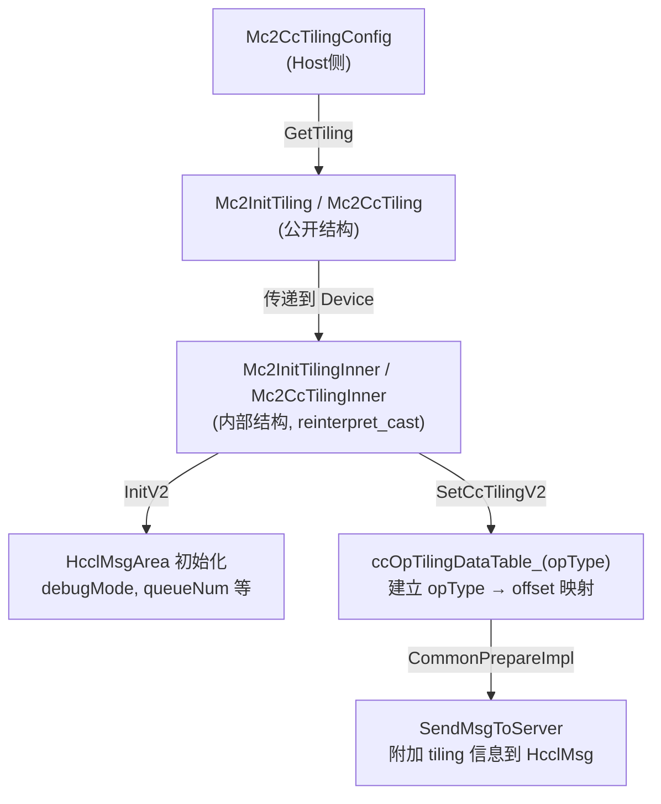

<!--
@source: include/adv_api/hccl/hccl_tiling.h
@source: include/adv_api/hccl/hccl_tilingdata.h
@source: include/adv_api/hccl/internal/hccl_tiling_msg.h
-->

# Tiling 配置 API

## Mc2CcTilingConfig

> 定义见 `include/adv_api/hccl/hccl_tiling.h:24-50`。

`Mc2CcTilingConfig` 是 Host 侧 Tiling 配置类，用于在算子 Tiling 阶段生成通信所需的 Tiling 数据。

### 构造函数

```cpp
explicit Mc2CcTilingConfig(
    const std::string& groupName, uint32_t opType, const std::string& algConfig,
    uint32_t reduceType = 0, uint8_t dstDataType = 0, uint8_t srcDataType = 0,
    uint8_t commEngine = 0);
```

**参数**：

| 参数 | 说明 |
|------|------|
| `groupName` | 通信组名称 |
| `opType` | 算子类型（对应 `HcclCMDType` 的整数值） |
| `algConfig` | 算法配置字符串 |
| `reduceType` | 规约类型（对应 `HcclReduceOp`，默认 0 = SUM） |
| `dstDataType` | 目标数据类型（默认 0） |
| `srcDataType` | 源数据类型（默认 0） |
| `commEngine` | 通信引擎（默认 0） |

### 接口方法

#### GetTiling

```cpp
uint32_t GetTiling(::Mc2InitTiling& tiling);  // 获取初始化 Tiling
uint32_t GetTiling(::Mc2CcTiling& tiling);    // 获取通信算子 Tiling
```

**功能**：生成 Tiling 数据结构。

#### 配置方法

| 方法 | 参数 | 说明 |
|------|------|------|
| `SetOpType` | `uint32_t opType` | 设置算子类型 |
| `SetGroupName` | `const std::string&` | 设置通信组名 |
| `SetAlgConfig` | `const std::string&` | 设置算法配置 |
| `SetReduceType` | `uint32_t reduceType, uint8_t dstDataType, uint8_t srcDataType` | 设置规约类型和数据类型 |
| `SetStepSize` | `uint8_t stepSize` | 设置步长大小 |
| `SetSkipLocalRankCopy` | `uint8_t` | 设置是否跳过本地 rank 拷贝 |
| `SetSkipBufferWindowCopy` | `uint8_t` | 设置是否跳过窗口拷贝 |
| `SetDebugMode` | `uint8_t` | 设置调试模式 |
| `SetQueueNum` | `uint16_t num` | 设置队列数（0 = 单队列模式） |
| `SetCommBlockNum` | `uint16_t num` | 设置通信块数 |
| `SetCommEngine` | `uint8_t commEngine` | 设置通信引擎 |

## Tiling 数据结构

### Mc2InitTiling（公开）

> `hccl_tilingdata.h:49-51`

```cpp
BEGIN_TILING_DATA_DEF(Mc2InitTiling)
    TILING_DATA_FIELD_DEF_ARR(uint8_t, 64, reserved);
END_TILING_DATA_DEF;  // 64 bytes
```

### Mc2CcTiling（公开）

> `hccl_tilingdata.h:54-56`

```cpp
BEGIN_TILING_DATA_DEF(Mc2CcTiling)
    TILING_DATA_FIELD_DEF_ARR(uint8_t, 512, reserved);
END_TILING_DATA_DEF;  // 512 bytes
```

### Mc2InitTilingInner（内部）

> `include/adv_api/hccl/internal/hccl_tiling_msg.h:22-32`

```cpp
struct Mc2InitTilingInner {
    uint32_t version;
    uint32_t mc2HcommCnt;
    uint32_t offset[MAX_CC_TILING_NUM];  // 8 个 tiling 偏移
    uint8_t debugMode;
    uint8_t preparePosition;
    uint16_t queueNum;     // 队列数（0 = 单队列模式）
    uint16_t commBlockNum;
    uint8_t devType;       // 设备类型
};
```

### Mc2CcTilingInner（内部）

> `hccl_tiling_msg.h:36-50`

```cpp
struct Mc2CcTilingInner {
    uint8_t skipLocalRankCopy;     // 跳过本地 rank 拷贝
    uint8_t skipBufferWindowCopy;  // 跳过窗口拷贝
    uint8_t stepSize;              // 步长大小
    uint8_t version;
    uint8_t commEngine;            // 通信引擎
    uint8_t srcDataType;
    uint8_t dstDataType;
    char groupName[128];           // 通信组名
    char algConfig[128];           // 算法配置
    uint32_t opType;               // 算子类型
    uint32_t reduceType;           // 规约类型
};
```

## Tiling 数据流



## 废弃结构

以下结构已标记为 `@deprecated`，请勿使用：

| 结构 | 定义位置 | 替代方案 |
|------|----------|----------|
| `Mc2ServerCfg` | `hccl_tilingdata.h:24-31` | — |
| `Mc2HcommCfg` | `hccl_tilingdata.h:37-46` | `Mc2CcTilingConfig` |
