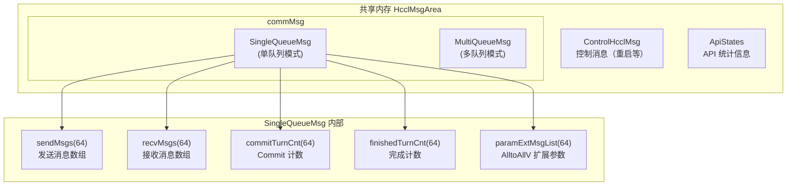
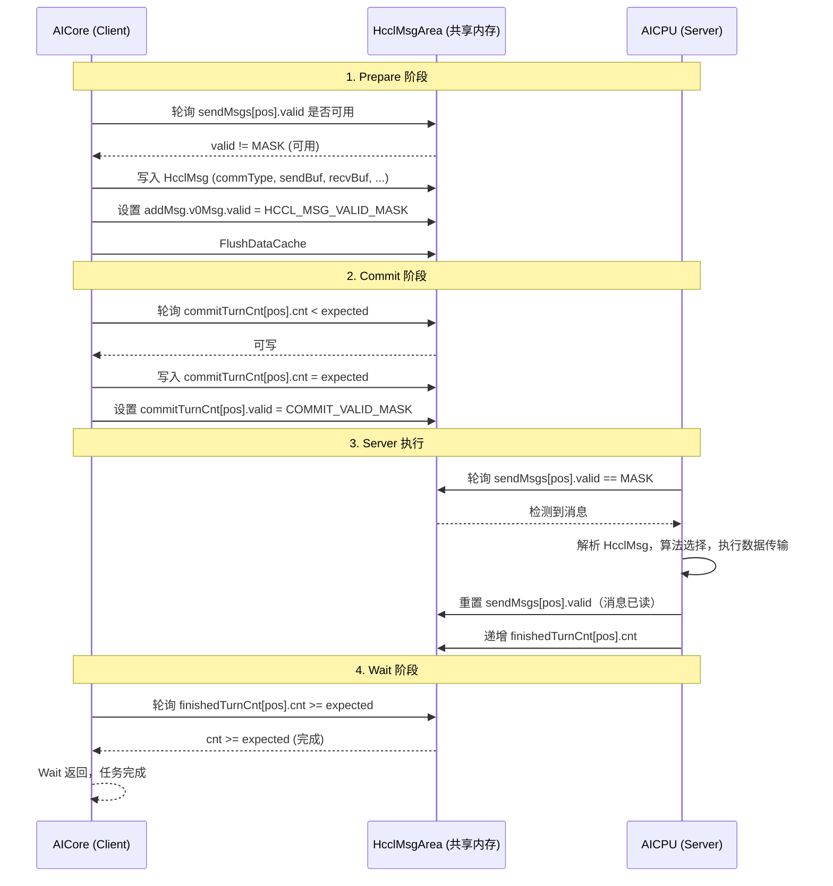

<!--
@source: include/adv_api/hccl/internal/hccl_msg.h
@source: impl/adv_api/detail/hccl/common/hccl_aicpu_impl.h
@source: impl/adv_api/detail/hccl/common/hccl_inner_def.h
-->

# 设备-服务端消息通信机制

## 共享内存架构

HCCL 的 Client（AICore）和 Server（AICPU）通过共享内存 `HcclMsgArea` 进行异步通信。`HcclMsgArea` 是 workspace 中预留的通信区域，属于每个通信组。

> 定义见 `include/adv_api/hccl/internal/hccl_msg.h:175-182`。



## HcclMsg 消息结构

每条通信消息由 `HcclMsg` 描述，定义于 `hccl_msg.h:87-101`：

```cpp
struct HcclMsg {
    HcclCommType commType;        // 通信类型（AllReduce/AllGather/...）
    HcclReduceOp opType;          // 规约操作（SUM/PROD/MAX/MIN）
    uint64_t sendBuffer;          // 源数据缓冲区地址
    uint64_t recvBuffer;          // 目标数据缓冲区地址
    uint64_t dataCnt;             // 参与通信的数据数量
    uint64_t strideCount;         // 步长（用于不连续内存场景）
    union {
        V0MsgAdditionInfo v0Msg;  // V0 附加信息
        V1MsgAdditionInfo v1Msg;  // V1 附加信息
    } addMsg;
};
```

### V0MsgAdditionInfo 关键字段

| 字段 | 类型 | 说明 |
|------|------|------|
| `hcclDataType` | `HcclDataType` | 数据类型 |
| `valid` | `uint32_t` | 消息有效标志（`HCCL_MSG_VALID_MASK = 0x5CDF123A`） |
| `repeatCnt` | `uint8_t` | 该消息启动的通信任务数 |
| `commDepGroupID` | `int8_t` | 依赖的通信组 ID（-1 表示无依赖） |
| `commDepHandleID` | `HcclHandle` | 依赖的任务 Handle ID |
| `selfHandleID` | `HcclHandle` | 本消息的 Handle ID |
| `version` | `HcclTilingVersion` | Tiling 版本 |
| `xorCheck` | `uint32_t` | XOR 校验和 |

> 定义见 `hccl_msg.h:43-59`。

## Prepare-Commit-Wait 通信时序



## 消息有效性协议

### 消息写入（Client → Server）

1. Client 轮询 `sendMsgs[pos].valid`，直到其不等于 `HCCL_MSG_VALID_MASK`（表示 Server 已读取上一条消息）
2. Client 写入完整的 `HcclMsg` 数据
3. Client 设置 `valid = HCCL_MSG_VALID_MASK`，表示消息就绪
4. Client 调用 `FlushDataCache` 确保数据刷写到内存

> 实现见 `impl/.../common/hccl_aicpu_impl.h:104-142`（`SendMsgToServer`）。

### Commit 计数协议

`TurnCnt` 结构用于 Client-Server 间的执行计数同步：

```cpp
struct TurnCnt {
    uint64_t valid;   // COMMIT_VALID_MASK，Client 写入
    uint64_t cnt;     // 计数值，Client 写入，Server 重置
    uint64_t reserved[6];
};
```

- `commitTurnCnt`：Client 写入，表示需要执行的任务数
- `finishedTurnCnt`：Server 写入，表示已完成的任务数

> 定义见 `hccl_msg.h:136-140`。

### Finalize 协议

Finalize 使用特殊完成计数 `FINALIZE_FINISH_CNT = 1234567899999999999`：

1. Client 发送 `ControlMsgType::HCCL_CMD_FINALIZE` 消息
2. Client 等待 `finishedTurnCnt.cnt == FINALIZE_FINISH_CNT`
3. Server 执行完所有任务后写入该特殊值
4. Client 收到后重置 `finishedTurnCnt`

> 实现见 `impl/.../common/hccl_aicpu_impl.h:482-539`（`Finalize`）。

## 多队列模式

当 `queueNum_ > 0` 时，启用多队列模式 `MultiQueueMsg`：

- 最多支持 `MAX_QUE_NUM = 48` 个队列
- 每个队列独立维护 `sendMsgs`、`commitTurnCnt`、`finishedTurnCnt`
- 队列 ID 由 `GetBlockIdx() * queueNum_ + queId` 计算

> 定义见 `hccl_msg.h:152-157`。

## 消息容量限制

| 常量 | 值 | 说明 |
|------|-----|------|
| `HCCL_MSG_CNT` | 64 | 单队列最大消息数 |
| `HCCL_MAX_HANDLE_ID` | 63 | 最大 Handle ID |
| `MAX_QUE_NUM` | 48 | 最大队列数 |
| `HCCL_MAX_RANK_NUM_V2` | 256 | AlltoAllV 最大 rank 数 |
