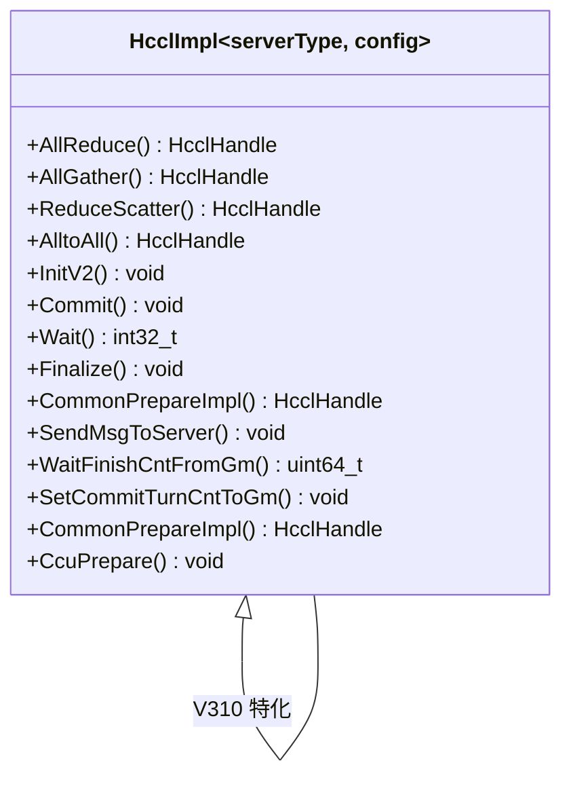
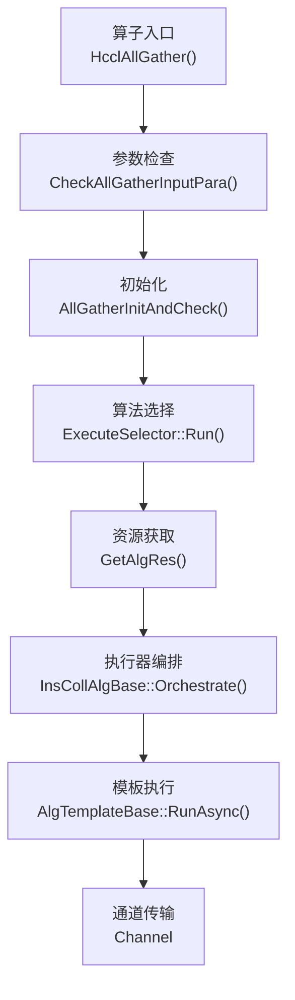
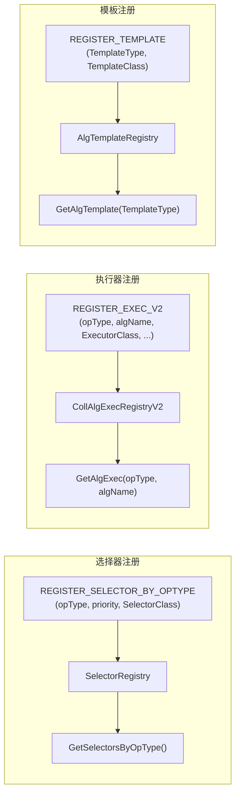
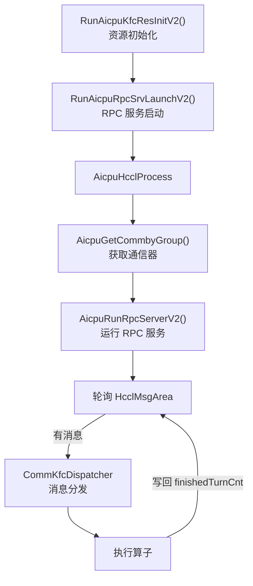

<!--
@source: include/adv_api/hccl/hccl.h
@source: impl/adv_api/detail/hccl/impl/hccl_impl_def.h
@source: impl/adv_api/detail/hccl/impl/hccl_impl.h
@source: impl/adv_api/detail/hccl/common/hccl_base.h
@source: impl/adv_api/detail/hccl/common/hccl_aicpu_impl.h
@source: impl/adv_api/detail/hccl/common/hccl_aicpu_common.h
@source: impl/adv_api/detail/hccl/cc/src/ops/
-->

# 四层架构设计

## 第一层：公共 API 层

**位置**：`include/adv_api/hccl/`

### Hccl 模板类

`Hccl` 是用户直接使用的模板类，定义于 `hccl.h:52`：

```cpp
template <HcclServerType serverType = HcclServerType::HCCL_SERVER_TYPE_AICPU,
          const auto& config = DEFAULT_CFG>
class Hccl {
public:
    template <bool commit = false>
    __aicore__ inline HcclHandle AllReduce(GM_ADDR sendBuf, GM_ADDR recvBuf,
        uint64_t count, HcclDataType dataType, HcclReduceOp op, uint8_t repeat = 1);
    // ... 其他算子
private:
    HcclImpl<serverType, config> impl_;
};
```

**设计要点**：
- 模板参数 `serverType` 决定服务端类型（AICPU 或 CCU），编译期确定
- 模板参数 `config` 为 `HcclServerConfig`，指定核心类型（AIV/AIC）和 blockId
- 所有方法均为 `__aicore__ inline`，在设备侧内联执行
- 实际工作委托给 `impl_` 成员（Pimpl 模式变体）

### 类型定义

`hccl_common.h` 定义了核心枚举和类型：

| 类型 | 定义位置 | 说明 |
|------|----------|------|
| `HcclHandle` | `hccl_common.h:20` | 任务标识符，`int8_t` 类型 |
| `HcclCMDType` | `hccl_common.h:22-44` | 集合通信命令类型枚举 |
| `HcclReduceOp` | `hccl_common.h:46-52` | 规约操作类型（SUM/PROD/MAX/MIN） |
| `HcclServerType` | `hccl_common.h:65` | 服务端类型（AICPU/CCU） |
| `HcclDataType` | `hccl_common.h:74-94` | 数据类型枚举（INT8~FP8E8M0 等 18 种） |
| `CoreType` | `hccl_common.h:67` | 核心类型（DEFAULT/ON_AIV/ON_AIC） |
| `HcclServerConfig` | `hccl_common.h:69-72` | 服务端配置（核心类型 + blockId） |
| `ScopeType` | `hccl_common.h:96-102` | 同步范围（ALL/QUEUE/BLOCK） |

---

## 第二层：设备侧实现层

**位置**：`impl/adv_api/detail/hccl/{impl,common,ccu}`

### HcclImpl 基类

`HcclImpl` 是设备侧实现的基类模板，定义于 `common/hccl_base.h:41`。基类提供所有接口的空实现（返回 -1），作为不支持某平台时的安全后备：

```cpp
template <HcclServerType serverType, const auto& config>
class HcclImpl {
public:
    template <bool commit = false>
    __aicore__ inline HcclHandle AllReduce(...) { return -1; }  // 默认空实现
    // ...
};
```

### 平台特化

通过 `hccl_impl_def.h` 的条件编译分发到具体平台实现：



### AICPU 实现

`common/hccl_aicpu_impl.h` 提供了 AICPU 服务端模式的设备侧实现核心逻辑：

| 方法 | 职责 |
|------|------|
| `InitInner()` | 初始化消息区域地址、Handle 表、工作标志 |
| `CheckCommonPrepareParamValid()` | 校验 Prepare 参数合法性 |
| `CommonPrepareImpl()` | 通用的 Prepare 实现：校验→分配 Handle→发送消息 |
| `SendMsgToServer()` | 将 `HcclMsg` 写入共享内存 `HcclMsgArea` |
| `SetCommitTurnCntToGm()` | 写入 Commit 计数到共享内存 |
| `WaitFinishCntFromGm()` | 轮询共享内存中的完成计数 |
| `Commit()` | 递增 Commit 计数 |
| `Wait()` | 等待完成计数达到预期 |
| `Finalize()` | 发送 Finalize 消息，等待服务端退出 |

### CCU 实现

`ccu/hccl_ccu_v0_prepare.h` 和 `impl/platform_v310/hccl_ccu_v0.h` 提供 CCU 服务端模式的实现。CCU 模式下，消息通过 CCU 硬件寄存器传输，不走 AICPU。

---

## 第三层：Host 侧算法层

**位置**：`impl/adv_api/detail/hccl/cc/src/ops/`

### 目录结构

```
cc/src/ops/
├── all_gather/              # AllGather 算子
│   ├── all_gather_op.{h,cc}           # 算子入口
│   ├── selector/                       # 算法选择器
│   │   └── all_gather_auto_selector.{h,cc}
│   ├── executor/                       # 执行器
│   └── template/                       # 算法模板
│       ├── aicpu/                      # AICPU 模板
│       └── ccu/                        # CCU 模板
├── reduce_scatter/          # ReduceScatter 算子
│   └── (同上结构)
├── op_common/               # 公共组件
│   ├── selector/            # 选择器基类与注册表
│   ├── executor/            # 执行器基类与注册表
│   ├── template/            # 模板基类与注册表
│   ├── topo/                # 拓扑识别
│   └── inc/                 # 公共参数定义
└── interface_graph_mode/    # 图模式接口
```

### 算子执行链



### 三大注册机制



---

## 第四层：AICPU 服务端

**位置**：`impl/adv_api/detail/hccl/cc/src/aicpu_kfc/`

### 服务端框架



### 关键组件

| 组件 | 文件 | 职责 |
|------|------|------|
| RPC 入口 | `hccl_aicpu_interface.cc` | 对外暴露 `RunAicpuKfcResInitV2` 和 `RunAicpuRpcSrvLaunchV2` |
| HCCL Process | `aicpu_hccl_process.{h,cc}` | 通信器管理、RPC 服务循环 |
| Dispatcher | `decoupler/comm_kfc_dispatcher.{h,cc}` | 消息分发到具体算子处理 |
| Communicator | `framework/aicpu_communicator.{h,cc}` | 底层通信抽象 |
| HDC | `framework/aicpu_hdc.{h,cc}` | 设备通信抽象层 |
| DFX | `debug/dfx/` | 调试、诊断、profiling |
