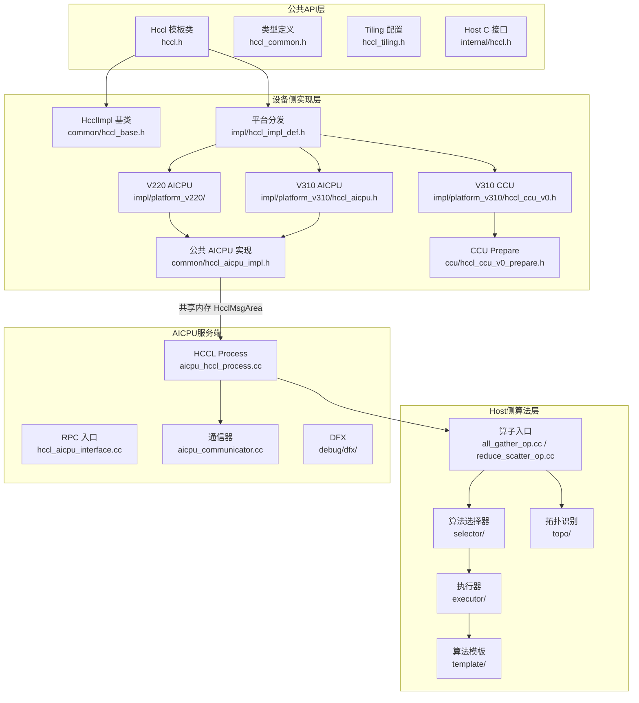
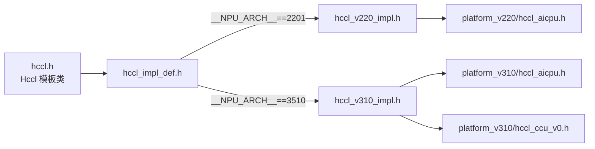
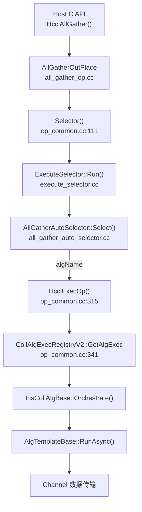
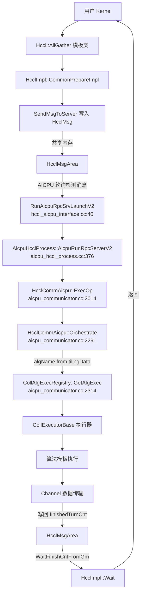

<!--
@source: include/adv_api/hccl/hccl.h
@source: include/adv_api/hccl/hccl_common.h
@source: impl/adv_api/detail/hccl/impl/hccl_impl_def.h
@source: impl/adv_api/detail/hccl/impl/hccl_impl.h
@source: impl/adv_api/detail/hccl/common/hccl_base.h
@source: impl/adv_api/detail/hccl/common/hccl_aicpu_impl.h
@source: impl/adv_api/detail/hccl/cc/src/ops/
@source: impl/adv_api/detail/hccl/cc/src/aicpu_kfc/
-->

# 整体架构总览

## 架构分层

HCCL 采用 **四层架构**，从上到下依次为公共 API 层、设备侧实现层、Host 侧算法层、AICPU 服务端层。

## 核心设计思想

### 1. Client-Server 异步模型

设备侧（AICore）作为 Client，AICPU 作为 Server，通过共享内存 `HcclMsgArea` 进行通信：

- **Client**（AICore）：调用 `Prepare` 写消息 → 调用 `Commit` 通知执行 → 调用 `Wait` 等待完成
- **Server**（AICPU）：轮询共享内存 → 解析消息 → 算法选择 → 执行数据传输 → 写回完成计数

### 2. 编译期平台分发

通过 `__NPU_ARCH__` 宏在编译期选择对应平台的实现，无运行时开销：

> 分发逻辑见 `impl/adv_api/detail/hccl/impl/hccl_impl_def.h:20-26`。

### 3. 注册机制驱动

Host 侧算法层使用三种注册机制实现可扩展性：

| 注册类型 | 注册表 | 宏 | 说明 |
|----------|--------|-----|------|
| 选择器注册 | `SelectorRegistry` | `REGISTER_SELECTOR_BY_OPTYPE` | 按算子类型注册算法选择器 |
| 执行器注册 | `CollAlgExecRegistryV2` | `REGISTER_EXEC_V2` | 按算法名注册执行器 |
| 模板注册 | `AlgTemplateRegistry` | `REGISTER_TEMPLATE` | 按模板类型注册算法模板 |

### 4. 算法选择 Fallback 链

`AutoSelectorBase::Select` 按以下优先级尝试匹配算法，未匹配则降级：

> 逻辑见 `impl/.../cc/src/ops/op_common/selector/auto_selector_base.cc:15-91`。

## 模块间数据流

HCCL 存在两条执行路径，需严格区分：

### 路径一：Host 侧算子执行（Host C API 调用链）

当 Host 侧调用 `HcclAllGather()` 等 C API 时，在 Host CPU 上执行算法选择和编排：

> 依据：`all_gather_op.cc:225-237`（AllGatherOutPlace 调用 Selector 和 HcclExecOp）、`op_common.cc:111-132`（Selector 调用 ExecuteSelector::Run）、`op_common.cc:341`（HcclExecOp 调用 CollAlgExecRegistryV2）

### 路径二：AICPU 服务端执行（设备侧 Client-Server 调用链）

当设备侧 Kernel 通过 `Hccl::AllGather()` 下发任务时，AICPU Server 轮询消息后执行：

> 依据：`aicpu_hccl_process.cc:556`（AicpuRunRpcServerV2 调用 ExecOp）、`aicpu_communicator.cc:2053`（ExecOp 调用 Orchestrate）、`aicpu_communicator.cc:2314`（Orchestrate 通过 CollAlgExecRegistry 获取执行器）

**关键区别**：
- Host 侧路径使用 `CollAlgExecRegistryV2`（V2 注册表），通过 `ExecuteSelector` 选择算法
- AICPU 服务端路径使用 `CollAlgExecRegistry`（V1 注册表），算法名直接从 `tilingData->algName` 获取，不经选择器

## 关键文件索引

| 文件 | 行数 | 说明 |
|------|------|------|
| `include/adv_api/hccl/hccl.h` | 427 | Hccl 模板类公共 API |
| `include/adv_api/hccl/hccl_common.h` | 105 | 枚举与类型定义 |
| `include/adv_api/hccl/hccl_tiling.h` | 57 | Mc2CcTilingConfig |
| `include/adv_api/hccl/internal/hccl.h` | 261 | Host C 接口 |
| `include/adv_api/hccl/internal/hccl_msg.h` | 227 | 消息结构定义 |
| `impl/.../hccl/impl/hccl_impl.h` | 214 | Hccl→HcclImpl 转发 |
| `impl/.../hccl/common/hccl_aicpu_impl.h` | 542 | AICPU 设备侧核心实现 |
| `impl/.../hccl/common/hccl_inner_def.h` | 190 | 内部数据结构 |
| `impl/.../hccl/cc/src/ops/op_common/selector/auto_selector_base.cc` | 416 | 算法选择基类 |
| `impl/.../hccl/cc/src/ops/op_common/selector/execute_selector.cc` | 70 | 选择器执行入口 |
| `impl/.../hccl/cc/src/ops/op_common/template/alg_template_base.h` | 206 | 算法模板基类 |
| `impl/.../hccl/cc/src/ops/op_common/executor/executor_v2_base.h` | 76 | V2 执行器基类 |
| `impl/.../hccl/cc/src/ops/op_common/inc/alg_param.h` | 612 | OpParam 等核心参数 |
