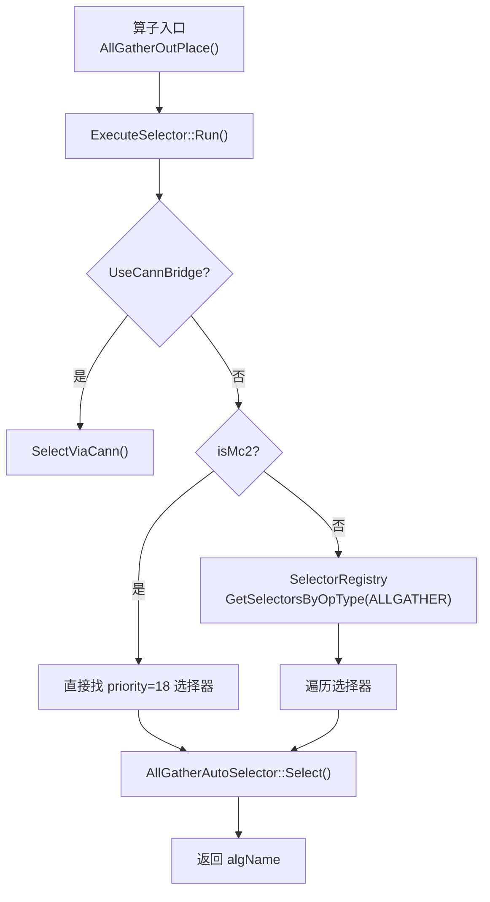
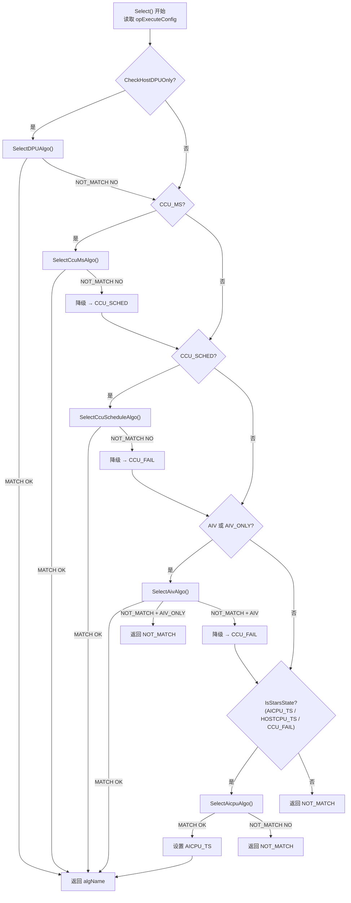
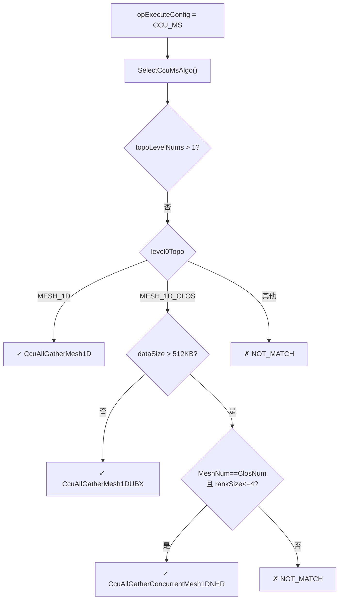
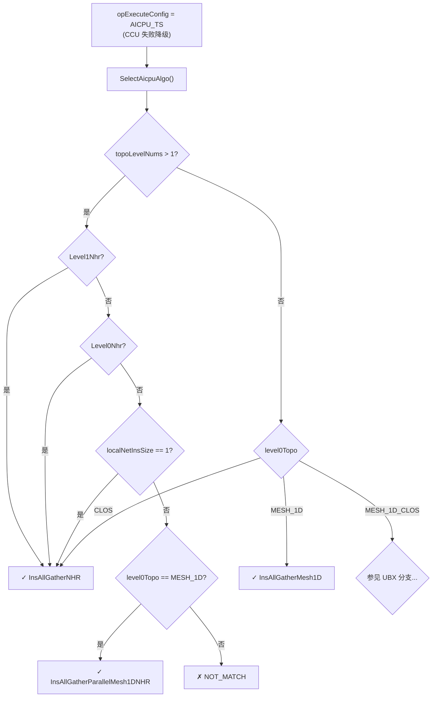
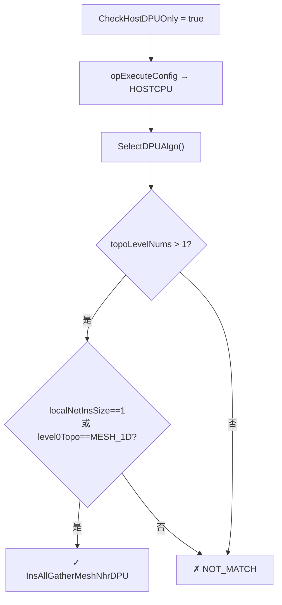
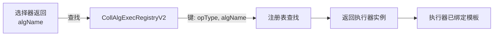

<!--
@source: impl/adv_api/detail/hccl/cc/src/ops/op_common/selector/auto_selector_base.cc
@source: impl/adv_api/detail/hccl/cc/src/ops/all_gather/selector/all_gather_auto_selector.cc
-->

# 算法选择决策演示

本文档以 AllGather 为例，动态演示算法选择过程。

## 选择入口

## Fallback 链决策

`AutoSelectorBase::Select()` 的完整决策流程：

## AllGather 各模式选择示例

### 示例 1：CCU_MS 模式，单层级 MESH_1D

### 示例 2：AICPU 模式，多层级拓扑

### 示例 3：DPU 模式

## 场景模拟

### 场景 A：单机 8 卡 AllGather（V310, CCU_MS）

| 参数 | 值 |
|------|-----|
| opExecuteConfig | CCU_MS |
| topoLevelNums | 1 |
| level0Topo | MESH_1D |
| level0MeshType | SINGLE_DIE |
| dataSize | 2MB (> 512KB) |

**选择路径**：`CCU_MS → SelectCcuMsAlgo → SelectMeshAlgo → level0Topo==MESH_1D`

**结果**：`CcuAllGatherMesh1D`

### 场景 B：双机 16 卡 AllGather（AICPU 模式）

| 参数 | 值 |
|------|-----|
| opExecuteConfig | AICPU_TS |
| topoLevelNums | 2 |
| Level1Nhr | true |
| level0Topo | MESH_1D |

**选择路径**：`AICPU_TS → SelectAicpuAlgo → topoLevelNums>1 → Level1Nhr=true`

**结果**：`InsAllGatherNHR`

### 场景 C：UBX 机型，小数据量

| 参数 | 值 |
|------|-----|
| opExecuteConfig | CCU_MS |
| topoLevelNums | 1 |
| level0Topo | MESH_1D_CLOS |
| dataSize | 256KB (< 512KB) |
| MeshNum == ClosNum | true |

**选择路径**：`CCU_MS → SelectCcuMsAlgo → SelectMeshAlgo → MESH_1D_CLOS → dataSize<=512KB`

**结果**：`CcuAllGatherMesh1DUBX`

### 场景 D：CCU 全部失败降级到 AICPU

| 参数 | 值 |
|------|-----|
| 初始 opExecuteConfig | CCU_MS |
| CCU_MS 匹配 | NOT_MATCH |
| CCU_SCHED 匹配 | NOT_MATCH |
| 最终 opExecuteConfig | CCU_FAIL → AICPU_TS |

**选择路径**：`CCU_MS ✗ → CCU_SCHED ✗ → CCU_FAIL → IsStarsState → SelectAicpuAlgo`

**结果**：取决于 AICPU 选择器逻辑

## 算法名到执行器的映射

选择器返回算法名后，通过 `CollAlgExecRegistryV2` 查找执行器：

示例映射（AllGather）：

| algName | 执行器 | 模板 |
|---------|--------|------|
| `InsAllGatherMesh1D` | `InsV2AllGatherSoleExecutor` | `InsTempAllGatherMesh1D` |
| `InsAllGatherNHR` | `InsV2AllGatherSoleExecutor` | `InsTempAllGatherNHR` |
| `InsAllGatherParallelMesh1DNHR` | `InsV2AllGatherParallelExecutor` | `Mesh1D` + `NHR` |
| `CcuAllGatherMesh1D` | `InsV2AllGatherSoleExecutor` | `CcuTempAllGatherMesh1D` |
