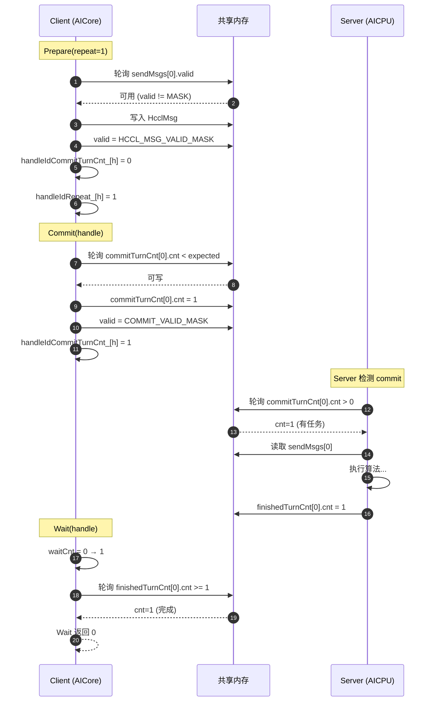
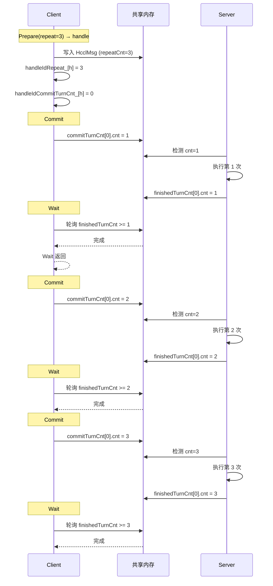
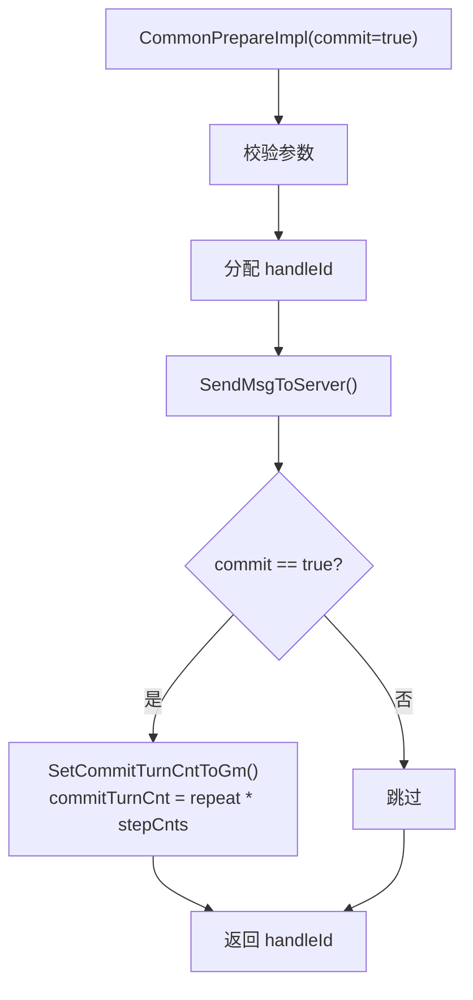
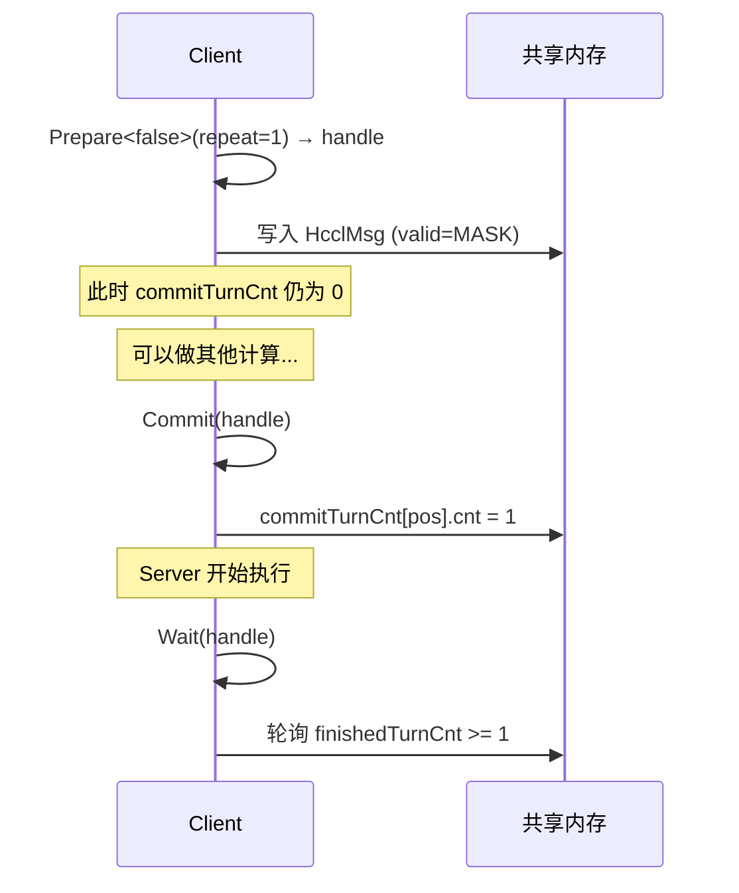
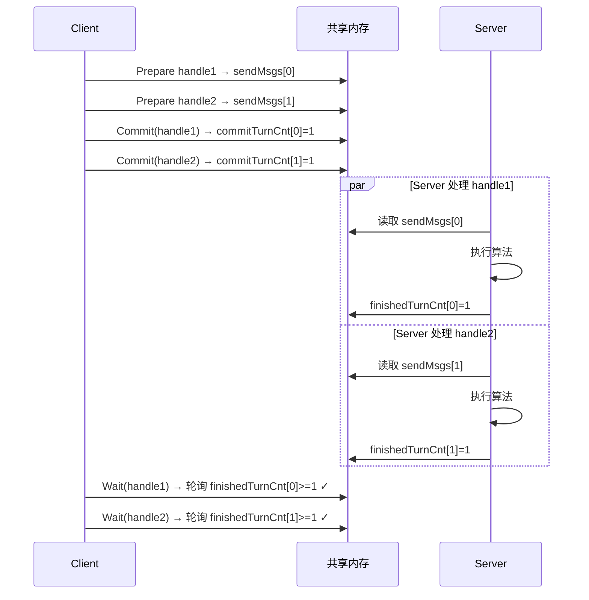
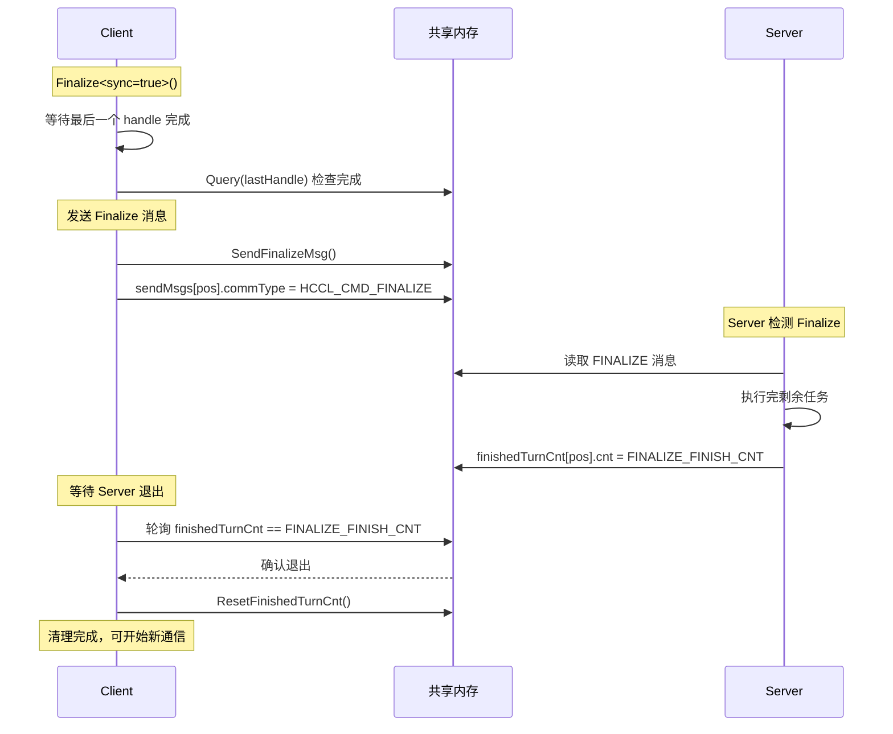

<!--
@source: impl/adv_api/detail/hccl/common/hccl_aicpu_impl.h
@source: include/adv_api/hccl/internal/hccl_msg.h
-->

# Commit/Wait 时序演示

本文档详细演示 Commit 和 Wait 机制的时序和计数逻辑。

## 基本概念

### TurnCnt 结构

> `hccl_msg.h:136-140`

```cpp
struct TurnCnt {
    uint64_t valid;   // COMMIT_VALID_MASK (987654321)
    uint64_t cnt;     // 计数值
    uint64_t reserved[6];
};
```

### 两种 TurnCnt

| 类型 | 写入方 | 读取方 | 说明 |
|------|--------|--------|------|
| `commitTurnCnt` | Client (Commit) | Server (轮询) | 表示需要执行的任务数 |
| `finishedTurnCnt` | Server (完成后) | Client (Wait) | 表示已完成的任务数 |

### 计数关系

```
handleIdRepeat_[handle]      — Prepare 时设置的 repeat 值
handleIdCommitTurnCnt_[handle] — Client 累计的 commit 计数
finishedTurnCnt[pos].cnt      — Server 累计的完成计数

约束: commitCnt <= repeat * stepCntsPerRepeat
等待: finishedTurnCnt >= waitCnt
```

## 单次 Prepare + Commit + Wait



## repeat=3 场景



## commit=true 自动提交

当 Prepare 的 `commit` 模板参数为 `true` 时，`CommonPrepareImpl` 内部自动调用 `SetCommitTurnCntToGm`：



> 见 `hccl_aicpu_impl.h:274-276`。

## commit=false 手动提交



## 多 Handle 并发场景



## 计数校验逻辑

### Commit 校验

> `hccl_aicpu_impl.h:469-477`

```cpp
const uint16_t commitCnt = handleIdCommitTurnCnt_[handleId];
if (commitCnt >= handleIdRepeat_[handleId] * GetStepCntsPerRepeatByHandle(handleId)) {
    // 错误：Commit 次数超过 repeat 上限
    return;
}
```

### Wait 校验

> `hccl_aicpu_impl.h:431-438`

```cpp
uint16_t& waitCnt = handleIdWaitCallNum_[handleId];
if (waitCnt >= handleIdCommitTurnCnt_[handleId]) {
    // 错误：Wait 次数超过 Commit 次数
    return HCCL_FAILED;
}
```

## Finalize 时序



> `FINALIZE_FINISH_CNT = 1234567899999999999`，见 `hccl_msg.h:29`。

## 多队列模式

当 `queueNum_ > 0` 时，Commit/Wait 行为变化：

| 行为 | 单队列 (queueNum_=0) | 多队列 (queueNum_>0) |
|------|---------------------|---------------------|
| Commit | 写入 `commitTurnCnt[pos]` | 不写 commitTurnCnt（消息自带 valid） |
| Wait | 阻塞轮询 `finishedTurnCnt` | 直接返回 `HCCL_SUCCESS` |
| Query | 查询 `finishedTurnCnt` | 返回 0 |
| 消息位置 | `curMsgPosition_[0]` | `curMsgPosition_[queId]` |

> 多队列模式下 Wait 不阻塞，依赖队列自身的同步机制。
