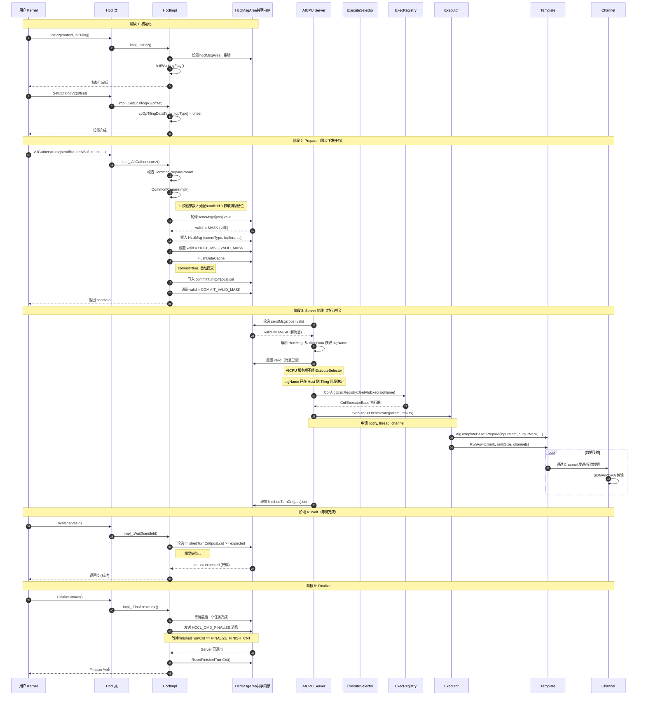
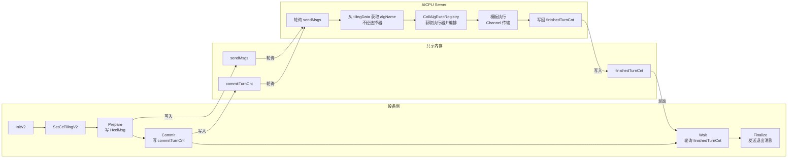
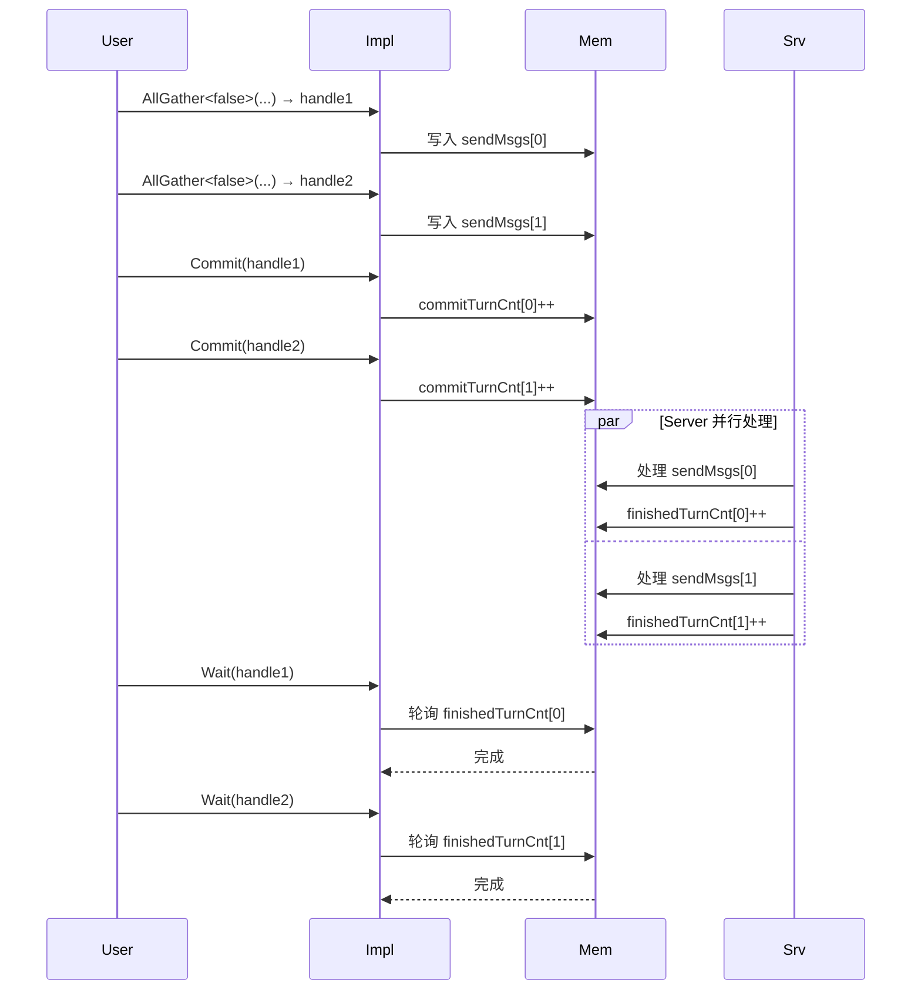

<!--
@source: include/adv_api/hccl/hccl.h
@source: impl/adv_api/detail/hccl/impl/hccl_impl.h
@source: impl/adv_api/detail/hccl/common/hccl_aicpu_impl.h
@source: impl/adv_api/detail/hccl/cc/src/ops/op_common/selector/execute_selector.cc
@source: impl/adv_api/detail/hccl/cc/src/ops/op_common/selector/auto_selector_base.cc
@source: impl/adv_api/detail/hccl/cc/src/ops/all_gather/
-->

# 完整调用流程

以 AllGather 为例，展示从用户 Kernel 调用到数据传输完成的完整调用链。

## 全局时序图

## 简化流程图

## 关键步骤说明

### 1. 初始化阶段

- `InitV2` 设置共享内存地址 `hcclMsgArea_`，初始化 Handle 表
- `SetCcTilingV2` 建立算子类型到 Tiling 数据偏移的映射
- 这两个步骤只需执行一次

### 2. Prepare 阶段（异步）

- 构造 `CommonPrepareParam`，包含算子类型、缓冲区地址、数据量等
- 轮询共享内存中消息槽位是否可用（Server 已读取上一条消息）
- 写入 `HcclMsg` 并设置 `valid` 标志
- 分配 Handle ID 并记录元信息
- 如果 `commit=true`，自动写入 commit 计数

### 3. Commit 阶段

- 递增 `commitTurnCnt`，通知 Server 执行
- 每次 Commit 对应一次任务执行
- Commit 次数不超过 `repeat * stepCntsPerRepeat`

### 4. Server 处理阶段（并行）

- Server 轮询检测 `sendMsgs` 中的 `valid` 标志
- 检测到消息后，执行算法选择 → 执行器编排 → 模板执行
- 数据通过 Channel（SDMA/RDMA）传输
- 完成后递增 `finishedTurnCnt`

### 5. Wait 阶段（阻塞）

- 轮询 `finishedTurnCnt` 是否达到预期值
- 达到后返回成功
- Wait 调用次数应与 Commit 一致

### 6. Finalize 阶段

- 等待最后一个任务完成
- 发送 `HCCL_CMD_FINALIZE` 控制消息
- 等待 Server 写入 `FINALIZE_FINISH_CNT`
- 重置 `finishedTurnCnt` 供下次使用

## 多次 Prepare 场景

> 注意：Wait 必须按 Prepare 的顺序调用（见 `hccl.h:314` 的注释）。
