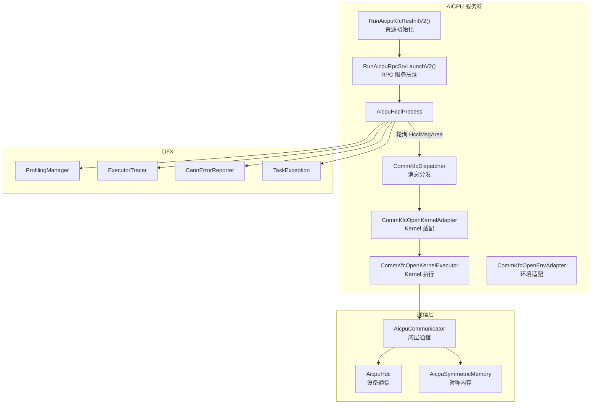
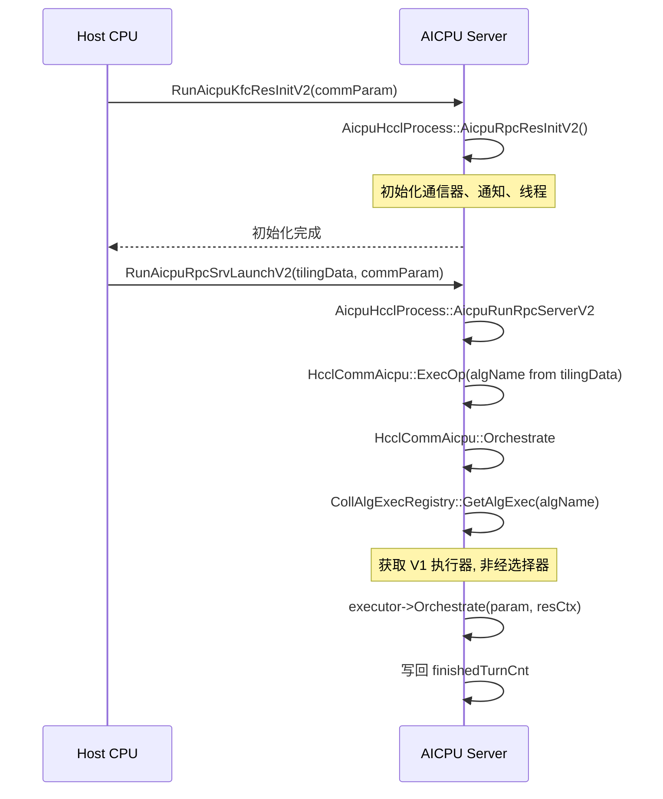
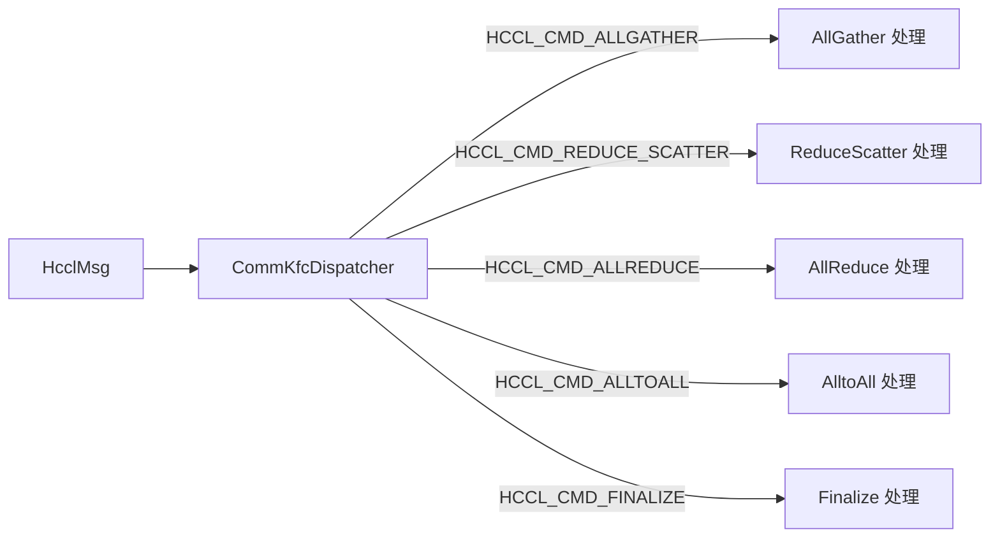

<!--
@source: impl/adv_api/detail/hccl/cc/src/aicpu_kfc/framework/device/hccl_aicpu_interface.h
@source: impl/adv_api/detail/hccl/cc/src/aicpu_kfc/framework/device/hccl_aicpu_interface.cc
@source: impl/adv_api/detail/hccl/cc/src/aicpu_kfc/framework/device/framework/aicpu_hccl_process.h
@source: impl/adv_api/detail/hccl/cc/src/aicpu_kfc/framework/device/decoupler/
@source: impl/adv_api/detail/hccl/cc/src/aicpu_kfc/framework/device/framework/
-->

# AICPU 服务端

## 概述

AICPU 服务端是 HCCL 架构中负责实际执行集合通信任务的软件组件，运行在 AI 处理器的 AICPU 上。



## RPC 入口

> `hccl_aicpu_interface.h:16-18`

AICPU 服务端通过两个导出函数提供服务：

```cpp
extern "C" {
    __attribute__((visibility("default")))
    uint32_t RunAicpuKfcResInitV2(void* args);    // 资源初始化

    __attribute__((visibility("default")))
    uint32_t RunAicpuRpcSrvLaunchV2(void* args);  // RPC 服务启动
}
```

### 调用流程



## AicpuHcclProcess

> `aicpu_hccl_process.h:23-61`

### 核心方法

| 方法 | 说明 |
|------|------|
| `AicpuRpcResInitV2` | 资源初始化（通信器、通知、线程） |
| `AicpuGetCommMutex` | 获取通信互斥锁 |
| `AicpuGetCommbyGroup` | 按 group 获取通信器 |
| `AicpuGetCommAll` | 获取所有通信器 |
| `AicpuDestoryCommbyGroup` | 销毁指定 group 的通信器 |
| `AicpuRunRpcServerV2` | 运行 RPC 服务（主循环） |
| `CallMC2MaintenanceThread` | 调用维护线程 |
| `GetCommExecStatus` | 获取通信执行状态 |
| `HandleOneSideService` | 处理单边服务 |
| `AcquireAicpuComm` | 获取 AICPU 通信器 |

### AicpuRunRpcServerV2 — RPC 服务主循环

此方法是服务端的核心循环：

1. 获取通信器 `HcclCommAicpu`
2. 读取 Tiling 数据和通信参数
3. 进入轮询循环，检测共享内存中的消息
4. 检测到消息后通过 `CommKfcDispatcher` 分发到具体算子处理
5. 算子执行完成后写回 `finishedTurnCnt`
6. 检测到 `FINALIZE` 消息后退出循环

### CalcDataSize — 数据量计算

> `aicpu_hccl_process.h:56-57`

```cpp
static HcclResult CalcDataSize(
    HcclCMDType op, HcclDataType type, u64 count,
    u32 rankSize, u64& inputSize, u64& outputSize);
```

根据算子类型、数据类型和数量计算输入输出数据大小。

## CommKfcDispatcher — 消息分发器

> `decoupler/comm_kfc_dispatcher.{h,cc}`

负责将收到的 `HcclMsg` 分发到对应的算子处理逻辑：



## Kernel 适配与执行

### CommKfcOpenKernelAdapter

> `decoupler/comm_kfc_open_kernel_adapter.{h,cc}`

将消息参数适配为 Kernel 执行所需的格式。

### CommKfcOpenKernelExecutor

> `decoupler/comm_kfc_open_kernel_executor.cc`

执行具体的 Kernel，通过 `CollAlgExecRegistryV2::Instance().GetAlgExec(opType, algName)` 获取执行器并调用 `executor->Orchestrate(param, resCtx)`（见 `comm_kfc_open_kernel_executor.cc:193-196`）。不经过算子入口函数（如 `AllGatherOutPlace`），算法名直接从 `param->algName` 获取。

### CommKfcOpenEnvAdapter

> `decoupler/comm_kfc_open_env_adapter.cc`

环境适配器，管理设备环境、资源初始化等。

## 通信器

### AicpuCommunicator

> `framework/aicpu_communicator.{h,cc}`

底层通信抽象，封装 rank 间的数据传输操作。

### AicpuHdc

> `framework/aicpu_hdc.{h,cc}`

设备通信（HDC）抽象层，提供底层硬件通信接口。

### AicpuSymmetricMemory

> `framework/aicpu_symmetric_memory.{h,cc}`

对称内存管理，支持跨 rank 的零拷贝访问。

### AicpuZeroCopyExchanger

> `framework/aicpu_zero_copy_exchanger.{h,cc}`

零拷贝数据交换器。

## DFX 组件

### Profiling

| 组件 | 文件 | 说明 |
|------|------|------|
| `ProfilingManagerDevice` | `debug/dfx/profiling/profiling_manager_device.cc` | Profiling 管理器 |
| `ProfilingExtendInfo` | `debug/dfx/profiling/profiling_extend_info.cc` | Profiling 扩展信息 |
| `ProfilingCommandHandle` | `debug/dfx/profiling/profiling_command_handle.cc` | Profiling 命令处理 |

### 诊断

| 组件 | 文件 | 说明 |
|------|------|------|
| `ExecutorTracer` | `debug/dfx/trace/executor_tracer.cc` | 执行器追踪 |
| `CannErrorReporter` | `debug/dfx/trace/cann_error_reporter.cc` | 错误上报 |
| `TaskException` | `debug/dfx/taskexception/task_exception.cc` | 任务异常处理 |

## CannDispatchBridge

> `decoupler/cann_dispatch_bridge.{h,cc}`

CANN 分发桥接，当 `UseCannBridge(opParam)` 为 true 时，算法选择走 CANN 原生路径而非 HCCL 自有选择器。
