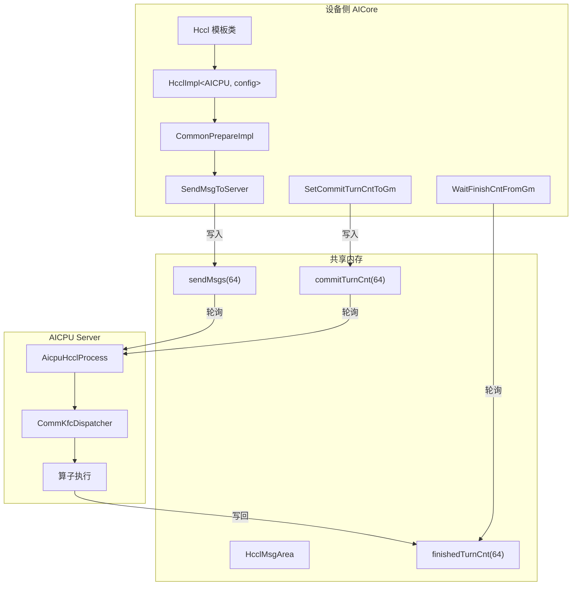

<!--
@source: impl/adv_api/detail/hccl/common/hccl_base.h
@source: impl/adv_api/detail/hccl/common/hccl_aicpu_impl.h
@source: impl/adv_api/detail/hccl/common/hccl_aicpu_common.h
@source: impl/adv_api/detail/hccl/common/hccl_inner_def.h
@source: impl/adv_api/detail/hccl/common/hccl_control.h
@source: impl/adv_api/detail/hccl/impl/platform_v310/hccl_aicpu.h
@source: impl/adv_api/detail/hccl/impl/platform_v220/hccl_aicpu.h
-->

# 设备侧 AICPU 实现

## 概述

AICPU 服务端模式是 HCCL 的主要执行模式。设备侧（AICore）作为 Client，通过共享内存与 AICPU Server 通信。



## HcclImpl 基类

> `impl/.../common/hccl_base.h:41-138`

`HcclImpl` 是模板基类，提供所有接口的空实现（返回 -1），确保不支持某平台时安全降级：

```cpp
template <HcclServerType serverType, const auto& config>
class HcclImpl {
public:
    template <bool commit = false>
    __aicore__ inline HcclHandle AllReduce(...) { return -1; }
    __aicore__ inline void InitV2(...) {}
    __aicore__ inline int32_t Wait(...) { return -1; }
    // ... 所有方法默认返回失败
};
```

## AICPU 特化实现

> `impl/.../common/hccl_aicpu_impl.h`

`HcclImpl<HcclServerType::HCCL_SERVER_TYPE_AICPU, config>` 的特化提供完整实现。

### 成员变量

| 变量 | 说明 |
|------|------|
| `hcclMsgArea_` | `__gm__ HcclMsgArea*`，指向共享内存区域 |
| `hcclContext_` | `__gm__ OpResCtx*`，运行时上下文 |
| `curHandleId_` | 当前 Handle ID 计数器 |
| `handleIdMsgPosition_[]` | Handle ID → 消息位置映射 |
| `handleIdRepeat_[]` | Handle ID → repeat 次数映射 |
| `handleIdCommitTurnCnt_[]` | Handle ID → commit 计数映射 |
| `handleIdWaitCallNum_[]` | Handle ID → wait 调用次数映射 |
| `handleId2CmdType_[]` | Handle ID → 命令类型映射 |
| `curMsgPosition_[]` | 当前消息位置（每队列） |
| `curVersion_` | Tiling 版本 |
| `workingFlag_` | 是否为工作核心 |
| `queueNum_` | 队列数 |
| `debugMode_` | 调试模式标志 |
| `tilingBaseAddr_` | Tiling 基地址 |
| `ccOpTilingDataTable_[]` | 算子类型 → Tiling 偏移映射 |
| `ccOpParamTable_[]` | 算子类型 → 参数映射 |

### CommonPrepareImpl — 核心 Prepare 逻辑

> `hccl_aicpu_impl.h:248-282`

所有算子的 Prepare 接口最终调用此方法：

```cpp
template <bool commit>
__aicore__ inline HcclHandle CommonPrepareImpl(const CommonPrepareParam& param)
{
    // 1. 重启检查
    HCCL_CHECK_RESTART(hcclMsgArea_, return INVALID_HANDLE_ID);

    // 2. 参数校验
    if (unlikely(param.repeat == 0U)) return INVALID_HANDLE_ID;
    ASCENDC_HCCL_API_ASSERT(CheckCommonPrepareParamValid(param), ...);

    // 3. 分配 Handle ID
    HcclHandle handleId = ++curHandleId_;
    ASCENDC_HCCL_API_ASSERT(handleId < HCCL_MAX_HANDLE_ID, ...);

    // 4. AlltoAllV 特殊处理：发送扩展参数
    if (param.commType.prepareType == HcclCMDType::HCCL_CMD_ALLTOALLV) {
        SendMsgToServer(param.paramExt);
    }

    // 5. 发送消息到共享内存
    const uint16_t queId = (queueNum_ == 0U ? 0U : static_cast<uint16_t>(param.dataType));
    SendMsgToServer(queId, param);

    // 6. 记录 Handle 元信息
    handleIdMsgPosition_[handleId] = curMsgPosition_[queId];
    handleIdRepeat_[handleId] = param.repeat;
    handleId2CmdType_[handleId] = static_cast<uint8_t>(param.commType.prepareType);

    // 7. 如果 commit=true，自动提交
    if constexpr (commit) {
        SetCommitTurnCntToGm(curMsgPosition_[queId],
            param.repeat * GetStepCntsPerRepeatByHandle(handleId), handleId);
    }

    // 8. 递增消息位置
    ++(curMsgPosition_[queId]);
    return handleId;
}
```

### SendMsgToServer — 消息发送

> `hccl_aicpu_impl.h:104-142`

```cpp
__aicore__ inline void SendMsgToServer(
    uint16_t queId, const CommonPrepareParam& param,
    int8_t srcGroupID, HcclHandle srcHandleID)
{
    // 1. 获取消息槽位
    __gm__ HcclMsg* hcclSendMsg;
    if (queueNum_ == 0U) {
        hcclSendMsg = hcclMsgArea_->commMsg.singleMsg.sendMsgs + curMsgPosition_[0U];
    } else {
        hcclSendMsg = hcclMsgArea_->commMsg.multiMsg.sendMsgs[queId + GetBlockIdx() * queueNum_]
                      + curMsgPosition_[queId];
    }

    // 2. 轮询等待消息槽位可用（Server 已读取上一条）
    do {
        HCCL_CHECK_RESTART(hcclMsgArea_, return);
        FlushDataCache(hcclSendMsg);
    } while (debugMode_ != HCCL_ONLY_COMPUTE &&
             hcclSendMsg->addMsg.v0Msg.valid == HCCL_MSG_VALID_MASK);

    // 3. 组装消息
    AssembleHcclMsg(param, curVersion_, curHandleId_, tiling, hcclSendMsg, &hcclMsgArea_->controlMsg);

    // 4. 刷新缓存
    FlushDataCache(reinterpret_cast<__gm__ void*>(hcclSendMsg));
}
```

### Commit 实现

> `hccl_aicpu_impl.h:457-480`

```cpp
__aicore__ inline void Commit(HcclHandle handleId)
{
    // 校验
    ASCENDC_HCCL_API_ASSERT(curVersion_ != INVALID_TILING_VERSION, ...);
    if (unlikely(handleId <= INVALID_HANDLE_ID || handleId >= HCCL_MAX_HANDLE_ID)) { ... return; }

    // 检查 commit 次数不超过上限
    const uint16_t commitCnt = handleIdCommitTurnCnt_[handleId];
    if (unlikely(commitCnt >= handleIdRepeat_[handleId] * GetStepCntsPerRepeatByHandle(handleId))) { ... return; }

    // 递增 commit 计数
    const uint16_t stepSize = GetStepSizeByHandle(handleId);
    SetCommitTurnCntToGm(handleIdMsgPosition_[handleId],
        (stepSize == 0U ? 1U : stepSize), handleId);
}
```

### Wait 实现

> `hccl_aicpu_impl.h:415-454`

```cpp
__aicore__ inline int32_t Wait(HcclHandle handleId)
{
    // 校验
    HCCL_CHECK_RESTART(hcclMsgArea_, return HCCL_FAILED);
    ASCENDC_HCCL_API_ASSERT(curVersion_ != INVALID_TILING_VERSION, ...);
    if (queueNum_ != 0U) return HCCL_SUCCESS;  // 多队列模式不阻塞

    // 校验 wait 次数
    uint16_t& waitCnt = handleIdWaitCallNum_[handleId];
    if (unlikely(waitCnt >= handleIdCommitTurnCnt_[handleId])) { ... return HCCL_FAILED; }

    // 记录统计
    if (workingFlag_) {
        __gm__ TurnCnt* apiInfo = &(hcclMsgArea_->apiStats.waitStats[handleId2CmdType_[handleId]]);
        FlushDataCache(apiInfo); ++(apiInfo->cnt); FlushDataCache(apiInfo);
    }

    // 轮询等待完成
    int8_t curMsgPos = handleIdMsgPosition_[handleId];
    const uint16_t stepSize = GetStepSizeByHandle(handleId);
    waitCnt += (stepSize == 0U ? 1U : stepSize);
    (void)WaitFinishCntFromGm(curMsgPos, waitCnt);
    return HCCL_SUCCESS;
}
```

### WaitFinishCntFromGm — 轮询完成计数

> `hccl_aicpu_impl.h:230-246`

```cpp
__aicore__ inline uint64_t WaitFinishCntFromGm(uint8_t msgPos, uint64_t expectedCnt)
{
    __gm__ TurnCnt* finishGM = hcclMsgArea_->commMsg.singleMsg.finishedTurnCnt + msgPos;
    GlobalTensor<int64_t> globalHcclMsgArea;
    while (true) {
        HCCL_CHECK_RESTART(hcclMsgArea_, return finishGM->cnt);
        FlushDataCacheAicpu(globalHcclMsgArea, finishGM);
        if ((debugMode_ == HCCL_ONLY_COMPUTE) || (finishGM->cnt >= expectedCnt)) {
            break;
        }
    }
    return finishGM->cnt;
}
```

### InitWorkingFlag — 工作核心判断

> `hccl_aicpu_impl.h:67-80`

根据 `config.type` 和 `config.blockId` 判断当前核心是否为工作核心：

```cpp
if constexpr (config.type == CoreType::ON_AIV) {
    workingFlag_ = (g_coreType == AscendC::AIV && GetBlockIdx() == config.blockId);
} else if constexpr (config.type == CoreType::ON_AIC) {
    workingFlag_ = (g_coreType == AscendC::AIC && GetBlockIdx() == config.blockId);
} else {
    workingFlag_ = (GetBlockIdx() == config.blockId);
}
```

只有工作核心才会实际写入消息到共享内存，非工作核心的写操作被跳过。

## V310 平台特化

> `impl/.../impl/platform_v310/hccl_aicpu.h`

V310（Ascend 910_93）平台特化：

### InitV2

> `platform_v310/hccl_aicpu.h:30-45`

1. 从 `initTiling` 读取 `Mc2InitTilingInner`
2. 设置 `debugMode_`、`devType_`、`tilingBaseAddr_`
3. 将 `context` 转为 `OpResCtx*`，获取 `workspace`
4. 调用 `InitInner(workspace, CONTEXT_DECOUPLE_VERSION)`

### SetCcTilingV2

> `platform_v310/hccl_aicpu.h:48-65`

1. 从 `tilingBaseAddr_ + offset` 读取 `Mc2CcTilingInner`
2. 提取并校验 `opType`
3. 建立 `ccOpTilingDataTable_[opType] = offset` 映射
4. 匹配 `algInfo` 建立 `ccOpParamTable_[opType]` 映射

### GetRankDim

> `platform_v310/hccl_aicpu.h:22-27`

返回 `hcclContext_->rankSize`（注意 V220 平台可能不同）。

## V220 平台特化

> `impl/.../impl/platform_v220/hccl_aicpu.h`

V220（Atlas A2）平台特化，结构与 V310 类似但具体实现细节可能不同。

## 消息组装

### AssembleHcclMsg

> `hccl_aicpu_common.h`

将 `CommonPrepareParam` 转换为 `HcclMsg` 结构并写入共享内存，包含 XOR 校验和计算。

### AssembleHcclMsgExt

> `hccl_aicpu_common.h:38-49`

AlltoAllV 专用，将 `sendCounts`、`sdispls`、`recvCounts`、`rdispls` 数组写入 `HcclMsgExt`。

## 重启机制

> `hccl_inner_def.h` / `hccl_control.h`

通过 `HCCL_CHECK_RESTART` 宏检测 `HcclMsgArea` 的 `ControlHcclMsg` 中的 `restart` 标志，支持运行时重启恢复。
