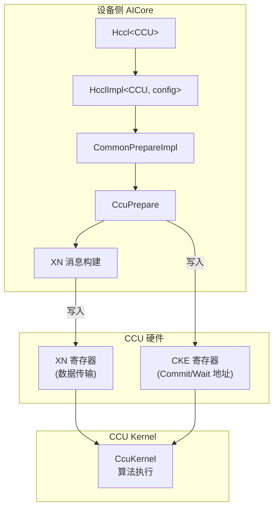

<!--
@source: impl/adv_api/detail/hccl/impl/platform_v310/hccl_ccu_v0.h
@source: impl/adv_api/detail/hccl/ccu/hccl_ccu_v0_prepare.h
@source: impl/adv_api/detail/hccl/ccu/hccl_ccu_xn_utils.h
@source: impl/adv_api/detail/hccl/common/hccl_inner_def.h
-->

# 设备侧 CCU 实现

## 概述

CCU（Communication Compute Unit）是 V310 平台的通信计算单元。与 AICPU 模式不同，CCU 模式下消息通过 CCU 硬件寄存器传输，由 CCU 硬件直接执行数据搬移，不经过 AICPU 软件栈，从而降低延迟。



## CCU 相关常量

> `hccl_inner_def.h:141-155`

| 常量 | 值 | 说明 |
|------|-----|------|
| `CCU_CKE_SIZE` | 8 | CKE 大小 |
| `CCU_XN_DATA_SIZE` | 8 | 每个 XN 的字节数 |
| `CCU_USED_XN_NUM` | 15 | 当前使用的 XN 数量 |
| `CCU_MAX_MSG_NUM` | 64 | 发送给 CCU 的最大消息队列长度 |
| `CCU_MSG_XN_NUM` | 64 | 最大 XN 数量（每消息体 64*8B=512B） |
| `CCU_LOOP_COUNT` | 128 | CCU 循环数 |
| `CCU_LOOP_COUNT_M2M_RE` | 16 | AllReduce/ReduceScatter 循环数 |
| `CCU_LOOP_COUNT_M2M_AG` | 8 | AllGather 循环数 |
| `CCU_LOOP_COUNT_ATAVW` | 8 | AlltoAllvWrite 循环数 |
| `CCU_MEMSLICE_SIZE` | 4096 | CCU MS 大小 |
| `CCU_MAX_COMM_DATA` | 256MB | 最大通信数据量 |

## CCU 消息结构

### CCUMsg

> `hccl_inner_def.h:157-162`

```cpp
struct CCUMsg {
    GM_ADDR xnData;        // 转换为 CCU 寄存器值的消息
    GM_ADDR xnAddr;        // XN 地址
    GM_ADDR commitCKEAddr; // 对应每个 msg 的 commit 地址
    GM_ADDR waitCKEAddr;   // 对应每个 msg 的 wait 地址
};
```

### CCUMsgExt

> `hccl_inner_def.h:164-169`

```cpp
struct CCUMsgExt {
    uint64_t sendSize;
    uint64_t loopNum = UINT64_MAX - 1;
    uint64_t sendOffset;
    uint64_t recvOffset;
};
```

### CcuPrepareParam

> `hccl_inner_def.h:171-178`

```cpp
struct CcuPrepareParam {
    uint32_t rankNum;
    uint32_t rankId;
    uint32_t repeatIndex;
    uint8_t alltoallvCnt;
    __gm__ CCUMsgExt* ccuMsgExt;
    uint64_t scratchAddr;
};
```

## CCU 特化实现

> `impl/.../impl/platform_v310/hccl_ccu_v0.h`

### 算子接口

CCU 特化提供与 AICPU 特化相同的算子接口（AllReduce、AllGather、ReduceScatter、AlltoAll、AlltoAllV），但内部实现走 `CcuPrepare` 路径：

```cpp
template <const auto& config>
template <bool commit>
__aicore__ inline HcclHandle HcclImpl<HcclServerType::HCCL_SERVER_TYPE_CCU, config>::AllReduce(
    GM_ADDR sendBuf, GM_ADDR recvBuf, uint64_t count,
    HcclDataType dataType, HcclReduceOp op, uint8_t repeat)
{
    ASCENDC_HCCL_API_ASSERT(op >= HCCL_REDUCE_SUM && op < HCCL_REDUCE_RESERVED, ...);
    return CommonPrepareImpl<commit>(
        {HcclCMDType::HCCL_CMD_ALLREDUCE, sendBuf, recvBuf, count, dataType, dataType, op, 0, repeat});
}
```

> 见 `hccl_ccu_v0.h:24-33`。

CCU 模式的 `CommonPrepareImpl` 实现位于 `ccu/hccl_ccu_v0_prepare.h`，它构建 CCU 消息（XN 数据）并写入 CCU 硬件寄存器，而非通过共享内存 `HcclMsgArea` 传递。

## CCU Kernel

CCU 算法通过 CCU Kernel 执行，位于各算子的 `template/ccu/kernel/` 目录：

| Kernel 类 | 文件 | 说明 |
|-----------|------|------|
| `CcuKernelAllGatherMesh1D` | `ccu_kernel_all_gather_mesh1d.{h,cc}` | AllGather 1D Mesh |
| `CcuKernelAllGatherMesh1DMem2Mem` | `ccu_kernel_all_gather_mesh1d_mem2mem.{h,cc}` | AllGather Mem2Mem |
| `CcuKernelAllGatherNHR1DMem2Mem` | `ccu_kernel_all_gather_nhr1d_mem2mem.{h,cc}` | AllGather NHR |
| `CcuKernelAllGather2DiesMesh1D` | `ccu_kernel_all_gather_2dies_mesh_1D.{h,cc}` | AllGather 2Die |
| `CcuKernelReduceScatterMesh1D` | `ccu_kernel_reduce_scatter_mesh1d.{h,cc}` | ReduceScatter 1D Mesh |
| `CcuKernelReduceScatterNHR1DMem2Mem` | `ccu_kernel_reduce_scatter_nhr1d_mem2mem.{h,cc}` | ReduceScatter NHR |

## CCU 与 AICPU 模式对比

| 方面 | AICPU 模式 | CCU 模式 |
|------|-----------|----------|
| 消息传递 | 共享内存 `HcclMsgArea` | CCU 硬件寄存器（XN/CKE） |
| 执行主体 | AICPU 软件 | CCU 硬件 |
| 延迟 | 较高（软件轮询） | 较低（硬件直接执行） |
| 支持的算子 | 全部 | AllReduce/AllGather/ReduceScatter/AlltoAll |
| 平台 | V220 + V310 | 仅 V310 |
| serverType | `HCCL_SERVER_TYPE_AICPU` (0) | `HCCL_SERVER_TYPE_CCU` (5) |
| 条件编译 | 默认 | `MC2_CLIENT_ENABLE_CCU` |

## CCU 快速下发

> `alg_param.h:287-312`

CCU 模式支持快速下发（FastLaunch），通过 `CcuFastLaunchCtx` 结构预缓存 kernel 参数：

```cpp
struct CcuFastLaunchCtx {
    char algName[OP_ALG_LENGTH];
    u32 threadNum;
    u32 ccuKernelNum[MAX_TEMP_NUM_IN_ALGO];
    // 紧接 ThreadHandle 数组
    // 紧接 CcuKernelSubmitInfo 数组
};
```

快速下发避免了每次调用时的参数重新计算，通过缓存的 `cachedArgs` 直接提交 kernel。
