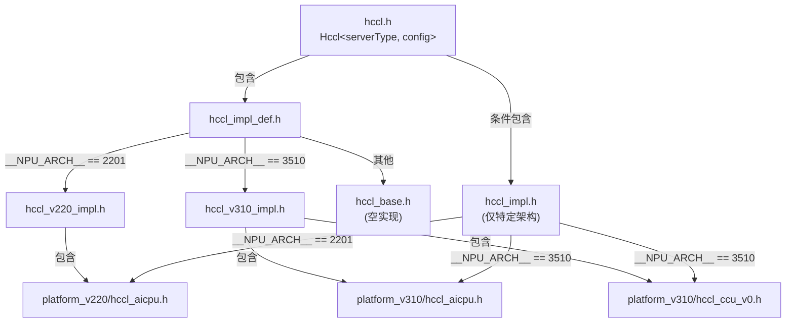
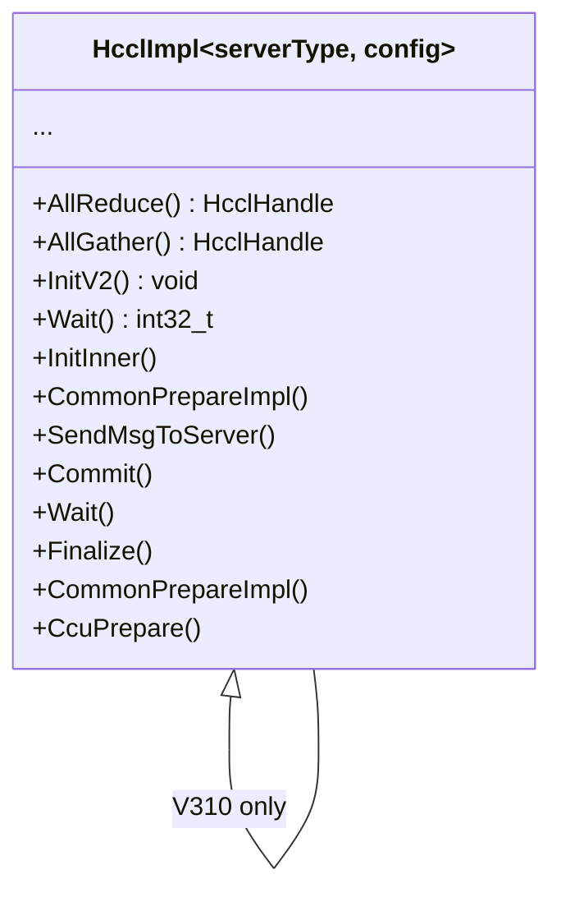

<!--
@source: impl/adv_api/detail/hccl/impl/hccl_impl_def.h
@source: impl/adv_api/detail/hccl/impl/hccl_impl.h
@source: impl/adv_api/detail/hccl/impl/hccl_v220_impl.h
@source: impl/adv_api/detail/hccl/impl/hccl_v310_impl.h
@source: impl/adv_api/detail/hccl/impl/platform_v220/hccl_aicpu.h
@source: impl/adv_api/detail/hccl/impl/platform_v310/hccl_aicpu.h
@source: impl/adv_api/detail/hccl/impl/platform_v310/hccl_ccu_v0.h
@source: include/adv_api/hccl/hccl.h
-->

# 平台分发机制

## 编译期平台分发

HCCL 通过 `__NPU_ARCH__` 宏在编译期选择平台实现，无运行时开销。



## 分发逻辑

### hccl_impl_def.h

> `impl/.../hccl/impl/hccl_impl_def.h:20-26`

```cpp
#include "../common/hccl_base.h"  // HcclImpl 基类（空实现）

#if defined(__NPU_ARCH__) && __NPU_ARCH__ == 2201
#include "hccl_v220_impl.h"
#endif

#if defined(__NPU_ARCH__) && __NPU_ARCH__ == 3510
#include "hccl_v310_impl.h"
#endif
```

### hccl.h 中的条件包含

> `include/adv_api/hccl/hccl.h:418-421`

```cpp
#if defined(__NPU_ARCH__) && \
    (__NPU_ARCH__ == 3510 || __NPU_ARCH__ == 1001 || \
     __NPU_ARCH__ == 2002 || __NPU_ARCH__ == 2201)
#include "../../../impl/adv_api/detail/hccl/impl/hccl_impl.h"
#endif
```

`hccl_impl.h` 包含了 `Hccl` 类方法的实际转发实现（DFX 守卫 + 委托给 `impl_`）。只有在受支持的架构上才会被包含。

### hccl_impl.h 中的平台选择

> `impl/.../hccl/impl/hccl_impl.h:18-24`

```cpp
#if __NPU_ARCH__ == 2201
#include "platform_v220/hccl_aicpu.h"
#elif __NPU_ARCH__ == 3510
#include "platform_v310/hccl_aicpu.h"
#include "platform_v310/hccl_ccu_v0.h"
#endif
```

## 支持的平台

| `__NPU_ARCH__` | 平台 | AICPU 支持 | CCU 支持 | 实现文件 |
|----------------|------|-----------|----------|----------|
| `2201` | Atlas A2 训练/推理 | 是 | 否 | `platform_v220/hccl_aicpu.h` |
| `3510` | Ascend 910_93 | 是 | 是 | `platform_v310/hccl_aicpu.h` + `platform_v310/hccl_ccu_v0.h` |
| `1001` | （待确认） | — | — | — |
| `2002` | （待确认） | — | — | — |
| 其他 | 不支持 | 空实现 | 空实现 | `hccl_base.h` |

## HcclImpl 特化选择

平台分发最终体现在 `HcclImpl` 的模板特化上：



### AICPU 特化

- **V220**：`platform_v220/hccl_aicpu.h` 包含 `common/hccl_aicpu_impl.h` 的公共实现
- **V310**：`platform_v310/hccl_aicpu.h` 包含 `common/hccl_aicpu_impl.h` 并增加 V310 特有方法

### CCU 特化

- **仅 V310**：`platform_v310/hccl_ccu_v0.h` 包含 `ccu/hccl_ccu_v0_prepare.h`

## V220 vs V310 差异

| 方面 | V220 (Atlas A2) | V310 (910_93) |
|------|-----------------|---------------|
| 最大 rank 数 | 32 (`HCCL_MAX_RANK_NUM`) | 64 (`HCCL_MAX_RANK_NUM_V310`) |
| CCU 支持 | 否 | 是 |
| HcclCombineOpParam | 标准 | 扩展（含 xnOffset、ckeOffset、opType 表） |
| Tiling 版本 | NEW_TILING_VERSION | CONTEXT_DECOUPLE_VERSION |
| AssembleHcclMsg | `AssembleHcclMsg` | `AssembleHcclMsgV2` |
| BatchWrite | 支持 | 不支持（返回 -1） |
| AlltoAllvWrite | 支持 | 不支持（返回 -1） |

> V310 的 `HcclCombineOpParam` 扩展字段见 `hccl_inner_def.h:95-103`。

## HcclTilingVersion — Tiling 版本

> `hccl_msg.h:35-41`

| 版本 | 说明 |
|------|------|
| `DEPRECATED_TILING_VERSION` | 废弃版本 |
| `NEW_TILING_VERSION` | 新 Tiling 版本（不支持在线编译） |
| `ONLINE_COMPILATION_TILING_VERSION` | 支持在线编译的版本 |
| `CONTEXT_DECOUPLE_VERSION` | Context 解耦版本（V310 当前使用） |
| `INVALID_TILING_VERSION` | 无效版本 |

不同 Tiling 版本影响了 Tiling 数据的存储方式和消息组装逻辑。
