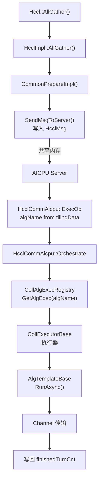

<!--
@source: include/adv_api/hccl/hccl.h (AllGather API)
@source: include/adv_api/hccl/internal/hccl.h (HcclAllGather)
@source: impl/adv_api/detail/hccl/cc/src/ops/all_gather/all_gather_op.h
@source: impl/adv_api/detail/hccl/cc/src/ops/all_gather/all_gather_op.cc
@source: impl/adv_api/detail/hccl/cc/src/ops/all_gather/selector/all_gather_auto_selector.h
@source: impl/adv_api/detail/hccl/cc/src/ops/all_gather/selector/all_gather_auto_selector.cc
@source: impl/adv_api/detail/hccl/cc/src/ops/all_gather/executor/
@source: impl/adv_api/detail/hccl/cc/src/ops/all_gather/template/
-->

# AllGather 算子详解

## API 接口

### 设备侧 API

> `include/adv_api/hccl/hccl.h:102-105`

```cpp
template <bool commit = false>
__aicore__ inline HcclHandle AllGather(
    GM_ADDR sendBuf, GM_ADDR recvBuf, uint64_t sendCount,
    HcclDataType dataType, uint64_t strideCount, uint8_t repeat = 1);
```

### Host 侧 C API

> `include/adv_api/hccl/internal/hccl.h:119-120`

```cpp
extern HcclResult HcclAllGather(
    void* sendBuf, void* recvBuf, uint64_t sendCount, HcclDataType dataType,
    HcclComm comm, aclrtStream stream);
```

## 算子入口

> `all_gather_op.h:34-53`

| 函数 | 说明 |
|------|------|
| `HcclAllGather` | C 接口入口 |
| `HcclAllGatherGraphMode` | 图模式入口 |
| `AllGatherOutPlace` | Out-of-place 执行入口 |
| `AllGatherOutPlaceGraphMode` | 图模式执行入口 |
| `AllGatherOutPlaceCommon` | 公共执行逻辑 |
| `AllGatherInitAndCheck` | 初始化与参数检查 |
| `CheckAllGatherInputPara` | 输入参数校验 |
| `AllGatherSupportSymmetricMemory` | 是否支持对称内存 |

## 选择器

### AllGatherAutoSelector

> `all_gather_auto_selector.h:17-48`

继承 `AutoSelectorBase`，实现以下子选择器：

| 方法 | 说明 |
|------|------|
| `SelectCcuMsAlgo` | CCU_MS 模式选择 |
| `SelectMeshAlgo` | Mesh 拓扑选择（CCU_MS 子方法） |
| `SelectCcuScheduleAlgo` | CCU_SCHED 模式选择 |
| `SelectCcuScheduleUBXAlgo` | UBX 机型 CCU_SCHED 选择 |
| `SelectCcuScheduleLevel0Algo` | Level0 CCU_SCHED 选择 |
| `SelectAicpuAlgo` | AICPU 模式选择 |
| `SelectAivAlgo` | AIV 模式选择 |
| `SelectDPUAlgo` | DPU 模式选择 |

**注册**：`REGISTER_SELECTOR_BY_OPTYPE(HCCL_CMD_ALLGATHER, 18, AllGatherAutoSelector)`

### 算法选择决策表

> 基于 `all_gather_auto_selector.cc` 源码分析。

#### CCU_MS 模式

| topoLevelNums | level0Topo | 条件 | 算法名 |
|---------------|------------|------|--------|
| > 1 | MESH_1D | — | `CcuAllGatherParallelMeshNHR` |
| > 1 | 非 MESH_1D | — | NOT_MATCH |
| = 1 | MESH_1D | — | `CcuAllGatherMesh1D` |
| = 1 | MESH_1D_CLOS | dataSize <= 512KB | `CcuAllGatherMesh1DUBX` |
| = 1 | MESH_1D_CLOS | dataSize > 512KB, MeshNum==ClosNum, rankSize<=4 | `CcuAllGatherConcurrentMesh1DNHR` |
| = 1 | MESH_1D_CLOS | dataSize > 512KB, 其他 | NOT_MATCH |
| = 1 | 其他 | — | NOT_MATCH |

#### CCU_SCHED 模式

| topoLevelNums | level0Topo | 条件 | 算法名 |
|---------------|------------|------|--------|
| > 1 | MESH_1D | Level1Nhr=true | `CcuAllGatherNHR1DMem2Mem` |
| > 1 | MESH_1D | is2DieFullMesh | NOT_MATCH |
| > 1 | MESH_1D | localNetInsSize=1 | `CcuAllGatherNHR1DMem2Mem` |
| > 1 | MESH_1D | 其他 | `CcuAllGatherParallelMesh1DNHR` |
| > 1 | 非 MESH_1D | — | NOT_MATCH |
| = 1 | MESH_1D | TWO_DIE_REGULAR | `CcuAllGatherMesh2Die` |
| = 1 | MESH_1D | TWO_DIE_NOT_REGULAR | NOT_MATCH |
| = 1 | MESH_1D | SINGLE_DIE | `CcuAllGatherMesh1DMem2Mem` |
| = 1 | MESH_1D_CLOS | dataSize > 512KB, MeshNum==ClosNum, rankSize<=4 | `CcuAllGatherConcurrentMesh1DNHRMem` |
| = 1 | MESH_1D_CLOS | dataSize > 512KB, ClosNum%MeshNum==0 | `CcuAllGatherParallelMesh1DNHRMemUBX` |
| = 1 | MESH_1D_CLOS | dataSize > 512KB, 其他 | `CcuAllGatherNHR1DMem2MemUBX` |
| = 1 | MESH_1D_CLOS | dataSize <= 512KB | `CcuAllGatherMesh1DMem2MemUBX` |

#### AICPU 模式

| topoLevelNums | level0Topo | 条件 | 算法名 |
|---------------|------------|------|--------|
| > 1 | — | Level1Nhr=true | `InsAllGatherNHR` |
| > 1 | — | Level0Nhr=true | `InsAllGatherNHR` |
| > 1 | — | localNetInsSize=1 | `InsAllGatherNHR` |
| > 1 | MESH_1D | 其他 | `InsAllGatherParallelMesh1DNHR` |
| > 1 | 非 MESH_1D | — | NOT_MATCH |
| = 1 | MESH_1D | — | `InsAllGatherMesh1D` |
| = 1 | MESH_1D_CLOS | MeshNum==ClosNum, rankSize<=4, data>512KB | `InsAllGatherConcurrentMesh1DNHR` |
| = 1 | MESH_1D_CLOS | MeshNum==ClosNum, rankSize<=4, data<=512KB | `InsAllGatherMesh1D` |
| = 1 | MESH_1D_CLOS | ClosNum%MeshNum==0, data>512KB | `InsAllGatherParallelMesh1DNHRUBX` |
| = 1 | MESH_1D_CLOS | 其他 | `InsAllGatherNHR` |
| = 1 | CLOS | — | `InsAllGatherNHR` |

#### AIV 模式

固定选择 `AivAllGatherMesh1D`。

#### DPU 模式

| 条件 | 算法名 |
|------|--------|
| topoLevelNums > 1 且 (localNetInsSize=1 或 level0Topo==MESH_1D) | `InsAllGatherMeshNhrDPU` |
| 其他 | NOT_MATCH |

## 执行器

### 执行器类

| 执行器类 | 文件 | 模板数 | 说明 |
|----------|------|--------|------|
| `InsV2AllGatherSoleExecutor` | `ins_v2_all_gather_sole_executor.{h,cc}` | 1 | 单模板执行器 |
| `InsV2AllGatherConcurrentExecutor` | `ins_v2_all_gather_concurrent_executor.{h,cc}` | 2 | 并发执行器（Mesh+NHR） |
| `InsV2AllGatherParallelExecutor` | `ins_v2_all_gather_parallel_executor.{h,cc}` | 2 | 并行执行器（多层级） |
| `InsV2AllGatherSequenceExecutor` | `ins_v2_all_gather_sequence_executor.{h,cc}` | 2 | 顺序执行器（DPU） |

### 执行器注册表

| 算法名 | 执行器 | 拓扑匹配 | 模板 |
|--------|--------|----------|------|
| `InsAllGatherMesh1D` | SoleExecutor | TopoMatch1D | `InsTempAllGatherMesh1D` |
| `InsAllGatherNHR` | SoleExecutor | TopoMatch1D | `InsTempAllGatherNHR` |
| `InsAllGatherConcurrentMesh1DNHR` | ConcurrentExecutor | TopoMatchUBX | `InsTempAllGatherMesh1D` + `InsTempAllGatherNHR` |
| `InsAllGatherParallelMesh1DNHR` | ParallelExecutor | TopoMatchMultilevel | `InsTempAllGatherMesh1D` + `InsTempAllGatherNHR` |
| `InsAllGatherParallelMesh1DNHRUBX` | ParallelExecutor | TopoMatchUBX | `InsTempAllGatherMesh1D` + `InsTempAllGatherNHR` |
| `InsAllGatherMeshNhrDPU` | SequenceExecutor | TopoMatchMultilevel | `InsTempAllGatherMesh1D` + `InsTempAllGatherNHRDPU` |
| `CcuAllGatherMesh1D` | SoleExecutor | TopoMatch1D | `CcuTempAllGatherMesh1D` |
| `CcuAllGatherMesh1DMem2Mem` | SoleExecutor | TopoMatch1D | `CcuTempAllGatherMesh1DMem2Mem` |
| `CcuAllGatherNHR1DMem2Mem` | SoleExecutor | TopoMatch1D | `CcuTempAllGatherNHR1DMem2Mem` |
| `CcuAllGatherMesh1DUBX` | SoleExecutor | TopoMatchUBX | `CcuTempAllGatherMesh1D` |
| `CcuAllGatherNHR1DMem2MemUBX` | SoleExecutor | TopoMatchUBX | `CcuTempAllGatherNHR1DMem2Mem` |
| `CcuAllGatherMesh1DMem2MemUBX` | SoleExecutor | TopoMatchUBX | `CcuTempAllGatherMesh1DMem2Mem` |
| `CcuAllGatherConcurrentMesh1DNHR` | ConcurrentExecutor | TopoMatchUBX | `CcuTempAllGatherMesh1D` + `CcuTempAllGatherNHR1DMultiJettyMem2Mem` |
| `CcuAllGatherConcurrentMesh1DNHRMem` | ConcurrentExecutor | TopoMatchUBX | `CcuTempAllGatherMesh1DMem2Mem` + `CcuTempAllGatherNHR1DMultiJettyMem2Mem` |
| `CcuAllGatherParallelMesh1DNHR` | ParallelExecutor | TopoMatchMultilevel | `CcuTempAllGatherMesh1DMem2Mem` + `CcuTempAllGatherNHR1DMem2Mem` |
| `CcuAllGatherParallelMesh1DNHRMemUBX` | ParallelExecutor | TopoMatchUBX | `CcuTempAllGatherMesh1DMem2Mem` + `CcuTempAllGatherNHR1DMultiJettyMem2Mem` |
| `CcuKernelAllGather2DiesMeshMem2Mem1D` | SoleExecutor | TopoMatch1D | `CcuTempAllGather2DiesMeshMem2Mem1D` |
| `CcuKernelAllGather2DiesMesh1D` | SoleExecutor | TopoMatch1D | `CcuTempAllGather2DiesMesh1D` |

> CCU 相关注册受 `#if !defined(AICPU_COMPILE) && MC2_CLIENT_ENABLE_CCU` 条件编译控制。

## 模板

### AICPU 模板

| 模板类 | 文件 | 说明 |
|--------|------|------|
| `InsTempAllGatherMesh1D` | `template/aicpu/ins_temp_all_gather_mesh_1D.{h,cc}` | 1D Mesh AllGather |
| `InsTempAllGatherNHR` | `template/aicpu/ins_temp_all_gather_nhr.{h,cc}` | NHR AllGather |
| `InsTempAllGatherNHRDPU` | `template/aicpu/ins_temp_all_gather_nhr_dpu.{h,cc}` | NHR DPU AllGather |
| `InsTempAllGatherMesh1DZAxisDetour` | `template/aicpu/ins_temp_all_gather_mesh_1D_Z_axis_detour.{h,cc}` | Z 轴绕行 Mesh |

### CCU 模板

| 模板类 | 文件 | 说明 |
|--------|------|------|
| `CcuTempAllGatherMesh1D` | `template/ccu/ccu_temp_all_gather_mesh_1D.{h,cc}` | CCU 1D Mesh |
| `CcuTempAllGatherMesh1DMem2Mem` | `template/ccu/ccu_temp_all_gather_mesh_1D_mem2mem.{h,cc}` | CCU Mem2Mem |
| `CcuTempAllGatherNHR1DMem2Mem` | `template/ccu/ccu_temp_all_gather_nhr_1D_mem2mem.{h,cc}` | CCU NHR Mem2Mem |
| `CcuTempAllGatherNHR1DMultiJettyMem2Mem` | `template/ccu/ccu_temp_all_gather_nhr_1D_multi_jetty_mem2mem.{h,cc}` | CCU NHR Multi-Jetty |
| `CcuTempAllGather2DiesMesh1D` | `template/ccu/ccu_temp_all_gather_2dies_mesh_1D.{h,cc}` | CCU 2Die Mesh |
| `CcuTempAllGather2DiesMeshMem2Mem1D` | `template/ccu/ccu_temp_all_gather_2dies_mesh_1d_mem2mem.{h,cc}` | CCU 2Die Mem2Mem |

### CCU Kernel 模板

位于 `template/ccu/kernel/`，提供底层 CCU kernel 实现。

## 完整调用链



> 注：AICPU 服务端不经 `AllGatherOutPlace` 算子入口和 `ExecuteSelector`，算法名在 Host 侧 Tiling 阶段已确定并通过 `tilingData` 传入。详见 [架构总览](../architecture/overview.md) 中的两条路径说明。
