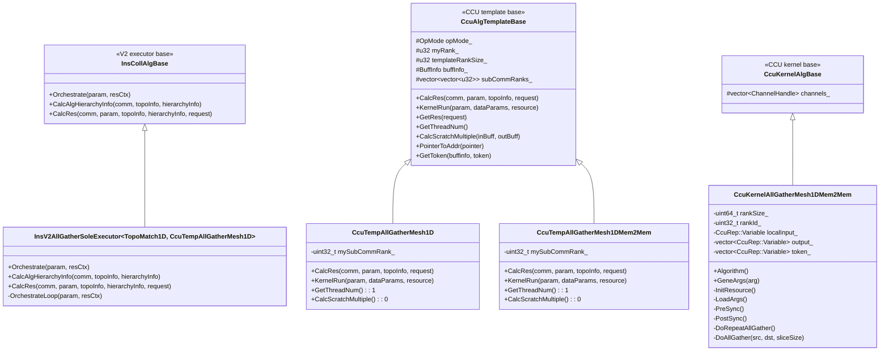
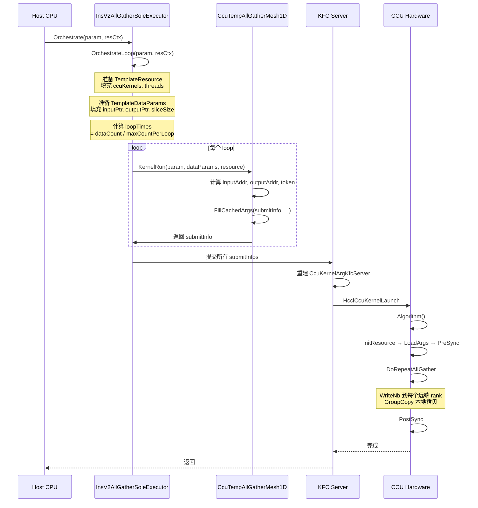

<!--
@source: impl/adv_api/detail/hccl/cc/src/ops/all_gather/executor/ins_v2_all_gather_sole_executor.{h,cc}
@source: impl/adv_api/detail/hccl/cc/src/ops/all_gather/template/ccu/ccu_temp_all_gather_mesh_1D.{h,cc}
@source: impl/adv_api/detail/hccl/cc/src/ops/all_gather/template/ccu/ccu_temp_all_gather_mesh_1D_mem2mem.{h,cc}
@source: impl/adv_api/detail/hccl/cc/src/ops/all_gather/template/ccu/kernel/ccu_kernel_all_gather_mesh1d_mem2mem.{h,cc}
@source: impl/adv_api/detail/hccl/cc/src/ops/op_common/template/ccu_alg_template_base.{h,cc}
@source: impl/adv_api/detail/hccl/cc/src/ops/op_common/template/ccu/ccu_kernel_alg_base.{h,cc}
@source: impl/adv_api/detail/hccl/cc/src/ops/op_common/template/ccu/ccu_kernel_utils.{h,cc}
@source: impl/adv_api/detail/hccl/cc/src/ops/op_common/template/template_utils.h
@source: impl/adv_api/detail/hccl/cc/src/ops/op_common/op_common.cc
@source: impl/adv_api/detail/hccl/cc/src/ops/op_common/inc/alg_param.h
@source: impl/adv_api/detail/hccl/cc/src/ops/all_gather/selector/all_gather_auto_selector.{h,cc}
@source: impl/adv_api/include/adv_api/hccl/internal/hcomm/pkg_inc/hcomm/ccu/
-->

# Ascend 950 AllGather CCU Mesh 算法详细设计

> 本文档聚焦 `__NPU_ARCH__ == 3510`（Ascend 950）平台下 AllGather 算法的 CCU Mesh 通路。

## 1. 概述

CCU（Communication Compute Unit）是 Ascend 950 上的专用通信硬件单元。AllGather CCU Mesh 算法利用 CCU 硬件的 WriteNb（非阻塞写）和 CKE（同步信号）机制，在 Mesh 拓扑的 rank 之间实现高效的数据收集。

### 1.1 核心特点

- **硬件加速**：数据传输由 CCU 硬件直接执行，不经 AICPU 软件栈
- **Mesh 拓扑**：适用于服务器内 1D Mesh 全连接拓扑
- **One-Shot 模式**：每个 rank 将自己的数据一次性广播给所有其他 rank
- **CKE 同步**：通过 CKE 寄存器实现 rank 间的 PreSync 和 PostSync

### 1.2 算法选择条件

> `all_gather_auto_selector.cc:17-36`

当 `opExecuteConfig == CCU_MS` 且 `topoLevelNums == 1` 且 `level0Topo == MESH_1D` 时，选择 `CcuAllGatherMesh1D`。

## 2. 类层次结构



## 3. 注册机制

### 3.1 执行器注册

> `ins_v2_all_gather_sole_executor.cc:197-205`

```cpp
#if !defined(AICPU_COMPILE) && MC2_CLIENT_ENABLE_CCU
// 当前唯一激活的 CCU AllGather 注册
REGISTER_EXEC_V2(
    HcclCMDType::HCCL_CMD_ALLGATHER, CcuAllGatherMesh1D,
    InsV2AllGatherSoleExecutor, TopoMatch1D, CcuTempAllGatherMesh1D);
#endif
```

**注意**：以下注册当前被注释掉，未激活：

| 算法名 | 模板 | 状态 |
|--------|------|------|
| `CcuAllGatherMesh1DMem2Mem` | `CcuTempAllGatherMesh1DMem2Mem` | 注释掉 |
| `CcuAllGatherNHR1DMem2Mem` | `CcuTempAllGatherNHR1DMem2Mem` | 注释掉 |
| `CcuKernelAllGather2DiesMeshMem2Mem1D` | `CcuTempAllGather2DiesMeshMem2Mem1D` | 注释掉 |
| `CcuKernelAllGather2DiesMesh1D` | `CcuTempAllGather2DiesMesh1D` | 注释掉 |
| `CcuAllGatherMesh1DUBX` | `CcuTempAllGatherMesh1D` | 注释掉 |

`REGISTER_EXEC_V2` 宏展开后，将 `(HCCL_CMD_ALLGATHER, "CcuAllGatherMesh1D")` 作为键注册到 `CollAlgExecRegistryV2` 单例中，值为 `DefaultExecCreatorV2<InsV2AllGatherSoleExecutor<TopoMatch1D, CcuTempAllGatherMesh1D>>()` 工厂函数。

### 3.2 CCU Kernel 注册

> `op_common.cc:1451-1496`

CCU Kernel 注册发生在资源申请阶段（`HcclGetCcuKernel`），而非程序启动时：

```cpp
// 1. 按 resGroup 分批注册
HcommCcuKernelRegisterStart(insHandle);
for (u32 i = 0; i < totalKernelNum; i++) {
    CcuKernelInfo& kernelInfo = resRequest.ccuKernelInfos[i];
    // 2. 调用 Hcomm 接口注册
    HcommCcuKernelRegister(insHandle, dieId, kernelInfo.kernelFuncName,
                           kernelInfo.kernelFunc, kernelArgs, kernelArgNum, &kernelHandle);
    // 3. 保存 handle
    resCtxHost->ccuKernels[i] = kernelHandle;
}
HcommCcuKernelRegisterEnd(insHandle);
```

**`CcuKernelInfo` 结构**（`alg_param.h:267-276`）：

| 字段 | 类型 | 说明 |
|------|------|------|
| `resGroup` | `u32` | 资源组号（相同组可复用资源） |
| `creator` | `hcomm::KernelCreator` | Kernel 构造函数 lambda |
| `kernelArg` | `shared_ptr<CcuKernelArg>` | Kernel 构造参数 |
| `channels` | `vector<HcclChannelDesc>` | Kernel 所需通信通道 |
| `kernelFuncName` | `char[]` | Kernel 函数名（如 `"CcuKernelAllGatherMesh1D"`） |

### 3.3 当前激活版本的 Kernel 注册特殊性

> `ccu_temp_all_gather_mesh_1D.cc:48-56`

`CcuTempAllGatherMesh1D`（当前激活版本）的 `creator` 和 `kernelArg` 被注释掉了：

```cpp
// KFC Server will replace this placeholder kernelInfo before CCU kernel registration.
CcuKernelInfo kernelInfo;
strcpy(kernelInfo.kernelFuncName, "CcuKernelAllGatherMesh1D");
// creator 被注释
// kernelArg 被注释
kernelInfo.channels = channelDescs;
```

这意味着当前版本走 **KFC Server 路径**，由 KFC Server 在运行时重建 kernel arg 并替换 placeholder。

相比之下，`CcuTempAllGatherMesh1DMem2Mem`（被注释的版本）有完整的 creator 和 kernelArg：

> `ccu_temp_all_gather_mesh_1D_mem2mem.cc:48-50,66-67`

```cpp
kernelInfo.creator = [](const hcomm::CcuKernelArg& arg) {
    return std::make_unique<CcuKernelAllGatherMesh1DMem2Mem>(arg);
};
kernelInfo.kernelArg = std::make_shared<CcuKernelArgAllGatherMesh1DMem2Mem>(
    subCommRanks_[0].size(), mySubCommRank_, param, subCommRanks_);
```

## 4. 调用机制

### 4.1 完整调用链



### 4.2 执行器编排流程

> `ins_v2_all_gather_sole_executor.cc:66-98,101-188`

#### Orchestrate 入口

```cpp
HcclResult Orchestrate(const OpParam& param, const AlgResourceCtxSerializable& resCtx)
{
    // 1. 提取基本信息
    myRank_ = resCtx.topoInfo.userRank;
    dataCount_ = param.DataDes.count;
    dataType_ = param.DataDes.dataType;
    dataSize_ = dataCount_ * dataTypeSize_;
    
    // 2. CCU 模式跳过 channel 恢复
    if (param.engine != COMM_ENGINE_AIV && param.engine != COMM_ENGINE_CCU) {
        RestoreChannelMap(resCtx, remoteRankToChannelInfo_);
    }
    
    // 3. 进入循环编排
    OrchestrateLoop(param, resCtx);
}
```

#### OrchestrateLoop 核心逻辑

```cpp
HcclResult OrchestrateLoop(const OpParam& param, const AlgResourceCtxSerializable& resCtx)
{
    // 1. 准备资源
    TemplateResource templateAlgRes;
    if (param.engine == COMM_ENGINE_CCU) {
        templateAlgRes.ccuKernels = resCtx.ccuKernels;  // 从资源上下文获取已注册的 kernel handle
    }
    templateAlgRes.threads = resCtx.threads;
    
    // 2. 准备数据参数
    TemplateDataParams tempAlgParams;
    tempAlgParams.buffInfo.inputPtr = param.inputPtr;
    tempAlgParams.buffInfo.outputPtr = param.outputPtr;
    tempAlgParams.repeatNum = 1;
    
    // 3. 构建 template 实例
    InsAlgTemplate algTemplate(param, resCtx.topoInfo.userRank, resCtx.algHierarchyInfo.infos[0]);
    
    // 4. 计算 loop 分块
    u64 maxDataSizePerLoop = UB_MAX_DATA_SIZE;  // 256MB
    u64 maxCountPerLoop = maxDataSizePerLoop / dataTypeSize_;
    u64 loopTimes = dataCount_ / maxCountPerLoop + (dataCount_ % maxCountPerLoop != 0);
    
    // 5. 循环执行
    for (u64 loop = 0; loop < loopTimes; loop++) {
        u64 currDataCount = (loop == loopTimes - 1) ? 
                            dataCount_ - processedDataCount : maxCountPerLoop;
        tempAlgParams.sliceSize = currDataCount * dataTypeSize_;
        tempAlgParams.outputSliceStride = (strideCount_ == 0) ? 
                                          dataSize_ : strideCount_ * dataTypeSize_;
        
        // 调用模板的 KernelRun
        algTemplate.KernelRun(param, tempAlgParams, templateAlgRes);
        processedDataCount += currDataCount;
    }
}
```

### 4.3 模板 KernelRun

#### CcuTempAllGatherMesh1D::KernelRun（当前激活版本）

> `ccu_temp_all_gather_mesh_1D.cc:88-149`

```cpp
HcclResult KernelRun(const OpParam& param, const TemplateDataParams& templateDataParams,
                     TemplateResource& templateResource)
{
    // 1. 计算地址
    uint64_t inputAddr = PointerToAddr(buffInfo_.inputPtr) + buffInfo_.inBuffBaseOff;
    uint64_t outputAddr = PointerToAddr(buffInfo_.outputPtr) + buffInfo_.outBuffBaseOff;
    uint64_t token;
    GetToken(buffInfo_, token);
    
    // 2. 计算偏移和数据量
    uint32_t rankId = mySubCommRank_;
    uint64_t offset = rankId * templateDataParams.outputSliceStride;
    uint64_t sliceSize = templateDataParams.sliceSize;
    
    // 3. 填充 submitInfo（KFC 模式）
    CcuKernelSubmitInfo submitInfo{};
    submitInfo.kernelHandle = templateResource.ccuKernels[0];
    FillCachedArgs(submitInfo, inputAddr, outputAddr, token, offset, sliceSize);
    templateResource.submitInfos.push_back(submitInfo);
    
    // 注：旧的直接 launch 路径已被注释，当前仅通过 KFC Server 执行
}
```

#### CcuTempAllGatherMesh1DMem2Mem::KernelRun（Mem2Mem 版本，当前注释）

> `ccu_temp_all_gather_mesh_1D_mem2mem.cc:79-122`

```cpp
HcclResult KernelRun(...)
{
    // 1. 计算地址和参数
    uint64_t inputAddr = ...; uint64_t outputAddr = ...; uint64_t token = ...;
    uint64_t inputSliceStride = templateDataParams.inputSliceStride;
    uint64_t outputSliceStride = templateDataParams.outputSliceStride;
    uint32_t repeatNum = templateDataParams.repeatNum;
    uint64_t normalSliceSize = templateDataParams.sliceSize;
    uint64_t lastSliceSize = templateDataParams.tailSize;
    uint64_t isInputOutputEqual = (inputAddr == outputAddr) ? 1 : 0;
    
    // 2. 构造 TaskArg
    std::unique_ptr<CcuTaskArg> taskArg = std::make_unique<CcuTaskArgAllGatherMesh1DMem2Mem>(
        inputAddr, outputAddr, token, inputSliceStride, outputSliceStride,
        repeatNum, inputRepeatStride, outputRepeatStride,
        normalSliceSize, lastSliceSize, isInputOutputEqual);
    
    // 3. 直接 launch kernel
    HcclCcuKernelLaunch(param.hcclComm, templateResource.threads[0],
                        templateResource.ccuKernels[0], taskArgPtr);
}
```

## 5. CCU Kernel 算法详解

### 5.1 数据结构

> `ccu_kernel_all_gather_mesh1d_mem2mem.h:22-131`

#### Kernel 构造参数

```cpp
class CcuKernelArgAllGatherMesh1DMem2Mem : public hcomm::CcuKernelArg {
    uint64_t dimSize_;                           // rank 总数
    uint32_t rankId_;                            // 本 rank 在子通信域中的 ID
    OpParam opParam_;                            // 算子参数
    std::vector<std::vector<uint32_t>> subCommRanks_;  // 子通信域 rank 列表
};
```

#### Kernel 运行时参数

```cpp
class CcuTaskArgAllGatherMesh1DMem2Mem : public hcomm::CcuTaskArg {
    uint64_t inputAddr_;          // 输入缓冲区地址
    uint64_t outputAddr_;         // 输出缓冲区地址
    uint64_t token_;              // 内存访问 token
    uint64_t inputSliceStride_;   // 输入分片步长
    uint64_t outputSliceStride_;  // 输出分片步长
    uint64_t repeatNum_;          // 重复次数
    uint64_t inputRepeatStride_;  // 输入重复步长
    uint64_t outputRepeatStride_; // 输出重复步长
    uint64_t normalSliceSize_;    // 正常分片大小
    uint64_t lastSliceSize_;      // 最后一个分片大小（尾块）
    uint64_t isInputOutputEqual_; // 输入输出是否同一地址（in-place）
};
```

#### Kernel 内部资源

```cpp
class CcuKernelAllGatherMesh1DMem2Mem : public CcuKernelAlgBase {
    CcuRep::Variable localInput_;              // 本地输入地址变量
    std::vector<CcuRep::Variable> output_;     // 各 rank 的输出地址变量（含本地和远端）
    std::vector<CcuRep::Variable> token_;      // 各 rank 的 token 变量
    CcuRep::Variable normalSliceSize_;         // 分片大小
    CcuRep::Variable repeatTimeflag_;          // 重复标志
    GroupOpSize localGoSize_;                  // 分块操作大小
    hcomm::CcuRep::LocalAddr src;              // 本地源地址
    std::vector<hcomm::CcuRep::RemoteAddr> dst;// 远端目标地址数组
    CcuRep::CompletedEvent event_;             // 完成事件
};
```

### 5.2 算法执行流程

> `ccu_kernel_all_gather_mesh1d_mem2mem.cc:202-212`

```cpp
HcclResult CcuKernelAllGatherMesh1DMem2Mem::Algorithm()
{
    InitResource();      // 1. 初始化资源
    LoadArgs();          // 2. 加载运行时参数
    PreSync();           // 3. 前同步
    DoRepeatAllGather(); // 4. 主循环：数据广播
    PostSync();          // 5. 后同步
    return HCCL_SUCCESS;
}
```

#### 5.2.1 InitResource — 资源初始化

> `ccu_kernel_all_gather_mesh1d_mem2mem.cc:34-87`

```cpp
HcclResult InitResource()
{
    localInput_ = CreateVariable();
    
    // 按 rank 号从小到大遍历，建立 output_ 和 token_ 数组
    // 遇到本 rank 填充本地资源，否则取远端 channel 资源
    for (uint64_t peerId = 0; peerId < rankSize_; peerId++) {
        if (peerId == rankId_) {
            output_.push_back(CreateVariable());  // 本地输出
            token_.push_back(CreateVariable());   // 本地 token
        } else {
            // 从 channel 获取远端资源
            CcuRep::Variable inputVar, tokenVar;
            CreateVariable(channels_[channelIdx], OUTPUT_XN_ID, &inputVar);
            output_.push_back(inputVar);
            CreateVariable(channels_[channelIdx], TOKEN_XN_ID, &tokenVar);
            token_.push_back(tokenVar);
            channelIdx++;
        }
    }
    
    // 创建其他变量
    normalSliceSize_ = CreateVariable();
    repeatTimeflag_ = CreateVariable();
    localGoSize_ = CreateGroupOpSize();  // 计算分块大小
    
    // 创建地址对象
    src = CreateLocalAddr();
    for (uint64_t rankIdx = 0; rankIdx < rankSize_; rankIdx++) {
        if (rankIdx == rankId_) {
            dst.push_back({});  // 本地 rank 不需要远端地址
        } else {
            dst.push_back(CreateRemoteAddr());
        }
    }
    
    event_ = CreateCompletedEvent();
}
```

**关键设计**：`output_` 和 `token_` 数组按 rank 顺序排列，本 rank 位置为本地变量，其他位置为远端 channel 变量。这要求 `channels_` 的顺序与 rank 顺序一致。

#### 5.2.2 LoadArgs — 加载运行时参数

> `ccu_kernel_all_gather_mesh1d_mem2mem.cc:89-104`

```cpp
void LoadArgs()
{
    Load(localInput_);                    // 输入地址
    Load(output_[rankId_]);               // 本地输出地址
    Load(token_[rankId_]);                // 本地 token
    Load(currentRankSliceInputOffset_);   // 本 rank 输入偏移
    Load(currentRankSliceOutputOffset_);  // 本 rank 输出偏移
    Load(tmpRepeatNum_);                  // 重复次数
    Load(inputRepeatStride_);             // 输入重复步长
    Load(outputRepeatStride_);            // 输出重复步长
    Load(normalSliceSize_);               // 分片大小
    Load(lastSliceSize_);                 // 尾块大小
    Load(isInputOutputEqual_);            // 是否 in-place
    Load(localGoSize_);                   // 分块大小
}
```

#### 5.2.3 GeneArgs — 参数转换

> `ccu_kernel_all_gather_mesh1d_mem2mem.cc:214-256`

将 `CcuTaskArg` 转换为 CCU 硬件可识别的 `uint64_t` 数组：

```cpp
std::vector<uint64_t> GeneArgs(const CcuTaskArg& arg)
{
    // 计算运行时偏移
    uint64_t currentRankSliceInputOffset = taskArg->inputSliceStride_ * rankId_;
    uint64_t currentRankSliceOutputOffset = taskArg->outputSliceStride_ * rankId_;
    uint64_t tmpRepeatNum = UINT64_MAX - taskArg->repeatNum_;  // 用减法实现倒计数
    
    // 计算分块大小（GoSize）
    auto goSize = CalGoSize(normalSliceSize);
    
    // 返回 15 个参数
    return {inputAddr, outputAddr, token,
            currentRankSliceInputOffset, currentRankSliceOutputOffset,
            tmpRepeatNum, inputRepeatStride, outputRepeatStride,
            normalSliceSize, lastSliceSize, isInputOutputEqual,
            goSize[0], goSize[1], goSize[2], goSize[3]};
}
```

**CalGoSize**（`ccu_kernel_alg_base.cc:15-86`）将数据大小分解为四元组：

| 返回值 | 含义 |
|--------|------|
| `offset` | 偏移量（已处理的整 LoopGroup 数据量） |
| `loopIterNum` | 串行重复次数 |
| `loopExtendNum` | 并行展开参数 |
| `tailSize` | 尾块大小 |

计算基于 `loopSize = loopCount * memSlice`（默认 `128 * 4096 = 512KB`）。

#### 5.2.4 PreSync — 前同步

> `ccu_kernel_all_gather_mesh1d_mem2mem.cc:106-118`

```cpp
void PreSync()
{
    // 1. 向所有 channel 记录 output 和 token 的通知
    for (ChannelHandle channel : channels_) {
        NotifyRecord(channel, CKE_IDX_0, OUTPUT_XN_ID, output_[rankId_], 1 << OUTPUT_XN_ID);
        NotifyRecord(channel, CKE_IDX_0, TOKEN_XN_ID, token_[rankId_], 1 << TOKEN_XN_ID);
    }
    
    // 2. 等待所有 channel 的 output 和 token 通知
    uint16_t allBit = 1 << OUTPUT_XN_ID | 1 << TOKEN_XN_ID;
    for (ChannelHandle channel : channels_) {
        NotifyWait(channel, CKE_IDX_0, allBit);
    }
}
```

**作用**：通过 CKE 寄存器交换各 rank 的 output 地址和 token，确保所有 rank 都能看到彼此的输出缓冲区地址后才开始数据传输。

#### 5.2.5 DoRepeatAllGather — 主数据广播循环

> `ccu_kernel_all_gather_mesh1d_mem2mem.cc:162-200`

```cpp
void DoRepeatAllGather()
{
    // 1. 设置源地址（本 rank 的输入数据）
    src.addr = localInput_ + currentRankSliceInputOffset_;
    src.token = token_[rankId_];
    
    // 2. 设置目标地址数组
    for (uint32_t rankIdx = 0; rankIdx < rankSize_; rankIdx++) {
        if (rankIdx == rankId_) {
            remote_src.addr = output_[rankId_] + currentRankSliceOutputOffset_;
            remote_src.token = token_[rankId_];
        } else {
            dst[rankIdx].addr = output_[rankIdx] + currentRankSliceOutputOffset_;
            dst[rankIdx].token = token_[rankIdx];
        }
    }
    
    // 3. CCU_WHILE 循环（通过 tmpRepeatNum 倒计数）
    CCU_WHILE(tmpRepeatNum_ != UINT64_MAX)
    {
        tmpRepeatNum_ += constVar1_;  // 递增计数
        
        CCU_IF(repeatTimeflag_ != 0)  // 非第一次迭代时累加步长
        {
            src.addr += inputRepeatStride_;
            for (uint32_t rankIdx = 0; rankIdx < rankSize_; rankIdx++) {
                if (rankIdx == rankId_) {
                    remote_src.addr += outputRepeatStride_;
                } else {
                    dst[rankIdx].addr += outputRepeatStride_;
                }
            }
        }
        
        CCU_IF(normalSliceSize_ != 0) {
            DoAllGather(src, dst, normalSliceSize_);
        }
        
        repeatTimeflag_ = 1;  // 标记已执行过一次
    }
}
```

#### 5.2.6 DoAllGather — 单次全收集

> `ccu_kernel_all_gather_mesh1d_mem2mem.cc:131-160`

```cpp
void DoAllGather(const LocalAddr& src, const vector<RemoteAddr>& dst,
                 const CcuRep::Variable& sliceSize)
{
    uint32_t channelId = 0;
    
    for (uint64_t rankIdx = 0; rankIdx < rankSize_; rankIdx++) {
        if (rankIdx == rankId_) {
            // 本地拷贝（in-place 时跳过）
            CCU_IF(isInputOutputEqual_ != 0)
            {
                event_.SetMask(1 << rankIdx);
                RecordEvent(event_);  // 直接记录事件，不拷贝
            }
            CCU_IF(isInputOutputEqual_ == 0)
            {
                event_.SetMask(1 << rankIdx);
                GroupCopy(remote_src, src_loccopy, localGoSize_);  // 本地拷贝
                RecordEvent(event_);
            }
        } else {
            // 远端写入
            CCU_IF(normalSliceSize_ != 0)
            {
                event_.SetMask(1 << rankIdx);
                WriteNb(channels_[channelId], dst[rankIdx], src, sliceSize, event_);
            }
            channelId++;
        }
    }
    
    // 等待所有 rank 的传输完成
    event_.SetMask((1 << rankSize_) - 1);
    WaitEvent(event_);
}
```

**数据流示意**（4 rank Mesh）：

```
Rank 0 的 src data
    ├── WriteNb → Rank 1 的 output[0] 位置
    ├── WriteNb → Rank 2 的 output[0] 位置
    ├── WriteNb → Rank 3 的 output[0] 位置
    └── GroupCopy → Rank 0 自己的 output[0] 位置（非 in-place 时）

Rank 1 的 src data
    ├── WriteNb → Rank 0 的 output[1] 位置
    ├── WriteNb → Rank 2 的 output[1] 位置
    ├── WriteNb → Rank 3 的 output[1] 位置
    └── GroupCopy → Rank 1 自己的 output[1] 位置
...
```

每个 rank 将自己的数据同时写入所有其他 rank 的对应位置，最终每个 rank 的 output 缓冲区包含所有 rank 的数据。

#### 5.2.7 PostSync — 后同步

> `ccu_kernel_all_gather_mesh1d_mem2mem.cc:120-129`

```cpp
void PostSync()
{
    // 1. 向所有 channel 发送完成通知
    for (ChannelHandle channel : channels_) {
        NotifyRecord(channel, CKE_IDX_0, 1 << POST_SYNC_ID);
    }
    // 2. 等待所有 channel 的完成通知
    for (ChannelHandle channel : channels_) {
        NotifyWait(channel, CKE_IDX_0, 1 << POST_SYNC_ID);
    }
}
```

**作用**：确保所有 rank 都完成数据写入后，算法才算结束。

## 6. 资源计算

### 6.1 CalcRes — 模板资源计算

> `ccu_temp_all_gather_mesh_1D.cc:35-86` / `ccu_temp_all_gather_mesh_1D_mem2mem.cc:33-77`

```cpp
HcclResult CalcRes(HcclComm comm, const OpParam& param,
                   const TopoInfoWithNetLayerDetails* topoInfo,
                   AlgResourceRequest& resourceRequest)
{
    // 1. 不需要从流和 notify
    resourceRequest.notifyNumOnMainThread = 0;
    resourceRequest.slaveThreadNum = 0;
    
    // 2. 1 个 kernel
    resourceRequest.ccuKernelNum.push_back(1);
    
    // 3. 创建 kernelInfo
    CcuKernelInfo kernelInfo;
    
    // 4. 计算 channel
    std::vector<HcclChannelDesc> channelDescs;
    if (topoInfo->level0Topo != Level0Shape::MESH_1D_CLOS) {
        CalcChannelRequestMesh1D(comm, param, topoInfo, subCommRanks_, channelDescs);
    } else {
        // UBX 机型：优先选择 1DMESH 拓扑
        CalcChannelRequestMesh1DWithPriorityTopo(
            comm, param, topoInfo, subCommRanks_, channelDescs, CommTopo::COMM_TOPO_1DMESH);
    }
    
    // 5. 填充 kernelInfo
    kernelInfo.channels = channelDescs;
    resourceRequest.ccuKernelInfos.push_back(kernelInfo);
}
```

### 6.2 Scratch Buffer

> `ccu_temp_all_gather_mesh_1D.cc:151-157`

```cpp
u64 CalcScratchMultiple(BufferType inBuffType, BufferType outBuffType)
{
    return 0;  // one-shot 模式，不需要额外 scratch buffer
}
```

One-Shot 模式直接从 input 写到 output，不需要中间缓存。

### 6.3 线程需求

```cpp
u64 GetThreadNum() const { return 1; }  // 仅需 1 个线程
```

## 7. KFC Server 路径

当前激活的 `CcuAllGatherMesh1D` 版本走 KFC Server 路径，而非直接 launch：

### 7.1 KFC Server 替换机制

> `ccu_temp_all_gather_mesh_1D.cc:48,73-76`

```cpp
// KFC Server will replace this placeholder kernelInfo before CCU kernel registration.
// kernelInfo.creator 和 kernelInfo.kernelArg 被注释
// KFC Server reconstructs CcuKernelArgKfcServer from param/rank/subCommRanks
```

KFC Server 在运行时：
1. 从 `param`、`rank`、`subCommRanks` 重建 `CcuKernelArgKfcServer`
2. 复用 `CalcRes` 阶段计算的 `channels`
3. 替换 placeholder kernelInfo 后执行 kernel 注册和 launch

### 7.2 SubmitInfo 机制

> `ccu_temp_all_gather_mesh_1D.cc:110-113`

```cpp
CcuKernelSubmitInfo submitInfo{};
submitInfo.kernelHandle = templateResource.ccuKernels[0];
FillCachedArgs(submitInfo, inputAddr, outputAddr, token, offset, sliceSize);
templateResource.submitInfos.push_back(submitInfo);
```

`CcuKernelSubmitInfo`（`alg_param.h:281-284`）：

```cpp
struct CcuKernelSubmitInfo {
    CcuKernelHandle kernelHandle;
    uint64_t cachedArgs[CCU_MAX_TASK_ARG_NUM];  // 最多 30 个参数
};
```

## 8. 关键常量

> `ccu_kernel_all_gather_mesh1d_mem2mem.cc:16-22` / `ccu_kernel_alg_base.h:27-33`

| 常量 | 值 | 说明 |
|------|-----|------|
| `OUTPUT_XN_ID` | 1 | output 在 channel 中的 XN ID |
| `TOKEN_XN_ID` | 2 | token 在 channel 中的 XN ID |
| `CKE_IDX_0` | 0 | CKE 索引 0 |
| `POST_SYNC_ID` | 3 | 后同步的 bit 索引 |
| `CCU_MS_SIZE` | 4096 | CCU Memory Slice 大小 |
| `CCU_MS_INTERLEAVE` | 8 | Loop 间 MS 步长 |
| `CCU_MS_DEFAULT_LOOP_COUNT` | 128 | 默认 Loop 并行次数 |
| `CCU_MAX_TASK_ARG_NUM` | 30 | 快速下发最大参数数 |

## 9. 两种版本对比

| 方面 | CcuTempAllGatherMesh1D | CcuTempAllGatherMesh1DMem2Mem |
|------|------------------------|-------------------------------|
| 状态 | **激活** | 注释掉 |
| Kernel launch | KFC Server 替换 | 直接 HcclCcuKernelLaunch |
| KernelArg | placeholder（KFC 填充） | CcuKernelArgAllGatherMesh1DMem2Mem |
| TaskArg | CcuKernelSubmitInfo | CcuTaskArgAllGatherMesh1DMem2Mem |
| Repeat 支持 | 否（repeat=1） | 是（CCU_WHILE 循环） |
| 尾块处理 | 否 | 是（normalSliceSize + lastSliceSize） |
| In-place 优化 | 否 | 是（isInputOutputEqual） |
| 分块传输 | 否 | 是（GroupOpSize + CalGoSize） |
