<!--
@source: impl/adv_api/detail/hccl/cc/src/ops/all_gather/template/ccu/ccu_temp_all_gather_mesh_1D.{h,cc}
@source: impl/adv_api/detail/hccl/cc/src/ops/all_gather/template/ccu/ccu_temp_all_gather_mesh_1D_mem2mem.{h,cc}
@source: impl/adv_api/detail/hccl/cc/src/ops/all_gather/template/ccu/kernel/ccu_kernel_all_gather_mesh1d.{h,cc}
@source: impl/adv_api/detail/hccl/cc/src/ops/all_gather/template/ccu/kernel/ccu_kernel_all_gather_mesh1d_mem2mem.{h,cc}
@source: impl/adv_api/detail/hccl/cc/src/ops/all_gather/template/ccu/kernel/ccu_kernel_kfc_all_gather_mesh1d.{h,cc}
@source: impl/adv_api/detail/hccl/cc/src/ops/kfc_server/template/ccu/kernel/ccu_kernel_kfc_server.{h,cc}
@source: impl/adv_api/detail/hccl/cc/src/ops/kfc_server/template/ccu/ccu_temp_kfc_server.{h,cc}
@source: impl/adv_api/detail/hccl/cc/src/ops/op_common/op_common.cc
@source: impl/adv_api/detail/hccl/cc/src/ops/op_common/template/template_utils.h
@source: impl/adv_api/detail/hccl/cc/src/common/hccl_mc2.cc
@source: impl/adv_api/detail/hccl/cc/src/common/hccl_alloc_ctx_res.{h,cc}
@source: impl/adv_api/detail/hccl/cc/src/common/hcomm_dlsym/ccu_launch_dl.{h,cc}
-->

# AllGather CCU Mesh1D：KFC Server 路径 vs 非 KFC 路径

> 本文聚焦 Ascend 950（`__NPU_ARCH__ == 3510`）平台下，AllGather CCU Mesh1D 算法的两种 CCU 调用流程的差异。

## 1. 两条 CCU 调用路径

CCU 硬件有两种 kernel 提交方式，对应两种算法交付件：

| 维度 | KFC Server 路径（当前激活） | 非 KFC 路径（当前注释） |
|------|---------------------------|------------------------|
| 模板类 | `CcuTempAllGatherMesh1D` | `CcuTempAllGatherMesh1DMem2Mem` |
| 算法名 | `CcuAllGatherMesh1D` | `CcuAllGatherMesh1DMem2Mem` |
| Kernel 注册 | placeholder → 被 `CcuTempKfcServer` 替换为 `CcuKfcServerKernel` | 直接使用 `creator` + `kernelArg` 注册 |
| Kernel 提交 | `HcommCcuKernelLaunch` 提交 `CcuKfcServerKernel` | `HcclCcuKernelLaunch` 提交 `CcuKernelAllGatherMesh1DMem2Mem` |
| 算法执行 | CCU 硬件上 `CcuKfcServerKernel` 循环读取参数 → 调用 `CcuKfcAllGatherMesh1DKernel` | CCU 硬件上 `CcuKernelAllGatherMesh1DMem2Mem::Algorithm()` 直接执行 |
| 当前状态 | **激活** | 注释掉 |

## 2. CCU Kernel 注册机制对比

### 2.1 非 KFC 路径：直接注册

> `ccu_temp_all_gather_mesh_1D_mem2mem.cc:46-69`

非 KFC 路径的 `CcuTempAllGatherMesh1DMem2Mem::CalcRes` 完整填充 `CcuKernelInfo` 的全部字段：

```cpp
CcuKernelInfo kernelInfo;

// 1. creator: 完整定义
kernelInfo.creator = [](const hcomm::CcuKernelArg& arg) {
    return std::make_unique<CcuKernelAllGatherMesh1DMem2Mem>(arg);
};

// 2. kernelArg: 完整构造
kernelInfo.kernelArg = std::make_shared<CcuKernelArgAllGatherMesh1DMem2Mem>(
    subCommRanks_[0].size(), mySubCommRank_, param, subCommRanks_);

// 3. channels
kernelInfo.channels = channelDescs;
resourceRequest.ccuKernelInfos.push_back(kernelInfo);
```

随后在 `HcclGetCcuKernel`（`op_common.cc:1477`）中直接注册：

```
HcommCcuKernelRegisterStart(insHandle)
  → HcommCcuKernelRegister(insHandle, dieId, kernelFuncName,
                           creator, kernelArgs, &kernelHandle)
HcommCcuKernelRegisterEnd(insHandle)
```

注册结果：CCU 硬件获得一个 `CcuKernelHandle`，绑定到 `CcuKernelAllGatherMesh1DMem2Mem` 的 `Algorithm()` 方法。

### 2.2 KFC Server 路径：placeholder + 替换

KFC Server 路径的注册分两步：

#### 第一步：placeholder（`CcuTempAllGatherMesh1D::CalcRes`）

> `ccu_temp_all_gather_mesh_1D.cc:48-78`

```cpp
CcuKernelInfo kernelInfo;
strcpy(kernelInfo.kernelFuncName, "CcuKernelAllGatherMesh1D");
// creator 被注释 — 空
// kernelArg 被注释 — 空
kernelInfo.channels = channelDescs;
resourceRequest.ccuKernelInfos.push_back(kernelInfo);
```

此时 `ccuKernelInfos` 中只有一个 placeholder，`creator` 和 `kernelArg` 均为空。

#### 第二步：KFC Server 替换（`op_common.cc:809-821`）

```cpp
// kfc算法kernel资源准备 - 仅当isKfc为true时执行
if (param.isKfc && param.engine == COMM_ENGINE_CCU) {
    auto ccuKfcExecutor = CollAlgExecRegistryV2::Instance().GetAlgExec(
        HcclCMDType::HCCL_CMD_KFC_SERVER, "CcuKfcServer");
    ccuKfcExecutor->CalcRes(comm, param, topoInfo, algHierarchyInfo, resRequest);
}
```

`CcuTempKfcServer::CalcRes`（`ccu_temp_kfc_server.cc:63-94`）执行替换：

```cpp
CcuKernelInfo kernelInfo;
strcpy(kernelInfo.kernelFuncName, "CcuKernelKfcServer");
kernelInfo.kernelFunc = reinterpret_cast<void *>(CcuKfcServerKernel);

// 从 placeholder 继承 channels 和 rank 信息
InheritKfcServerKernelArg(
    resourceRequest.ccuKernelInfos.back(),  // placeholder
    kernelInfo,                              // 新的 KfcServer kernelInfo
    param, mySubCommRank_, subCommRanks_);

// 替换 placeholder
resourceRequest.ccuKernelInfos.back() = kernelInfo;
```

`InheritKfcServerKernelArg`（`ccu_temp_kfc_server.cc:20-46`）构造 `CcuKernelArgKfcServer`：

```cpp
if (srcName == "CcuKernelAllGatherMesh1D" || param.opType == HCCL_CMD_ALLGATHER) {
    kfcArg->rankSize = subCommRanks[0].size();
    kfcArg->rankId = rankId;
    kfcArg->loadFromMem = false;
    kfcArg->opParam = param;
    kfcArg->subCommRanks = subCommRanks;
}
dstKernel.setKernelArg(kfcArg);
dstKernel.channels = srcKernel.channels;  // 继承 channels
```

替换后，`ccuKernelInfos` 中的条目变为：
- `kernelFuncName` = `"CcuKernelKfcServer"`
- `kernelFunc` = `CcuKfcServerKernel`
- `kernelArg` = `CcuKernelArgKfcServer`（含 rankSize、rankId、opParam、subCommRanks、channels）
- `channels` = 继承自 placeholder

随后 `HcclGetCcuKernel` 将 `CcuKfcServerKernel` 注册到 CCU 硬件。

### 2.3 注册差异汇总

| `CcuKernelInfo` 字段 | 非 KFC 路径 | KFC Server 路径 |
|----------------------|-------------|----------------|
| `kernelFuncName` | 由 creator 隐式确定 | `"CcuKernelKfcServer"` |
| `kernelFunc` | 由 creator 提供 | `CcuKfcServerKernel` 函数指针 |
| `creator` | **完整 lambda**，创建 `CcuKernelAllGatherMesh1DMem2Mem` | **不使用**（KfcServer 用 `kernelFunc` 直接注册） |
| `kernelArg` | `CcuKernelArgAllGatherMesh1DMem2Mem`（4 字段） | `CcuKernelArgKfcServer`（5 字段：rankSize, rankId, loadFromMem, opParam, subCommRanks） |
| `channels` | 由 `CalcChannelRequestMesh1D` 计算 | 同左（从 placeholder 继承） |
| 注册到 CCU 的 kernel | `CcuKernelAllGatherMesh1DMem2Mem::Algorithm()` | `CcuKfcServerKernel()` |

## 3. CCU Kernel 提交方式对比

### 3.1 非 KFC 路径：直接 launch

> `ccu_temp_all_gather_mesh_1D_mem2mem.cc:110-119`

模板 `KernelRun` 构造 `CcuTaskArg` 后直接调用 `HcclCcuKernelLaunch`：

```cpp
// 构造运行时参数（11 个字段）
std::unique_ptr<CcuTaskArg> taskArg = std::make_unique<CcuTaskArgAllGatherMesh1DMem2Mem>(
    inputAddr, outputAddr, token,
    inputSliceStride, outputSliceStride,
    repeatNum, inputRepeatStride, outputRepeatStride,
    normalSliceSize, lastSliceSize, isInputOutputEqual);

// 直接提交给 CCU 硬件
HcclCcuKernelLaunch(param.hcclComm, templateResource.threads[0],
                    templateResource.ccuKernels[0], taskArgPtr);
```

CCU 框架收到 launch 后：
1. 调用 kernel 的 `GeneArgs(arg)` 将 `CcuTaskArg` 转为 `uint64_t` 数组（15 个）
2. 写入 CCU 硬件寄存器
3. CCU 硬件执行 `CcuKernelAllGatherMesh1DMem2Mem::Algorithm()`

**每次 `KernelRun` 调用 = 一次 CCU kernel launch = 一次 `Algorithm()` 执行。**

### 3.2 KFC Server 路径：参数写入 HBM + 循环执行

> `ccu_temp_all_gather_mesh_1D.cc:110-113`

模板 `KernelRun` 只填充 `submitInfos`，不直接 launch：

```cpp
// 填充 cachedArgs（5 个 uint64_t）
CcuKernelSubmitInfo submitInfo{};
submitInfo.kernelHandle = templateResource.ccuKernels[0];
FillCachedArgs(submitInfo, inputAddr, outputAddr, token, offset, sliceSize);
templateResource.submitInfos.push_back(submitInfo);
// 不调用 HcclCcuKernelLaunch
```

`submitInfos` 被序列化后写入 HBM 的 xn 区域。CCU 硬件上 `CcuKfcServerKernel` 是一个**持久运行的循环**（`ccu_kernel_kfc_server.cc:294-331`）：

```cpp
CCU_WHILE(repeatCond == 0)
{
    WaitTurnStartSig(waitAddr, turnStartSig, ctx);     // 等待本轮开始信号
    LoadFuncParamFromMemory(paramAddr, param, ctx);    // 从 HBM 读取本轮参数
    CCU_IF(param[0] == INVALID_U64) { repeatCond = 1; } // 终止条件
    CCU_IF(param[0] != INVALID_U64) {
        MissionPreSync(...);                            // 同步
        DispatchKfcSubKernel(param, arg, ctx);          // 分发到具体算法
        MissionPostSync(ctx);                           // 同步
        SetTurnEndSig(recordAddr, turnEndSig, ctx);     // 写完成信号
    }
    waitAddr += ckeSize; paramAddr += paramSize;        // 移动到下一轮
}
```

`DispatchKfcSubKernel`（`ccu_kernel_kfc_server.cc:247-252`）根据 `opParam.opType` 分发：

```cpp
if (ctx.arg->opParam.opType == HcclCMDType::HCCL_CMD_ALLGATHER) {
    CcuKfcAllGatherMesh1DKernel(
        param[1], param[2], ctx.token,    // inputAddr, outputAddr, token
        param[3], param[4],               // offset, sliceSize
        ctx.arg->channels, ctx.arg->channelCount,
        ctx.arg->rankSize, ctx.arg->rankId);
}
```

**KFC Server 在 CCU 硬件上注册一次，持久运行，每轮从 HBM 读取参数并分发。**

### 3.3 提交方式对比

| 维度 | 非 KFC 路径 | KFC Server 路径 |
|------|-------------|----------------|
| 模板 `KernelRun` | 构造 `CcuTaskArg` → `HcclCcuKernelLaunch` | `FillCachedArgs` → `submitInfos` |
| 参数传递 | `CcuTaskArg` 指针（11 字段） | `cachedArgs[30]` 写入 HBM xn 区域 |
| CCU 上执行的 kernel | `CcuKernelAllGatherMesh1DMem2Mem::Algorithm()` | `CcuKfcServerKernel` → `CcuKfcAllGatherMesh1DKernel` |
| kernel 生命周期 | 每次 launch 一次执行 | 注册一次，持久循环，多轮复用 |
| 轮次同步 | kernel 内部 `Algorithm()` 一次性完成 | CCU 硬件等待 `waitAddr` 信号，完成后写 `recordAddr` |
| 参数地址 | 通过 `HcclCcuKernelLaunch` 参数传递 | 通过 HBM xn 区域传递（`LoadFuncParamFromMemory` 读取） |

## 4. 算法交付件对比

### 4.1 Kernel 类层次

```
非 KFC 路径:
  CcuKernelAlgBase
    └── CcuKernelAllGatherMesh1DMem2Mem
          └── Algorithm(): InitResource → LoadArgs → PreSync → DoRepeatAllGather → PostSync

KFC Server 路径:
  CcuKfcServerKernel (自由函数，非类继承)
    └── CCU_WHILE 循环
          └── DispatchKfcSubKernel
                └── CcuKfcAllGatherMesh1DKernel (自由函数)
                      └── InitResource → LoadArgs → PreSync → DoAllGather → PostSync
```

### 4.2 算法实现对比

| 维度 | `CcuKernelAllGatherMesh1DMem2Mem` | `CcuKfcAllGatherMesh1DKernel` |
|------|-----------------------------------|-------------------------------|
| 实现风格 | `CcuKernelAlgBase` 子类 | 自由函数 |
| 构造参数 | `CcuKernelArgAllGatherMesh1DMem2Mem` | 直接从函数参数传入 |
| 运行参数 | `CcuTaskArgAllGatherMesh1DMem2Mem`（11 字段） | `ccu::Variable` × 5（inputAddr, outputAddr, token, offset, sliceSize） |
| 广播原语 | `WriteNb` + `GroupCopy` | `ccu::Write` + `ccu::LocalCopy` |
| 分块机制 | `GroupOpSize`（CalGoSize） | 直接使用 `sliceSize`（不分块） |
| Repeat 支持 | 是（`CCU_WHILE` 倒计数） | 否（由 KFC Server 循环处理多轮） |
| 尾块处理 | 是（`normalSliceSize` + `lastSliceSize`） | 否 |
| In-place 优化 | 是（`isInputOutputEqual`） | 否 |
| 同步机制 | CKE NotifyRecord/Wait | CKE NotifyRecord/Wait（per-rank bit mask） |

### 4.3 KFC Server 的 AllGather Kernel 实现

> `ccu_kernel_kfc_all_gather_mesh1d.cc:145-170`

```cpp
CcuResult CcuKfcAllGatherMesh1DKernel(
    ccu::Variable inputAddr, ccu::Variable outputAddr,
    ccu::Variable tokenInfo, ccu::Variable offset, ccu::Variable sliceSize,
    const ChannelHandle channels[], uint32_t channelCount,
    uint32_t rankSize, uint32_t rankId)
{
    KfcAllGatherMesh1DContext ctx;
    // ... 初始化 ctx ...

    InitResource(ctx);    // 建立远端 output/token 变量
    LoadArgs(ctx, ...);   // 加载本轮运行时参数
    PreSync(ctx);         // 交换 output 地址和 token
    DoAllGather(ctx);     // 数据广播
    PostSync(ctx);        // 后同步
}
```

`DoAllGather`（`ccu_kernel_kfc_all_gather_mesh1d.cc:102-143`）：

```cpp
static CcuResult DoAllGather(KfcAllGatherMesh1DContext &ctx)
{
    // 本地拷贝
    ccu::LocalCopy(localDst, src, ctx.sliceSize, event, 1 << ctx.rankId);

    // 远端写入（逐 rank）
    for (uint32_t rankIdx = 0; rankIdx < ctx.rankSize; rankIdx++) {
        if (rankIdx == ctx.rankId) continue;
        ccu::Write(ctx.channels[channelIdx], dst[channelIdx], src,
                   ctx.sliceSize, event, 1 << rankIdx);
        channelIdx++;
    }
    ccu::EventWait(event, eventMask);  // 等待全部完成
}
```

### 4.4 非 KFC 路径的 AllGather Kernel 实现

> `ccu_kernel_all_gather_mesh1d_mem2mem.cc:131-160`

```cpp
void DoAllGather(const LocalAddr& src, const vector<RemoteAddr>& dst,
                 const CcuRep::Variable& sliceSize)
{
    for (uint64_t rankIdx = 0; rankIdx < rankSize_; rankIdx++) {
        if (rankIdx == rankId_) {
            // 本地拷贝（in-place 时跳过）
            CCU_IF(isInputOutputEqual_ == 0)
                GroupCopy(remote_src, src_loccopy, localGoSize_);
        } else {
            // 远端非阻塞写
            WriteNb(channels_[channelId], dst[rankIdx], src, sliceSize, event_);
        }
    }
    WaitEvent(event_);
}
```

### 4.5 KFC Server 循环机制详解

> `ccu_kernel_kfc_server.cc:255-331`

KFC Server 的核心是 `KfcServerGenCircularQueue`——一个在 CCU 硬件上持久运行的循环队列：

```
HBM 布局:
  xnAddr   → [param[0..31] | param[0..31] | ... | param[0..31] ] × 64 轮
  waitAddr → [sig0 | sig1 | ... | sig63]  每轮开始信号
  recordAddr → [sig0 | sig1 | ... | sig63] 每轮完成信号

CCU 硬件循环:
  while (true) {
      1. WaitTurnStartSig: 轮询 waitAddr[queueIdx]，等待 AICore 写入开始信号
      2. LoadFuncParamFromMemory: 从 xnAddr[queueIdx] 读取 32 个参数
      3. 如果 param[0] == INVALID: 退出循环
      4. MissionPreSync: 同步
      5. DispatchKfcSubKernel: 根据 opParam.opType 分发到具体算法
      6. MissionPostSync: 同步
      7. SetTurnEndSig: 写入 recordAddr[queueIdx] 完成信号
      8. queueIdx++; 如果 == 64 则回绕到 0
  }
```

**关键设计**：CCU 硬件上只注册一次 `CcuKfcServerKernel`，后续每轮通信只需 AICore 写入参数和开始信号到 HBM，CCU 自动读取并执行。这避免了每轮通信的 kernel 注册开销。

## 5. 完整 CCU 调用链对比

### 5.1 非 KFC 路径

```
Host:
  HcclExecOp (op_common.cc:483, engine == COMM_ENGINE_CCU)
    → executor->Orchestrate (op_common.cc:502)
      → OrchestrateLoop (ins_v2_all_gather_sole_executor.cc:101)
        → CcuTempAllGatherMesh1DMem2Mem::KernelRun
          → 构造 CcuTaskArgAllGatherMesh1DMem2Mem (11 字段)
          → HcclCcuKernelLaunch(comm, thread, kernelHandle, taskArg)
            → HcommCcuKernelLaunch (ccu_launch_dl.cc:22, dlsym 弱符号)

CCU 硬件:
  CcuKernelAllGatherMesh1DMem2Mem::Algorithm()
    → InitResource → LoadArgs → PreSync → DoRepeatAllGather → PostSync
```

### 5.2 KFC Server 路径

```
Host:
  HcclExecOp (op_common.cc:483, engine == COMM_ENGINE_CCU)
    → executor->Orchestrate (op_common.cc:502)
      → OrchestrateLoop (ins_v2_all_gather_sole_executor.cc:101)
        → CcuTempAllGatherMesh1D::KernelRun
          → FillCachedArgs(submitInfo, 5 个参数)
          → submitInfos.push_back(submitInfo)
    → 序列化 resCtx → 写入 HBM

AICore:
  CcuKernelLaunch (hccl_mc2.cc:344)
    → 从 HBM 读取 OpResCtx → OpParam → AlgResourceCtxSerializable
    → HcommCcuKernelLaunch(thread, kernelHandle, kfcArgs, argSize)
      → 提交 CcuKfcServerKernel 到 CCU

CCU 硬件 (持久循环):
  CcuKfcServerKernel (ccu_kernel_kfc_server.cc:376)
    → ParseKernelArg → InitResource → LoadArgs → CompArgs
    → KfcServerGenCircularQueue (ccu_kernel_kfc_server.cc:255)
      → CCU_WHILE 循环:
          WaitTurnStartSig (等待 AICore 写入开始信号)
          LoadFuncParamFromMemory (从 xnAddr 读取参数)
          DispatchKfcSubKernel
            → CcuKfcAllGatherMesh1DKernel (ccu_kernel_kfc_all_gather_mesh1d.cc:145)
              → InitResource → LoadArgs → PreSync → DoAllGather → PostSync
          SetTurnEndSig (写完成信号)
```

### 5.3 对比图

```mermaid
flowchart TD
    subgraph 非KFC路径
        N1["Host: OrchestrateLoop"] --> N2["CcuTempAllGatherMesh1DMem2Mem<br/>KernelRun"]
        N2 --> N3["构造 CcuTaskArg<br/>11 字段"]
        N3 --> N4["HcclCcuKernelLaunch<br/>直接提交"]
        N4 --> N5["CCU: Algorithm<br/>一次执行"]
    end

    subgraph KFC路径
        K1["Host: OrchestrateLoop"] --> K2["CcuTempAllGatherMesh1D<br/>KernelRun"]
        K2 --> K3["FillCachedArgs<br/>5 字段"]
        K3 --> K4["submitInfos 序列化<br/>写入 HBM"]
        K4 --> K5["HcommCcuKernelLaunch<br/>提交 CcuKfcServerKernel"]
        K5 --> K6["CCU: KfcServerGenCircularQueue<br/>持久循环"]
        K6 --> K7["WaitTurnStartSig<br/>等待开始信号"]
        K7 --> K8["LoadFuncParamFromMemory<br/>从 HBM 读参数"]
        K8 --> K9["DispatchKfcSubKernel<br/>CcuKfcAllGatherMesh1DKernel"]
        K9 --> K10["SetTurnEndSig<br/>写完成信号"]
        K10 --> K7
    end
```



## 6. 参数对比

### 6.1 非 KFC 路径参数

**Kernel 构造参数**（`CcuKernelArgAllGatherMesh1DMem2Mem`，注册时固定）：

| 字段 | 类型 | 说明 |
|------|------|------|
| `dimSize_` | `uint64_t` | rank 总数 |
| `rankId_` | `uint32_t` | 本 rank ID |
| `opParam_` | `OpParam` | 算子参数 |
| `subCommRanks_` | `vector<vector<u32>>` | 子通信域 rank 列表 |

**运行时参数**（`CcuTaskArgAllGatherMesh1DMem2Mem`，每次 launch 传入）：

| 字段 | 说明 |
|------|------|
| `inputAddr_` | 输入缓冲区地址 |
| `outputAddr_` | 输出缓冲区地址 |
| `token_` | 内存访问 token |
| `inputSliceStride_` | 输入分片步长 |
| `outputSliceStride_` | 输出分片步长 |
| `repeatNum_` | 重复次数 |
| `inputRepeatStride_` | 输入重复步长 |
| `outputRepeatStride_` | 输出重复步长 |
| `normalSliceSize_` | 正常分片大小 |
| `lastSliceSize_` | 尾块大小 |
| `isInputOutputEqual_` | 是否 in-place |

`GeneArgs` 转换为 15 个 `uint64_t` 后提交给 CCU。

### 6.2 KFC Server 路径参数

**Kernel 构造参数**（`CcuKernelArgKfcServer`，注册时固定）：

| 字段 | 类型 | 说明 |
|------|------|------|
| `rankSize` | `uint64_t` | rank 总数 |
| `rankId` | `uint32_t` | 本 rank ID |
| `loadFromMem` | `bool` | 是否从内存加载 |
| `opParam` | `OpParam` | 算子参数（含 `opType` 用于分发） |
| `subCommRanks` | `vector<vector<u32>>` | 子通信域 rank 列表 |

**运行时参数**（`kfcServerArgs`，写入 HBM xn 区域）：

| 索引 | 字段 | 说明 |
|------|------|------|
| [0] | `xnAddr` | HBM 上算子执行参数首地址 |
| [1] | `ckeAddr` | CKE 寄存器地址 |
| [2] | `dieNum` | Die 数量（默认 1） |
| [3] | `missionNum` | Mission 数量（默认 1） |
| [4] | `missionIndex` | Mission 索引（默认 0） |
| [5] | `token` | 内存访问 token（占位符，后续更新） |

**每轮参数**（由 `FillCachedArgs` 填充，写入 HBM xn 区域的 per-turn slot）：

| 索引 | 字段 | 说明 |
|------|------|------|
| [0] | 标志位 | `INVALID_U64` 表示终止 |
| [1] | `inputAddr` | 输入地址 |
| [2] | `outputAddr` | 输出地址 |
| [3] | `offset` | 偏移 |
| [4] | `sliceSize` | 分片大小 |

KFC Server 通过 `LoadFuncParamFromMemory` 读取这 5 个参数，传给 `CcuKfcAllGatherMesh1DKernel`。

## 7. 总结

| 维度 | 非 KFC 路径 | KFC Server 路径 |
|------|-------------|----------------|
| **CCU kernel** | `CcuKernelAllGatherMesh1DMem2Mem`（算法专用） | `CcuKfcServerKernel`（通用调度器） |
| **注册方式** | `creator` + `kernelArg` 完整填充 | placeholder → `CcuTempKfcServer` 替换为 `CcuKfcServerKernel` |
| **提交方式** | `HcclCcuKernelLaunch` 每次 launch | 参数写 HBM → CCU 循环读取 |
| **kernel 生命周期** | 每次 launch 执行一次 `Algorithm()` | 注册一次，持久循环 64 轮 |
| **算法分发** | 直接执行固定 kernel | `DispatchKfcSubKernel` 按 `opType` 分发 |
| **参数复杂度** | 11 字段 TaskArg | 5 字段 cachedArgs + 6 字段 kfcServerArgs |
| **算法能力** | repeat/stride/tail/in-place | 基础（无 repeat/tail/in-place） |
| **多轮开销** | 每轮一次 launch | 仅写 HBM 参数 + 信号，无 launch 开销 |
| **适用场景** | 单次大块传输 | 多轮小块传输（减少 launch 开销） |
