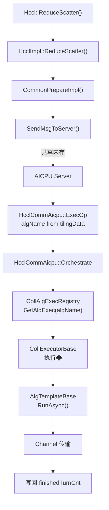

<!--
@source: include/adv_api/hccl/hccl.h (ReduceScatter API)
@source: include/adv_api/hccl/internal/hccl.h (HcclReduceScatter)
@source: impl/adv_api/detail/hccl/cc/src/ops/reduce_scatter/reduce_scatter_op.h
@source: impl/adv_api/detail/hccl/cc/src/ops/reduce_scatter/selector/reduce_scatter_auto_selector.h
@source: impl/adv_api/detail/hccl/cc/src/ops/reduce_scatter/selector/reduce_scatter_auto_selector.cc
@source: impl/adv_api/detail/hccl/cc/src/ops/reduce_scatter/executor/
@source: impl/adv_api/detail/hccl/cc/src/ops/reduce_scatter/template/
-->

# ReduceScatter 算子详解

## API 接口

### 设备侧 API

> `include/adv_api/hccl/hccl.h:132-135`

```cpp
template <bool commit = false>
__aicore__ inline HcclHandle ReduceScatter(
    GM_ADDR sendBuf, GM_ADDR recvBuf, uint64_t recvCount,
    HcclDataType dataType, HcclReduceOp op, uint64_t strideCount, uint8_t repeat = 1);
```

### Host 侧 C API

> `include/adv_api/hccl/internal/hccl.h:66-68`

```cpp
extern HcclResult HcclReduceScatter(
    void* sendBuf, void* recvBuf, uint64_t recvCount, HcclDataType dataType,
    HcclReduceOp op, HcclComm comm, aclrtStream stream);
```

## 算子入口

> `reduce_scatter_op.h:40-59`

| 函数 | 说明 |
|------|------|
| `HcclReduceScatter` | C 接口入口 |
| `HcclReduceScatterGraphMode` | 图模式入口 |
| `ReduceScatterOutPlace` | Out-of-place 执行入口 |
| `ReduceScatterOutPlaceGraphMode` | 图模式执行入口 |
| `ReduceScatterExecOp` | 执行算子 |
| `GetAlgResReduceScatter` | 获取算法资源 |
| `CheckReduceScatterInputPara` | 输入参数校验 |

## 选择器

### ReduceScatterAutoSelector

> `reduce_scatter_auto_selector.h`

继承 `AutoSelectorBase`，注册为 `REGISTER_SELECTOR_BY_OPTYPE(HCCL_CMD_REDUCE_SCATTER, 18, ReduceScatterAutoSelector)`。

### 选择器特有约束

> `reduce_scatter_auto_selector.cc:14-18`

```cpp
constexpr u64 RS_AICPU_1D_MAX_DATA_SIZE = 16 * 1024 * 1024;       // 16MB
constexpr u64 RS_AICPU_1D_MIN_DATA_SIZE = 4 * 1024 * 1024;        // 4MB
constexpr u64 RS_AICPU_1D_TWO_LEVER_DATA_SIZE_THRESHOLD = 1536 * 1024 * 1024; // 1.5GB
constexpr u64 RS_AICPU_SEQUENCE_SIZE_THRESHOLD = 1 * 1024 * 1024 * 1024;      // 1GB
```

### CCU_MS 模式约束

CCU_MS 模式不支持以下场景（见 `reduce_scatter_auto_selector.cc:30-47`）：
- INT8 数据类型
- PROD 规约操作
- INT64 / UINT64 / FP64 数据类型
- 多层级拓扑（topoLevelNums > 1）

### 算法选择概览

ReduceScatter 选择器同样遵循 `AutoSelectorBase::Select` 的 fallback 链（DPU → CCU_MS → CCU_SCHED → AIV → AICPU），各子选择器根据拓扑和数据量选择具体算法。

## 执行器

### 执行器类

| 执行器类 | 文件 | 模板数 | 说明 |
|----------|------|--------|------|
| `InsV2ReduceScatterSoleExecutor` | `ins_v2_reduce_scatter_sole_executor.{h,cc}` | 1 | 单模板执行器 |
| `InsReduceScatterConcurrentExecutor` | `ins_reduce_scatter_concurrent_executor.{h,cc}` | 2 | 并发执行器 |
| `InsReduceScatterParallelExecutor` | `ins_reduce_scatter_parallel_executor.{h,cc}` | 2 | 并行执行器 |
| `InsV2ReduceScatterSequenceExecutor` | `ins_v2_reduce_scatter_sequence_executor.{h,cc}` | 2 | 顺序执行器 |
| `InsV2ReduceScatterSequenceExecutorAicpu` | `ins_v2_reduce_scatter_sequence_executor_aicpu.{h,cc}` | 2 | AICPU 顺序执行器 |

### 执行器注册表

#### AICPU 算法

| 算法名 | 执行器 | 拓扑匹配 | 模板 |
|--------|--------|----------|------|
| `InsReduceScatterMesh1D` | SoleExecutor | TopoMatch1D | `InsTempReduceScatterMesh1D` |
| `InsReduceScatterMesh1DMeshChunk` | SoleExecutor | TopoMatch1D | `InsTempReduceScatterMesh1DMeshChunk` |
| `InsReduceScatterNHR` | SoleExecutor | TopoMatch1D | `InsTempReduceScatterNHR` |
| `InsReduceScatterAicpuReduceNHR` | SoleExecutor | TopoMatch1D | `InsTempReduceScatterAicpuReduceNHR` |
| `InsReduceScatterMesh1DZAxisDetour` | SoleExecutor | TopoMatch1D | `InsTempReduceScatterMesh1DZAxisDetour` |

#### AICPU 并发/并行算法

| 算法名 | 执行器 | 拓扑匹配 | 模板 |
|--------|--------|----------|------|
| `InsReduceScatterConcurrentMesh1DNHR` | ConcurrentExecutor | TopoMatchUBX | Mesh1D + NHR |
| `InsReduceScatterParallelMesh1DNHR` | ParallelExecutor | TopoMatchMultilevel | Mesh1D + NHR |
| `InsReduceScatterParallelMesh1DNHRUBX` | ParallelExecutor | TopoMatchUBX | Mesh1D + NHR |
| `InsReduceScatterParallelMesh1DNHRPcie` | ParallelExecutor | TopoMatchPcieMix | Mesh1D + NHR |

#### CCU 算法

| 算法名 | 执行器 | 拓扑匹配 | 模板 |
|--------|--------|----------|------|
| `CcuReduceScatterMesh1D` | SoleExecutor | TopoMatch1D | `CcuTempReduceScatterMesh1D` |
| `CcuReduceScatterMesh1DMem2Mem` | SoleExecutor | TopoMatch1D | `CcuTempReduceScatterMesh1DMem2Mem` |
| `CcuReduceScatterNHR1DMem2Mem` | SoleExecutor | TopoMatch1D | `CcuTempReduceScatterNHR1DMem2Mem` |
| `CcuReduceScatterMeshMem2Mem1D2Die` | SoleExecutor | TopoMatch1D | `CcuTempReduceScatterMeshMem2Mem1D2Die` |
| `CcuReduceScatterMesh2Die` | SoleExecutor | TopoMatch1D | `CcuTempReduceScatterMesh2Die` |
| `CcuReduceScatterNhr1DMem2MemMultiJetty` | SoleExecutor | TopoMatch1D | `CcuTempReduceScatterNhrMultiJettyMem2Mem1D` |
| `CcuReduceScatterParallelMesh1DNHR` | ParallelExecutor | TopoMatchMultilevel | Mesh1DMem2Mem + NHR1DMem2Mem |
| `CcuReduceScatterParallelMesh1DNHRMultiJetty` | ParallelExecutor | TopoMatchMultilevel | Mesh1DMem2Mem + NhrMultiJettyMem2Mem |

> CCU 相关注册受 `#if !defined(AICPU_COMPILE) && MC2_CLIENT_ENABLE_CCU` 条件编译控制。

## 模板

### AICPU 模板

| 模板类 | 文件 | 说明 |
|--------|------|------|
| `InsTempReduceScatterMesh1D` | `template/aicpu/ins_temp_reduce_scatter_mesh_1D.{h,cc}` | 1D Mesh |
| `InsTempReduceScatterMesh1DMeshChunk` | `template/aicpu/ins_temp_reduce_scatter_mesh_1D_meshchunk.{h,cc}` | MeshChunk |
| `InsTempReduceScatterNHR` | `template/aicpu/ins_temp_reduce_scatter_nhr.{h,cc}` | NHR |
| `InsTempReduceScatterAicpuReduceNHR` | `template/aicpu/ins_temp_reduce_scatter_aicpu_reduce_nhr.{h,cc}` | AICPU Reduce NHR |
| `InsTempReduceScatterMesh1DZAxisDetour` | `template/aicpu/ins_temp_reduce_scatter_mesh_1D_Z_axis_detour.{h,cc}` | Z 轴绕行 |
| `InsTempReduceScatterMesh1dDpu` | `template/aicpu/ins_temp_reduce_scatter_mesh_1d_dpu.{h,cc}` | DPU Mesh |

### CCU 模板

| 模板类 | 文件 | 说明 |
|--------|------|------|
| `CcuTempReduceScatterMesh1D` | `template/ccu/ccu_temp_reduce_scatter_mesh_1D.{h,cc}` | CCU 1D Mesh |
| `CcuTempReduceScatterMesh1DMem2Mem` | `template/ccu/ccu_temp_reduce_scatter_mesh_1D_mem2mem.{h,cc}` | CCU Mem2Mem |
| `CcuTempReduceScatterNHR1DMem2Mem` | `template/ccu/ccu_temp_reduce_scatter_nhr_1D_mem2mem.{h,cc}` | CCU NHR Mem2Mem |
| `CcuTempReduceScatterNHR1DMultiJettyMem2Mem` | `template/ccu/ccu_temp_reduce_scatter_nhr_1D_multi_jetty_mem2mem.{h,cc}` | CCU NHR Multi-Jetty |
| `CcuTempReduceScatterMesh2Die` | `template/ccu/ccu_temp_reduce_scatter_mesh2die.{h,cc}` | CCU 2Die |
| `CcuTempReduceScatterMesh1D2DieMem2Mem` | `template/ccu/ccu_temp_reduce_scatter_mesh_1D_2die_mem2mem.{h,cc}` | CCU 2Die Mem2Mem |

## 完整调用链



> 注：AICPU 服务端不经 `ReduceScatterOutPlace` 算子入口和 `ExecuteSelector`，算法名在 Host 侧 Tiling 阶段已确定。详见 [架构总览](../architecture/overview.md)。

## 与 AllGather 的对比

| 方面 | AllGather | ReduceScatter |
|------|-----------|---------------|
| 数据流向 | 收集（分散→集中） | 散布（集中→分散） |
| 是否需要规约 | 否 | 是（需要 op 参数） |
| CCU_MS INT8 支持 | 支持 | 不支持 |
| CCU_MS PROD 支持 | 支持 | 不支持 |
| CCU_MS 64 位类型 | 支持 | 不支持 |
| 默认 AICPU 算法 | `InsAllGatherMesh` | `InsReduceScatterNHR` |
| Z 轴绕行模板 | 有 | 有 |
