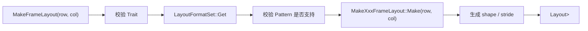
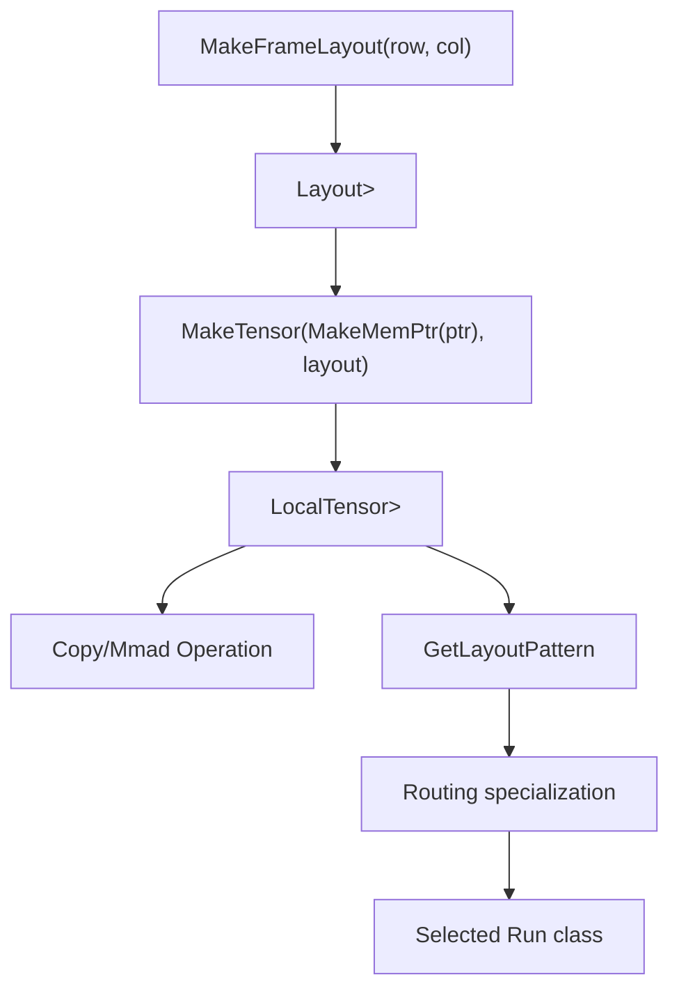

# Layout FrameLayout 详细设计说明书

## 1. 需求及场景描述

### 1.1 背景

Tensor API 中的 `Layout` 用于描述 Tensor 的逻辑形状与物理排布关系。普通 `MakeLayout(shape, stride)` 能表达通用布局，但 Cube/Datamove/Mmad 场景中常见的矩阵排布具有固定格式，例如 `NZ`、`ZN`、`ND`、`DN`、`ZZ`、`NN` 以及 Scale 相关格式。这些格式需要根据输入的 `row/column`、元素类型、`C0` 大小自动生成嵌套 `shape` 和 `stride`。

`MakeFrameLayout` 和 `FrameLayoutFormat` 的目标是提供一个统一入口，将“布局格式”抽象为 `LayoutPattern` 类型，将“元素类型与 C0 参数”抽象为 `LayoutTrait` 类型，最终生成带有格式标签的 `Layout<Shape, Stride, Info>`。

### 1.2 目标

- 统一创建常见矩阵帧格式布局，避免调用方手写复杂的 `shape/stride`。
- 将布局格式编码到类型系统中，供后续 `GetLayoutPattern<layoutType>` 参与 Copy/Mmad routing。
- 支持动态维度与 `Std::Int<N>` 静态维度。
- 支持默认元素类型、Scale 类型、FP4 类型以及自定义 `C0_ELEMENT`。
- 在编译期尽早发现不支持的 layout pattern 或不合法 trait。

### 1.3 典型场景

```cpp
using namespace AscendC::Te;

auto l1Layout = MakeFrameLayout<NDExtLayoutPtn, LayoutTraitDefault<float>>(m, n);
auto l0aLayout = MakeFrameLayout<NZLayoutPtn, LayoutTraitDefault<float>>(m, k);
auto l0bLayout = MakeFrameLayout<ZNLayoutPtn, LayoutTraitDefault<float>>(k, n);

auto l1Tensor = MakeTensor(MakeMemPtr<Location::L1>(ptr), l1Layout);
```

在该场景中，`MakeFrameLayout` 生成的 layout 不仅用于 `tensor[coord]` 的地址计算，也会在 Copy/Mmad 执行时通过 `GetLayoutPattern<typename T::layoutType>` 参与路由匹配。

## 2. 接口描述

### 2.1 相关头文件

- 公共声明：`include/tensor_api/tensor/layout.h`
- 实现入口：`impl/tensor_api/tensor/layout_frame.h`
- Pattern 实现：`impl/tensor_api/tensor/layout_pattern.h`
- Layout 定义：`impl/tensor_api/tensor/layout_definition.h`

外部使用方应优先包含：

```cpp
#include "tensor_api/tensor.h"
```

### 2.2 LayoutPattern 类型

当前 `LayoutFormatSet` 支持以下 pattern 到 maker 的映射：

| Pattern | Maker | 说明 |
| --- | --- | --- |
| `NZLayoutPtn` | `MakeNzFrameLayout` | NZ fractal layout |
| `ZNLayoutPtn` | `MakeZnFrameLayout` | ZN fractal layout |
| `ZZLayoutPtn` | `MakeZzFrameLayout` | ZZ fractal layout |
| `NNLayoutPtn` | `MakeNnFrameLayout` | NN scale-related layout |
| `NDLayoutPtn` | `MakeNDFrameLayout` | 普通 row-major 2D layout |
| `DNLayoutPtn` | `MakeDNFrameLayout` | 普通 column-major 2D layout |
| `NDExtLayoutPtn` | `MakeNDExtFrameLayout` | 扩展 ND，嵌套 shape 表达 |
| `DNExtLayoutPtn` | `MakeDNExtFrameLayout` | 扩展 DN，嵌套 shape 表达 |
| `ScaleANDLayoutPtn` | `MakeScaleANDFrameLayout` | Scale A ND |
| `ScaleADNLayoutPtn` | `MakeScaleADNFrameLayout` | Scale A DN |
| `ScaleBNDLayoutPtn` | `MakeScaleBNDFrameLayout` | Scale B ND |
| `ScaleBDNLayoutPtn` | `MakeScaleBDNFrameLayout` | Scale B DN |

### 2.3 LayoutTrait 类型

`LayoutTrait` 提供元素类型和 C0 参数：

```cpp
template <typename T = uint16_t, size_t C0 = 32 / sizeof(T)>
struct LayoutTraitDefault {
    using type = T;
    static constexpr auto C0_ELEMENT = Std::Int<C0>{};
};

template <typename T = fp8_e8m0_t, size_t C0 = 2 / sizeof(T)>
struct LayoutTraitScale {
    using type = T;
    static constexpr auto C0_ELEMENT = Std::Int<C0>{};
};

template <typename T = fp4x2_e2m1_t, size_t C0 = 64 / sizeof(T)>
struct LayoutTraitFP4 {
    using type = T;
    static constexpr auto C0_ELEMENT = Std::Int<C0>{};
};
```

自定义 trait 必须满足：

```cpp
struct MyTrait {
    using type = ...;
    static constexpr auto C0_ELEMENT = AscendC::Std::Int<N>{};
};
```

### 2.4 MakeFrameLayout 接口

#### 2.4.1 TraitType 版本

```cpp
template <typename LayoutPattern,
          typename TraitType = LayoutTraitDefault<>,
          Std::enable_if_t<!IsIntegralConstantV<TraitType>, int> = 0,
          typename... Args>
__aicore__ inline decltype(auto) MakeFrameLayout(const Args&... args);
```

用法：

```cpp
auto layout = MakeFrameLayout<NZLayoutPtn, LayoutTraitDefault<float>>(128, 256);
auto staticLayout = MakeFrameLayout<NDExtLayoutPtn, LayoutTraitDefault<half>>(
    AscendC::Std::Int<16>{}, AscendC::Std::Int<16>{});
```

语义：

- `LayoutPattern` 指定布局格式。
- `TraitType` 指定元素类型和 `C0_ELEMENT`。
- `args...` 当前主要是 `row, column`。
- 返回值是带有 `Std::tuple<LayoutPattern, TraitType>` 信息的 `Layout` 对象。

#### 2.4.2 IntType 快捷版本

```cpp
template <typename LayoutPattern,
          typename IntType,
          Std::enable_if_t<IsIntegralConstantV<IntType>, int> = 0,
          typename... Args>
__aicore__ inline decltype(auto) MakeFrameLayout(const Args&... args);
```

该版本用于将第二模板参数直接解释为 `C0`：

```cpp
auto layout = MakeFrameLayout<NZLayoutPtn, AscendC::Std::Int<16>>(128, 256);
```

等价于：

```cpp
auto layout = MakeFrameLayout<NZLayoutPtn, LayoutTraitDefault<uint16_t, 16>>(128, 256);
```

### 2.5 FrameLayoutFormat 接口

```cpp
template <typename LayoutPattern, typename TraitType = LayoutTraitDefault<>>
struct FrameLayoutFormat {
    template <typename... Args>
    __aicore__ inline decltype(auto) operator()(const Args&... args) {
        return MakeFrameLayout<LayoutPattern, TraitType>(args...);
    }
};
```

用途：

- 将 layout pattern 和 trait 预绑定成可调用对象。
- 便于在高阶模板、测试参数化、配置对象中传递布局构造器。

示例：

```cpp
FrameLayoutFormat<NZLayoutPtn, LayoutTraitDefault<float>> makeNz;
auto layout = makeNz(128, 256);
```

## 3. 方案描述

### 3.1 总体流程



### 3.2 Pattern 到 Maker 的工厂映射

`layout_frame.h` 使用 `TupleMap` 维护 pattern 到 maker 的静态映射：

```cpp
using LayoutFormatSet = TupleMap<
    Std::tuple<NZLayoutPtn, MakeNzFrameLayout>,
    Std::tuple<NDLayoutPtn, MakeNDFrameLayout>,
    ...
    Std::tuple<ScaleBDNLayoutPtn, MakeScaleBDNFrameLayout>>;
```

`TupleMap::Get<LayoutPattern>` 在编译期查找对应 maker：

- 找到时返回 `MakeXxxFrameLayout`。
- 找不到时返回 `EmptyValue`。
- `MakeFrameLayout` 对 `EmptyValue` 做 `static_assert`，报出 `Unsupported layout pattern.`。

### 3.3 Trait 校验方案

`IsFrameLayoutTrait` 使用 SFINAE 检查 `TraitType` 是否具备必要成员：

```cpp
template <typename T>
struct IsFrameLayoutTrait<T, void_t<typename T::type, decltype(T::C0_ELEMENT)>> : Std::true_type {};
```

`MakeFrameLayout<Pattern, Trait>` 内部校验：

```cpp
static_assert(IsFrameLayoutTraitV<TraitType>,
    "MakeFrameLayout<LayoutPattern, TraitType>(...) expects TraitType to define type and C0_ELEMENT.");
```

该设计把 trait 的合法性检查前置到布局构造入口，避免错误延迟到具体 maker 或 routing 阶段。

### 3.4 布局信息的类型携带

每个 maker 最终生成：

```cpp
using LayoutT = Layout<decltype(shape), decltype(stride), Std::tuple<Pattern, TraitType>>;
return LayoutT(shape, stride);
```

因此 layout 类型中携带了：

- shape 类型和值
- stride 类型和值
- layout pattern 类型
- layout trait 类型

后续模块可以通过：

```cpp
using Pattern = GetLayoutPattern<typename Tensor::layoutType>;
using Trait = GetLayoutTrait<typename Tensor::layoutType>;
```

获取布局格式和 trait，用于 Copy/Mmad routing、格式检查和指令参数构造。

### 3.5 与 Tensor 和 Operation 的关系



## 4. 规格描述

### 4.1 通用规格

| 项目 | 规格 |
| --- | --- |
| 命名空间 | `AscendC::Te` |
| 入口接口 | `MakeFrameLayout<LayoutPattern, TraitType>(row, column)` |
| 返回类型 | `Layout<ShapeType, StrideType, Std::tuple<LayoutPattern, TraitType>>` |
| 输入维度 | 当前 maker 均以二维矩阵 `row, column` 为入口 |
| 静态维度 | 支持 `AscendC::Std::Int<N>{}` |
| 动态维度 | 支持运行时整型参数 |
| 默认 trait | `LayoutTraitDefault<uint16_t, 32 / sizeof(uint16_t)>` |
| 默认 `FRACTAL_FIXED` | 16 |
| 不支持 pattern | 编译期 `static_assert("Unsupported layout pattern.")` |
| 非法 trait | 编译期 `static_assert`，要求定义 `type` 和 `C0_ELEMENT` |

### 4.2 Pattern 规格

#### 4.2.1 NDLayoutPtn

输入：`row, column`

```cpp
shape  = (row, column)
stride = (column, 1)
```

适用：普通 row-major 二维布局。

#### 4.2.2 DNLayoutPtn

输入：`row, column`

```cpp
shape  = (row, column)
stride = (1, row)
```

适用：普通 column-major 二维布局。

#### 4.2.3 NDExtLayoutPtn

输入：`row, column`

```cpp
shape  = ((1, row), (1, column))
stride = ((0, column), (0, 1))
```

适用：以嵌套 shape 表达 ND 排布，便于和 fractal layout 保持统一维度结构。

#### 4.2.4 DNExtLayoutPtn

输入：`row, column`

```cpp
shape  = ((1, row), (1, column))
stride = ((0, 1), (0, row))
```

适用：以嵌套 shape 表达 DN 排布。

#### 4.2.5 NZLayoutPtn

输入：`row, column`

```cpp
c0 = TraitType::C0_ELEMENT
shape  = ((16, ceil(row / 16)), (c0, ceil(column / c0)))
stride = ((c0, c0 * 16), (1, c0 * ceil_align(row, 16)))
```

适用：A 矩阵或 GM/L1/L0A 等路径中常见 NZ fractal 排布。

#### 4.2.6 ZNLayoutPtn

输入：`row, column`

```cpp
c0 = TraitType::C0_ELEMENT
shape  = ((c0, ceil(row / c0)), (16, ceil(column / 16)))
stride = ((1, c0 * ceil_align(column, 16)), (c0, c0 * 16))
```

适用：B 矩阵或 L0B 等路径中常见 ZN fractal 排布。

#### 4.2.7 ZZLayoutPtn

输入：`row, column`

```cpp
c0 = TraitType::C0_ELEMENT
shape  = ((16, ceil(row / 16)), (c0, ceil(column / c0)))
stride = ((c0, 16 * ceil_align(column, c0)), (1, c0 * 16))
```

适用：Scale A 等路径中的 ZZ 排布。

#### 4.2.8 NNLayoutPtn

输入：`row, column`

约束：

```cpp
TraitType::C0_ELEMENT == 2
```

规格：

```cpp
c0 = TraitType::C0_ELEMENT
shape  = ((c0, row / c0), (16, ceil(column / 16)))
stride = ((1, c0 * 16), (c0, row * 16))
```

适用：Scale B 的 NN 类排布。当前实现通过 `static_assert` 限定 `c0 == 2`。

#### 4.2.9 ScaleANDLayoutPtn

约束：

```cpp
TraitType::C0_ELEMENT == 2
```

规格：

```cpp
shape  = ((1, row), (1, column))
stride = ((0, column), (0, 1))
```

适用：Scale A ND 非转置表达。

#### 4.2.10 ScaleADNLayoutPtn

约束：

```cpp
TraitType::C0_ELEMENT == 2
```

规格：

```cpp
c0 = TraitType::C0_ELEMENT
shape  = ((1, row), (c0, column / c0))
stride = ((0, c0), (1, c0 * row))
```

适用：Scale A DN/转置表达。

#### 4.2.11 ScaleBNDLayoutPtn

约束：

```cpp
TraitType::C0_ELEMENT == 2
```

规格：

```cpp
c0 = TraitType::C0_ELEMENT
shape  = ((c0, row / c0), (1, column))
stride = ((1, c0 * column), (0, c0))
```

适用：Scale B ND 非转置表达。

#### 4.2.12 ScaleBDNLayoutPtn

规格：

```cpp
shape  = ((1, row), (1, column))
stride = ((0, 1), (0, row))
```

适用：Scale B DN/转置表达。

### 4.3 校验规格

| 校验点 | 位置 | 失败方式 |
| --- | --- | --- |
| `TraitType` 必须定义 `type` 和 `C0_ELEMENT` | `MakeFrameLayout<Pattern, Trait>` | `static_assert` |
| `LayoutPattern` 必须存在于 `LayoutFormatSet` | `MakeFrameLayout` | `static_assert("Unsupported layout pattern.")` |
| `NNLayoutPtn` 要求 `C0_ELEMENT == 2` | `MakeNnFrameLayout::Make` | `static_assert` |
| `ScaleANDLayoutPtn` 要求 `C0_ELEMENT == 2` | `MakeScaleANDFrameLayout::Make` | `static_assert` |
| `ScaleADNLayoutPtn` 要求 `C0_ELEMENT == 2` | `MakeScaleADNFrameLayout::Make` | `static_assert` |
| `ScaleBNDLayoutPtn` 要求 `C0_ELEMENT == 2` | `MakeScaleBNDFrameLayout::Make` | `static_assert` |
| `Layout` 的 shape/stride 必须是 tuple | `Layout` 构造函数 | `static_assert` |

### 4.4 用法规格

#### 普通 ND 布局

```cpp
auto layout = MakeFrameLayout<NDLayoutPtn, LayoutTraitDefault<float>>(128, 256);
// shape  = (128, 256)
// stride = (256, 1)
```

#### NZ 布局

```cpp
auto layout = MakeFrameLayout<NZLayoutPtn, LayoutTraitDefault<float>>(128, 256);
// c0 = 32 / sizeof(float)
// shape/stride 自动生成 nested fractal 形式
```

#### 自定义 C0

```cpp
auto layout = MakeFrameLayout<NZLayoutPtn, LayoutTraitDefault<float, 16>>(128, 256);
```

#### 静态维度

```cpp
auto layout = MakeFrameLayout<NDExtLayoutPtn, LayoutTraitDefault<half>>(
    AscendC::Std::Int<16>{}, AscendC::Std::Int<16>{});
```

#### 预绑定构造器

```cpp
FrameLayoutFormat<NZLayoutPtn, LayoutTraitDefault<float>> makeNz;
auto layout = makeNz(128, 256);
```

#### 与 Tensor 组合

```cpp
auto iter = MakeMemPtr<Location::L1>(ptr);
auto layout = MakeFrameLayout<NZLayoutPtn, LayoutTraitDefault<float>>(m, n);
auto tensor = MakeTensor(iter, layout);
```

## 5. 约束条件

### 5.1 接口约束

- `MakeFrameLayout` 当前面向二维矩阵入口，调用参数语义为 `row, column`。
- `LayoutPattern` 必须是 `LayoutFormatSet` 中注册的 pattern 类型。
- 自定义 trait 必须提供 `using type = ...` 和 `static constexpr C0_ELEMENT`。
- `FrameLayoutFormat` 只是轻量可调用包装，不保存运行时状态。

### 5.2 类型系统约束

- `LayoutPattern` 和 `TraitType` 被编码进 `Layout` 类型，改变 pattern 或 trait 会改变 layout 类型。
- routing 依赖 `GetLayoutPattern<layoutType>`，因此 pattern 选择会直接影响 Copy/Mmad 选路。
- `Std::Int<N>` 静态维度会参与类型推导和编译期计算，运行时整型则保留为运行时值。

### 5.3 格式约束

- `NNLayoutPtn`、`ScaleANDLayoutPtn`、`ScaleADNLayoutPtn`、`ScaleBNDLayoutPtn` 当前要求 `C0_ELEMENT == 2`。
- `NZ/ZN/ZZ` 使用 `FRACTAL_FIXED == 16` 作为固定分块维度。
- `ceil_division` 和 `ceil_align` 会使 shape/stride 覆盖非整除维度，但调用方仍需保证底层 buffer 容量满足实际访问需求。

### 5.4 扩展约束

新增 layout pattern 时，需要同步完成：

1. 在 `layout_pattern.h` 中定义新的 `XxxLayoutPtn`。
2. 实现 `MakeXxxFrameLayout::Make<TraitType>(row, column)`。
3. 在 `layout_frame.h` 的 `LayoutFormatSet` 中注册 `Std::tuple<XxxLayoutPtn, MakeXxxFrameLayout>`。
4. 如该 pattern 会参与 Copy/Mmad，需要补充 arch routing specialization。
5. 如该 pattern 有硬件格式约束，需要在 `arch/utils/check_format.h` 或对应路径补充校验。

### 5.5 失败模式

- 未注册 pattern：编译期报 `Unsupported layout pattern.`。
- trait 缺少成员：编译期报 `MakeFrameLayout<LayoutPattern, TraitType>(...) expects TraitType to define type and C0_ELEMENT.`。
- Scale/NN pattern 的 `C0_ELEMENT` 不等于 2：编译期报对应 pattern 的 static assertion。
- layout 已成功构造但 routing 未支持：后续 Copy/Mmad 可能落到 ignore/unsupported 路径，由 routing 或 arch class 报错。

## 6. 设计小结

`MakeFrameLayout` 是 Tensor API 中“格式化布局”的工厂入口。它把 `row/column`、`LayoutPattern`、`LayoutTrait` 合成为带类型标签的 `Layout`。该设计的关键价值在于：布局信息不只是运行时 shape/stride 值，也通过类型系统传递给后续 Tensor、Operation 和 Routing，从而实现编译期选路和硬件指令参数生成。
