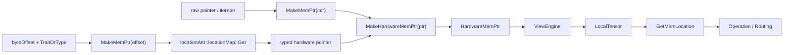
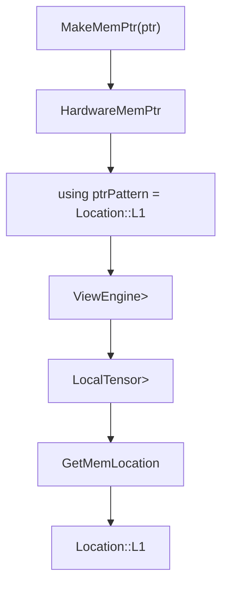

# MakeMemPtr / Location 详细设计说明书

## 1. 需求及场景描述

### 1.1 背景

Tensor API 中的 Tensor 需要同时描述两类信息：

- 数据在哪里：GM、UB、L1、L0A、L0B、L0C、BIAS、FIXBUF 等硬件存储位置。
- 数据怎么排：Layout 中的 shape、stride、layout pattern 和 trait。

`MakeFrameLayout` 负责描述“数据怎么排”，`MakeMemPtr<Location::XX>` 负责描述“数据在哪里”。两者最终通过 `MakeTensor(pointer, layout)` 组合成 `LocalTensor`，供 Copy/Mmad 等 Operation 提取类型信息并进行 routing。

如果直接使用裸指针，后续 Operation 只能看到指针类型，无法稳定区分该指针属于 GM 还是 L1/L0A/UB 等硬件空间。`MakeMemPtr` 的设计目标就是把硬件内存位置从运行时概念提升为编译期类型标签。

### 1.2 目标

- 为不同硬件内存空间提供统一的 pointer/iterator 包装入口。
- 将 `Location::XX` 编码到 pointer 类型中，实现类型透传。
- 让 `LocalTensor` 的 iterator 类型携带内存位置信息。
- 支持 Operation 通过 `GetMemLocation<T>` 在编译期获得 Tensor 的物理位置。
- 减少运行时 scalar 判断，如 `if (src == GM && dst == L1)`。
- 与 Layout 解耦，形成 `Pointer 描述位置，Layout 描述排布` 的组合模型。

### 1.3 典型场景

#### 使用已有硬件指针

```cpp
using namespace AscendC::Te;

auto gmPtr = MakeMemPtr<Location::GM>(gmData);
auto l1Ptr = MakeMemPtr<Location::L1>(l1Data);

auto gmTensor = MakeTensor(gmPtr, MakeFrameLayout<NDExtLayoutPtn>(m, n));
auto l1Tensor = MakeTensor(l1Ptr, MakeFrameLayout<NZLayoutPtn>(m, n));
```

#### 使用 byteOffset 构造物理地址

```cpp
struct FloatTrait {
    using type = float;
};

auto ubPtr = MakeMemPtr<Location::UB, FloatTrait>(byteOffset);
auto l1Ptr = MakeMemPtr<Location::L1, float>(byteOffset);
```

#### 参与 Operation/Routing

```cpp
using DstPos = GetMemLocation<decltype(l1Tensor)>;
using SrcPos = GetMemLocation<decltype(gmTensor)>;
```

后续 Copy 路由可基于 `DstPos`、`SrcPos`、layout pattern 和 arch version 选择具体实现类。

## 2. 接口描述

### 2.1 相关头文件

- 公共声明：`include/tensor_api/tensor/pointer.h`
- 实现入口：`impl/tensor_api/tensor/pointer_pattern.h`
- 指针构造实现：`impl/tensor_api/tensor/pointer_pattern_impl.h`
- 硬件指针包装：`impl/tensor_api/tensor/pointer_mem_impl.h`
- iterator 适配：`impl/tensor_api/tensor/pointer_adaptor_impl.h`
- Location 和地址属性：`impl/tensor_api/utils/constant_impl.h`

外部使用方优先包含：

```cpp
#include "tensor_api/tensor.h"
```

### 2.2 Location 类型

`Location` 是一组纯类型 tag：

```cpp
namespace Location {
    struct INVALID {};
    struct GM {};
    struct UB {};
    struct L1 {};
    struct L0A {};
    struct L0B {};
    struct L0C {};
    struct BIAS {};
    struct FIXBUF {};
}
```

这些类型不保存运行时状态，仅用于模板参数和编译期匹配。

### 2.3 PtrTrait

```cpp
template <typename T = uint16_t>
struct PtrTrait {
    using type = T;
};
```

`PtrTrait` 用于 byteOffset 版本的 `MakeMemPtr`。它告诉系统：根据这个 offset 构造出来的硬件指针应当指向哪种元素类型。

如果传入的第二模板参数本身已经满足 trait 形式，即存在 `typename T::type`，则直接使用该 trait；否则会自动包装成 `PtrTrait<T>`：

```cpp
template <typename T>
using MemPtrTraitT = typename Std::conditional<IsPtrTrait<T>::value, T, PtrTrait<T>>::type;
```

### 2.4 MakeMemPtr 接口

#### 2.4.1 byteOffset 版本

```cpp
template <typename HardWare, typename TraitOrType, typename... Args>
__aicore__ inline constexpr auto MakeMemPtr(Args... args);
```

语义：

- `HardWare`：内存位置类型，如 `Location::UB`、`Location::L1`。
- `TraitOrType`：元素类型或包含 `type` 的 trait。
- `args...`：当前主要用于传入 byteOffset。

示例：

```cpp
auto ptr1 = MakeMemPtr<Location::UB, float>(byteOffset);
auto ptr2 = MakeMemPtr<Location::L1, PtrTrait<half>>(byteOffset);
```

该版本要求第一个参数不是可解引用 iterator/pointer：

```cpp
static_assert(!IsMemPtrIterator<Arg>::value, "MakeMemPtr expects a byteOffset.");
```

#### 2.4.2 iterator/pointer 版本

```cpp
template <typename HardWare, typename... Args>
__aicore__ inline constexpr auto MakeMemPtr(Args... args);
```

语义：

- `HardWare`：内存位置类型。
- `args...`：已有 iterator 或 pointer。

示例：

```cpp
auto ptr = MakeMemPtr<Location::GM>(gmData);
```

该版本要求第一个参数是可解引用 iterator/pointer：

```cpp
static_assert(IsMemPtrIterator<Arg>::value,
    "MakeMemPtr<HardWare>(arg) expects an iterator/pointer");
```

### 2.5 MakeHardwareMemPtr

```cpp
template <typename PtrPattern, typename Iterator>
__aicore__ inline auto MakeHardwareMemPtr(Iterator iter)
{
    return HardwareMemPtr<PtrPattern, Iterator>{iter};
}
```

该接口把已有 iterator 包装成带 `PtrPattern` 的 `HardwareMemPtr`。

### 2.6 MakeLocationMemPtr

```cpp
template <typename PtrPattern, typename TraitType, typename Arg>
__aicore__ inline auto MakeLocationMemPtr(const Arg& arg)
{
    using pointer = typename locationAttr<typename TraitType::type>::locationMap::template Get<PtrPattern>;
    return MakeHardwareMemPtr<PtrPattern>(
        reinterpret_cast<pointer>(asc_get_phy_buf_addr(0) + arg));
}
```

该接口用于 byteOffset 版本：

1. 通过 `TraitType::type` 获得元素类型。
2. 通过 `locationAttr<T>::locationMap::Get<PtrPattern>` 获得硬件地址空间指针类型。
3. 通过 `asc_get_phy_buf_addr(0) + arg` 计算物理地址。
4. `reinterpret_cast` 成目标硬件指针。
5. 包装为 `HardwareMemPtr<PtrPattern, pointer>`。

### 2.7 HardwareMemPtr

```cpp
template <typename PtrPattern, typename Pointer>
struct HardwareMemPtr : IterAdaptor<Pointer, HardwareMemPtr<PtrPattern, Pointer>> {
    using IterAdaptor<Pointer, HardwareMemPtr<PtrPattern, Pointer>>::IterAdaptor;
    using ptrPattern = PtrPattern;
};
```

核心职责：

- 复用 `IterAdaptor` 的访问能力。
- 通过 `using ptrPattern = PtrPattern` 保存内存位置类型。

### 2.8 GetMemLocation

```cpp
template <typename T>
using GetMemLocation = typename T::iterator::ptrPattern;
```

用于从 Tensor 类型中提取位置标签。由于 `LocalTensor` 的 `iterator` 来自 `EngineType::iterator`，而 `EngineType` 又来自 `ViewEngine<HardwareMemPtr<...>>`，因此位置标签可以从 `MakeMemPtr` 一直透传到 Operation/Routing。

### 2.9 IterAdaptor

`IterAdaptor<Iterator, DerivedType>` 提供统一 pointer-like 行为：

- `operator*`
- `operator[]`
- `operator+`
- `operator&`
- `operator|`
- `Get()`
- 比较运算符

其中 `operator[]` 和 `operator+` 会通过 `IndexCorrect` 修正 B4 类型索引：

```cpp
if constexpr (IsB4Type<valueType>) {
    return i >> 1;
} else {
    return i;
}
```

## 3. 方案描述

### 3.1 总体流程



### 3.2 两类构造路径

#### 已有 pointer/iterator 路径

```text
MakeMemPtr<Location::GM>(data)
  -> static_assert(IsMemPtrIterator<Arg>)
  -> MakeHardwareMemPtr<Location::GM>(data)
  -> HardwareMemPtr<Location::GM, decltype(data)>
```

适合调用方已经拥有具体地址的场景，例如测试用例、kernel 中已有 GM/L1 buffer 指针等。

#### byteOffset 路径

```text
MakeMemPtr<Location::UB, float>(byteOffset)
  -> MemPtrTraitT<float> = PtrTrait<float>
  -> locationAttr<float>::locationMap::Get<Location::UB>
  -> __ubuf__ float*
  -> reinterpret_cast<__ubuf__ float*>(asc_get_phy_buf_addr(0) + byteOffset)
  -> HardwareMemPtr<Location::UB, __ubuf__ float*>
```

适合调用方只持有物理 buffer 偏移，需要根据 Location 和元素类型构造硬件地址空间指针的场景。

### 3.3 Location 到硬件指针类型的映射

`locationAttr<T>` 定义了元素类型 `T` 在不同硬件地址空间下对应的指针类型：

| Location | 指针类型 |
| --- | --- |
| `Location::GM` | `__gm__ T*` |
| `Location::L1` | `__cbuf__ T*` |
| `Location::L0A` | `__ca__ T*` |
| `Location::L0B` | `__cb__ T*` |
| `Location::L0C` | `__cc__ T*` |
| `Location::UB` | `__ubuf__ T*` |
| `Location::BIAS` | `__biasbuf__ T*` |
| `Location::FIXBUF` | `__fbuf__ T*` |

该映射由 `TupleMap` 实现：

```cpp
using locationMap = TupleMap<
    Std::tuple<Location::GM, gmAttr>,
    Std::tuple<Location::L1, cbufAttr>,
    ...
    Std::tuple<Location::FIXBUF, fbufAttr>>;
```

### 3.4 类型透传链路



### 3.5 与 Layout 和 Operation 的配合

Tensor API 中，Pointer 和 Layout 分别承担不同职责：

```text
Pointer: 数据在哪里
Layout : 数据怎么排
Tensor : Pointer + Layout
```

组合示例：

```cpp
auto ptr = MakeMemPtr<Location::L1>(l1Data);
auto layout = MakeFrameLayout<NZLayoutPtn, LayoutTraitDefault<float>>(m, n);
auto tensor = MakeTensor(ptr, layout);
```

在 Copy/Mmad 中：

```cpp
using Pos = GetMemLocation<Tensor>;
using Ptn = GetLayoutPattern<typename Tensor::layoutType>;
```

最终 routing 可以基于：

- 源 Tensor Location
- 目的 Tensor Location
- 源/目的 LayoutPattern
- 当前 ArchVersion
- CopyMode 或 bias 位置

进行编译期选路。

## 4. 规格描述

### 4.1 通用规格

| 项目 | 规格 |
| --- | --- |
| 命名空间 | `AscendC::Te` |
| 位置类型 | `Location::GM/UB/L1/L0A/L0B/L0C/BIAS/FIXBUF` |
| 主要入口 | `MakeMemPtr<HardWare>(iter)` |
| offset 入口 | `MakeMemPtr<HardWare, TraitOrType>(byteOffset)` |
| 返回核心类型 | `HardwareMemPtr<PtrPattern, Pointer>` |
| 统一访问基类 | `IterAdaptor<Pointer, DerivedType>` |
| 类型标签字段 | `HardwareMemPtr::ptrPattern` |
| 位置提取接口 | `GetMemLocation<T>` |
| byteOffset 基址 | `asc_get_phy_buf_addr(0)` |

### 4.2 接口规格

#### `MakeMemPtr<HardWare>(iter)`

输入要求：

- 第一个参数必须是可解引用对象。
- 通过 `decltype(*Std::declval<T&>())` 判断。

输出：

```cpp
HardwareMemPtr<HardWare, Iterator>
```

失败模式：

```cpp
static_assert(IsMemPtrIterator<Arg>::value,
    "MakeMemPtr<HardWare>(arg) expects an iterator/pointer");
```

#### `MakeMemPtr<HardWare, TraitOrType>(byteOffset)`

输入要求：

- 第一个参数不能是可解引用对象。
- `TraitOrType` 可以是元素类型，也可以是带 `type` 成员的 trait。

输出：

```cpp
HardwareMemPtr<HardWare, locationAttr<T>::locationMap::Get<HardWare>>
```

失败模式：

```cpp
static_assert(!IsMemPtrIterator<Arg>::value,
    "MakeMemPtr expects a byteOffset.");
```

### 4.3 HardwareMemPtr 规格

`HardwareMemPtr` 继承 `IterAdaptor` 后具备以下能力：

| 能力 | 接口 |
| --- | --- |
| 解引用 | `operator*()` |
| 下标访问 | `operator[](Index)` |
| 指针偏移 | `operator+(Index)` |
| 地址掩码 | `operator&(uint64_t)` |
| 地址置位 | `operator|(uint64_t)` |
| 取原始 iterator | `Get()` |
| 比较 | `== != < <= > >=` |

### 4.4 Location 映射规格

| Location | 语义 | 地址空间指针 |
| --- | --- | --- |
| `GM` | Global Memory | `__gm__ T*` |
| `UB` | Unified Buffer | `__ubuf__ T*` |
| `L1` | CBUF/L1 | `__cbuf__ T*` |
| `L0A` | Cube A | `__ca__ T*` |
| `L0B` | Cube B | `__cb__ T*` |
| `L0C` | Cube C | `__cc__ T*` |
| `BIAS` | Bias Buffer | `__biasbuf__ T*` |
| `FIXBUF` | Fixpipe Buffer | `__fbuf__ T*` |

### 4.5 用法规格

#### GM 指针

```cpp
auto gmPtr = MakeMemPtr<Location::GM>(gmData);
```

#### L1 指针

```cpp
auto l1Ptr = MakeMemPtr<Location::L1>(l1Data);
```

#### L0A/L0B/L0C 指针

```cpp
auto a = MakeMemPtr<Location::L0A>(aBuf);
auto b = MakeMemPtr<Location::L0B>(bBuf);
auto c = MakeMemPtr<Location::L0C>(cBuf);
```

#### offset 构造

```cpp
auto ub = MakeMemPtr<Location::UB, float>(byteOffset);
```

#### 与 Tensor 组合

```cpp
auto ptr = MakeMemPtr<Location::L1>(l1Data);
auto layout = MakeFrameLayout<NZLayoutPtn, LayoutTraitDefault<float>>(m, n);
auto tensor = MakeTensor(ptr, layout);
```

#### routing 提取

```cpp
using Pos = GetMemLocation<decltype(tensor)>;
```

## 5. 约束条件

### 5.1 接口约束

- `MakeMemPtr<HardWare>(arg)` 要求 `arg` 是可解引用 iterator/pointer。
- `MakeMemPtr<HardWare, TraitOrType>(arg)` 要求 `arg` 是 byteOffset，不应是可解引用 pointer。
- `HardWare` 应使用 `Location` 命名空间下的硬件位置 tag。
- byteOffset 版本依赖 `asc_get_phy_buf_addr(0)`，该接口只适合目标设备侧地址构造语义。

### 5.2 类型约束

- `TraitOrType` 如果是 trait，必须存在 `typename TraitOrType::type`。
- `TraitOrType` 如果是普通元素类型，会被包装为 `PtrTrait<T>`。
- `HardwareMemPtr` 必须保留 `using ptrPattern = PtrPattern`，否则 `GetMemLocation` 无法工作。
- `LocalTensor` 的 `iterator` 类型必须能追溯到 `HardwareMemPtr`，否则 Operation 无法提取 Location。

### 5.3 Location 映射约束

- `locationAttr<T>::locationMap` 当前未映射 `Location::INVALID`。
- 若新增 Location，需要同步扩展：
  1. `Location` tag。
  2. `locationAttr<T>` 中对应地址空间 pointer alias。
  3. `locationMap` 映射。
  4. Copy/Mmad routing specialization。
  5. 必要的 arch instruction 参数构造逻辑。

### 5.4 运行时约束

- `MakeMemPtr` 不负责检查底层 buffer 容量。
- `MakeMemPtr` 不负责检查地址对齐。
- `MakeMemPtr` 不负责检查 Location 与实际物理地址是否匹配。
- `operator[]` 和 `operator+` 的索引修正只覆盖 `IsB4Type<valueType>` 场景。

### 5.5 失败模式

| 场景 | 失败方式 |
| --- | --- |
| `MakeMemPtr<HardWare>(byteOffset)` 错用 iterator 版本 | `static_assert`，要求 iterator/pointer |
| `MakeMemPtr<HardWare, TraitOrType>(pointer)` 错用 offset 版本 | `static_assert`，要求 byteOffset |
| `Location` 未在 `locationMap` 中注册 | `TupleMap::Get` 返回 `EmptyValue`，后续类型使用会报错 |
| Tensor iterator 不含 `ptrPattern` | `GetMemLocation<T>` 类型解析失败 |
| routing 不支持该 Location 组合 | 落到 unsupported/ignore 路径或 static assertion |

## 6. 设计优势

### 6.1 类型透传

`Location::XX` 不是运行时字段，而是 `HardwareMemPtr` 类型的一部分：

```cpp
HardwareMemPtr<Location::L1, __cbuf__ T*>
```

这使 `Location` 能从 `MakeMemPtr` 透传到 `LocalTensor`，再透传到 Operation/Routing。

### 6.2 减少运行时 scalar 判断

Copy/Mmad 不需要运行时判断源/目的位于哪个内存空间，而是通过模板特化完成：

```cpp
CopyGM2L1Tensor2Tensor<DstPos, SrcPos, Version, DstPtn, SrcPtn>
```

这种设计减少了运行时分支，也更利于编译器内联和常量折叠。

### 6.3 统一 pointer-like 接口

不管底层是 `__gm__ T*`、`__cbuf__ T*` 还是 `__ca__ T*`，包装后都通过 `IterAdaptor` 提供统一访问能力。`ViewEngine` 和 `LocalTensor` 无需关心具体硬件地址空间。

### 6.4 Pointer 与 Layout 解耦

Pointer 只描述数据位置，Layout 只描述数据排布。两者通过 `MakeTensor` 组合，后续 Operation 可以分别提取：

```cpp
GetMemLocation<T>
GetLayoutPattern<typename T::layoutType>
```

这让 Tensor 描述保持正交，便于组合和扩展。

### 6.5 归一化硬件指针构造

`MakeMemPtr` 同时覆盖已有 pointer 和 byteOffset 两种输入形式，让上层代码不必直接处理 `__gm__`、`__cbuf__` 等地址空间 cast 细节。

## 7. 设计小结

`MakeMemPtr<Location::XX>` 是 Tensor API 中“硬件内存位置类型化”的入口。它通过 `HardwareMemPtr` 把 `Location` 编码到 iterator 类型中，通过 `IterAdaptor` 统一访问接口，并通过 `GetMemLocation<T>` 支撑后续 Operation/Routing 的编译期选路。该设计与 `MakeFrameLayout` 互补：前者描述“数据在哪里”，后者描述“数据怎么排”，两者共同构成 Tensor API 的静态分发基础。
