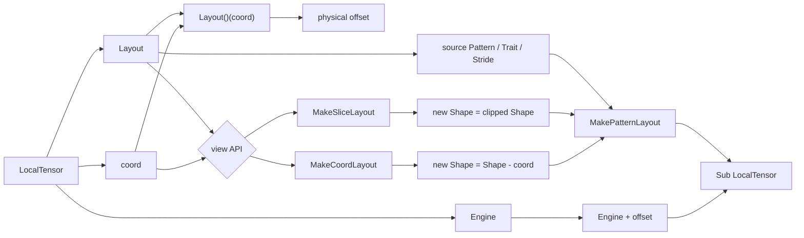
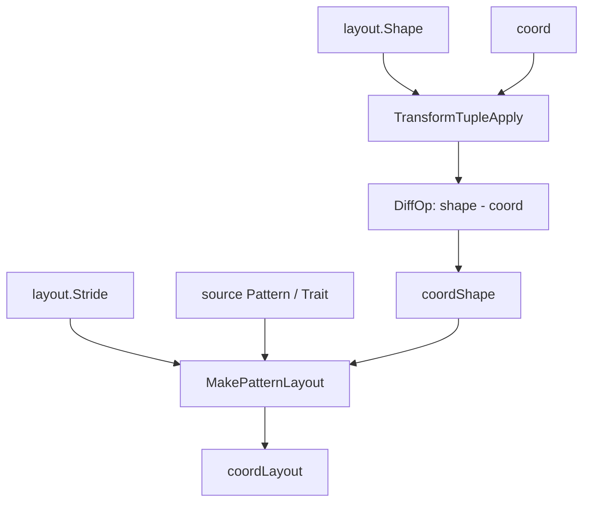
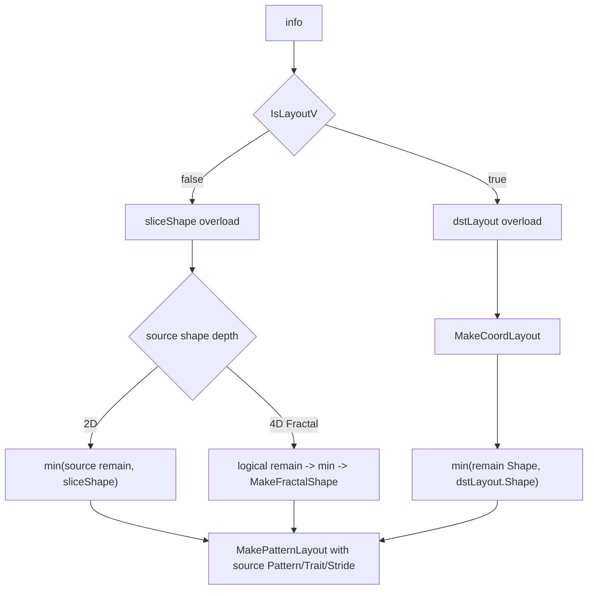

# Tensor 子视图与 Slice 设计说明书

## 1. 需求及场景描述

### 1.1 背景

Tensor API 中的 `LocalTensor` 本质上是一个轻量级数据视图，由 `Engine` 和 `Layout` 两部分组成：

- `Engine` 保存可访问的数据迭代器和指针偏移能力。
- `Layout` 保存逻辑形状 `Shape`、物理步长 `Stride`、布局模式 `Pattern` 以及布局特征 `Trait`。

在算子实现中，经常需要从一个 Tensor 中取出局部区域继续参与计算，例如：

- 从矩阵某个坐标开始处理剩余区域。
- 在边界 tile 上取一个不超过源 Tensor 剩余范围的子块。
- 按目标 Tensor 的 Layout 规格，从源 Tensor 中裁剪一个可参与 Copy、Mmad 或后续 Compose 的子视图。
- 对 ND、NZ、ZN、Fractal 等布局保持一致的索引语义，避免每个算法重复计算地址和布局。

因此需要一套统一接口，在不拷贝数据的前提下，通过坐标生成新的 Tensor 视图。

### 1.2 目标

该接口族的设计目标如下：

1. 基于坐标快速生成子 Tensor 视图。
2. 子 Tensor 只调整起始地址和 Layout，不分配新内存，不搬运数据。
3. 保留源 Layout 的 `Pattern` 和 `Trait`，让后续 Operation Routing 仍能识别原布局语义。
4. 通过模板和 `static_assert` 在编译期约束非法 Shape、Coord、Layout 组合。
5. 对边界 Slice 自动裁剪真实 Shape，减少调用者在业务代码中重复做 `min` 计算。
6. 同时支持普通二维布局和 Fractal 四维布局的切片形状派生。

### 1.3 典型场景

#### 场景一：从指定坐标开始访问剩余 Tensor

调用：

```cpp
auto subTensor = tensor(coord);
```

语义：

- `subTensor.Engine()` 指向 `tensor` 在 `coord` 对应的物理偏移位置。
- `subTensor.Layout().Shape()` 表示从 `coord` 到源 Tensor 结尾的剩余形状。
- `subTensor.Layout().Stride()` 与源 Tensor 保持一致。

#### 场景二：从指定坐标截取固定大小 Slice

调用：

```cpp
auto subTensor = tensor.Slice(coord, sliceShape);
```

语义：

- 从 `coord` 对应地址开始建立子视图。
- 期望子视图大小由 `sliceShape` 给出。
- 当 `sliceShape` 超过源 Tensor 剩余范围时，内部使用 `min` 自动裁剪到真实可用大小。

#### 场景三：按目标 Layout 截取 Slice

调用：

```cpp
auto subTensor = tensor.Slice(coord, dstLayout);
```

语义：

- 先从源 Tensor 的 `coord` 位置得到剩余 Layout。
- 再用源剩余 Shape 和目标 Layout Shape 做逐维 `min`。
- 最终子视图仍继承源 Layout 的 Pattern、Trait、Stride。

## 2. 接口描述

### 2.1 `LocalTensor::operator()(coord)`

接口位置：

- `impl/tensor_api/tensor/local_tensor_impl.h`

接口定义：

```cpp
template <typename Coord>
__aicore__ inline constexpr decltype(auto) operator()(const Coord& coord);

template <typename Coord>
__aicore__ inline constexpr decltype(auto) operator()(const Coord& coord) const;
```

功能：

- 根据 `coord` 创建从该坐标到源 Tensor 结尾的子 Tensor。
- 非 `const` 和 `const` 重载逻辑一致，用于适配不同对象限定符。

核心流程：

```cpp
auto sliceEngine = Engine() + Layout()(coord);
auto coordLayout = MakeCoordLayout(coord, Layout());
return TensorType<decltype(sliceEngine), decltype(coordLayout)>{sliceEngine, coordLayout};
```

返回值：

```cpp
LocalTensor<TensorAttribute<decltype(sliceEngine), decltype(coordLayout)>>
```

返回对象中：

- `sliceEngine` 是源 Engine 加上 `coord` 对应物理偏移后的新 Engine。
- `coordLayout` 是从源 Layout 派生出的剩余 Layout。

### 2.2 `LocalTensor::operator()(c0, c1, cs...)`

接口定义：

```cpp
template <typename Coord0, typename Coord1, typename... Coords>
__aicore__ inline constexpr decltype(auto) operator()(
    const Coord0& c0, const Coord1& c1, const Coords&... cs);

template <typename Coord0, typename Coord1, typename... Coords>
__aicore__ inline constexpr decltype(auto) operator()(
    const Coord0& c0, const Coord1& c1, const Coords&... cs) const;
```

功能：

- 提供多参数坐标入口。
- 内部通过 `MakeCoord(c0, c1, cs...)` 归一化为 tuple 坐标，再复用 `operator()(coord)`。

设计意义：

- 让调用者既可以传入已经构造好的 `Coord`，也可以直接传入多个坐标分量。
- 保持下层实现只处理一种标准坐标结构，减少接口分叉。

### 2.3 `LocalTensor::Slice(coord, info)`

接口定义：

```cpp
template <typename Coord, typename Info>
__aicore__ inline constexpr decltype(auto) Slice(const Coord& coord, const Info& info);

template <typename Coord, typename Info>
__aicore__ inline constexpr decltype(auto) Slice(const Coord& coord, const Info& info) const;
```

功能：

- 根据 `coord` 和 `info` 创建一个有边界规格的子 Tensor。
- `info` 可以是普通 `SliceShape`，也可以是目标 `Layout`。
- 具体派生规则由 `MakeSliceLayout(coord, Layout(), info)` 根据类型选择重载。

核心流程：

```cpp
auto sliceEngine = Engine() + Layout()(coord);
auto coordLayout = MakeSliceLayout(coord, Layout(), info);
return TensorType<decltype(sliceEngine), decltype(coordLayout)>{sliceEngine, coordLayout};
```

与 `operator()(coord)` 的区别：

| 接口 | Layout 派生方式 | Shape 语义 |
| --- | --- | --- |
| `operator()(coord)` | `MakeCoordLayout` | 从 `coord` 到源 Tensor 结尾的完整剩余 Shape |
| `Slice(coord, sliceShape)` | `MakeSliceLayout` | `min(剩余 Shape, 请求 Shape)` |
| `Slice(coord, dstLayout)` | `MakeSliceLayout` | `min(剩余 Shape, 目标 Layout Shape)` |

### 2.4 `MakeCoordLayout`

接口位置：

- `impl/tensor_api/tensor/layout_impl.h`

接口定义：

```cpp
template <typename Coord, typename LayoutType>
__aicore__ inline decltype(auto) MakeCoordLayout(
    const Coord& coord,
    const LayoutType& layout);
```

功能：

- 根据源 Layout 和坐标生成剩余 Layout。

输入：

- `coord`：切入坐标，要求是 tuple。
- `layout`：源 Layout，要求满足 `IsLayoutV<LayoutType>`。

输出：

- 一个由源 `Pattern`、源 `Trait`、新 Shape、源 Stride 构造出的 Layout。

内部规则：

```cpp
coordShape = layout.Shape() - coord
coordStride = layout.Stride()
coordPattern = GetLayoutPattern<LayoutType>
coordTrait = GetLayoutTrait<LayoutType>
```

### 2.5 `MakeSliceLayout(coord, layout, sliceShape)`

接口定义：

```cpp
template <
    typename Coord,
    typename LayoutType,
    typename SliceShape,
    Std::enable_if_t<!IsLayoutV<SliceShape>, int> = 0>
__aicore__ inline decltype(auto) MakeSliceLayout(
    const Coord& coord,
    const LayoutType& layout,
    const SliceShape& sliceShape);
```

功能：

- 当第三个参数不是 Layout 时，将其作为请求切片形状处理。
- 当前只支持二维 `SliceShape`。
- 对普通二维源 Layout 和 Fractal 四维源 Layout 分别派生真实切片 Layout。

二维源 Layout 的规则：

```cpp
srcRow = layout.Shape()[0] - coord[0]
srcCol = layout.Shape()[1] - coord[1]
realRow = min(srcRow, sliceShape[0])
realCol = min(srcCol, sliceShape[1])
newShape = MakeShape(realRow, realCol)
newStride = layout.Stride()
```

Fractal 四维源 Layout 的规则：

```cpp
innerRow = GetShape<0>(layout)[0]
innerCol = GetShape<1>(layout)[0]

srcRow = innerRow * GetShape<0>(layout)[1] - coord[0]
srcCol = innerCol * GetShape<1>(layout)[1] - coord[1]

realRow = min(srcRow, sliceShape[0])
realCol = min(srcCol, sliceShape[1])

newShape = MakeFractalShape(
    MakeShape(realRow, realCol),
    MakeShape(innerRow, innerCol))
newStride = layout.Stride()
```

### 2.6 `MakeSliceLayout(coord, srcLayout, dstLayout)`

接口定义：

```cpp
template <
    typename Coord,
    typename SrcLayoutType,
    typename DstLayoutType,
    Std::enable_if_t<IsLayoutV<DstLayoutType>, int> = 0>
__aicore__ inline decltype(auto) MakeSliceLayout(
    const Coord& coord,
    const SrcLayoutType& srcLayout,
    const DstLayoutType& dstLayout);
```

功能：

- 当第三个参数是 Layout 时，将其作为目标 Layout 规格处理。
- 源 Layout 和目标 Layout 的 rank 必须一致。

内部规则：

```cpp
sliceLayout = MakeCoordLayout(coord, srcLayout)
sliceShape = min(sliceLayout.Shape(), dstLayout.Shape())
newStride = srcLayout.Stride()
newPattern = GetLayoutPattern<SrcLayoutType>
newTrait = GetLayoutTrait<SrcLayoutType>
```

设计重点：

- 目标 Layout 只提供 Shape 裁剪上限。
- 返回 Layout 的 Pattern、Trait、Stride 仍来自源 Layout。
- 这样可以保证子视图仍按照源 Tensor 的物理布局解释数据。

## 3. 方案描述

### 3.1 总体流程



整体分为两条路径：

1. 数据路径：`Engine() + Layout()(coord)` 计算新起点。
2. 布局路径：`MakeCoordLayout` 或 `MakeSliceLayout` 计算新 Layout。

两条路径最终重新组合成新的 `LocalTensor<TensorAttribute<NewEngine, NewLayout>>`。

### 3.2 数据路径设计

`Layout()(coord)` 最终进入 `Crd2Idx(coord, Shape(), Stride())`，将逻辑坐标转换为物理线性偏移。

关键点：

- 地址偏移由 Layout 统一负责，调用者不需要感知 ND、NZ、ZN、Fractal 等布局的 stride 细节。
- `Engine() + offset` 只改变视图起点，不改变底层 buffer。
- 因为没有数据拷贝，接口适合在 AICore kernel 的高频路径中使用。

### 3.3 Layout 派生设计

`operator()(coord)` 使用 `MakeCoordLayout`，表示从坐标开始到源 Tensor 结束。



`Slice(coord, info)` 使用 `MakeSliceLayout`，表示从坐标开始截取一个受限区域。



### 3.4 Pattern 和 Trait 透传

所有 Layout 派生最终都使用：

```cpp
using TraitType = GetLayoutTrait<LayoutType>;
using PatternType = GetLayoutPattern<LayoutType>;
return MakePatternLayout<PatternType, TraitType>(newShape, layout.Stride());
```

或对源目标 Layout 版本使用：

```cpp
using TraitType = GetLayoutTrait<SrcLayoutType>;
using PatternType = GetLayoutPattern<SrcLayoutType>;
return MakePatternLayout<PatternType, TraitType>(sliceShape, srcLayout.Stride());
```

这意味着：

- 子视图继承源 Tensor 的布局模式。
- 后续算法仍能通过 Layout 类型拿到准确的 Pattern。
- Trait 中携带的元素类型、C0 等信息不会在 Slice 后丢失。
- Operation Routing 不需要为 Slice 结果引入额外特殊分支。

### 3.5 编译期约束设计

接口大量使用 `static_assert` 和 `enable_if`，将非法组合尽量前移到编译期暴露。

约束包括：

- Layout 参数必须满足 `IsLayoutV`。
- `MakeCoordLayout` 的 `coord` 必须是 tuple。
- `coord` 和 `Shape` 的嵌套深度、tuple size 必须一致。
- 非 Layout 的 `SliceShape` 必须是 tuple。
- 非 Layout 的 `SliceShape` 当前只支持二维。
- `dstLayout` 重载要求源目标 rank 一致。

这样可以避免在 kernel 执行路径中引入复杂的动态错误处理。

## 4. 规格描述

### 4.1 行为规格

| 接口 | 输入 | 输出 Tensor 起点 | 输出 Layout Shape | 输出 Layout Stride | Pattern/Trait |
| --- | --- | --- | --- | --- | --- |
| `operator()(coord)` | 坐标 | `Engine + Layout(coord)` | `Shape - coord` | 源 Stride | 源 Pattern/Trait |
| `Slice(coord, sliceShape)` | 坐标、二维 Shape | `Engine + Layout(coord)` | `min(剩余 Shape, sliceShape)` | 源 Stride | 源 Pattern/Trait |
| `Slice(coord, dstLayout)` | 坐标、目标 Layout | `Engine + Layout(coord)` | `min(剩余 Shape, dstLayout.Shape)` | 源 Stride | 源 Pattern/Trait |

### 4.2 `MakeCoordLayout` 规格

输入约束：

```cpp
IsLayoutV<LayoutType> == true
Std::is_tuple_v<CoordType> == true
NestingDepthV<ShapeType> == NestingDepthV<CoordType>
Std::tuple_size_v<ShapeType> == Std::tuple_size_v<CoordType>
```

Shape 计算：

```cpp
coordShape = TransformTupleApply(layout.Shape(), coord, DiffOp{})
```

其中：

```cpp
DiffOp(shape, coord) = shape - coord
```

返回 Layout：

```cpp
MakePatternLayout<PatternType, TraitType>(coordShape, layout.Stride())
```

### 4.3 二维 `MakeSliceLayout` 规格

适用条件：

- `SliceShape` 不是 Layout。
- `SliceShape` 是二维 tuple。
- `SliceShape` 的嵌套深度和 tuple size 与源 Shape 一致。

Shape 计算：

```cpp
srcRow = layout.Shape()[0] - coord[0]
srcCol = layout.Shape()[1] - coord[1]
realRow = min(srcRow, sliceShape[0])
realCol = min(srcCol, sliceShape[1])
newShape = MakeShape(realRow, realCol)
```

返回 Layout：

```cpp
MakePatternLayout<PatternType, TraitType>(newShape, layout.Stride())
```

### 4.4 Fractal `MakeSliceLayout` 规格

适用条件：

- `SliceShape` 是二维 tuple。
- 源 Shape 与 `SliceShape` 结构不一致。
- 源 Shape 嵌套深度必须是四维。

源 Shape 结构可理解为：

```cpp
MakeShape(
    MakeShape(innerRow, outerRow),
    MakeShape(innerCol, outerCol))
```

逻辑剩余 Shape 计算：

```cpp
srcRow = innerRow * outerRow - coord[0]
srcCol = innerCol * outerCol - coord[1]
realRow = min(srcRow, sliceShape[0])
realCol = min(srcCol, sliceShape[1])
```

Fractal Shape 重建：

```cpp
newShape = MakeFractalShape(
    MakeShape(realRow, realCol),
    MakeShape(innerRow, innerCol))
```

返回 Layout：

```cpp
MakePatternLayout<PatternType, TraitType>(newShape, layout.Stride())
```

### 4.5 目标 Layout `MakeSliceLayout` 规格

适用条件：

```cpp
IsLayoutV<DstLayoutType> == true
IsLayoutV<SrcLayoutType> == true
SrcLayoutType::rank == DstLayoutType::rank
```

Shape 计算：

```cpp
sliceLayout = MakeCoordLayout(coord, srcLayout)
sliceShape = TransformTupleApply(sliceLayout.Shape(), dstLayout.Shape(), MinOp{})
```

其中：

```cpp
MinOp(src, dst) = min(src, dst)
```

返回 Layout：

```cpp
MakePatternLayout<SrcPatternType, SrcTraitType>(sliceShape, srcLayout.Stride())
```

### 4.6 返回类型规格

`LocalTensor` 内部使用别名：

```cpp
template <typename TensorEngine, typename TensorLayout>
using TensorType = LocalTensor<TensorAttribute<TensorEngine, TensorLayout>>;
```

因此 `operator()` 和 `Slice()` 的返回类型都遵循：

```cpp
TensorType<decltype(sliceEngine), decltype(coordLayout)>
```

该返回类型由编译器根据 Engine 偏移表达式和 Layout 派生结果自动推导。

## 5. 约束条件

### 5.1 坐标结构约束

`MakeCoordLayout` 要求 `coord` 是 tuple，并且与源 Layout Shape 具有相同的嵌套深度和 tuple size。

这意味着：

- 普通二维 Shape 需要二维 Coord。
- Fractal 嵌套 Shape 如果直接使用 `MakeCoordLayout`，Coord 也需要匹配嵌套结构。
- 多参数 `operator()(c0, c1, cs...)` 会先通过 `MakeCoord` 转成标准 Coord。

### 5.2 SliceShape 约束

非 Layout 版本的 `MakeSliceLayout` 要求：

```cpp
Std::is_tuple_v<SliceShape> == true
NestingDepthV<SliceShape> == TWO_DIM_DATA
```

当前它面向二维逻辑切片规格，不支持直接传入三维或更高维 SliceShape。

### 5.3 Fractal Layout 约束

当源 Shape 与二维 SliceShape 的结构不一致时，代码进入 Fractal 分支，并要求：

```cpp
NestingDepthV<OriginShape> == FOUR_DIM_DATA
```

该分支假设源 Shape 可通过内层维度和外层维度还原成二维逻辑行列：

```cpp
logicalRow = innerRow * outerRow
logicalCol = innerCol * outerCol
```

因此该路径适合 NZ、ZN 等 Fractal 类布局，不适合任意不规则嵌套 Shape。

### 5.4 目标 Layout 约束

目标 Layout 版本要求源目标 rank 一致：

```cpp
SrcLayoutType::rank == DstLayoutType::rank
```

目标 Layout 只参与 Shape 上限裁剪，不会改变返回 Layout 的 Pattern、Trait、Stride。

### 5.5 边界和合法性约束

接口会对请求 Shape 做上界裁剪：

```cpp
realDim = min(sourceRemainDim, requestDim)
```

但接口没有显式运行时检查以下情况：

- `coord` 是否超出源 Shape。
- `coord` 是否为负值。
- `shape - coord` 是否发生无符号下溢。
- `coord` 与物理内存容量是否匹配。

这些条件需要由调用侧或更上层 tiling 逻辑保证。

### 5.6 Stride 保持约束

所有子视图都保持源 Layout 的 Stride。

这代表子 Tensor 是源 Tensor 的视图，而不是重新紧凑排列的新 Tensor。后续访问仍按照源 Tensor 的物理布局跳步。

### 5.7 性能约束

该接口面向 AICore 内联使用，设计上依赖：

- `__aicore__ inline constexpr` 提供内联和常量传播机会。
- 模板类型携带 Pattern、Trait、rank 等信息。
- `static_assert` 在编译期约束类型组合。
- tuple 递归和 `TransformTupleApply` 将 Shape 运算归一化到编译期可优化的表达式。

调用方应避免在高频路径中构造复杂动态 Coord 或无法被编译器优化的 Shape 表达式。

## 6. 设计收益

### 6.1 统一子视图抽象

`operator()` 和 `Slice()` 都遵循同一模型：

```cpp
newTensor = oldTensor.Engine shifted by coord + derived Layout
```

调用者只需要表达坐标和目标范围，不需要手写地址偏移与 stride 推导。

### 6.2 零拷贝

接口只创建新的 `LocalTensor` 视图，不分配新 buffer，不移动数据。

这适合 AICore 上 tile 级别的细粒度计算。

### 6.3 类型信息透传

Pattern 和 Trait 从源 Layout 透传到子 Layout，使后续算法仍能基于类型完成路由：

- Copy 可以继续识别 Layout Pattern。
- Mmad 可以继续识别矩阵布局。
- Trait 中的元素类型、C0 等信息不会因 Slice 丢失。

### 6.4 边界 Slice 简化

`Slice` 内部把源剩余 Shape 和请求 Shape 做 `min`，调用者不需要在每个边界 tile 上重复计算真实大小。

### 6.5 支持 Fractal 逻辑切片

Fractal 分支允许调用者用二维逻辑 Shape 表达请求区域，内部再还原成 Fractal Shape。

这降低了上层算法对内部四维嵌套布局的感知成本。

## 7. 小结

该接口族将 Tensor 子视图拆成两个稳定动作：

1. 使用 `Layout()(coord)` 把逻辑坐标转换为物理地址偏移。
2. 使用 `MakeCoordLayout` 或 `MakeSliceLayout` 生成保持源布局语义的新 Layout。

这种设计让 Tensor API 可以在零拷贝、类型透传、布局感知和边界裁剪之间取得统一表达，适合作为 Copy、Mmad、Tile 级计算等上层接口的基础能力。
