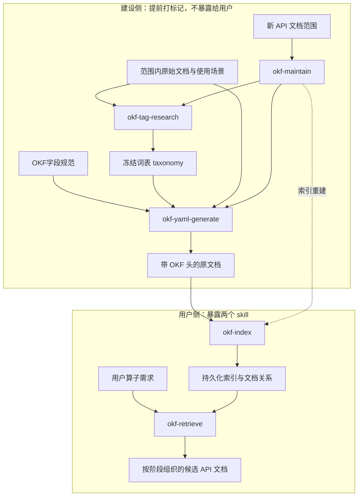

# OKF Skill 详细说明（PLAN）

> 本文档说明 OKF 建设与检索流程中 5 个 skill 的职责边界与输入输出契约，供逐 skill 精细调整使用。
> 历史整理计划（10 → 5 聚合）已执行完成，归档于提交 `refactor(okf): aggregate 10 skills into 5 and unify marking entry`；
> 流程外评测资产见附录 B。

## 0. 总览

### 0.1 双视角与 skill 清单

| 视角 | Skill | 一句话定位 |
| --- | --- | --- |
| 建设侧 | `okf-tag-research` | 词表调研：双盲发现、确定性校验、人工审批与冻结发布；持有词表唯一事实源 |
| 建设侧 | `okf-yaml-generate` | 唯一打标记入口：full 全管线与 tags／description／deps／check 子命令 |
| 建设侧 | `okf-maintain` | 新 API 文档范围的三段流水线编排入口，只编排不建规则 |
| 用户侧 | `okf-index` | 把已打标记文档构建为按 surface 隔离的持久化索引，提供查询 CLI |
| 用户侧 | `okf-retrieve` | 从算子需求经索引检索分阶段候选 API 文档 |

### 0.2 端到端流程



### 0.3 全局约定

- **run 目录**：调研用 `okf-tag-research/runs/<run-id>/`，打标记用 `okf-yaml-generate/tmp/<run-id>/`，
  索引用 `okf-index/index/<surface>/`，评测用 `okf-evaluate/baseline|reports`；每次运行使用新目录，禁止复用他人工件。
- **写入门禁**：tags／description／deps 模式必须先 dry-run（或 validate）再 `--write`；full 管线 `validate` 阻断不得写入；
  同一 front matter 的字段写入必须串行，不允许两个 writer 并发写同一文件。
- **词表唯一事实源**：`okf-tag-research/taxonomy/tag-taxonomy.json` 与 `tag-rules.yaml`；生产写入不得使用 `provisional`。
- **只读／派生边界**：索引是 front matter 的纯派生数据；检索不落盘；`docs/` 正文、头文件、样例源码不在任何 skill 的写入面。
- **共享资产**：`OKF字段规范.md`、`标签体系说明.md`、`最小标签集设计说明.md`、`范围清单.md`、
  `产品映射表.md`、`document-issues.md`、`流程与架构说明书.md`（均在 `okf_skills/` 顶层，消费方矩阵见附录 A）。

## 1. okf-tag-research（建设侧：标签调研）

### 1.1 职责与边界

确定或扩展受控 tag 词表，不向 DevKit Markdown 写入 tag。流程由两个相互隔离的发现子代理、确定性校验、
主代理规则化裁决和两次人工关口构成；本 skill 是词表唯一事实源，生产标注方（`okf-yaml-generate` tags/full 模式）
从本 skill 的 `taxonomy/` 读取 namespace 和值。

### 1.2 输入

**人工输入**（两次人工关口）：

| 关口 | 人工提供内容 |
| --- | --- |
| `prepare` 前 | 精确 DevKit 范围、调研目标、基础 taxonomy、候选发布名称（run-id） |
| 发布包后 | 审批结论：批准或拒绝候选 taxonomy；批准前不得更新 release registry 或写入词表 |

**文件输入**：

- `taxonomy/tag-taxonomy.json`：基础词表（`status` 为 `frozen`/`released`），含 `namespaces`、
  `required_namespaces`、`mandatory_namespaces` 与各值定义；`prepare` 固定其 sha256。
- 源目录内 Markdown 文档及其 sha256（`--source-dir` 指定，不得用近期修改文件代替指定范围）。
- `--guard-repo` 指向的 api-yaml-metadata-guard 仓库根目录（文档扫描/门槛判定依赖）。
- `references/artifact-contract.md`（主代理写 review/approval 前必读）、`references/worker-protocol.md`
  （启动子代理前必读）。

**命令与参数**：

| 命令 | 关键参数 | 说明 |
| --- | --- | --- |
| `prepare` | `--devkit-root --source-dir --guard-repo --taxonomy(默认本 skill) --run-id --output-dir --discovery-count(48) --minimum-independent-directories(2) --maximum-coverage(0.30) --isolation-level` | 固化范围与哈希，生成两份任务包 |
| `validate-discovery` | `--run-dir --worker discovery-a\|discovery-b` | 校验单份发现结果 |
| `summarize-discovery` | `--run-dir` | 汇总两份已校验发现 |
| `validate-review` | `--run-dir` | 校验主代理 review |
| `validate-annotation` | `--run-dir --annotations <annotations.json>` | 校验逐篇标注对必填概念的覆盖 |
| `freeze-provisional` | `--run-dir` | 生成 provisional taxonomy（不可用于生产） |
| `build-release-bundle` | `--run-dir` | 生成人工审批发布包 |
| `approve` | `--run-dir --approval <approval.json> [--output-taxonomy]` | 冻结已批准的 proposal |

**子代理输入**：`inputs/discovery-a.json`、`inputs/discovery-b.json`（`purpose: independent_open_discovery_assignment`），
每个任务包只含自己的样本文档、输出位置和 DevKit 原文根目录；隔离级别为 `logical_shared_workspace` 时须在
manifest 记录，不得描述为严格盲审。

### 1.3 输出

**run 目录工件**（`runs/<run-id>/`，逐命令生成）：

| 工件 | 生产者 | 内容 |
| --- | --- | --- |
| `run-manifest.json` | `prepare` | scope（devkit_root/source_dir/documents）、taxonomy{path,sha256}、thresholds、assignments/outputs、isolation_level、status |
| `inputs/discovery-{a,b}.json` | `prepare` | 两个发现子代理的隔离任务包 |
| `outputs/discovery-{a,b}.json` | 发现子代理 | 候选 namespace:value、定义、逐字证据、目录覆盖 |
| `validation/discovery-{a,b}.json` | `validate-discovery` | 确定性校验结论 |
| `reports/discovery-summary.json` | `summarize-discovery` | 两份已校验发现的汇总 |
| `main-agent-review.json` | 主代理 | 按契约裁决候选：approve／defer，含理由 |
| `validation/main-agent-review.json` | `validate-review` | review 校验结论 |
| `validation/annotation-coverage.json` | `validate-annotation` | 必填概念覆盖校验 |
| `provisional-taxonomy.json` | `freeze-provisional` | `status: provisional` 的候选词表（禁止传给写入器） |
| `approval/release-bundle.json` | `build-release-bundle` | `state: awaiting_human_approval`、gates（含 provisional sha256）、approved_additions |
| `approval.json` | 人工 | `schema_version`、`purpose: human_taxonomy_approval`、`run_id`、`decision: approve`、`approver`、`approved_at` |

**批准后的持久化产物**：`taxonomy/releases/<run-id>-frozen.json`（`status: frozen` + approval，`approve` 默认输出，
禁止覆盖已存在文件）；生产用 `taxonomy/tag-taxonomy.json` 的切换是单独的人工批准动作。

**stdout**：每个命令输出 JSON 摘要（如 run_id、documents 数、状态、输出路径）。

### 1.4 下游消费方

- `okf-yaml-generate`：tags 模式与 full 管线读取 `taxonomy/tag-taxonomy.json`、`taxonomy/tag-rules.yaml`。
- `okf-maintain`：前置检查 `api_surfaces` 词表值是否已登记。
- 人工维护文档：`标签体系说明.md`、`最小标签集设计说明.md`。

### 1.5 维护边界

新增、删除、合并或重新定义标签必须开新调研 run 并经人工批准；`provisional` 不外传；
旧 frozen 版本只读、不覆盖；词表问题由本 skill 新轮次处理，不使用未定义值绕过。

## 2. okf-yaml-generate（建设侧：唯一打标记入口）

### 2.1 职责与边界

为指定 Ascend DevKit API 文档或目录生成、校验并写入完整 OKF YAML 头。处理范围固定为
`docs/zh/api/SIMD-API/{c_api,basic_api,adv_api,tensor_api}`；写入面仅限选中文档的 front matter、
有证据的 include Doxygen 注释和样例调用 marker（可移除旧的 `api_signature` YAML 围栏）；
不改 Markdown 正文、声明、实现、样例代码或索引正文。

统一 CLI 为 `scripts/controller.py`；各模式对应独立脚本仍可单独调用，行为一致：

| 模式 | 用途 | 入口脚本 |
| --- | --- | --- |
| full（无子命令） | `prepare → worker → resolve-issues → validate → write` 全管线 | controller 原有管线 |
| `tags` | 按冻结词表写入 tag 块 | `scripts/write_tags.py` |
| `description` | 单 API description 的 prepare/validate/write | `scripts/description.py` |
| `deps` | 写入 dependencies 并替换旧 usage_dependencies | `scripts/generate_dependencies.py` |
| `check` | 字段闭包检查（同时内嵌为 prepare/validate 关口） | `scripts/field_manager.py` |

### 2.2 输入

**通用输入**：

- 目标文档或目录（`--devkit-root` 下的仓内相对路径）。
- 字段与分类规则：`config/source-context-v1.yaml`、`config/document-profile-registry.yaml`。
- 词表与证据规则：`okf-tag-research/taxonomy/tag-taxonomy.json`、`okf-tag-research/taxonomy/tag-rules.yaml`。
- 取证输入：目标 Markdown 正文、真实头文件（`include/`）、样例源码；样例的 include/impl 声明用于核对原型与重载。
- 运行目录：`tmp/<run-id>/`，每次运行独占。

**full 管线逐阶段输入**：

| 阶段 | 输入 |
| --- | --- |
| `prepare` | `--devkit-root --source-dir 或 --document --run-dir`；扫描目录内全部 Markdown 并按正文分类 |
| 语义工件 | 每批 `semantic-input.json`：`document_path`、`document_sha256`、`description{value,evidence}`、`tag`、`tag_evidence`、`dependencies`、`version`；Index 页免语义输入，由正文链接生成 `navigation` |
| `worker` | `--task batches/batch-NN/task.json --semantic-input ... --output ... [--worker-id]`；单文件一个 worker，目录批次最多并发 6 个，不按字段拆 agent |
| `resolve-issues` | `--run-dir [--decisions resolution-decisions.json]`；decision 需覆盖全部 issue，`classification/resolution` 取固定枚举 |
| `validate` | `--run-dir` |
| `write` | `--run-dir`，仅在 validate 通过后执行 |
| `description` 前置 | description 必须来自本 skill `description` 模式 validate 通过且文档哈希一致的 `description-result.json` |
| 生命周期证据（可选） | `scripts/lifecycle_stage.py --package ... --release-notes ... --output lifecycle.json` |

**tags 模式输入**：annotation artifact（通常 `tmp/okf-agent/<run-id>/tags.json`），每项含 `path`、
`tag`（必须且只含 9 个 namespace）、`evidence`（每个 `namespace:value` 逐字证据，`api_surfaces` 用稳定路径）、
`confidence`、`proposed_tags`（必须为空）。

**description 模式输入**：单个 `docs/zh/api/SIMD-API/` 下 Markdown；`prepare` 生成
`run-manifest.json`＋`task.json`（含输入哈希）；Agent 写 `description-result.json`
（`status: ready|unresolved`、单段中文 `description`、1–3 条逐字 `evidence`、`confidence`、文档哈希）。

**deps 模式输入**：annotation artifact（通常 `tmp/okf-agent/<run-id>/dependencies.json`），每项含
`document_path`、`dependencies[]`；每条依赖含 `path`、`kind`、可选 `condition`、
`evidence{source_path,excerpt}`；`kind` 取 `requires`／`configures`／`constrained_by`／`related`。

**check 输入**：无参数；读取 profile 注册表和 controller 的生成/校验能力声明。

### 2.3 输出

**写入面（文档侧）**：

- front matter 完整 OKF 头，字段与顺序固定为
  `okftype, title, resource, description, tag, signature, declaration, type_catalog, archs, header,
  dependencies, examples, navigation, version`（按 Profile 取适用字段）。
- include Doxygen 关联注释与样例调用 `//! [override_id]` marker。
- 移除旧 `api_signature` YAML 围栏。
- tags 模式只改 tag 块；description 模式只改顶层 `description`（不存在时插入到 `resource` 后）；
  deps 模式只改 `dependencies` 并删除旧 `usage_dependencies`。

**run 目录工件（full 管线）**：

| 工件 | 生产者 | 内容 |
| --- | --- | --- |
| `manifest.json` | `prepare` | devkit_root、documents、batches、taxonomy 路径、write_contracts |
| `classification-report.json` | `prepare` | 逐页 `status/okftype/rule` 或 `unclassified`＋原因；有未分类页即停止 |
| `batches/batch-NN/task.json` | `prepare` | 每批 ≤25 篇任务包 |
| `worker-result.json` | `worker` | `fields`、`evidence`、`issues`、`semantic_verified`、`doxygen`、`example_markers` |
| `issues.json` | `resolve-issues` | 全部发现的 issue 汇总 |
| `resolution-input.json` | `resolve-issues` | 交问题处理 agent 的输入（无 decisions 时） |
| `resolution-decisions.json` | `resolve-issues --decisions` | 校验通过的逐 issue 决议 |
| `validation.json` | `validate` | `status: ok`、patches/files/issues 数 |
| `error-report.json`＋`error-report.md` | `validate`（阻断时） | 问题清单与处理建议，退出码 1 |
| `write-result.json` | `write` | `written` 文件数 |

**stdout**：各模式输出 JSON 摘要——tags：`validated_annotations/taxonomy/written/documents`；
deps：`validated_annotations/written/legacy_usage_dependencies_replaced/documents/dependency_counts`；
description：`run_dir/task`、`validation.json`、`write-plan.json`、`written`；
check：`{ok, registry, errors}`。

**覆盖与闭包检查**：文档分类覆盖、字段闭包（check 关口）、tag 词表值＋逐字证据、dependencies 合法性与
`requires` 无环、Doxygen/marker 目标存在；任一失败均不得写入。

### 2.4 失败处理

- tags：taxonomy 非 `frozen`、namespace/value 不存在、缺必填、值为空、证据缺失或非逐字、路径越界、
  front matter 缺失或 YAML 无法解析时停止且不写入；dry-run 未成功禁止 `--write`。
- description：`prepare` 后文档变化、evidence 非逐字、长度 8–180 越界、Markdown 结构、unresolved 默认拒绝写入；
  写入前必须存在同输入的 dry-run `write-plan.json`。
- deps：路径／证据／关系类型／YAML／循环校验任一失败，整个写入停止。
- full：分类失败、语义输入缺失或哈希不一致、issue 未决议、validate 阻断时不得 `write`。

### 2.5 下游消费方

- `okf-index`：以文档 front matter 为唯一构建输入（tag/signature/dependencies/examples/navigation 等）。
- `okf-retrieve`：消费 description、tag、dependencies 生成的检索视图。
- `okf-maintain`：对既有文档增删改按单文档重跑本 skill。

## 3. okf-index（用户侧：索引建设）

### 3.1 职责与边界

把已打标记文档的 front matter 组织成持久化索引，支撑 `okf-retrieve` 的算子需求检索。
索引是 front matter 的纯派生数据，不承载独立知识；每个 API surface 一个隔离实例
（`index/<surface>/`），文档、视图、依赖图、缺口登记与漂移检测互不共享。

### 3.2 输入

- 范围内 Markdown front matter（scope 由 `scripts/build_index.py` 的 `SCOPES` 注册表定义；
  当前仅 `c_api`：`docs/zh/api/SIMD-API/c_api`，838 篇）。
- `okf-tag-research/taxonomy/tag-taxonomy.json`（tag 值合法性校验）。
- `index/<surface>/gaps.json`：人工维护的缺口登记（构建只做存在性校验；hint/evidence 必须是真实仓库路径）。
- 查询参数：`--surface`（默认 c_api）、`--stage in,out,compute`、`--operation`、`--category`、
  `--dtype`、`--kw`、`--convert <src> <dst>`、`--api <name>`、`--deps-of <api|path> [--kind] [--reverse]`、
  `--gap`、`--json`、`--index-dir`。
- `tests/dryrun.yaml`：20 题查询清单＋extended 能力面查询（测试输入）。

### 3.3 输出

| 工件 | 说明 |
| --- | --- |
| `index/<surface>/index.json` | `schema: okf-index/2`；`documents`＋9 视图＋依赖图＋`scope`；架构变体页 tags/signature/deps/examples 上卷到家族主页，视图只索引主文档，deprecated 散置家族标记 `standalone_primary` 独立参与检索 |
| `index/<surface>/build-meta.json` | `source_commit`／`commit_date`（信息性，漂移比较时排除）、`taxonomy_sha256`、`gaps_sha256`、逐文档 `document_sha256` |
| `index/<surface>/gaps.json` | 本 surface 缺口登记（范围外缺口＋关系缺口，人工维护、构建校验） |
| `index/<surface>/概览.md` | 人读概览（构建产物） |
| `--check` 退出码 | 文档改动未重建索引时退出码 1，作为漂移报警 |
| query stdout | 统一为 `path \| API 名 \| 命中原因` 卡片；`--json` 为机器可读输出 |

构建内联全量校验，任一失败拒绝出索引：字段无越界、`okftype` 合法、tag 值全部出自冻结词表、
signature header 存在于 `include/`、examples 路径存在、依赖目标存在（范围外打 `out_of_scope`）、
`requires` 边无环（`requires`＋`configures` 对偶边不判环）、gaps 的 hint/evidence 路径存在。
构建确定性：输出不含时钟，同输入两次构建字节一致。

### 3.4 复用依赖与维护边界

- `build_index.py` 直接 import `okf-yaml-generate/scripts/controller.py` 的
  `split_front_matter / taxonomy / ALLOWED_FIELDS / DEPENDENCY_KINDS`，不复制解析与词表规则。
- 文档新增/修改/删除后重跑 `build_index.py --scope <surface>` 并提交索引 diff；
  `test_committed_index_fresh` 在索引陈旧时失败，属预期漂移报警。
- 不手改 `index.json`；新 surface 在 `SCOPES` 注册表登记并校准分类/导航与 dryrun 清单，
  按 `okf-maintain` 接入清单编排。

## 4. okf-retrieve（用户侧：知识检索）

### 4.1 职责与边界

打通「算子需求 → 索引查询 → 分阶段候选文档」链路；只定义检索流程与输出规范，不新建索引数据。
检索范围是整个 c_api 实例（当前 838 篇）。

### 4.2 输入

- 用户算子需求（任务 prompt）。
- `okf-index` 持久化索引与查询 CLI：`okf-index/scripts/query.py`（`--surface` 默认 c_api），
  索引数据 `index/c_api/{index.json,gaps.json}`。
- 候选文档正文：只读支撑推荐所需的章节（功能说明/约束说明）；源码 `include/`、`impl/` 仅用于核对原型与重载。
- 检索子代理提示模板 v6.1-retrieve（含资产路径、隔离约束与输出格式，冒烟与对照复用）。

### 4.3 输出

固定格式，不落盘、不增删章节：

```text
## 候选
- 路径: docs/zh/api/SIMD-API/c_api/xxx/yyy.md 或 include/... | API: asc_yyy | 用途: 一句话
## 文档范围内未覆盖
- 能力描述（及源码或范围外线索，若有）
```

必要时保留待确认事项；用户主动询问后再展开接口细节或算子实现。

### 4.4 检索流程与策略要点

流程：理解需求 → 拆解搬入/计算/搬出与配置、同步关注点 → 查询索引（先缩范围再沿依赖图展开）→
按需核对候选文档 → 输出固定格式结果。

策略要点：

- 搬运家族保留：出现「对齐搬运」时 `asc_copy_*` 与 `asc_copy_*_align` 同时保留。
- 矩阵流水线：gm2l1/l12l0a/l12l0b（含 img2col）→ `matrix_multiply_accumulate`（mmad）→ l0c2gm，
  配置项经 `--deps-of asc_copy_l0c2gm` 展开。
- 寄存器流水线：loadalign/loadunalign → reg 计算 → storealign/storeunalign。
- 同步需求：`--operation synchronization` 覆盖核间/流水线同步；语义细节读 sync 概念页。
- deprecated 导航：优先给出正文声明的现行替代接口（`related` 依赖边），deprecated 页保留为兼容候选。
- 缺口判断首选 `--gap`；未命中时如实说明「c_api 范围内未覆盖」并给出源码或范围外目录线索
  （basic_api/adv_api/tensor_api/SIMT/AI-CPU）。
- 按需核对：只读「功能说明/约束说明」章节；源码仅核对原型与重载；不做全量精读。

缺口语义：索引缺失或失效时应说明限制并回流对应 skill，不能把 c_api 范围内未检索到写成仓库不支持。

## 5. okf-maintain（建设侧：流水线复用）

### 5.1 职责与边界

新 API 文档范围的三段流水线（调研 → 添加头 → 建立索引）复用入口：只确定接入步骤、检查前置条件、
分派建设动作并复核结果；不新建标签、字段、Profile 或索引规则。既有范围内文档增删改的局部修正
直接复用对应 skill 自身的维护边界（单文档重跑头、重建索引、词表新轮次），不设集中维护环节。

### 5.2 输入

- 新 API 文档范围（文档根目录及其角色分布）。
- 该范围的范围清单与角色判定规则（参考 c_api 实例 [`范围清单.md`](范围清单.md)）。
- 前置检查项：`api_surfaces` 词表值已在冻结 taxonomy 登记；
  `okf-yaml-generate/config/source-context-v1.yaml` 的 default_tags 覆盖该目录。
- 既有字段规范与冻结词表；各 skill 的命令与 run 目录约定。

### 5.3 输出

- 三段流水线的接入动作分派与复核结论：调研轮次（如需）、分批打头计划（每批 ≤25 篇、每波 ≤6 worker）、
  surface 登记与索引构建清单。
- 不新增持久化资产：词表归 `okf-tag-research`，YAML 头归 `okf-yaml-generate`，
  索引实例归 `okf-index`；审计痕迹沿用各 skill 的 run 目录。

### 5.4 三段流水线与接入清单

| 段 | 复用 skill | 交付物 | 关键门槛 |
| --- | --- | --- | --- |
| 1 调研 | `okf-tag-research` | 冻结词表（当前 core-v9） | 双盲发现、确定性校验、人工批准后冻结 |
| 2 添加头 | `okf-yaml-generate` | 范围内全部文档的 OKF YAML 头、include Doxygen、example marker | prepare→worker→resolve-issues→validate→write；validate 阻断不得写入 |
| 3 建立索引 | `okf-index` | `index/<surface>/{index.json,gaps.json,build-meta.json}` 与查询 CLI | 校验不过不出索引；单测＋dryrun 全过 |

接入清单：

1. **确定范围与角色判定**：确认文档根目录，编制该范围的范围清单与角色判定规则。
2. **前置检查**：`api_surfaces` 词表值已登记；source-context 的 default_tags 已覆盖。
3. **词表覆盖评估**：现有冻结词表不足时先执行 `okf-tag-research` 调研轮次并人工批准。
4. **分批生成 YAML 头**：目录超过 25 篇按批组织，每波最多 6 个 worker。
5. **索引接入**：在 `okf-index` 的 `SCOPES` 登记新 surface，校准分类/导航规则与该 surface 的
   dryrun 查询清单后执行 `build_index.py --scope <surface>`；不影响既有实例。
6. **复核**：`okf-index` 单测与 dryrun 全过；`okf-yaml-generate check` 字段闭包通过。

强制约束：禁止跳过任一段直接写头或建索引；词表未冻结不得进入标注；禁止临时创造未定义标签值；
禁止手改索引构建产物；任一校验失败必须回到对应步骤重做。

## 附录 A. 共享资产与消费方矩阵

顶层 Markdown 保持在 `okf_skills/` 原位；引用路径变更时同步修正。

| 文件 | 归属视角 | 消费方 |
| --- | --- | --- |
| `OKF字段规范.md` | 建设侧字段契约 | `okf-yaml-generate`（含 deps 形状契约）、`okf-index` |
| `标签体系说明.md`、`最小标签集设计说明.md` | 建设侧词表说明 | `okf-tag-research`、`okf-yaml-generate`（tags 模式） |
| `范围清单.md`、`产品映射表.md` | 建设侧范围记录 | `okf-maintain`、`okf-tag-research` |
| `document-issues.md` | 建设侧问题登记 | `okf-yaml-generate`（resolve-issues 阶段） |
| `流程与架构说明书.md` | 全局行为依据 | 所有 skill |

## 附录 B. 流程外资产：okf-evaluate

`okf-evaluate` 已退出流程，目录原地保留（含 `baseline/`、`testset/`、`reports/`、`评测口径.md`），
不再列入 skill 清单，`okf-maintain` 与说明书不得引用其为流程环节。

- 历史职责：阶段 1 在无 OKF、无索引的原始文档上建立基线；阶段 7 用同一测试集与口径做增强对照；
  核心指标为任务耗时与 token 消耗，质量指标（查全、误报、缺口正确性）作为「质量不降低」门槛。
- 输入：`testset/tasks.yaml`（20 任务＋gold＋反查依据）、检索运行产物、opencode 会话存储。
- 输出：`baseline/results/`（逐任务答案、指标、评分）、`reports/`（增强检索评测报告）；
  原始运行产物保留在对应检索 skill 的 run 目录。
- 现状：`testset/tasks.yaml` 仍被 `okf-index` 单测用作查询回归清单；除此之外不参与建设/检索链路。
