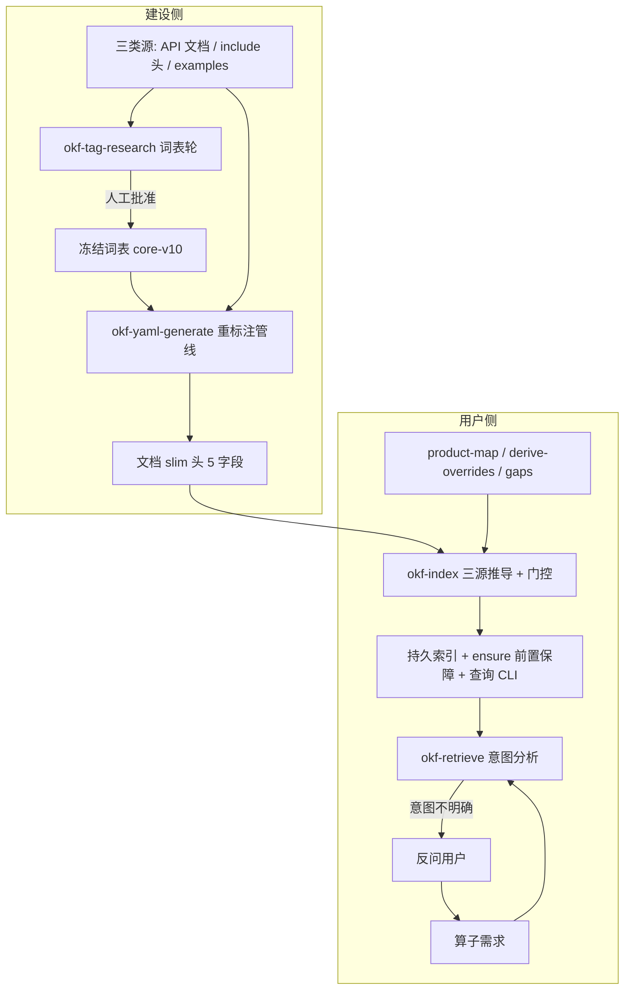

# OKF Skills README

Ascend C API 算子开发前的 API 发现基础设施：根据算子需求快速定位所需 C API 文档及其作用。
字段、标签与推导的唯一契约是 [字段与推导规范.md](字段与推导规范.md)（5 字段 slim 头 +
三类头推导 + LLM 兜底边界 + 门控规则）；本文件只说明职责分工、流程与当前状态。

## 1. 双视角与 Skill 清单

| 视角 | Skill | 职责 | 关键产物 |
| --- | --- | --- | --- |
| 建设侧 | `okf-tag-research` | 词表调研：三类源双盲发现、确定性校验、人工审批冻结；3 语义 namespace（roles/operations/traits） | `config/tag-taxonomy.json`（当前 core-v10）+ `okf-tag-research/taxonomy/releases/` |
| 建设侧 | `okf-yaml-generate` | 唯一打标记入口：prepare→标注→validate→write 管线写入 5 字段 slim 头；version 从 Release Notes 推导 | 文档 front matter、`config/version-overrides.yaml` |
| 建设侧 | `okf-maintain` | 新 API 文档范围接入的三段流水线编排（只编排不建规则） | 接入清单与分派结论 |
| 用户侧 | `okf-index` | 三类头 → 门控化持久索引（CANN 版本×架构×层级）+ 前置保障 ensure（本地环境匹配、指纹漂移检测、按需原地重建）+ 查询 CLI；脚本为主 + derive-overrides 兜底 | `okf-index/index/<surface>/` |
| 用户侧 | `okf-retrieve` | 意图分析（不明确先反问）→ 索引前置保障 + 多轮查询 → 分阶段候选 API 文档 | 固定格式检索结果（不落盘） |

## 2. 端到端流程

## 3. 全局约定

- **run 目录**：调研 `okf-tag-research/runs/<run-id>/`，标注 `okf-yaml-generate/tmp/<run-id>/`，
  索引 `okf-index/index/<surface>/`；每次运行新目录，禁止复用他人工件。
- **写入门禁**：validate 未通过不得写入；同一 front matter 串行写入。
- **唯一事实源**：词表=`config/tag-taxonomy.json`（okf-tag-research 冻结产出，消费方不得
  另建并行词表）；
  字段与推导=`字段与推导规范.md`；产品映射=`config/product-map.yaml`；
  版本裁决=`okf-yaml-generate/config/version-overrides.yaml`。
- **只读边界**：索引是三类头的纯派生数据；`docs/` 正文、include、样例不在任何 skill 写入面。
- **共享资产**：`字段与推导规范.md`、`config/tag-taxonomy.json`、`config/product-map.yaml`、
  本 README、`document-issues.md`（均在本目录，均在 `okf_skills/` 顶层）。

## 4. 当前状态（core-v10 全量轮）

- **词表**：core-v10 已冻结发布（3 namespace / 78 值；新增 `aligned_transfer`、
  `datablock_granularity`；6 个可推导 namespace 与 `masked`/`deprecated` 改为索引期推导；
  `strided_transfer` 等遗留候选记录在 `okf-tag-research/runs/core-v10/` 待下轮复议）。
- **标注**：c_api 全树 838 篇已全部换 5 字段 slim 头（试点 140 篇 + 全量轮 698 篇，
  审计在 `okf-yaml-generate/tmp/{pilot,fullround}/`）；正文零改动。
- **索引**：`index/c_api/` 已按 **CANN 9.2.0 × A5（3510）× c_api 全量** 门控重建：
  SCOPES categories=None（14 个分类），592 篇入索引（243 篇 2201-only、3 篇版本闭区间
  正确过滤）；unresolved 107 条（84 条静默声明无 @override_id、15 条 npu 兜底、
  8 条 include 无声明，见 document-issues DOC-002/004）。检索前经 `ensure_index.py`
  前置保障（本地 CANN/架构门控匹配 + 指纹漂移检测，不匹配时原地重建）；
  okf-index 已解除对建设侧 skill 的代码依赖（用户侧自含）。
- **全量轮已完成**；遗留：unresolved 残留的 derive-overrides 裁决、
  `strided_transfer` 候选复议、DOC-001/002/003/004 源文档修复。

## 5. 全量接入清单（okf-maintain 编排；全量轮已按此执行）

1. 确定范围与角色判定，编制范围清单（基线统计参考 [范围统计](#4-当前状态core-v10-全量轮)）。
2. 词表覆盖评估：现有 core-v10 不足时先跑 `okf-tag-research` 新轮次并人工批准。
3. 分批重标注（`okf-yaml-generate` prepare→标注→validate→write，≤25 篇/批）。
4. 索引接入：`SCOPES` 放开 categories、校准 dryrun 清单、`build_index.py --scope c_api` 重建。
5. 复核：`okf-index` 单测 + dryrun 全过、`okf-yaml-generate check` 闭包通过。

强制约束：禁止跳过任一段直接写头或建索引；词表未冻结不得标注；禁止临时创造未定义标签值；
禁止手改索引构建产物。

## 6. 文档问题登记

API 文档自身问题（非工具缺陷）登记在 [document-issues.md](document-issues.md)；
每条记录路径行号、实际/期望内容、影响与处理建议。当前待修复：DOC-001
（`asc_transpose.md` 原型限定符与头文件不一致，影响 include 映射——索引期已用 npu 标记兜底）、
DOC-002（`asc_copy_l12fb` 头文件声明缺 Doxygen 注解）、DOC-003（`asc_log` 与 `asc_ln`
语义重复且正文与命名不符）、DOC-004（8 篇文档家族名在 include 无匹配声明）。

## 7. 流程外资产

`okf-evaluate/` 已退出流程，目录原地保留（历史基线与评测报告）；其 `testset/tasks.yaml`
不再被 okf-index 引用。
