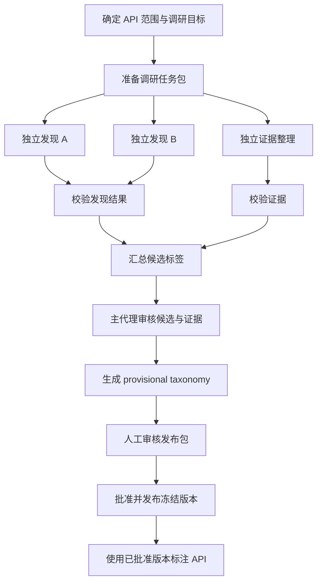

# API Tag 标签体系说明

## 文档目的

本文档说明当前 Ascend DevKit API 文档使用的受控 tag 标签体系，包括词表来源、词表生成流程、标签主题以及强制覆盖要求。

本文档面向需要调研、审核或标注 API tag 的维护者。标签的机器可校验定义以冻结 taxonomy 为准；本文档不构成另一份可独立维护的词表。

## 当前词表来源与版本

当前 tag 体系的唯一词表由以下文件定义：

- `okf-tag-research/taxonomy/tag-taxonomy.json`：冻结的 namespace、标签值、定义和选择规则，也是唯一词表事实源。

当前 `tag-taxonomy.json` 的状态为 `frozen`。本文档中的 namespace 总览对应当前词表；词表发生经批准的变更后，本文档应同步更新。

core-v9 由三轮调研产生（审计记录见 `okf-tag-research/runs/`）：`c-api-full-v1`（96 篇样本，2 目录门槛，归档未发布）、`c-api-full-v2`（192 篇样本、目录门槛 1，新增 8 值）、`cube-datamove-v1`（cube_datamove 全量 69 篇，新增 4 个位置值）。相对 core-v8 共新增 12 个值：`execution_models:scalar`、`execution_models:matrix_compute`、`source_locations:l0a_buffer/l0b_buffer/l0c_buffer`、`destination_locations:l0a_buffer/l0b_buffer/l0c_buffer/bias_table_buffer/fixpipe_buffer`、`traits:inter_core_synchronization`、`operations:img2col`。已知遗留候选（单代理或单文档支持，待后续词表轮）：`traits:returns_old_value`、`families:synchronization/atomic`、`traits:intra_core_synchronization`、`traits:activation`、`traits:channel_split`、`objects:image`、`destination_locations:l0a_mx_buffer/l0b_mx_buffer` 等。

## 当前词表生成与发布流程

词表不是由单次标注直接产生的。新标签必须经过独立发现、证据校验和人工审批，批准后才能成为冻结词表的一部分。



流程中的主要约束如下：

1. 每次调研必须使用新的 run 目录，并固定本轮文档范围和源文件哈希。
2. 两个发现代理必须相互隔离，分别产出结果。
3. 两份发现结果和主代理审核结果都必须通过确定性校验。
4. `provisional` 版本只用于审核，不能直接传给 tag 写入器。
5. 人工批准后，更新 `okf-tag-research/taxonomy/tag-taxonomy.json`；生产流程始终读取该文件。

## Tag 的基本结构

tag 使用“主题（namespace）+ 内容（value）”的结构。在 API Markdown 的 YAML 中，每个主题只出现一次，同一主题的多个内容放在同一个数组中：

```yaml
tag:
  - api_surfaces: [c_api]
  - roles: [compute]
  - traits: [elementwise, masked]
```

namespace 和 value 都必须来自当前冻结词表。不能使用词表之外的自定义主题或临时值。

## 当前 namespace 总览

当前冻结词表包含以下 9 个允许使用的 namespace；`api_surfaces`、`roles` 为全局最小必填字段：

| namespace | 说明 |
| --- | --- |
| `api_surfaces` | API 所属的文档或编程接口表面 |
| `roles` | API 在调用或执行流程中的主要角色 |
| `families` | API 所属的功能家族 |
| `operations` | API 执行或直接配置的主要操作 |
| `objects` | API 处理、产生或控制的主要对象 |
| `execution_models` | API 对应的执行模型 |
| `source_locations` | 输入数据或被转移数据的来源位置 |
| `destination_locations` | 输出数据或被转移数据的目标位置 |
| `traits` | API 具有的、适合检索的行为特征 |

## 当前词表内容

当前词表按 namespace 组织标签值，具体值和定义统一维护在 `okf-tag-research/taxonomy/tag-taxonomy.json` 中；必填和证据规则统一维护在 `okf-tag-research/taxonomy/tag-rules.yaml` 中。本文档只说明整体结构和覆盖要求。

## 强制概念与覆盖要求

`api_surfaces` 和 `roles` 是全局必填；`api_surfaces` 由稳定资源路径证明。`operations` 对 compute、data_movement、data_initialization 角色条件必填；`execution_models` 对 compute 角色条件必填。其余 namespace 仅在正文有证据且存在检索用途时填写。不适用 namespace 省略，不得用空数组伪造信息。

因此内存矢量 `asc_add` 的最小完整标注为 `roles: [compute]`、`operations: [add]`、`execution_models: [memory_vector]`；执行模型不能因“只查 add”而省略，因为同名寄存器矢量 API 也存在。

如果正文证据不足以确定某个强制概念，不能填入临时值、猜测值或空数组绕过校验。该文档应进入补充证据、人工审核或词表修订流程；在问题解决前不得写入 DevKit。

## 证据与审计要求

- 每个标签值都必须有目标 Markdown 正文中的逐字证据。
- `api_surfaces` 等导航型标签可以使用稳定路径作为证据。
- 目录名称、API 名称、dtype、架构、头文件属性和样例注释不能单独证明普通语义标签。
- 调研运行必须保存输入文档范围、源文件哈希、代理输出、校验结果和人工审核记录。
- 任一确定性校验失败，都必须重新产出对应工件并重新校验，不能人工修改校验结果绕过门禁。

## 当前体系的禁止事项

- 不把生命周期步骤、参数绑定、模板细节或实现细节提升为检索标签。
- 不把仅表示架构或 dtype 的内容提升为检索标签。
- 不把调用顺序、条件前置和同步关系伪装成无条件 tag。
- 不使用 provisional taxonomy 进行生产标注或写入。
- 不在 `okf-tag-research/taxonomy/` 之外另建一份正在维护的词表。

## 词表版本与维护原则

需要增加、删除、合并或重新定义标签时，应启动新的调研运行，形成候选 taxonomy，经人工批准后更新唯一事实源文件。

生产标注流程只能读取已批准的冻结版本。发布 registry 的切换、旧版本迁移和大范围 API 重标注都是独立的人工批准动作，不由词表调研流程自动完成。
