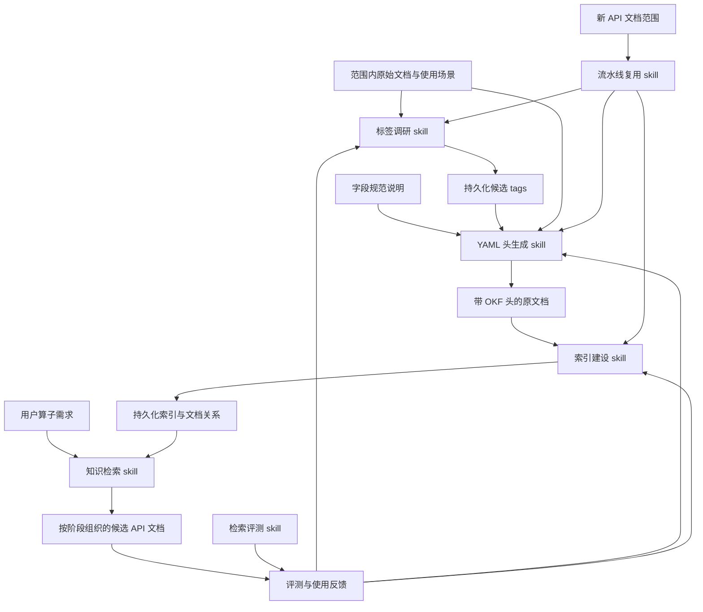

# OKF 知识检索项目：流程与架构说明书

## 1. 目标与交付边界

本项目服务于编写算子前的 API 发现：AI 根据算子需求，快速定位可能需要的 C API 文档及其作用，减少逐篇阅读文档的成本。OKF YAML 头提供可检索的知识描述，持久化索引建立文档之间的关联，一组 skills 负责建设、检索、流水线复用和效果评估。

当前建设范围包括 `docs/zh/api/SIMD-API/c_api` 目录及其子目录内的所有 Markdown 文件（约 800 篇，含分类页、API 页、架构差异页、类型定义页与废弃接口页）。

其他文档暂不纳入 YAML 头生成与索引建设范围。检索遇到范围外依赖时明确提示知识缺口，不据此扩展建设范围。

skills、字段规范、候选 tags、持久化索引和评测资产统一存放在 `okf-skills` 下；实际 YAML 头位于范围内的原文档顶部。

## 2. 总体架构

架构由四部分组成：

| 部分 | 职责 | 持久化产物归属 |
| --- | --- | --- |
| 原始知识 | 提供 API 功能、约束和使用依据 | 原文档；其正文仍是知识依据 |
| 知识描述 | 统一字段语义和标签选择，描述文档用途 | 字段说明、候选 tags 在 `okf-skills`；YAML 头在原文档 |
| 知识组织 | 连接分类、API 与相关文档，支持按算子需求缩小范围 | 索引与文档关系在 `okf-skills` |
| 使用与治理 | 引导检索、按各 skill 维护边界纠正知识、验证检索收益、编排新范围接入 | skills 与评测资产在 `okf-skills` |

YAML 头和索引是检索入口，不替代原文档。候选 tags 与索引首次建立后直接复用，仅在相关知识变化时更新，日常检索不重复开展全量调研或索引建设。

## 3. Skill 职责划分

全部 skill 均已交付并经实际运行验证；`okf-maintain` 定位为流水线复用入口，其编排的三段流水线（调研、添加头、建立索引）已在 c_api 全量运行验证。

| Skill | 辅助完成的工作 | 主要输入 | 主要输出 |
| --- | --- | --- | --- |
| `okf-tag-research` 标签调研 | 从目标 API 的特点和真实算子场景提炼统一标签体系 | 范围内文档、算子使用场景 | 持久化候选 tags 及其含义、使用边界 |
| `okf-tag-generate` 候选生成 | 按冻结词表为文档生成候选标签 | 词表、原文档 | 候选 tags 及证据 |
| `okf-yaml-generate` YAML 头生成 | 按统一字段规范描述各类文档，从候选集合选择 tags，并内联生成 API 依赖关系 | 字段规范、候选 tags、原文档 | 范围内文档的 OKF YAML 头与覆盖检查结果 |
| `okf-index` 索引建设 | 将文档描述组织成可按需求检索的关联知识 | 文档 YAML 头及文档关系依据 | 持久化索引、关联关系及一致性检查结果 |
| `okf-retrieve` 知识检索 | 分析算子需求，通过已有索引定位相关文档 | 用户需求、已有索引 | 按阶段组织的候选 API、简短用途、文档位置及缺口 |
| `okf-maintain` 流水线复用 | 为新 API 文档范围编排调研、添加头与建立索引三段流水线，提供复用入口与接入检查 | 新 API 文档范围、既有字段规范与词表 | 按流水线组织的建设动作分派与复核结果 |
| `okf-evaluate` 检索评测 | 建立测试集，对比无 OKF 与 OKF 加索引两种检索路径 | 固定任务集、原始文档基线、增强知识资产 | 检索质量与效率对比、问题清单 |

复用 skill 只负责编排接入与复核，不新建规则；标签、YAML 头与索引的具体建设分别由对应 skill 承担，避免形成多套规则。既有范围内文档增删改的局部修正直接复用对应 skill 自身的维护边界，不设集中维护环节。

## 4. 知识建设流程

本节流程即 `okf-maintain` 提供复用的建设流水线：第 1–2 步为接入前置条件，第 3 步对应调研，第 4 步对应添加头，第 5–6 步对应建立索引与复核；新 API 范围接入时按同一流程执行。

1. **确定范围与基线。** 确认范围内文档清单，保留完全无 OKF 的评测基线，并确定典型算子检索任务。
2. **明确知识描述约定。** 制定项目采用的 OKF 字段规范，单独说明每个 YAML 字段的含义与使用边界。参考已有方案，但以本项目的算子检索需求为依据，不直接照搬。
3. **调研并固化候选 tags。** 结合目录分类、搬入／计算／搬出阶段、执行流水及同步等使用特征形成候选集合。分类、阶段和流水是不同维度；同步需求取决于实际依赖与使用条件，不能仅凭 API 名称作绝对判断。
4. **生成文档 YAML 头。** 为所有范围内 Markdown 文件添加与其文档角色相符的知识描述。tags 从候选集合选择；无法准确描述时反馈标签调研环节，不临时创造未定义标签。
5. **建立并保存索引。** 组织分类页、API 页、架构差异页及有依据的相关 API 文档关系，支持按功能与阶段查找。相关关系不等于必选调用顺序。
6. **完成检查并投入检索。** 检查范围覆盖、描述依据及关联一致性，形成可直接复用的知识资产。

字段名称、格式和候选标签值在后续阶段确定，本说明书不展开具体规范。用户提供的 [PR 5579](https://gitcode.com/cann/asc-devkit/pull/5579/diffs) 是后续调研线索；本轮未能获取其差异内容，因此不对其格式或兼容性作结论。

## 5. 算子需求检索流程

1. **理解需求。** 判断算子类别，提取计算意图与已知约束；对会影响候选选择的缺失信息标注待确认事项。
2. **拆解阶段。** 将需求映射为搬入、计算、搬出，并识别可能涉及的辅助配置与同步关注点。
3. **进入已有索引。** 先缩小到相关分类和能力，再沿文档关系选择候选，避免从全部原文档开始逐篇阅读。
4. **按需核对依据。** 只读取候选文档中支撑推荐所需的内容，区分已确认适用、条件待确认和范围内未覆盖。
5. **输出检索结果。** 给出按阶段组织的候选 API 文档、简短用途和选择依据，标注必要的缺口；用户主动询问后再展开接口细节或算子实现。

例如，用户提出“使用 C API 实现 MSELoss”时，检索 skill 先识别向量计算需求，再围绕数据搬入、差值与平方、按需求归约以及结果搬出定位文档。若归约方式等条件未明确，保留对应候选分支。本阶段不预设具体 API 组合，也不直接生成算子代码。

若某能力位于 c_api 范围之外（如基础 API、高阶 API、张量表达式等），只说明还需补查的依赖；不能把 c_api 范围内未检索到误写为仓库不支持。

## 6. 流水线复用与新范围接入

`okf-maintain` 是建设流水线的复用入口：把已在 c_api 验证的调研、添加头、建立索引三段打包为新 API 文档范围的标准接入路径。接入流程为：确定范围与角色判定 → 前置检查（api_surfaces 词表值、源上下文登记）→ 必要时词表调研轮次 → 分批生成 YAML 头 → 索引接入与构建 → 单测与 dryrun 复核，必要时按评测口径回归检索质量。

索引构建脚本当前按 c_api 范围固化，接入新范围时须先参数化范围配置并校准分类与导航规则；该改造在接入时实施，不改变既有 c_api 资产。

既有范围内文档新增、修改、移动或删除，以及检索失败、标签歧义和评测退化，直接回流对应 skill 处理：受影响文档的 YAML 头按 `okf-yaml-generate` 单文档重跑，索引经 `build_index.py` 重建，词表问题开 `okf-tag-research` 新轮次；不设集中维护环节。

新知识若来自范围外目录，先作为扩展需求记录，待另行确定范围后经复用入口接入。发现索引缺失或失效时，检索结果应说明限制并回流对应 skill，不能静默依赖错误关系。

## 7. 评测闭环与成功标准

测试集覆盖完整算子需求、单项能力定位、条件不完整、相关文档关联以及范围外知识缺口等场景。MSELoss 是代表性任务之一，不作为唯一评测依据。

对比两种条件：完全无 OKF、无新增索引的原始文档检索；使用 OKF YAML 头、持久化索引及检索 skill 的增强检索。两组采用相同文档正文、任务、模型和运行条件，基线不得接触新增知识资产。

首先评估候选文档是否正确、关键能力是否遗漏、限制是否如实表达，再比较检索耗时、文档读取量、检索操作量与 token 消耗。首次建设与后续更新成本单独报告，不与日常查询成本混淆。

项目成功意味着：范围内文档描述完整且有依据，标签与索引能够持续复用，检索结果可追溯，在不降低检索质量的前提下减少查找成本。具体评测口径和验收阈值在实现前确定，不预先宣称效率提升。
