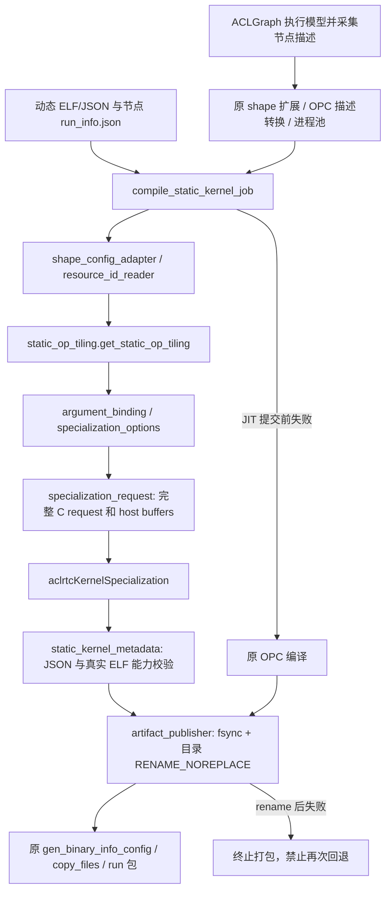

# 静态特化后端（CANN 9.3，首版）

原 `op_compiler` 静态入口和参数保持不变。每个 shape 先尝试 aclrtc，提交前的输入、资源、编译或元数据检查失败时调用原 `_opc_compile_single()`；AOE/tune 明确拒绝。没有新增编译缓存。



## 范围与参数来源

- 首版验证 `DynamicQuant`、`MoeGatingTopKSoftmaxV2`，目标 `Ascend910B4`。其他算子/SoC 自动回退 OPC。
- `resourceId` 从真实 ELF 元数据读取。当前 producer 实际使用 `.ascend.meta` TLV type 6、64 字节 ASCII ID；同时支持设计文档描述的 `.ascend.resource_id`。绝不替换为 ELF SHA256。
- `kernel_name`、`tiling_args_index`、tiling 运行字段及原始字节来自节点的 `run_info.json`，保留额外 run_info 字段；tiling_data 校验为偶数长度 hex 后解码为 bytes，不读取独立 bin 文件。entry/key 必须有明确映射；只接受单 entry/单 key 的一一映射或显式 `tilingKey`，不从名字后缀推断。
- `tiling_args_index` 必须来自 run_info，uint64、从 0 开始；`argsCount = 下标 + 1`，之前的槽位 NULL/0，tiling 槽位绑定 host buffer，`argsBytes` 等于 hex 解码后的字节数（不是字符数）。消费者限制最多 4096 槽，超出或缺失则回退，不猜值。
- 完整运行参数顺序仍复用 CANN `compile_op._gen_kernel_func_declare_head`，用于静态/SK 元数据及上游槽位交叉校验；有 DFX 时进一步核对。不能从最小 request 数组推导完整运行参数。普通 `opParaSize - 8` 检查保留；pointer manifest 读取长度检查暂缓。
- 不读取 manifest，不自行加载 compile database，不要求 devkit 新增 ABI 摘要。资源发现、编译器调用和 JIT ELF 生成交由 aclrtc。可选 `kernel_source` 仅用于验证 fixture 与生成源码布局一致，不是运行前置条件。
- 当前静态 ACLNN 会省略缺失可选参数；如果动态资源仍保留该槽，后端必须拒绝，不能仅更改 JSON 参数数掩盖二进制布局。临时验收资源使用 `no_placeholder` 并保留描述中的 null。request 长度使用上游下标加一，与完整运行布局分开。
- SK 选项复用 `asc_op_compile_base` 的 `parse_super_kernel_options()` 与 `gen_sub_super_kernel_compile_options()`，沿用 ACLGraph parser 的合法/非法/忽略语义。DCCI 正则、debug、early-start 关闭等不再一律回退。early-start 开启仍需要所选资源已有的 `super_kernel_early_start_set_flag/wait_flag` 能力依据；缺失时显式回退。当前不支持 GE 资源包装和需要修改源码模板的选项。
- 原生成函数产生的 DCCI/early-start/sync 标志同时用于静态 JSON；调用前后保存/恢复 compiler globals。受控宏先用 -U 清理，再由原生成函数给出本次值；additional_compile_options 校验后仅进入 basic options，不自动广播到 SK。
- 特殊初始化、descriptor/OOM、int64 模式、MC2/额外 tiling 条件等仍由 OPC 处理。2026-10-10 已接入上游 tiling 槽位及下标+1数组策略。

## 新 dump 未交付时的接入

默认根据已有节点描述 `origin_path` 找到动态 `bin_info` 及同名 `.json`；读取该节点旁 `<节点名>.specialization/run_info.json`。shape 与原节点不匹配则拒绝复用旧 tiling。上游最终节点命名落地后只需调整 `shape_config_adapter`，不是要求上游新增索引协议。

临时穿刺可在原节点 JSON 增加 `specialization` 路径配置（不会传给 OPC）：

```json
{
  "specialization": {
    "dynamic_elf": "/work/resource/kernel.o",
    "dynamic_json": "/work/resource/kernel.json",
    "run_info": "/work/node/run_info.json",
    "context": "/work/node/shape_context.json"
  }
}
```

`context` 是**测试 fixture 可选**的绑定信息，不是 docs/2.md 要求的新产物。若提供，必须包含 inputs/outputs/attrs、deterministic、impl_mode、soc_version、platform_info、dynamic_sha256；严格核对 shape、平台和资源版本。显式 context 路径缺失时失败；同节点 dump 可使用已有节点描述，但必须包含真实 soc_version，不得用当前 CLI 值补成采集证明。

## 发布、回退与日志

- 每次调用使用带时间、进程号、UUID 的结果/OPC dump/meta 目录。工作目录在最终结果目录之外，旧递归扫描器不能读到半成品。
- 对文件及目录 fsync，然后同文件系统目录 `renameat2(RENAME_NOREPLACE)`，再 fsync 父目录，禁止覆盖已有结果。
- rename 之后发生 fsync/日志错误时终止本次打包，不能再回退发布第二份同 shape 产物。
- 每 shape 的 `*_backend_result.json` 区分真正 JIT 成功与 OPC 回退；每次编译使用独立日志子目录，`backend_summary.json` 保留计数。日志不会因 info 级别被删除。
- JIT 单独子进程执行，900 秒超时后终止进程组再回退；不把 worker 中的裸地址传给其他进程。
- 使用原 shape 扩展、进程池、binary info 生成、复制和 run 打包，不修改 debug_compile 入口。

## 验证

在 CANN 环境中，把工具目录加入 PYTHONPATH 并把 TMPDIR、日志、缓存设置到工作目录：

```bash
python -B -m unittest discover -s static_compile/specialization/tests -v
python -B static_compile/specialization/tests/compare_artifacts.py \
  --jit /work/jit/kernel.json --opc /work/opc/kernel.json \
  --report /work/comparison.json
```

`compare_artifacts.py` 核对 ELF/JSON SHA256，分别报告二进制逐字节、JSON 文本、JSON 值、共同静态字段比较；不把字段子集相同说成完整产物相同。SK 能力必须在 ELF 中存在真实 SK_BIND 和四个函数，不靠写 `supportSuperKernel=1` 宣称。

2026-10-09 的验收已覆盖两算子的真实 JIT、OPC 编译和带临时 tiling fixture 的 ACLGraph/SK 数值执行。详见同目录 `VALIDATION.md`。原始产物保留在运行工作目录，不作为源代码放入 PR。

### 2026-10-12 run_info 字段同步

`run_info.json` 使用 `kernel_name` 表示本次所选真实入口；读取结果为 `StaticTilingResult.kernel_name`，经 entry/key 校验后传入 C request 的 `kernelEntry`。C ABI 和内部 request 适配字段 `SpecializationInput.kernel_entry` 不变。旧 JSON 仅提供 `kernel_entry` 时按缺少必填 `kernel_name` 处理，不自动兼容。当前复用的两算子 fixture 已同步；历史运行日志保持原样。

### 2026-10-12 SK 拆分声明

按 V3 §4.3，SK JSON 在验证主 SK 函数、split1/2/3 和 SK_BIND 存在后写入 `split_mode=4`；关闭 SK 时不输出该字段。仍交付包含四个变体的整体 ELF，不虚构独立 `obj_files_splitN` 文件。此实现面向当前 ACLGraph 的运行时 SK_BIND 消费链路；依赖独立对象/归档提取的其他消费者不能据此认定兼容。

正式资源应由算子侧交付带 resourceId 的动态 ELF 及可发现的特化资源，op_compiler 无需新增 ID 生成或替换映射。采集实际加载资源与特化读取资源的同一性需要由采集关联证据证明，单独提供 `specialization.dynamic_elf` 或 shape_context 不能证明。新测试流程保持 run_info 打桩，但需安装并实际调用同一资源；此前跨资源附件注入只作为历史穿刺回归。当前资源 schema 仅支持两个既定 op_type；自定义算子采用不同注册名称时须单独适配，不能猜测别名。
