# Devkit HCCL ST 整体设计与演进方案

> 本文以仓库内 `tests/api/adv_api/hccl/cc/st/algorithm` 当前代码为事实来源，系统说明 Devkit 的 AICPU、CCU 和 MC2/KFC ST。HCCL 原仓设计见 [HCCL_ST整体原理与迁移适配指南.md](HCCL_ST整体原理与迁移适配指南.md)，文件级接入指南见 [MC2_CCU算法适配原理与ST指南.md](MC2_CCU算法适配原理与ST指南.md)。

## 1. 设计目标和基本判断

Devkit ST 由已有的 AICPU Task 测试框架和新增的 CCU/MC2 测试框架共同组成。两者共享虚拟拓扑、Proxy/Stub 和 Checker 分层原则，但使用不同中间表示和执行模型。目标是在没有真实设备的 Host 环境中尽量提前发现：

- selector、tiling、资源申请和缓存错误；
- AICPU task 编排、同步、内存和 collective 语义错误；
- CCU kernel 的 Program、资源引用和控制流错误；
- Host/KFC producer 与 CCU `LoadArg` consumer 的 ABI 错位；
- MC2 KFC 队列、消息、opId、启动/完成信号和 finalize 错误；
- 多 Rank 数据最终来自错误的 Rank、offset 或长度。

这套方案不是只为 AllToAllV CCU 新增的一组 testcase。它是以下四个校验域的统一组织：

```text
AICPU Task 域       真实 selector/executor/template -> SimTaskQueue -> DAG/语义
MC2 Host 域         真实 Host 资源代码 -> tiling/resource/cache 断言
CCU Kernel 域       真实 CCU kernel -> Program -> RuntimeWorld
MC2 KFC 域          真实 KFC server -> queue/message -> collective Program
```

整套 ST 不是 Translator、驱动或硬件模拟器。它刻意选择“逻辑层精确、物理层止步”的边界：

```text
覆盖：产品算法 C++ -> 可观察逻辑表示 -> Host 执行模型 -> Checker
止步：Representation -> 真实物理资源 -> CcuInstr -> 驱动 -> 硬件时序
```

## 2. 总体架构

### 2.1 一张总图

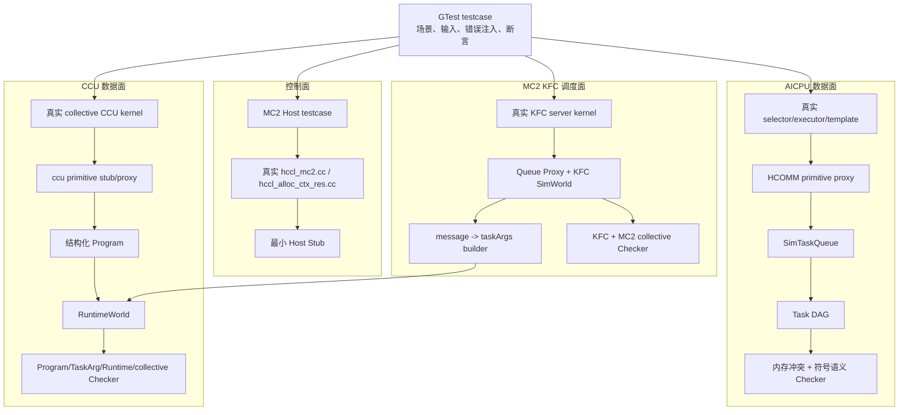

### 2.2 三个构建目标、四个校验域

| 构建目标 | 校验域 | 回答的问题 |
|---|---|---|
| `ascendc_ut_adv_api_hccl_cc_algorithm_ascend950pr_9599_AIC` | AICPU Task | 真实 selector/executor/template 产生的 Task、同步、内存和 collective 语义是否正确 |
| `ascendc_ut_adv_api_hccl_ccu_mc2_host` | MC2 Host | tiling 是否选择正确 CCU 算法，资源和 cache 是否正确 |
| `ascendc_ut_adv_api_hccl_ccu_mc2_device` | Kernel Device | 真实 AllToAllV CCU kernel 的 Program、taskArgs 和结果是否正确 |
| 同一 Device 目标 | KFC Device | 真实 server kernel 的消息、队列、dispatch 和结果是否正确 |

当前源码用例基线是：

| suite/校验域 | case 数 |
|---|---:|
| AllGather AICPU | 15 |
| ReduceScatter AICPU | 22 |
| AllToAllV MC2 Host | 10 |
| AllToAllV Kernel Device | 14 |
| AllToAllV KFC Device | 10 |

合计 71 个 case。数字来自当前 testcase 源码，只是文档基线；提交前仍以 `--gtest_list_tests` 和实际执行为准。

### 2.3 构建模块如何组合

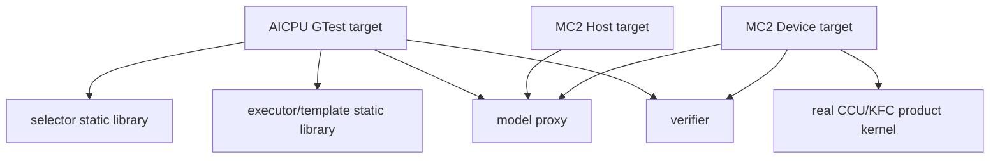

AICPU 目标通过 `--whole-archive` 链接 selector/executor 静态库，确保注册对象不会因未显式引用而被链接器裁掉。CCU Device 目标直接编译真实产品 kernel；模型能力进入 model proxy，Checker 进入 verifier。

## 3. 目录分层和所有权

```text
algorithm/
├── testcase/
│   ├── all_gather_aicpu_testcase.cc
│   ├── reduce_scatter_aicpu_testcase.cc
│   └── mc2_ccu/
│       ├── host/
│       └── device/
└── utils/src/
    ├── aicpu/                  # 真实 AICPU selector/executor/template 构建接入
    ├── ccu/                    # 真实 CCU kernel 的薄函数/ABI 适配
    ├── mc2_ccu/                # MC2 Host 产品源的最小链接桩
    ├── hccl_depends_stub/      # 产品外部依赖与 CCU 原语捕获入口
    ├── hccl_proxy/             # AICPU Task、CCU Program、KFC queue 的代理
    ├── sim_world/              # 虚拟拓扑、AICPU 任务模型、CCU/KFC 执行模型
    └── hccl_verifier/
        ├── 公共 DAG/内存/CCU/KFC Checker
        └── semantics_check/    # collective 专用 Checker
```

判断归属的简单规则：

| 问题 | 代码位置 |
|---|---|
| 产品调用了什么原语 | Stub/Proxy |
| AICPU 原语按哪个 Rank/stream 记录 | SimTaskQueue |
| CCU 原语执行后状态如何变化 | RuntimeWorld |
| 这个状态是否合法 | 公共 Checker |
| 输出对具体 collective 是否正确 | semantics checker |
| 构造什么场景、期望通过还是失败 | testcase |

## 4. 三个容易混淆的 World

### 4.1 `SimWorld`：虚拟通信环境

Devkit 继承 HCCL 的 `SimWorld`。它根据 `TopoMeta` 创建虚拟 Rank/NPU、INPUT/OUTPUT/CCL 内存、stream、notify、communicator 和 channel。

```text
SimWorld
  ├── CommDomain: rank <-> topology position
  ├── SimNpu[rank0]
  │   ├── virtual memory blocks
  │   ├── master/slave streams
  │   └── notifies
  └── SimNpu[rankN]
```

在 AICPU 路径中，`SimWorld` 提供产品算法运行所需的虚拟环境，HCOMM Stub 把任务写入 `SimTaskQueue`。它不是逐任务解释器。

在 MC2 Host testcase 中，`SimWorld` 主要提供 communicator、拓扑和内存分配环境，使真实 `hccl_mc2.cc`/`hccl_alloc_ctx_res.cc` 可以在 Host 上执行。

### 4.2 `RuntimeWorld`：CCU Program 解释器

`RuntimeWorld` 定义在 `sim_world/ccu_sim_world.*`，它不是 ACL Runtime，而是测试专用 CCU 逻辑解释器。每个 Rank 有一个 `RankState`：

```text
RankState
  ├── Program*                 编译态捕获的操作序列
  ├── RankLaunch*              kernel handle + taskArgs + RankMemory
  ├── pc                       当前 operation 下标
  ├── taskParams               taskArgs 按 13 槽打包
  ├── variables[address/event] 逻辑资源的运行值
  ├── notifies[(peer,index)]   跨 Rank notify 位图
  └── completed
```

`RuntimeWorld::Launch` 采用确定性的轮询推进：

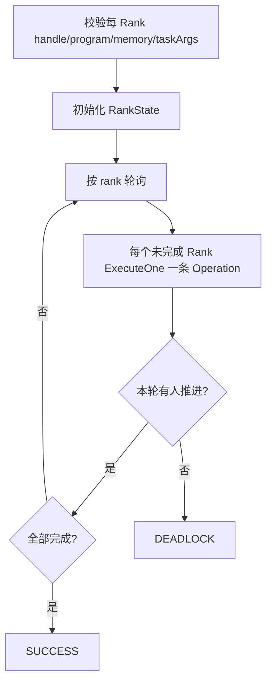

`NOTIFY_WAIT`/`EVENT_WAIT` 条件未满足时，该 Rank 的 pc 不前进；其他 Rank 仍可生产 notify/event。若所有 Rank 都阻塞，返回 `DEADLOCK`。

### 4.3 `CcuKfcSimWorld`：KFC 控制面解释器

`CcuKfcSimWorld` 位于 `sim_world/ccu_kfc_sim_world.*`。它不解释 collective 原语本身，而是模拟 server 如何消费一轮多 Rank 消息：

```text
检查所有 Rank 的当前 slot READY
  -> 检查 startCke=1、completionCke=0
  -> 校验 opId/finalize 的跨 Rank 一致性
  -> 每 Rank 调 taskArgBuilder(message, startup)
  -> 调用内部 RuntimeWorld 执行 collective Program
  -> slot 标记 COMPLETED 或 FINALIZED
```

因此它持有一个 `algorithmWorld_`：KFC World 验证控制面，内部 RuntimeWorld 验证被调度的数据面。

### 4.4 三者对照

| 概念 | 保存什么 | 是否逐操作执行 | 主要消费者 |
|---|---|---:|---|
| `SimWorld` | 拓扑、虚拟 NPU、内存、stream、notify | 否 | AICPU/Host 产品代码与 Stub |
| `SimTaskQueue` | Rank/stream 的 TaskStub 日志 | 否 | DAG 和 AICPU Checker |
| `RuntimeWorld` | CCU RankState、pc、变量、event、notify | 是 | CCU Kernel Device testcase |
| `CcuKfcSimWorld` | KFC queue/registration/dispatch 状态 | 控制面逐轮，数据面委托 RuntimeWorld | KFC Device testcase |

## 5. AICPU Test 的完整原理

### 5.1 先明确它究竟在测试什么

这里的 “AICPU Test” 容易被误解成“在 Host 上模拟 AICPU 指令执行”。当前框架实际验证的是 **AICPU 算法的 Host 展开结果**：真实 HCCL API、selector、executor 和 AICPU template 在 Host 测试进程中运行，最终下发的数据搬运、归约和同步原语被记录为 `TaskStub`，再通过 DAG、内存和 collective 语义 Checker 判断这些 Task 是否正确。

```text
真实执行的部分：HCCL API -> selector -> executor -> AICPU template
被记录的边界：HCOMM/ACL data task 与 sync task
被证明的结果：Task 编排、同步关系、逻辑内存、数据来源、collective 语义
没有执行的部分：真实 AICPU kernel、设备 Runtime、DMA/网络和硬件算术
```

因此，这不是纯 mock 单元测试：selector 和算法 template 是产品代码；也不是设备执行测试：数据面原语被转换为逻辑证据，而没有提交到真实设备。

### 5.2 四层模型

把整个 AICPU ST 分成四层后，各组件的职责会清晰很多：

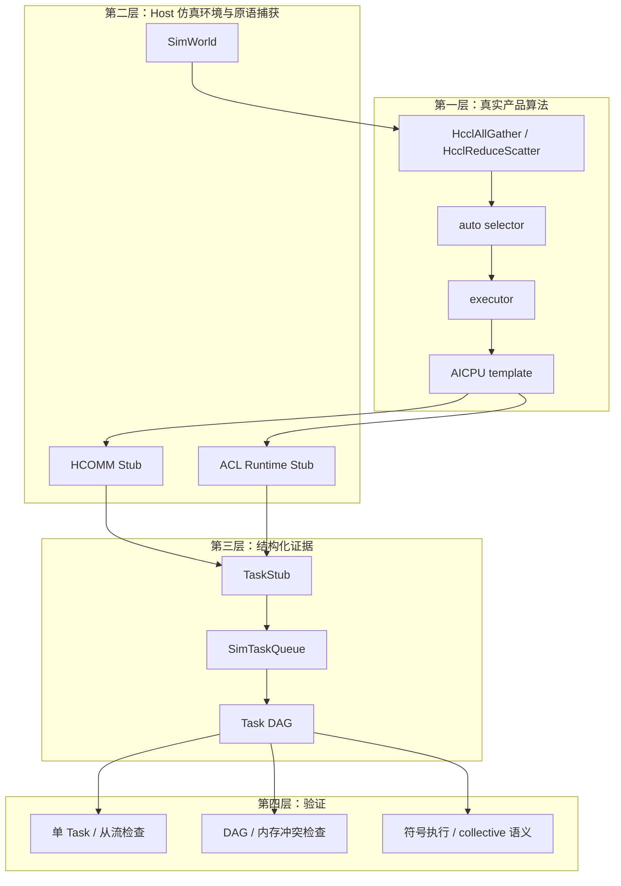

| 层次 | 核心问题 | 主要代码目录 |
|---|---|---|
| 产品算法 | 当前输入和拓扑选择了什么算法，展开了哪些原语 | `src/ops/*/selector`、`executor`、`template/aicpu` |
| 仿真与捕获 | 如何在无设备环境中提供 Rank、stream、内存和接口 | `utils/src/sim_world`、`utils/src/hccl_proxy` |
| 结构化证据 | 如何保存每个 Rank、每条 stream 的 Task 和依赖 | `sim_task.*`、`sim_task_queue.*`、`task_graph_generator` |
| 验证 | Task、同步、内存和最终算子语义是否正确 | `utils/src/hccl_verifier` |

这四层之间有意解耦：`SimWorld` 不判断 AllGather 是否正确，`TaskStub` 不执行真实通信，通用 DAG Checker 也不硬编码某个算法的输出布局。

### 5.3 被测产品链路如何进入 GTest

当前 AICPU 目标是：

```text
ascendc_ut_adv_api_hccl_cc_algorithm_ascend950pr_9599_AIC
```

它设置 `AICPU_COMPILE`，并直接编译或链接以下真实产品模块：

- AllGather、ReduceScatter 的 op 和 auto selector；
- sole、parallel、sequence executor；
- Mesh1D、NHR、MeshNHR、MeshChunk 等 AICPU template；
- selector/executor/template registry、拓扑匹配和 kernel launch 公共逻辑。

selector 和 executor 静态库通过 `--whole-archive` 链接，原因是它们依靠静态注册对象建立算法表；如果被链接器当成“没有显式引用的对象”裁掉，case 会错误地表现成算法未注册。

```text
GTest testcase
  -> HcclAllGather / HcclReduceScatter
  -> real op implementation
  -> real auto selector
  -> real executor
  -> real AICPU template
  -> HCOMM/ACL primitive Stub
```

Stub 的职责仅是补齐 Host 环境和截获原语。它不应复制 selector 条件、拓扑分支或 template 的 Task 展开逻辑，否则测试会变成“用测试代码验证测试代码”。

### 5.4 一条 case 从输入到结论的生命周期

`RunAllGatherAicpuA5` 和 `RunReduceScatterAicpuA5` 采用同一执行骨架，可以分成准备、录制、验证、清理四个阶段：

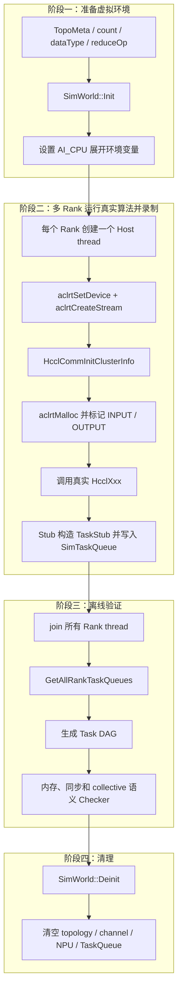

case 的最终断言不是“`HcclXxx` 返回成功”就结束，而是把 `SimTaskQueue::Global()->GetAllRankTaskQueues()` 交给 `CheckAllGather` 或 `CheckReduceScatter`。只有产品算法成功展开，并且记录下来的 Task 通过完整 Checker，case 才算通过。

### 5.5 多 Rank Host thread 与真实设备并发的区别

每个 Host thread 代表一个逻辑 Rank，分别建立自己的 device context、stream、communicator 和 buffer：

```text
一个 Host 测试进程
  ├── thread(rank0) -> HcclXxx -> rank0 的 stream queues
  ├── thread(rank1) -> HcclXxx -> rank1 的 stream queues
  └── thread(rankN) -> HcclXxx -> rankN 的 stream queues
```

这样做有两个目的：

1. 让所有 Rank 的产品算法都实际运行，生成各自的发送、接收和同步 Task；
2. 让 communicator/channel 建立以及跨 Rank post/wait 能拿到配对对象。

但 Host thread 的实际调度次序不是算法正确性的证据。某个 Rank 的线程先运行完，不代表它的设备 Task 应该先执行；主流、从流和跨 Rank 的真正 happens-before 关系由录制结束后的 Task DAG 重建。因此这里模拟的是“多 Rank 参与者”，不是设备 scheduler，也不是 CCU Mission 并发。

### 5.6 SimWorld 提供运行环境，但不执行 Task

`SimWorld::Init(TopoMeta, DevType)` 根据三层拓扑创建逻辑通信环境：

```text
TopoMeta
  -> SuperPod
    -> Server
      -> Physical NPU
        -> Rank mapping / SimNpu / stream / notify / memory
```

它主要持有：

- `CommDomain`：Rank 与 `superPodId/serverId/phyId` 的映射；
- 每个逻辑设备的 `SimNpu` 和设备类型；
- 主流、从流、notify 和 channel 所需的测试对象；
- INPUT、OUTPUT、CCL 等逻辑 buffer 及虚拟地址区间；
- communicator 和当前 Rank/thread 所需上下文。

这里最关键的边界是：`SimWorld` 让产品 Host 代码“认为通信环境存在”，但它不逐条解释 `TaskStub`。AICPU 路径在所有 Rank 完成录制后，由 Verifier 离线分析 TaskQueue。

`SimWorld::Deinit()` 会清理 channel、拓扑、NPU，并调用 `SimTaskQueue::Clear()`，避免上一条 case 的 Task 污染下一条 case。

### 5.7 虚拟地址为何能做内存校验

testcase 调用 `aclrtMalloc` 时，会把 `BUFFER_INPUT_MARK` 或 `BUFFER_OUTPUT_MARK` 作为测试标记传给 Runtime Stub。它不是实际设备内存分配策略，而是声明该地址属于哪一种逻辑 buffer。

Stub 随后把产品代码传入的指针和长度解析成：

```text
DataSlice = (所属 Rank, BufferType, byteOffset, byteSize)
```

例如，Rank2 输入地址偏移 128 字节、长度为 256 字节，会形成类似：

```text
(rank=2, buffer=INPUT, offset=128, size=256)
```

后续 Checker 不需要解引用这个“设备指针”，只需比较逻辑区间就能回答：

- 地址是否属于已登记 buffer；
- `offset + size` 是否越界；
- 两个 Task 是否访问重叠区间；
- 数据最终来自哪个 Rank、哪类 buffer、哪个 offset。

collective 的输入输出尺寸也在这里形成第一层约束：

| collective | 每 Rank INPUT 大小 | 每 Rank OUTPUT 大小 |
|---|---:|---:|
| AllGather | `sendCount * typeSize` | `sendCount * typeSize * rankSize` |
| ReduceScatter | `recvCount * typeSize * rankSize` | `recvCount * typeSize` |

### 5.8 HCOMM/ACL Stub 如何把调用变成 TaskStub

AICPU template 最终会调用有限集合的数据和同步原语。`utils/src/hccl_proxy/hccl_stub.cc` 与 `aclrt_stub.cc` 位于公共截获边界，它们根据当前 Rank、stream、peer、地址和操作类型构造结构化 Task：

| Task 类别 | 典型 TaskStub | 必须记录的证据 |
|---|---|---|
| 本地数据操作 | `LOCAL_COPY`、`LOCAL_REDUCE` | src/dst `DataSlice`、dataType、reduceOp |
| 远端读 | `READ`、`READ_REDUCE` | remoteRank、link、local/remote slice、reduceOp |
| 远端写 | `WRITE`、`WRITE_REDUCE` | remoteRank、link、local/remote slice、reduceOp |
| Rank 内同步 | `LOCAL_POST_TO`、`LOCAL_WAIT_FROM` | 主从 stream/thread、notifyId |
| Rank 间同步 | `POST`、`WAIT` | peer、link、topic/notify 类型 |

这些字段不是为了打印日志，而是后续验证的原始证据：地址字段支撑越界和冲突检查，peer/link/notify 支撑同步配对，reduceOp 支撑归约语义检查。

`TaskTypeStub` 枚举中虽然已经有 `LOCAL_BATCH_REDUCE`，但当前 `TaskCheckOpSemantics::GetSliceOpPair` 对它仍返回“不支持”。因此它不能算作已经打通的 AICPU 端到端原语能力；后续算法若使用它，还需要补齐地址读写集合和符号语义传播。

这也解释了为什么 AICPU 通常不需要逐 collective adapter：AllGather、ReduceScatter 等算法都收敛到同一组 HCOMM 原语，公共 Stub 记录的是“原语语义”，而不是“算法名称”。新增算法若只使用现有原语，一般只需接入真实产品源、testcase 和 collective 语义检查；只有引入新原语时，才需要贯通扩展 `TaskStub -> Stub -> DAG -> 读写集合 -> 符号语义`。

### 5.9 SimTaskQueue 是按 Rank 和 stream 保存的录制日志

`SimTaskQueue` 定义在 `utils/src/sim_world/sim_task_queue.*`，是进程内全局单例。核心结构是：

```cpp
// taskQueues[0] 是主流，taskQueues[1...] 是从流
using SingleTaskQueue =
    std::vector<std::vector<std::shared_ptr<TaskStub>>>;

using AllRankTaskQueues =
    std::map<PodId,
        std::map<SerId,
            std::map<PhyId, SingleTaskQueue>>>;
```

`AppendTask(npuPos, stream, task)` 使用 `superPodId/serverId/phyId` 找到逻辑 Rank，再使用 `streamId` 找到对应队列，最后按下发顺序追加 Task。多 Rank Host thread 可能同时写入，因此追加操作由 mutex 保护。

```text
Rank0
  stream0/master: localCopy -> localPost -> write -> post
  stream1/slave : localWait -> reduce -> localPost

Rank1
  stream0/master: wait -> read -> localPost
  stream1/slave : localWait -> localCopy -> post
```

TaskQueue 只证明同一 stream 内的程序顺序。不同 stream 或不同 Rank 的两个 Task 是否有先后关系，不能根据它们被追加的墙钟时间判断，必须交给同步成图。

### 5.10 从 TaskQueue 到 Task DAG

`TaskGraphGenerator` 把所有 Rank、所有 stream 的 Task 转换成有向图。每个 `TaskStub` 成为一个节点，边表示可证明的 happens-before：

1. 同一 stream 的相邻 Task 建立程序顺序边；
2. Rank 内 `LOCAL_POST_TO -> LOCAL_WAIT_FROM` 建立主流与从流之间的同步边；
3. Rank 间 `POST -> WAIT` 按 peer、link、topic/notify 关系建立通信同步边；
4. 若等待找不到对应 post，或剩余候选节点无法继续推进，则同步图不完整或存在死锁。

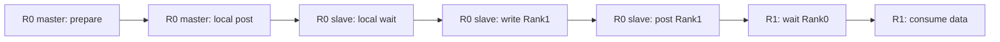

DAG 不是 TaskQueue 的可视化副本。它增加了跨 stream、跨 Rank 的同步边，并成为内存冲突和符号语义的时间模型。若两个内存操作之间不存在任意方向的可达路径，Checker 就必须把它们视为可能并发，而不能利用 Host 录制时碰巧出现的先后关系。

### 5.11 Checker 如何从 DAG 得出“算法正确”

`Checker::GenAndCheckGraph` 的主流程如下：

```text
PrintTask
  -> 1. CheckSlaveTaskQueue
  -> 2. TaskGraphGenerator::GenGraph
  -> 3. SingleTaskCheck::CheckTaskMem
  -> 4. CopyTaskGraph
  -> 5. GraphRevampBilateralSemantics
  -> 6. CheckRankMem::Execute
  -> 7. TaskCheckOpSemantics::Execute
```

| 阶段 | 做什么 | 主要能发现的问题 |
|---|---|---|
| 1. 从流检查 | 检查 slave queue 是否由本地 wait/post 正确包围 | 从流无启动同步、执行后未通知主流 |
| 2. DAG 成图 | 匹配 stream、Rank 内和 Rank 间同步 | post/wait 不匹配、错误 peer、不可推进或死锁 |
| 3. 单 Task 内存 | 检查每个 Task 自身的 `DataSlice` | 地址未登记、offset/size 越界、非法源目的 |
| 4. 图复制 | 为后续内存分析保留独立图 | 技术准备步骤，本身不产生算法结论 |
| 5. 双边语义改造 | 根据通信 peer 补充跨 Rank 数据访问影响 | 让远端读写进入统一冲突分析视角 |
| 6. Rank 内存检查 | 结合 DAG 可达性比较读写区间 | 缺同步导致的 read/write 或 write/write 冲突 |
| 7. 符号与 collective 语义 | 沿 DAG 传播数据来源并检查最终输出契约 | 缺数据、错 Rank、错 offset、错 reduceOp、错输出布局 |

其中第 5、6 步受 `closeRankMemCheck_` 控制；正常 collective 校验应保持开启。第 7 步由通用 `TaskCheckOpSemantics` 传播数据，再按照 `HcclCMDType` 分发到 AllGather、ReduceScatter 等专用 semantics checker。

这条链路体现了一个重要原则：每个结论都必须能追溯到上游证据。没有 `DataSlice` 就不能声称检查了内存冲突；没有 post/wait 元数据就不能声称建立了 happens-before；只检查 Task 数量也不能证明 collective 输出正确。

### 5.12 内存冲突检查为何与 Host 执行顺序无关

内存冲突检查先为 Task 提取逻辑读写集合：

- `LOCAL_COPY`：读 src，写 dst；
- `LOCAL_REDUCE`：读 src，同时读写 dst；
- `WRITE/WRITE_REDUCE`：读取本地源区间，并通过双边图反映远端目标影响；
- `READ/READ_REDUCE`：读取远端源区间，写入或归约到本地目标区间。

两个 Task 同时满足以下条件时，才是潜在冲突：

```text
访问区间重叠
AND 至少一个访问是写
AND DAG 中 A 不能到达 B
AND DAG 中 B 不能到达 A
```

例如，主流写 OUTPUT 的某个 shard，从流同时对同一区间做 reduce，如果两者之间缺少 local post/wait，即使某次 Host 运行中主流恰好先录制完，DAG 中仍然没有顺序保证，Checker 应报告冲突。它检查的是算法同步是否充分，而不是测试线程是否幸运地串行执行。

### 5.13 符号语义如何替代真实数据运算

`TaskCheckOpSemantics` 不为每个元素保存真实 FP16、INT8 数值，而是用 `BufferSemantic` 描述逻辑区间的数据来源：

```text
目标区间 [start, size]
  <- {(sourceRank, sourceBufferType, sourceOffset), ...}
  + 是否发生 reduce
  + reduceType
```

初始化时，每个 Rank 的 INPUT 区间带有自己的来源标签。随后：

- copy/read/write 把来源标签传播到目标区间；
- reduce 把多个来源集合合并，并记录 `reduceType`；
- 局部覆盖会切分 `BufferSemantic` 区间，避免把未覆盖部分误认为已更新；
- DAG 决定 Task 的合法传播顺序；
- 最后由 collective checker 检查每个 Rank 的 OUTPUT 来源集合和布局。

这是一种符号执行，而不是数值执行。它可以用很小的 Host 状态验证大数据分块、offset、Rank 来源和归约关系，但不能发现浮点舍入、溢出、真实算术指令或硬件精度问题。

### 5.14 AllGather：如何从 Task 证明最终语义

AllGather 当前有 15 个 AICPU case，覆盖 Mesh1D、NHR、parallel NHR + Mesh1D，2/3/4/6/8 Rank，多种整数和浮点数据类型，以及 small/big data、非 2 次幂 Rank。

对任意目的 Rank `r`，最终契约是：

```text
OUTPUT_r[s * sendCount : (s + 1) * sendCount]
    <- INPUT_s[0 : sendCount]
    for every source rank s
```

验证过程不是只数“有多少条 write”，而是：

1. selector/template 真实展开出 copy/read/write 和同步 Task；
2. DAG 证明每段远端数据在被消费前已经完成；
3. 内存 Checker 证明并行 Task 没有无序覆盖同一输出片段；
4. 符号执行得到每段 OUTPUT 的实际来源；
5. AllGather checker 比较 Rank 顺序、源 offset、目标 offset 和区间完整性。

因此它能发现选错算法分支后产生的错误 Task、遗漏某个源 Rank、片段顺序错误、offset 错误、输出缺口以及缺同步引起的冲突。

### 5.15 ReduceScatter：归约和分片如何一起验证

ReduceScatter 当前有 22 个 AICPU case，覆盖 Mesh、NHR、MeshNHR、MeshChunk，2/3/4/6/8 Rank，多种数据类型以及 SUM/MAX/MIN 等 reduceOp。

对目的 Rank `r`，其期望输出是所有输入 Rank 的第 `r` 个 shard：

```text
OUTPUT_r[0 : recvCount]
    <- reduce(
         INPUT_0[r * recvCount : (r + 1) * recvCount],
         INPUT_1[r * recvCount : (r + 1) * recvCount],
         ...,
         INPUT_N[r * recvCount : (r + 1) * recvCount])
```

Checker 同时验证四件事：来源 Rank 集合完整、每个来源 offset 都属于 shard `r`、归约类型与 testcase 的 `reduceOp` 一致、最终结果落在 Rank `r` 的 OUTPUT。DAG 和内存检查还会约束归约 Task 的执行前置条件，避免输入尚未到达就开始 reduce，或多个流无序覆盖同一累加区间。

### 5.16 能力、证据和边界总结

| 想验证的能力 | 依赖的直接证据 | 当前能否验证 |
|---|---|---:|
| selector/executor/template 是否能正确展开 | 真实产品调用链和最终 TaskQueue | 能 |
| 每条 stream 的 Task 次序 | `SimTaskQueue` 的追加顺序 | 能 |
| 主从流和跨 Rank 同步 | local/remote post-wait 与 Task DAG | 能 |
| 地址、分块和 offset | `DataSlice` 与虚拟 buffer 登记 | 能 |
| 无序内存冲突 | DAG 可达性与 Task 读写集合 | 能 |
| 数据来自哪个 Rank | `BufferSemantic` 符号传播 | 能 |
| AllGather/ReduceScatter 最终契约 | collective 专用 semantics checker | 能 |
| `LOCAL_BATCH_REDUCE` 端到端语义 | 目前只有 Task 类型，符号语义尚未实现 | 不能 |
| 真实 ACL Runtime 调度 | 无真实 Runtime 证据 | 不能 |
| AICPU kernel 二进制和设备执行 | 未装载并执行真实设备 kernel | 不能 |
| DMA/网络时序、带宽和性能 | 无物理链路和硬件时间模型 | 不能 |
| 浮点逐元素数值精度 | 使用来源符号而非真实数值 | 不能 |
| 驱动、固件、设备异常恢复 | Host Stub 不包含这些层 | 不能 |

所以 AICPU ST 的准确结论应该是：**真实产品算法的 Host 展开路径已经执行，其生成的 Task 编排、同步 DAG、逻辑内存和 collective 符号语义通过验证**。不能把它扩大表述成“AICPU 设备执行通过”或“硬件通信通过”。

## 6. CCU Test 的完整原理

### 6.1 先明确 CCU Test 究竟在测试什么

CCU Test 不是在 Host 上执行真实 CCU 微码，也不是只检查 `HcommCcuKernelRegister/Launch` 是否返回成功。当前框架把 CCU 产品代码分成三个可独立观察的校验域：Host 资源准备、collective kernel 数据面、KFC server 控制面，并为每个校验域选择不同的证据。

```text
Host Test
  真实执行：MC2 tiling 解析、CCU 分支选择、资源申请和缓存逻辑
  主要证据：OpResCtx、算法类型、KFC startup args、cache/error 状态

Kernel Device Test
  真实执行：产品 CCU kernel 的 C++ 注册期构造逻辑
  主要证据：结构化 Program、taskArgs ABI、RuntimeWorld 状态和最终数据

KFC Device Test
  真实执行：产品 KFC server kernel 的 C++ 注册期构造逻辑
  主要证据：server Program、registration、消息队列、CKE、dispatch 和 collective 结果
```

这里的 “Device Test” 表示被测对象是 Device 侧 kernel 源码，不表示 testcase 在真实 Device 上运行。它通过 Host 侧原语捕获和解释模型验证逻辑 Representation；真实 Translator、微码装载、驱动和硬件执行不在当前范围。

### 6.2 三个校验域为什么不能混成一条 case

三条路径处于不同生命周期，输入和失败模式也不同：

| 校验域 | 生命周期位置 | 主要输入 | 主要风险 |
|---|---|---|---|
| MC2 Host | kernel 启动前 | `Mc2CcTilingInner`、comm、stream、ctxTag | commEngine 分支错误、算法选择错误、资源漏配、cache 误复用、错误未回滚 |
| Kernel Device | CCU kernel 注册与 Launch | kernelArg、Channel、taskArgs、RankMemory | Program 结构错误、LoadArg/地址 ABI 错位、同步死锁、数据搬运错误 |
| KFC Device | 常驻 server 注册、消息消费与 dispatch | startup args、opId、64 槽 queue、message | 槽状态错误、CKE 时序错误、opId 错配、跨 Rank 消息不一致、dispatch 参数错误 |

Host 资源正确不能证明 kernel 数据面正确，kernel 直接启动正确也不能证明 KFC queue 协议正确。因此框架使用两个 GTest 目标、三个校验域，而不是让一个大 case 同时 mock 所有层。

### 6.3 CCU Test 的五层模型

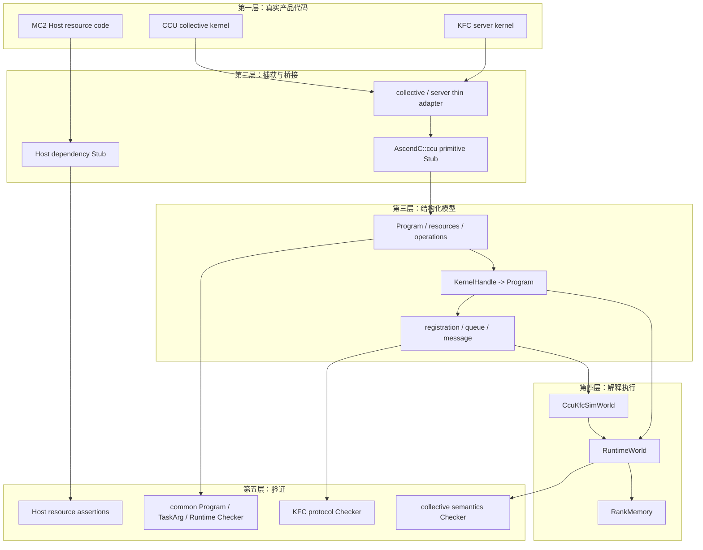

五层的所有权边界是：

- 产品层决定真正的算法结构，ST 不复制 peer 循环、同步序列或数据搬运算法；
- 捕获层只做类型安全调用、参数准备和 `AscendC::ccu` API 截获；
- 模型层保存结构，不判断某个 collective 的最终输出；
- 执行层根据 Program 和运行期参数推进状态，不反向生成期望值；
- Checker 层分别检查公共机制、collective 契约和 KFC 协议。

### 6.4 两个构建目标分别装入哪些真实代码

当前 CCU/MC2 ST 使用两个目标：

| 目标 | 直接编译的真实产品代码 | 对应校验域 |
|---|---|---|
| `ascendc_ut_adv_api_hccl_ccu_mc2_host` | `hccl_mc2.cc`、`hccl_alloc_ctx_res.cc` | MC2 Host |
| `ascendc_ut_adv_api_hccl_ccu_mc2_device` | `ccu_kernel_all_to_all_v_mesh1d.cc`、`ccu_kernel_kfc_server.cc` | Kernel Device、KFC Device |

Host 目标中的 `cann_host_bridge_stub.cc` 和 `hccl_op_common_stub.cc` 只补齐真实 Host 源的最小外部依赖。Device 目标中的 `ccu_all_to_all_v_mesh1d_adapter.cc` 和 `ccu_kfc_server_adapter.cc` 只负责用明确类型调用真实 kernel、准备动态参数或 KFC 映射；它们都不应该重新实现产品算法。

这种构建方式保证 Checker 观察到的 Program 来自真实产品 kernel。只对手工构造的 Program 做单测可以验证 Checker 自身，却不能证明产品 kernel 实际调用了正确的 CCU API。

### 6.5 三条端到端测试链路

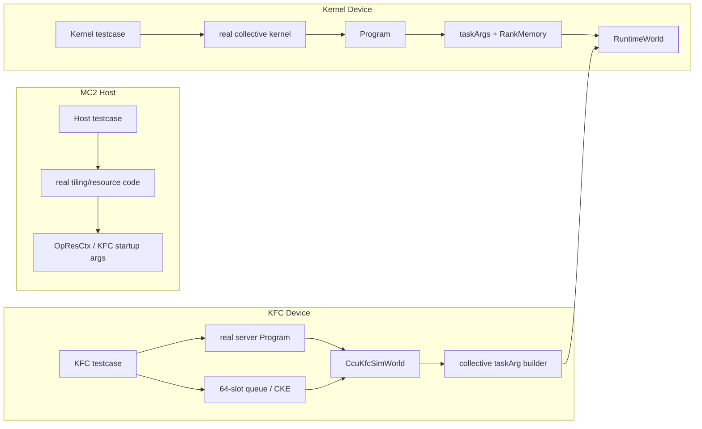

三条链最终在不同位置闭环：Host 链闭环于资源产物；普通 Kernel 链闭环于 Program 执行后的多 Rank 数据；KFC 链先闭环消息和队列状态，再复用同一个 collective `RuntimeWorld` 闭环数据面。

### 6.6 MC2 Host Test 如何验证资源控制面

Host testcase 直接调用真实 `HcclAllocComResourceByTiling` 等入口，用构造的 tiling 驱动 `commEngine == COMM_ENGINE_CCU` 分支。验证重点不是“函数返回成功”，而是返回后的资源上下文是否满足启动 CCU/KFC 所需契约：

- tiling 是否选择预期 CCU 算法；
- workspace、Rank、XN、CKE、token 等资源是否完整写入 `OpResCtx`；
- KFC server 的六项 startup args 是否指向刚分配的 queue/CKE/token；
- 多个配置是否按正确 cache key 共享或隔离 server；
- 不同 engine 值、空指针或分配失败是否正确传播错误并保持状态一致。

这一域没有执行普通 HCCL selector/executor 全链，也没有执行 collective kernel。它证明的是“MC2 tiling 能走到正确 CCU 资源路径并生成可启动上下文”，而不是“CCU 算法数据正确”。

### 6.7 Kernel Device Test 如何把真实 kernel 变成 Program

#### 6.7.1 为什么不能直接执行产品 kernel

产品 `AscendC::ccu` kernel 的 C++ 代码描述的是注册期程序构造。真实环境中它产生 Representation，之后由资源分配和 Translator 生成微码；它不是普通 CPU 函数那样直接搬运输入数据。

ST 因此把 CCU API 替换为捕获 Stub：

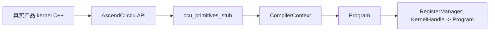

#### 6.7.2 RegisterManager 生命周期

```text
RegisterStart(instance)
  -> Register(name, typed callable, kernelArg)
       -> 创建 CompilerContext
       -> 执行真实 kernel callable
       -> 捕获 Program
       -> 分配 KernelHandle
  -> RegisterEnd(instance)
       -> Finalize 每个 Program
       -> 原子标记 compiled
```

当前 Device ST 使用自己的 `RegisterManager` 和类型安全的 `KernelFunction`。这与产品 `HcommCcuKernelRegister(void *kernelFunc, ...)` 的 Stub 不是同一个完整链路。后者目前仍只记录注册并返回成功，不能用普通 Host API 直接替代 Device adapter。

#### 6.7.3 Program 保存什么

`hccl_proxy/ccu_st_types.h` 的 `Program` 当前包含：

- `rankId/rankSize/channels`；
- `operations`：LOAD_ARG、Load/Store、赋值、地址运算、notify/event、WRITE、LOCAL_COPY、GROUP_COPY、IF/WHILE；
- `arguments`：argId 到 Variable handle 的绑定；
- Variable、Address、Event、CcuBuffer 资源集合；
- channel variable、LocalAddr、RemoteAddr 的组成关系；
- GroupCopy 的 function、loop、loop group 和 goSize 描述。

形象地说，Program 是“可执行操作序列 + 符号表 + 结构描述”：

```text
Program
  symbol table: V1, V2, A1, E1, Buffer0, Channel(0->1)
  operations:
    0 LOAD_ARG V1 <- arg[0]
    1 ADDRESS_ASSIGN A1 <- V1
    2 WRITE_VARIABLE_NOTIFY ...
    3 NOTIFY_WAIT ...
    4 WRITE remote <- local length=Vn event=E1
    5 EVENT_WAIT E1
```

#### 6.7.4 捕获不等于真实微码编译

ST 的 `CompilerContext::Finalize` 检查逻辑结构并关闭控制流，但不会执行真实物理 XN/GSA/CKE/MS 分配，也不会调用真实 `CcuRepTranslator` 生成 `CcuInstr`。文档和测试报告只能称为 Program/逻辑 IR 校验。

### 6.8 RuntimeWorld 怎样模拟 CCU 行为

#### 6.8.1 动态参数绑定

`RankLaunch` 提供：

```text
kernel handle
taskArgs[0..N-1]
RankMemory {input, output, parameter, inPlace}
```

Launch 先检查 Program Rank 元数据与 launches 数一致、taskArgs 数与 Program arguments 一致，再由 `PackTaskArgs` 每 13 项形成一个逻辑 `TaskParam`。`LOAD_ARG` 按 `argId / 13` 和 `argId % 13` 找到值。

这里的多个 `TaskParam` 只是当前 ST 对 13 槽 ABI 的分组检查，并不是完整模拟多个硬件 Mission/SQE 的并发执行。

#### 6.8.2 虚拟内存

`RankMemory` 使用 Host vector 存放 input/output/parameter。`ResolveMemory` 遍历所有 Rank 的地址区间，将 CCU 地址解析成：

```text
(ownerRank, host pointer, remaining range)
```

由此可检查：

- 本地源地址是否真的属于当前 Rank；
- WRITE 的目的是否属于 Channel 指向的远端 Rank；
- Load 参数表是否错误跨 Rank；
- 地址加长度是否溢出或越界。

#### 6.8.3 原语语义

| Operation | RuntimeWorld 行为 | 能发现的问题 |
|---|---|---|
| LOAD_ARG | 从逻辑 TaskParam 读入 Variable | 缺参、argId 越界 |
| LOAD/STORE_MEMORY | 访问当前 Rank 参数内存 | peer 表越界、错误 owner |
| ASSIGN/ADD/ADDRESS | 更新变量或地址表 | 动态 offset 计算结果 |
| WRITE_VARIABLE_NOTIFY | 写远端 channel variable 并置 notify | peer/channel variable 错配 |
| NOTIFY_RECORD/WAIT | 生产/消费 peer notify mask | 同步 mask、永久等待 |
| EVENT_RECORD/WAIT | 生产/消费本地 event mask | 完成事件不匹配 |
| WRITE | local -> remote `memmove` | Rank 方向、地址、长度 |
| LOCAL_COPY | local -> local `memmove` | self peer 搬运与越界 |
| GROUP_COPY | 按逻辑长度做整体 copy | 最终数据效果；内部结构由静态 Checker 检查 |
| IF/WHILE | 根据 Variable 跳转 peerIndex | 分支和循环控制流 |

`GROUP_COPY` 当前运行时按整体 `memmove` 模拟数据结果，不逐个模拟 MS buffer、Func、LoopEngine 或硬件 pipeline。其 loop/goSize/Event/CcuBuffer 结构由 Program/collective Checker 静态验证。

#### 6.8.4 死锁模拟

轮询模型每轮最多让每个 Rank 执行一条 operation。某 Rank wait 未满足时返回“未推进”，但不报错；当一整轮所有未完成 Rank 都未推进，才报告 `all ranks are blocked`。

这能发现显式 event/notify 的缺失生产者，但不能证明真实硬件 interleaving 下不存在所有竞态，因为当前没有 CCU `Program -> DAG` 和多 LoopEngine 调度模型。

### 6.9 CCU Checker 如何把模型证据转成结论

Checker 的可信度来自“被检查信息在上游确实被捕获”，而不是类名本身。

#### 6.9.1 `CcuLogicalResourceChecker`

它遍历 Program 的资源集合、地址映射和每条 Operation 的 handle 类型，所以能检查：

- handle 非零且不同资源类型不碰撞；
- LocalAddr/RemoteAddr 拥有合法 Address/Token；
- LoadArg 指向已分配 Variable；
- WRITE/LOCAL_COPY 的地址、长度和 Event 类型正确；
- IF/WHILE 的条件和 peerIndex 有效。

它不能判断“AllToAllV 应该有几个 WRITE”，因为这是 collective 规则。

#### 6.9.2 `CcuProgramChecker`

它在公共资源检查之上验证 `ArgDescriptor.id` 连续、每个参数恰有一个 LOAD_ARG、operation 与 descriptor 绑定一致。因此它能拒绝缺 LoadArg、重复 argId 和绑错 Variable。

#### 6.9.3 `CcuTaskArgChecker`

它比较 Program arguments 与 taskArgs 数量，再验证 13 槽分组、copiedArgCount 和每个 argId 的值。因此它校验的是公共参数桥接结构，不知道参数 3 应是 source offset 还是 destination offset。

#### 6.9.4 `CcuRuntimeChecker`

它读取 `RuntimeWorld::LastExecutionStats`，确认 Rank 数和每个 Rank completed。它证明所有 Program 都走到末尾，但不证明输出语义正确。

#### 6.9.5 `CcuAllToAllVSemanticsChecker`

它掌握 AllToAllV 契约，所以可以进一步检查：

- full-mesh channel 和每 peer output/token channel variable；
- 当前 kernel 必须有 10 个动态参数；
- 参数表每 Rank 4 个字段按 8 字节连续 Load；
- WRITE_VARIABLE_NOTIFY、NOTIFY_WAIT/RECORD、WRITE、GROUP_COPY、EVENT_RECORD/EVENT_WAIT 数量；
- 所有远端 Write 在首个合并 EventWait 前提交，零长度分支产生相同的完成位；
- GroupCopy 精确绑定 `goSize[0..3]`，每 16 个 Rank 的完成位由一个 Event mask 覆盖；
- pre-sync/post-sync mask 和 event 关系；
- taskArgs 是否精确等于 `PrepareAllToAllVTaskArgs(config)`；
- 最终 dst 数据是否来自正确 src Rank/sendOffset。

它在执行前独立从 testcase config 和初始内存生成 `expectation.outputs`，执行后再比较。期望值不是从 RuntimeWorld 的输出反推，因此输出被篡改时能被拒绝。

#### 6.9.6 `CcuKfcChecker`

它检查 server/collective 两个 Program 与 registration 的 Rank、Channel、handle 关系；检查六个 startup args 是否绑定 queue 的 XN/CKE/token；检查 server Program 中的消息 Load、Store、while、finalize、dispatch、64 槽 wrap 结构；检查每槽 state 与 start/completion CKE 一致。

#### 6.9.7 `CcuAllToAllVMc2Checker`

它检查 AllToAllV KFC message 的 opId、input/output、parameter 地址和 goSize 字段，并检查 peer table 的 `sendSize/reserved/sendOffset/recvOffset` ABI。公共 KFC Checker 不应知道这些字段含义。

#### 6.9.8 能力与证据映射

| 声明的能力 | 直接证据 |
|---|---|
| kernel 调用了正确 CCU 原语 | 真实 kernel 产生的 Program.operations |
| 资源引用合法 | Program 资源集合与 handle 映射 |
| taskArg ABI 对齐 | arguments + PackTaskArgs + collective config 比较 |
| 显式同步可推进 | RuntimeWorld event/notify 状态与 deadlock 检测 |
| 地址和 Rank 方向正确 | ResolveMemory ownerRank 与 Channel peer |
| AllToAllV 数据正确 | 独立 expectation 与执行后 output 比较 |
| KFC 协议正确 | Queue state/CKE/message/registration 的显式模型 |
| 多 LoopEngine 并发无冲突 | 当前没有充分证据，不能宣称 |

### 6.10 KFC Device Test 如何模拟常驻调度

普通 Kernel Device case 已经能证明“给定 taskArgs 时 collective Program 能执行正确”，但 MC2 实际由常驻 KFC server 从消息队列取任务。KFC Device Test 还要证明消息能够经过正确的控制面状态机，最终生成与普通启动一致的 collective taskArgs。

KFC 测试模型包含四类核心对象：

| 对象 | 保存的状态 | 作用 |
|---|---|---|
| `CcuKfcMemory` | 64 个 XN message slot、start CKE、completion CKE | 模拟 Host 与常驻 server 共享的队列内存 |
| `CcuKfcQueueProxy` | producer/consumer/wait index、每槽状态 | 约束 `FREE -> READY -> COMPLETED -> FREE` 和 wrap |
| `CcuKfcRegistration` | server/collective handle、opId、Rank、Channel、startup、builder | 建立控制面消息与数据面 Program 的注册关系 |
| `CcuKfcSimWorld` | stopped 状态和内部 `RuntimeWorld` | 校验一轮多 Rank 消息并调度 collective |

一轮非 finalize 消息按以下顺序推进：

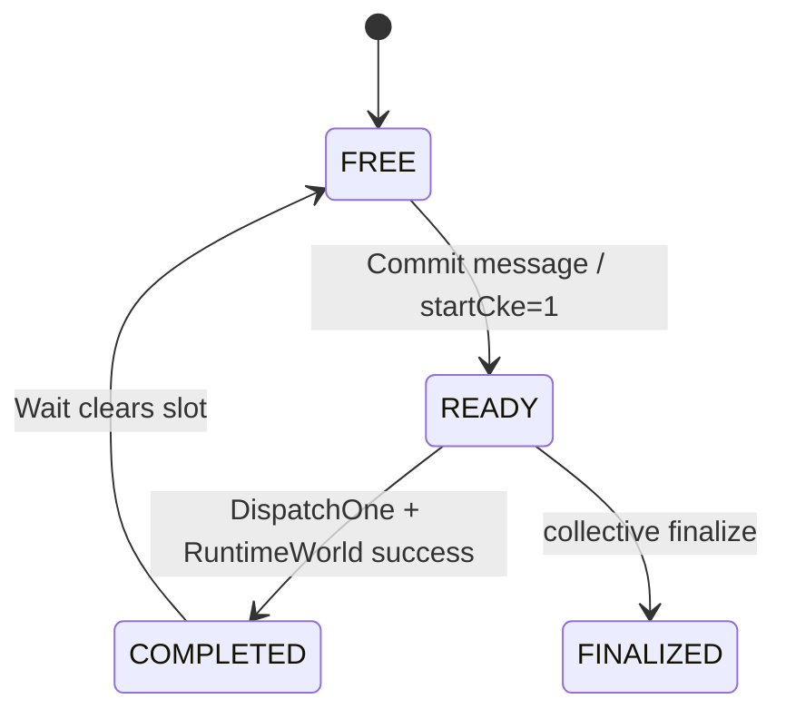

`DispatchOne` 要求所有 Rank 的当前槽都为 READY，registration 的 Rank 拓扑一致，message opId 与注册项一致，并且 finalize 必须跨 Rank 一致。随后 collective 专用 `taskArgBuilder` 把 message 和 startup token 转成普通 kernel 使用的 taskArgs，内部 `algorithmWorld_` 再执行 collective Program。

因此 `CcuKfcSimWorld` 不是第二套 collective simulator：它验证 KFC 控制面，然后委托 `RuntimeWorld` 验证数据面。普通启动和 KFC 启动必须在同一 taskArg ABI 和同一 Program 上汇合。

当前 startup 中虽然存在 `missionNum`、`missionIndex`，模型只接受 `missionNum == 1`、`missionIndex == 0`。这证明的是当前单 Mission KFC 协议，不代表已经模拟多 Mission/SQE 并发。

### 6.11 AllToAllV CCU 端到端实例

#### 6.11.1 三条链路

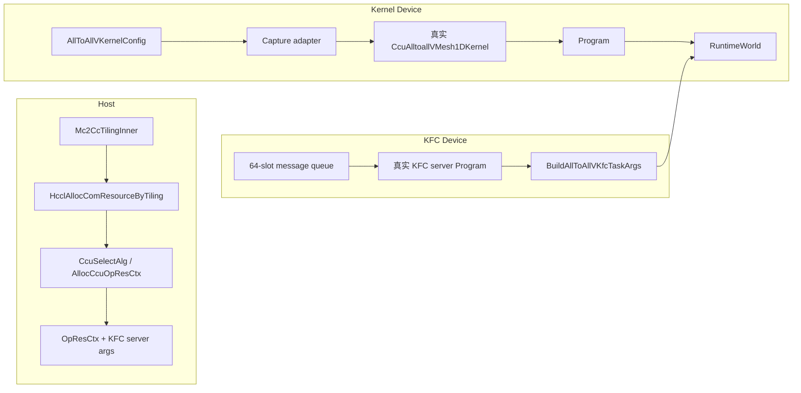

#### 6.11.2 Host 域验证

Host testcase 直接编译真实 `hccl_mc2.cc` 和 `hccl_alloc_ctx_res.cc`，当前检查：

- `AllocCcuOpResCtx` 初始化 workspace、XN、CKE、Rank；
- tiling 选择 `CcuAlltoallVMesh1D`；
- 多配置按主线限制回退，不进入 MC2 CCU 资源路径；
- `HcclAllocComResourceByTiling` 从 CCU tiling 分配资源；
- KFC 六个 startup args 使用已分配 queue/token；
- `CCU_SCHED` engine 和空指针边界。

`mc2_ccu/hccl_op_common_stub.cc` 只提供真实 Host 源所需的最小依赖；因此这一域验证资源控制逻辑，不等于普通 HCCL selector/executor 全链。

#### 6.11.3 捕获真实 AllToAllV kernel

`CaptureAllToAllVMesh1DKernel` 做三件事：

1. 校验 rankSize/rankId/full-mesh channels；
2. 创建 10 个 Variable 并按 0..9 `LoadArg`；
3. 调用真实产品 `mc2_ops_hccl::CcuAlltoallVMesh1DKernel`。

10 个 taskArgs 是：

| argId | 含义 |
|---:|---|
| 0 | inputAddress |
| 1 | outputAddress |
| 2 | token |
| 3 | sourceBaseOffset |
| 4 | destinationBaseOffset |
| 5 | parameterAddress |
| 6..9 | `goSize[0..3]` |

adapter 不实现 peer 循环、Write、LocalCopy 或同步；这些仍由真实产品 kernel 产生。

#### 6.11.4 peer 参数表

每个 peer 的参数表含四个 `uint64_t`：

```text
sendSize | reserved | sendOffset | recvOffset
```

RuntimeWorld 的 LOAD_MEMORY 按连续 byteOffset 加载。Checker 同时验证字段布局和最终关系：

```text
srcAddress = src.input + sourceBaseOffset + sendOffset[src][dst]
dstAddress = dst.output + destinationBaseOffset + recvOffset[dst][src]
length     = sendSize[src][dst]
```

非对称 count、非连续 offset 和零长度 peer 可以暴露“统一 slice 假设”或 peer 索引颠倒。

#### 6.11.5 普通 Kernel Device 执行

```text
RegisterAllRanks
 -> 每 Rank 得到 KernelHandle -> Program
 -> CheckRegistration
 -> BuildScenario 构造 input/output/parameter/taskArgs
 -> CheckTaskArgs
 -> CaptureRuntimeExpectation
 -> RuntimeWorld::Launch
 -> CheckRuntime
```

现有反例包括参数表越界、输出篡改、交换 source/destination base offset、缺少动态参数。这些反例分别证明 RuntimeWorld、collective Checker 和公共 ABI Checker 不是空检查。

#### 6.11.6 KFC Device 执行

KFC case 同时捕获 server kernel 和 collective kernel：

```text
queue.Commit(message)
  FREE -> READY, startCke=1
      -> CcuKfcSimWorld::DispatchOne
      -> Check opId and all-rank consistency
      -> BuildAllToAllVKfcTaskArgs
      -> RuntimeWorld::Launch collective
      -> MarkCompleted: completionCke=1
      -> queue.Wait -> FREE/next slot
```

`BuildAllToAllVKfcTaskArgs` 将 `message[1..9]` 和 startup token 映射成与普通 kernel 完全相同的 10 项 ABI。这样可验证“普通启动”和“KFC 启动”最终驱动同一个数据面，而不是两套算法。

现有 case 还覆盖 64 槽 wrap、未完成槽复用、未注册 opId、finalize 的跨 Rank 一致性等控制面风险。

### 6.12 CCU Test 如何形成可信结论

CCU case 不能依赖单一检查点。一个完整 Kernel/KFC 正例至少要经过以下证据链：

```text
真实产品 kernel
  -> 原语捕获得到 Program
  -> 公共 Program/资源 Checker
  -> collective 静态契约 Checker
  -> taskArgs ABI Checker
  -> 独立生成运行期 expectation
  -> RuntimeWorld 多 Rank 执行
  -> completed/deadlock 检查
  -> 实际 output 与独立 expectation 比较
```

“独立 expectation”尤其重要：期望输出必须在 Launch 前根据 testcase config 和初始输入生成，不能从 `RuntimeWorld` 的执行结果反推。否则 simulator 和产品 kernel 即使犯了同样的地址方向错误，case 仍可能假通过。

当前能力和证据边界如下：

| 想验证的能力 | 直接证据 | 当前能否验证 |
|---|---|---:|
| MC2 CCU 资源分支和上下文 | 真实 Host 代码输出的 `OpResCtx`、cache 和 startup args | 能 |
| 产品 kernel 调用了哪些 CCU API | 真实 kernel 捕获出的 `Program.operations` | 能 |
| Variable/Address/Event/Channel 引用合法 | Program 资源集合和 handle 关系 | 能 |
| LoadArg 与 taskArgs ABI 对齐 | `ArgDescriptor`、13 槽打包和 collective config | 能 |
| 地址 owner、长度和 Rank 方向 | `RankMemory`、`ResolveMemory`、Channel peer | 能 |
| 显式 event/notify 是否可推进 | `RuntimeWorld` 状态和 deadlock 检测 | 能 |
| AllToAllV 多 Rank结果 | Launch 前独立 expectation 与执行后 output | 能 |
| KFC queue/opId/CKE/finalize 协议 | queue、registration、message 和状态迁移 | 能 |
| 真实 Translator 和微码编码 | 未调用产品 Translator | 不能 |
| 真实 XN/GSA/CKE/MS 物理资源分配 | Program 只保存逻辑资源 | 不能 |
| GroupCopy 内部 LoopEngine pipeline 执行 | 当前按整体 `memmove` 模拟 | 不能 |
| 多 Mission/多 LoopEngine 并发冲突 | 尚无通用调度模型和 `Program -> DAG` | 不能 |
| 驱动、硬件时序和性能 | Host 模型无真实设备 | 不能 |

因此 CCU ST 的准确结论应该是：**MC2 Host 资源控制路径、真实 CCU/KFC kernel 产生的逻辑 Program、运行期 ABI、显式同步、KFC 协议和 Host 模型中的多 Rank 数据结果通过验证**。不能把它扩大表述成“真实 CCU 微码或硬件执行通过”。

## 7. 为什么当前 CCU 不直接复用 AICPU DAG

AICPU Task 已经是具体的 copy/reduce/notify，因此可以直接成图。CCU Program 还包含 Variable、Address、LoadArg、IF/WHILE、GroupCopy/LoopGroup 和运行期地址表达式。如果录制后立即降成 SimTask，会丢失：

- 参数如何绑定到 Variable；
- 地址和 goSize 如何动态计算；
- GroupCopy 内部资源和 Loop 描述；
- KFC message 如何生成同一 taskArgs；
- Program/handle/registration 的归属关系。

正确顺序应是：先做 Program/ABI/结构 Checker，再可选降低为 DAG 做并发冲突检查，而不是用 DAG 替代结构化 Program。

两条路径的关系可以概括为：

| 维度 | AICPU | CCU/MC2 |
|---|---|---|
| 产品入口 | 普通 HCCL Host API | MC2 Host 资源或直接真实 CCU kernel/KFC server |
| 中间表示 | 具体 `TaskStub` | 结构化 `Program` + taskArgs/KFC message |
| 多 Rank 模型 | Host thread 录制任务 | `RuntimeWorld` 轮询解释 Program |
| 同步验证 | Task DAG post/wait | event/notify 状态推进和 deadlock |
| 内存验证 | DataSlice + DAG 冲突 | Host RankMemory + owner/范围检查 |
| 最终语义 | BufferSemantic 来源传播 | 独立期望字节结果比较 |
| 当前优势 | DAG、冲突和多 collective 语义成熟 | Program ABI、控制流和 KFC 协议可观察 |
| 当前缺口 | 不执行设备数值和真实 Runtime | 尚无通用 Program DAG 和多执行实体并发 |

## 8. 当前方案的真实边界

### 8.1 已覆盖

- AICPU 真实 AllGather/ReduceScatter selector、executor 和 template；
- AICPU 多 Rank、主从流 Task 录制；
- AICPU Task DAG、同步配对、显式死锁和内存冲突；
- AICPU copy/reduce 符号来源及 collective 最终语义；
- MC2 Host tiling、资源、cache 和错误输入；
- 真实 AllToAllV/KFC server kernel 的 CCU API 调用形态；
- Program 资源、操作、LoadArg 和控制流结构；
- taskArgs 的 13 槽逻辑分组和字段值；
- 逻辑 event/notify 可推进性和显式死锁；
- Host vector 上的多 Rank地址、长度、方向和数据结果；
- KFC queue、opId、start/completion CKE、wrap 和 finalize。

### 8.2 尚未覆盖

- AICPU 的真实 Runtime/AICPU kernel 设备执行和数值精度；
- AICPU/CCU 的真实链路、驱动、固件、性能和异常恢复；
- 普通 `HcclAlltoallv -> selector/executor -> HcommCcuKernelRegister/Launch -> RuntimeWorld` 全链；
- `hcomm_ccu_stub.cc` 的通用 `KernelHandle -> Program` backend；
- CCU Program 到 Task DAG 的通用 lowering；
- 多个 Mission、多个单 Mission kernel 和多 LoopEngine 的真实并发冲突；
- GroupCopy 内部 MS/LoopEngine pipeline 的逐节点执行；
- 真实 XN/GSA/CKE/MS 物理分配和资源耗尽；
- Translator、CcuInstr、驱动、固件、硬件链路和性能。

## 9. 分阶段演进方案

### P0：稳定当前 AICPU 与 AllToAllV 基线

- 保持 AllGather/ReduceScatter AICPU 的真实产品源链接、37 个 case 和七阶段 Checker；
- 保持 Host/Kernel/KFC 三域均可独立定位失败；
- adapter 只做 callable/taskArg 桥接；
- Stub 的成功必须伴随资源、Program、状态或结果断言；
- 当前 AICPU 37 case、MC2 CCU 27 case 与 CMake、文档保持一致。

### P1：扩展 AICPU collective 和原语覆盖

- 新 collective 若只使用已有 HCOMM 原语，复用 SimTaskQueue、DAG 和内存冲突框架，只新增真实产品源构建、testcase、verifier 入口和 collective semantics checker；
- 新 HCOMM 原语必须同时补 TaskStub、Proxy、DAG 行为、读写集合和符号语义，不能只提供返回成功的 Stub；
- 用例覆盖 selector 分支、拓扑、Rank、大小/尾块、dataType、reduceOp 和 in-place 边界；
- 通用框架反例放公共 UT，collective 规则反例放对应 semantics testcase。

### P2：通用 Register/Launch backend

目标链路：

```text
ordinary HCCL API
 -> real selector/executor/template
 -> Register typed wrapper/unified callable
 -> KernelHandle -> Program
 -> Launch taskArgs
 -> RuntimeWorld
```

需要统一 product kernel callable ABI，或由注册点提供类型安全 wrapper。完成后可删除 adapter 中通用化的 Capture/普通 Prepare 部分，但 KFC message-to-taskArg builder 仍是 collective 契约。

### P3：Program -> DAG 后端

在保留 Program Checker 后，将已解析的数据操作和同步转为执行节点：

```text
Program/MissionInstance
 -> primitive/LoopEngine nodes
 -> Event/CKE/Channel happens-before
 -> resolved read/write intervals
 -> DAG conflict checker
```

PR 2273 的通用 CCU 原语到 SimTask 映射可以作为参考，但不应建立第二套 recorder。

### P4：多 Mission/LoopEngine 并发

引入一等 `MissionInstance`：Rank、Program、taskArgs、launch id、资源作用域。LoopGroup/LoopEngine/iteration 作为可调度节点，不能按源码顺序直接串行展开。使用确定性拓扑调度和受控 interleaving 检查没有 happens-before 的重叠访问。

### P5：多 collective KFC 注册

当前 `ccu_kfc_server_adapter` 有 AllToAllV 专用 dispatch。接入第二个 collective 时应抽象：

- collective identity/opId registry；
- kernel handle lookup；
- message validator；
- taskArg builder；
- collective semantics checker。

KFC 层只调度，不重新实现数据面。

### P6：设备验证衔接

Host ST 产出的 ABI 场景应复用于产品 UT/实机 ST，补齐 Translator、物理资源、驱动和真实性能。各层报告必须写清验证终点。

## 10. 完成定义

一项 Devkit HCCL ST 能力只有同时满足以下条件才算闭环：

1. 真实产品源被执行，而不是 Stub 复制算法；
2. AICPU 上游产生可观测 TaskQueue，CCU 上游产生可观测 Program/状态；
3. 公共 Checker 和 collective Checker 各守边界；
4. AICPU 正例验证 DAG/符号来源，CCU 正例验证 Program/ABI/最终数据；
5. 改动涉及的关键同步、结构、ABI 或协议有定向反例；
6. 文档不把 Task/Program Host 模型描述为真实设备执行；
7. 对尚未覆盖的数值、并发和硬件层明确声明。

## 11. 当前关键源码索引

```text
testcase/all_gather_aicpu_testcase.cc
testcase/reduce_scatter_aicpu_testcase.cc
testcase/mc2_ccu/host/all_to_all_v_mc2_host_testcase.cpp
testcase/mc2_ccu/device/all_to_all_v_kernel_device_testcase.cpp
testcase/mc2_ccu/device/all_to_all_v_kfc_device_testcase.cpp

utils/src/aicpu/CMakeLists.txt
utils/src/hccl_proxy/hccl_stub.cc
utils/src/sim_world/sim_world.*
utils/src/sim_world/sim_npu.*
utils/src/sim_world/sim_task.*
utils/src/sim_world/sim_task_queue.*
utils/src/hccl_verifier/checker.*
utils/src/hccl_verifier/task_graph_generator/
utils/src/hccl_verifier/mem_conflict_check/
utils/src/hccl_verifier/semantics_check/allgather_semantics_checker.*
utils/src/hccl_verifier/semantics_check/reduce_scatter_semantics_checker.*

utils/src/ccu/ccu_all_to_all_v_mesh1d_adapter.*
utils/src/ccu/ccu_kfc_server_adapter.*
utils/src/mc2_ccu/cann_host_bridge_stub.cc
utils/src/mc2_ccu/hccl_op_common_stub.cc

utils/src/hccl_depends_stub/ccu_primitives_stub.*
utils/src/hccl_proxy/ccu_st_types.h
utils/src/hccl_proxy/ccu_kernel_proxy.*
utils/src/hccl_proxy/ccu_kfc_proxy.*
utils/src/hccl_proxy/hcomm_ccu_stub.cc

utils/src/sim_world/ccu_sim_world.*
utils/src/sim_world/ccu_kfc_sim_world.*

utils/src/hccl_verifier/ccu_checker.*
utils/src/hccl_verifier/ccu_kfc_checker.*
utils/src/hccl_verifier/semantics_check/ccu_all_to_all_v_semantics_checker.*
utils/src/hccl_verifier/semantics_check/ccu_all_to_all_v_mc2_checker.*
```
