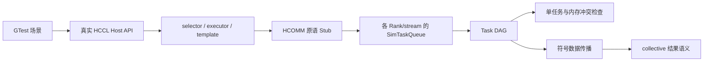
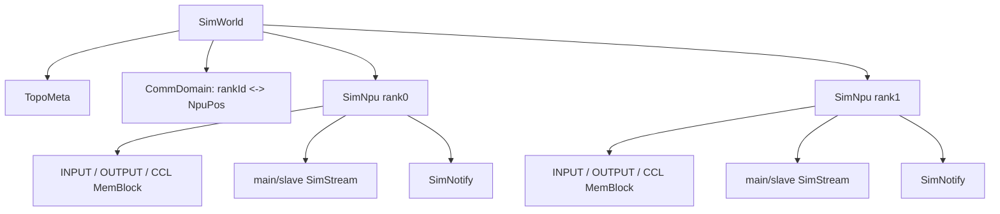
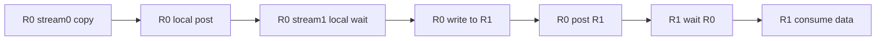
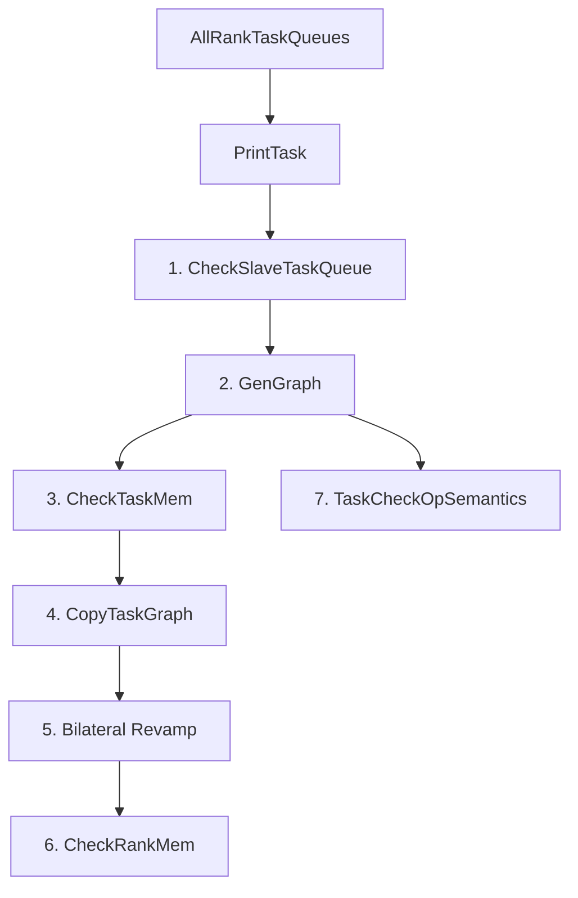

# HCCL 原仓 ST 整体原理与方案

> 本文以 HCCL 仓库内 `test/st/algorithm` 的当前代码为事实来源，只介绍 HCCL 原仓算法分析器的设计、执行链路和能力边界。

## 1. ST 要解决什么问题

HCCL 集合通信算法既包含多 Rank 数据搬运，又包含主流/从流、跨 Rank notify、读写和归约。只检查 Host API 返回成功，无法证明以下事实：

- selector/executor/template 是否选择并展开了正确算法；
- 每个 Rank 是否发送了正确片段，目标 offset 是否正确；
- 主流和从流之间是否存在完整同步；
- 跨 Rank post/wait 是否配对，是否可能死锁；
- 两个并发 task 是否无序访问同一块内存；
- Reduce 的源 Rank、源 offset、类型和操作是否正确。

HCCL ST 因此不是简单的 API mock，也不是周期级设备模拟器。它采用“真实算法展开 + Host 侧任务录制 + DAG/符号语义验证”：



核心思想是：不真的搬运设备字节，而是记录“哪一个 Rank 的哪一类 buffer、哪个 offset、多少字节，被 copy/reduce 到哪里”，然后验证任务之间的因果关系和数据来源。

## 2. 源码目录和职责

```text
hccl/test/st/algorithm/
├── README.md
├── testcase/                       # 每个 collective 的 GTest
└── utils/src/
    ├── aicpu/                      # ST 需要直接编入的 AICPU 算法侧代码
    ├── hccl_depends_stub/          # 产品外部依赖替身
    ├── hccl_proxy/                 # ACL/HCCL/HCOMM 接口到仿真对象的桥
    │   ├── communicator/           # SimCommunicator/Channel/Thread/Context
    │   └── topo_model/             # 测试拓扑模型
    ├── sim_world/                  # 虚拟拓扑、NPU、内存、stream、notify、task
    └── hccl_verifier/
        ├── singletask_check/       # 单 task 和从流形态
        ├── task_graph_generator/   # Task Queue -> DAG
        ├── mem_conflict_check/     # 并发内存冲突
        └── semantics_check/        # collective 符号语义
```

依赖方向应保持单向：

```text
testcase
  -> 产品 HCCL 算法
  -> hccl_proxy / depends_stub
  -> sim_world 产生任务日志
  -> hccl_verifier 消费任务日志
```

Stub 负责记录事实，Checker 负责判断事实，不应让 Stub 直接返回“算法正确”。

## 3. 一条用例是怎样运行的

以 `all_gather_aicpu_testcase.cc` 为例，逻辑过程是：

```text
1. 构造 TopoMeta
2. SimWorld::Init(topoMeta, devType)
3. 设置算法选择环境，例如 HCCL_OP_EXPANSION_MODE
4. 每个逻辑 Rank 启动一个 Host 线程
5. 在线程中 setDevice/createStream/initComm/allocMemory
6. 调用 HcclAllGather
7. 产品算法通过 HCOMM 原语产生 TaskStub
8. SimTaskQueue 收集所有 Rank、所有 stream 的任务
9. CheckAllGather -> Checker::GenAndCheckGraph
10. SimWorld::Deinit 清理全局拓扑、stream、notify 和队列
```

“多 Rank 并行调用”是多个逻辑通信参与者各调用一次 Host API。它使 Rank0 的 post/发送能与 Rank1 的 wait/接收配对，不代表同一 Rank 内的多个执行流天然具有先后关系；流间顺序仍由同步任务建立。

## 4. SimWorld：虚拟集群的骨架

### 4.1 对象层级

`SimWorld` 是全局虚拟通信环境：



`TopoMeta` 是三层结构：superpod -> server -> device。`CommDomain` 建立 Rank 与物理位置描述之间的映射。`SimWorld::InitSimNpuRes` 为拓扑中的每个位置创建 `SimNpu`。

### 4.2 SimNpu 模拟什么

每个 `SimNpu` 提供：

- INPUT、OUTPUT、CCL 等虚拟内存块；
- 主 stream 和从 stream；
- notify 资源；
- 地址到 `DataSlice` 的解析；
- device type 和拓扑位置。

ST 使用递增虚拟地址区分 Rank 和 buffer。地址不会被 Host 直接解引用，而是转换为：

```cpp
DataSlice {
    BufferType type; // INPUT / OUTPUT / CCL
    uint64_t offset;
    uint64_t size;
}
```

所以内存检查关注的是 `(rank, bufferType, offset, size)`，不是 Host 指针中的真实数据。

### 4.3 SimWorld 不负责什么

HCCL 原仓的 `SimWorld` 不是一个执行所有 task 的事件循环。它主要构造和持有虚拟资源。算法运行时，ACL/HCOMM Stub 根据当前 device、stream 和地址，把具体操作记录进 `SimTaskQueue`；后续由 Checker 在图上解释任务和符号数据。

## 5. Proxy 和 Stub：把产品调用变成任务

产品算法仍走真实 selector/executor/template，但其环境依赖由测试代理接管：

- `aclrt_stub.cc`：setDevice、stream、memory、kernel launch 等 Runtime 接口；
- `hccl_stub.cc`：通信原语、线程/stream 和任务提交；
- `hcclinner_stub.cc`：产品内部入口的测试桥接；
- `communicator/`：虚拟 communicator、channel、thread、context；
- `hccl_depends_stub.cc`：日志、配置、外部组件等最小依赖。

通用 HCOMM 原语会生成具体 `TaskStub`，典型类型包括：

```text
LOCAL_COPY / LOCAL_REDUCE
READ / READ_REDUCE
WRITE / WRITE_REDUCE
LOCAL_POST_TO / LOCAL_WAIT_FROM
POST / WAIT
```

每个 Task 保存源/目的 `DataSlice`、peer Rank、link type、notify/topic id、reduce type 等信息。这样算法可以是真实的，设备行为则被转换为可检查的数据结构。

## 6. SimTaskQueue：按 Rank 和 stream 保存程序顺序

`SimTaskQueue` 的核心结构是：

```cpp
// taskQueue[0] 是主流，taskQueue[1...] 是从流
using SingleTaskQueue = vector<vector<shared_ptr<TaskStub>>>;

using AllRankTaskQueues =
    map<PodId, map<SerId, map<PhyId, SingleTaskQueue>>>;
```

形象地看：

```text
Rank0
  stream0(master): A -> B -> C -> D
  stream1(slave) : wait0 -> E -> F -> post0

Rank1
  stream0(master): G -> H -> I
  stream1(slave) : wait1 -> J -> post1
```

`AppendTask` 只记录当前 stream 上的追加顺序。此时不同 stream、不同 Rank 之间还没有完整的因果关系，所以队列本身不足以检查并发和死锁，必须进一步生成 DAG。

## 7. 为什么需要 Task DAG

### 7.1 队列顺序不等于全局顺序

同一 stream 内 `A -> B` 是确定顺序；Rank0 stream0 的 A 与 Rank1 stream1 的 J 是否有先后关系，仅靠数组位置无法判断。DAG 把所有可证明的 happens-before 关系表示为边。

### 7.2 DAG 边的来源

`TaskGraphGenerator` 建立三类主要边：

1. stream 程序顺序：同一队列前一个 task 指向后一个 task；
2. Rank 内同步：`LOCAL_POST_TO -> LOCAL_WAIT_FROM`，按 topic/queue id 配对；
3. Rank 间同步：某 Rank 的 `POST ->` 对端对应 `WAIT`，按 Rank、link type、topic 和 notify type 配对。



如果所有待执行节点都在等待尚未出现的匹配 post，`unmatchedCnt` 会达到待处理队列大小，生成器判定同步不匹配或死锁。

### 7.3 DAG 的价值

DAG 同时服务三件事：

- 验证同步配对，识别死锁；
- 判断两个内存访问是否可能并发；
- 为符号语义传播提供合法的拓扑执行顺序。

## 8. Checker 七阶段链路

`Checker::GenAndCheckGraph` 的当前源码明确分为七步：



源码日志把打印置于编号外，后续依次为“检查从流、成图、Task 内存、图复制、图改造、Rank 内存、语义校验”。

### 8.1 从流形态

`SingleTaskCheck::CheckSlaveTaskQueue` 检查从流入口/出口和本地同步形态。例如从流第一项必须是符合约定的 `LOCAL_WAIT_FROM`，避免无条件先执行从流任务。

### 8.2 DAG 和死锁

`TaskGraphGenerator` 连接 stream、local post/wait 和 inter-rank post/wait。找不到 peer、存在未匹配 post 或所有节点均无法推进时失败。

### 8.3 单 Task 内存

`CheckTaskMem` 检查单个 copy/read/write/reduce 的源和目的是否位于合法 Rank buffer 范围，长度、地址类型和方向是否合理。

### 8.4 图复制和双边改造

内存冲突检查需要同时看到通信的本地端和远端影响。框架复制原 DAG，再由 `GraphRevampBilateralSemantics` 补齐双边语义，避免修改供最终 collective 语义使用的原图。

### 8.5 Rank 内存冲突

`CheckRankMem` 提取每个节点的读写片段：

- LOCAL_COPY：读 src、写 dst；
- LOCAL_REDUCE：读 src、写 dst；
- WRITE/WRITE_REDUCE：读本地发送片段；
- READ/READ_REDUCE：写本地接收片段。

然后结合 DAG 可达性构造并发关系。两个重叠访问若没有 happens-before，且至少一个是写，就可能构成 read/write 或 write/write 冲突。

这项检查证明的是“按照任务同步图不存在无序冲突”，不是硬件周期级无冲突。

### 8.6 符号数据传播

`TaskCheckOpSemantics` 不保存真实 tensor，而保存 `BufferSemantic`：

```text
目标区间 [start, size]
  <- 来源集合 {(srcRank, INPUT/OUTPUT/CCL, srcOffset)}
  + 是否 reduce、reduceType
```

LOCAL_COPY/READ/WRITE 会把来源集合传播到目的区间；Reduce 会合并多个来源并记录归约类型。发生部分覆盖时，语义区间会被切分，因此可以定位“哪一段数据来源错了”。

### 8.7 collective 最终语义

不同 collective 对输出有不同要求：

- AllGather：Rank r 输出的第 s 段必须只来自 Rank s 的 INPUT；
- ReduceScatter：Rank r 的输出必须由所有 Rank 输入中的第 r 段按指定 op 归约；
- AllToAllV：dst Rank 的 source 分段必须来自对应 src Rank 的 send displacement；
- Broadcast/Reduce：还要验证 root 和源集合。

因此“数据操作解释”是公共能力，“期望输出布局”是 collective 专用能力。

## 9. 以两 Rank AllGather 为例

假设每 Rank 输入 100 字节：

```text
初始：
R0 INPUT = source(R0, 0..99)
R1 INPUT = source(R1, 0..99)

期望：
R0 OUTPUT[0..99]   <- R0 INPUT[0..99]
R0 OUTPUT[100..199] <- R1 INPUT[0..99]
R1 OUTPUT[0..99]   <- R0 INPUT[0..99]
R1 OUTPUT[100..199] <- R1 INPUT[0..99]
```

如果 Rank1 将 offset 20..49 写到 Rank0 OUTPUT 50..79，符号语义会记录这段来源。最终 Checker 不只知道“有一次 WRITE”，还能指出 Rank0 输出目标区间的来源 Rank 或 offset 不符合 AllGather 规则。

## 10. 能校验与不能校验的范围

| 能力 | HCCL 原仓 Task ST |
|---|---:|
| 真实 selector/executor/template 展开 | 是 |
| 多 Rank/主从流 task 录制 | 是 |
| local/inter-rank 同步配对和死锁 | 是 |
| 单 task 地址范围 | 是 |
| Task DAG 内存冲突 | 是 |
| copy/reduce 符号来源与 collective 结果 | 是 |
| 真实 Runtime 调度顺序 | 否 |
| 网络、DMA、链路时序 | 否 |
| 驱动、固件、硬件资源极限和性能 | 否 |

## 11. 构建、运行和排障

仓库入口是：

```bash
cd <HCCL仓库>
bash build.sh --st
```

当前 `testcase/CMakeLists.txt` 按算子生成 `st_<op>_test`，并可通过 `ST_TASKS` 过滤。执行前以当前 CMake 和 `--gtest_list_tests` 为准，不依赖历史 suite 数。

排障顺序：

1. 是否进入期望 selector/executor/template；
2. `SimTaskQueue` 是否为空，Rank/stream 是否正确；
3. Task 打印中的地址、peer、topic、notify 是否正确；
4. 失败发生在从流、DAG、单 task、冲突还是最终语义；
5. success-only Stub 是否吞掉了被测逻辑。

## 12. 源码索引

```text
test/st/algorithm/README.md
test/st/algorithm/testcase/CMakeLists.txt
test/st/algorithm/testcase/all_gather_aicpu_testcase.cc
test/st/algorithm/utils/src/sim_world/sim_world.*
test/st/algorithm/utils/src/sim_world/sim_npu.*
test/st/algorithm/utils/src/sim_world/sim_task.*
test/st/algorithm/utils/src/sim_world/sim_task_queue.*
test/st/algorithm/utils/src/hccl_proxy/hccl_stub.cc
test/st/algorithm/utils/src/hccl_verifier/checker.cc
test/st/algorithm/utils/src/hccl_verifier/task_graph_generator/
test/st/algorithm/utils/src/hccl_verifier/mem_conflict_check/
test/st/algorithm/utils/src/hccl_verifier/semantics_check/
```
