# PyTorch → AscendC 映射层次结构 Mermaid 图

## 完整映射层次关系

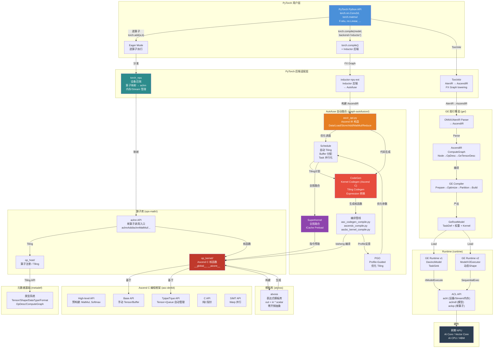

## 三种执行路径对比

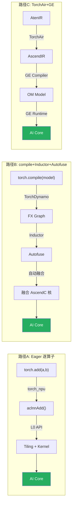

## Autofuse 内部管线

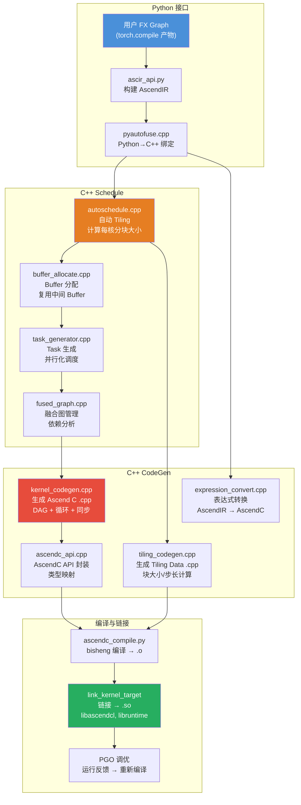

## 算子层次对照: PyTorch Op → 底层 API

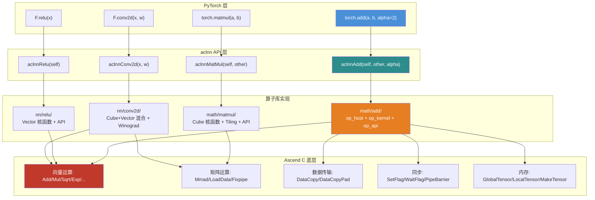

## atvoss 模板库 - 五层分层架构

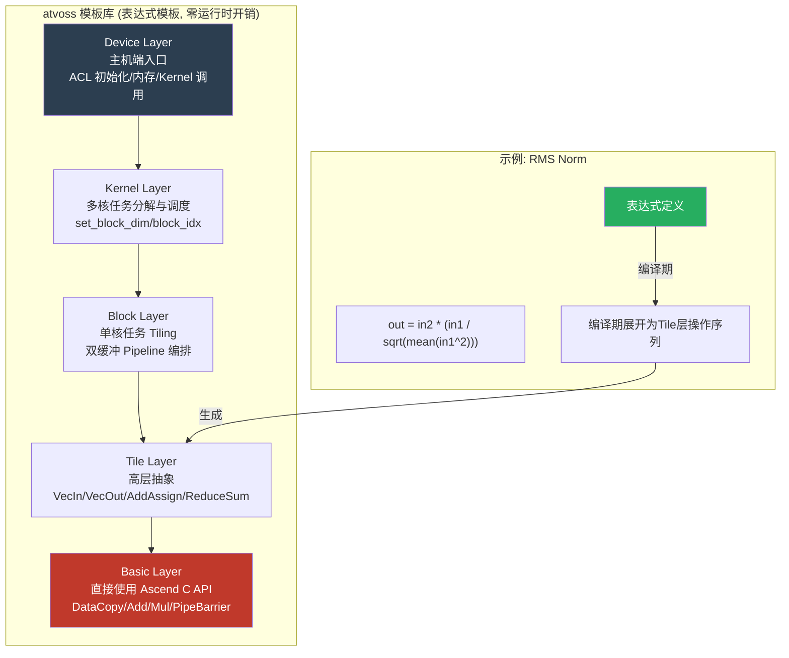

## PyTorch ↔ TF 代码路径对比

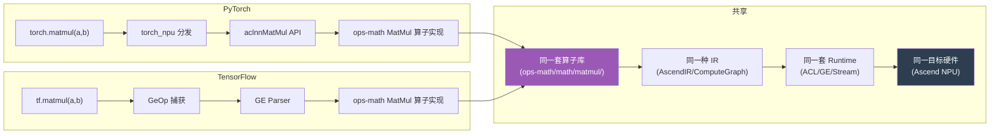

## Autofuse 自动融合完整管线

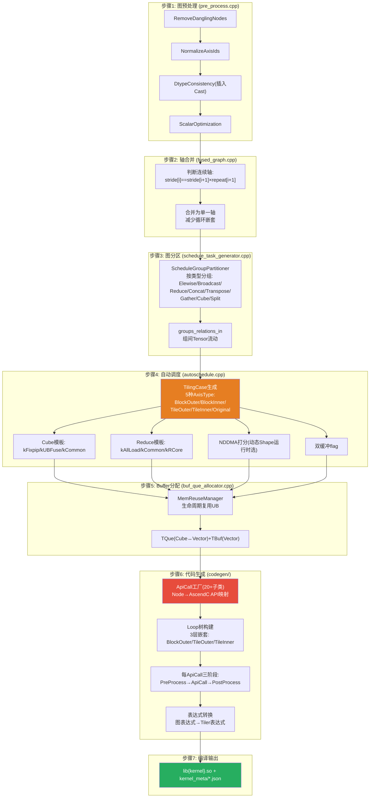

## Autofuse 融合前后数据搬运对比

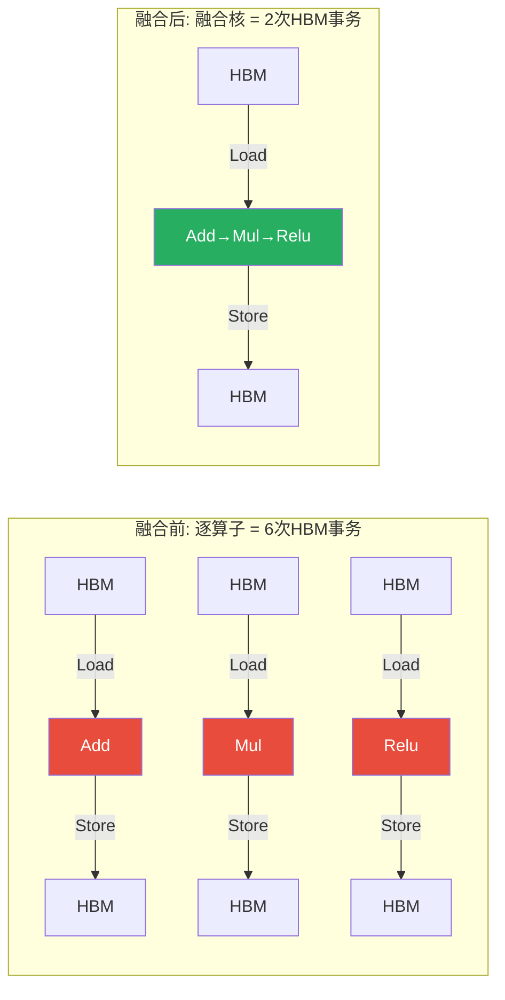

## SuperKernel 运行时调度

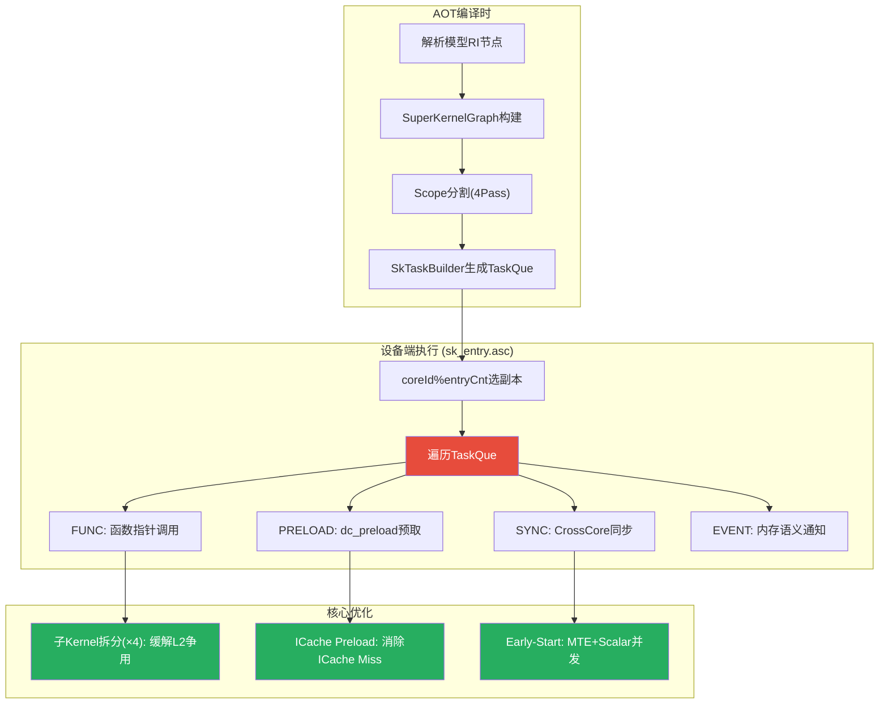

## Cube+Vector 融合模式决策树

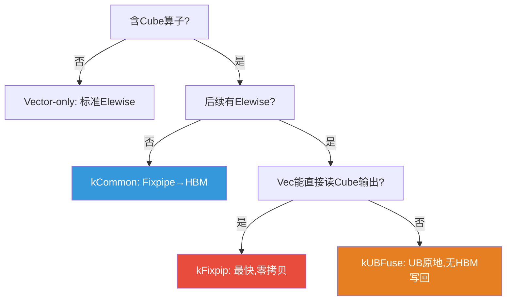

## ApiCall 代码生成流程

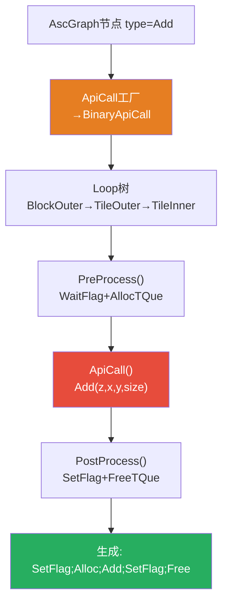

## Lowering → Symbolization → Schedule → CodeGen → ATT 完整流水线

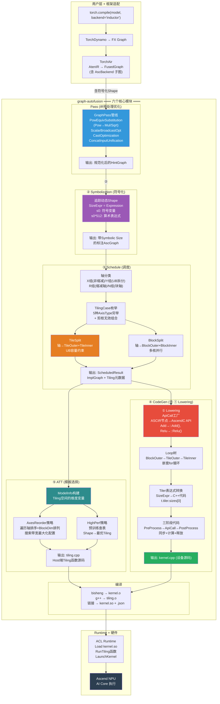

## 六个模块在层次架构中的位置

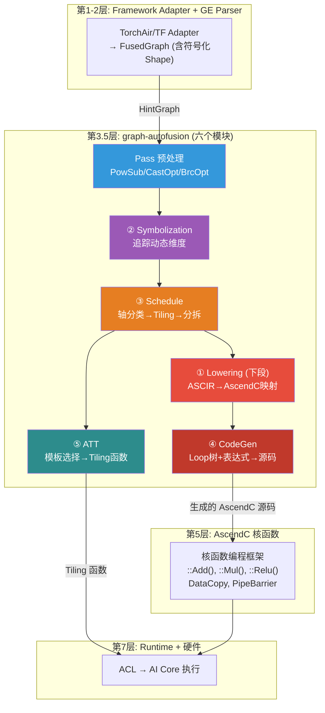

## IR 演变: 单一类型通过修改演化

