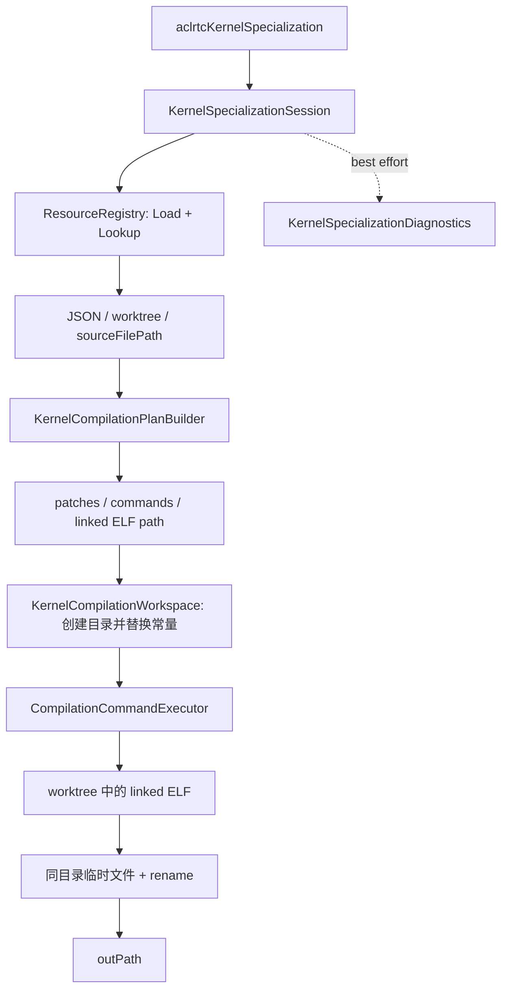

# ACLRTC Kernel 常量化编译

本目录实现 ACLNN Kernel 的请求级常量化编译。调用方提供已注册的 JIT resource、Kernel 入口、
运行时常量和可选编译参数；模块从 Manifest 生成编译计划，执行 Bisheng、llvm-objcopy 和 ld.lld，
最终向调用方指定路径发布一个链接后的 ELF。

Manifest 的生产、完整 Schema 校验和 JIT resource SO 的加载不属于本模块。Manifest 格式以
[Manifest 设计文档](https://fcn020hsamqq.feishu.cn/wiki/EPrzw1ieWiqgJWkvrAacNhqHnMe)为准，
接口与消费流程以
[ACLRTC 详细设计](https://fcn020hsamqq.feishu.cn/wiki/L2mGw2OZ5i3LUnk816ycbDXqnAg)为准。

## 对外接口

接口声明位于 `tools/include/acl/acl_rt_compile.h`：

```c
typedef struct aclrtcKernelSpecRequest {
    const char *resourceId;
    const char *kernelEntry;
    uint64_t argsCount;
    const void *const *argsAddr;
    const uint64_t *argsBytes;
    const char *const *options;
    uint64_t optionCount;
    const char *const *skOptions;
    uint64_t skOptionCount;
    uint8_t reserved[256];
} aclrtcKernelSpecRequest;

aclError aclrtcKernelSpecialization(
    const aclrtcKernelSpecRequest *request,
    const char *outPath);
```

请求必须零初始化，`resourceId` 是 64 位小写十六进制 SHA-256，`outPath` 是绝对文件路径。
`argsAddr[index]` 必须是同步调用期间可读的 host 地址，`argsBytes[index]` 是对应 buffer 的字节数。

basic 编译示例：

```c
aclrtcKernelSpecRequest request = {0};
request.resourceId = resourceId;
request.kernelEntry = kernelEntry;
request.argsCount = argsCount;
request.argsAddr = argsAddr;
request.argsBytes = argsBytes;

const char *options[] = {"-g"};
request.options = options;
request.optionCount = 1;

aclError result = aclrtcKernelSpecialization(&request, "/absolute/path/kernel.elf");
```

SK 编译在 `skOptions` 中加入 `--enable-super-kernel`。该控制项只选择 basic + SK，不传给
Bisheng；其他 `skOptions` 只注入 SK compile command。不传控制项但提供了其他 `skOptions` 时，
模块记录 warning、忽略这些选项并执行 basic 编译。

## 数据流



各对象只承担一个稳定职责：

- `KernelSpecializationSession` 编排一次同步请求和最终发布。
- `KernelCompilationPlanBuilder` 是 JSON 读取、占位符解析和命令后处理的唯一入口。
- `KernelCompilationWorkspace` 接管独占 worktree，应用 source patch，并负责保留或清理。
- `CompilationCommandExecutor` 使用 argv 直接启动进程，处理输出、超时和进程组回收。
- `KernelSpecializationDiagnostics` 只提供 dlog 和可选诊断文件，不改变编译结果。

specialization 内部统一使用 Boost.Filesystem 表达和操作路径，不依赖 C++17 标准库 filesystem
运行时实现；生产库和 UT 均显式链接 `Boost::filesystem`。

## Registry 接入

公共 Registry 合同如下：

```cpp
struct ResourceData {
    nlohmann::json json;
    std::string resourceDir;
    std::string sourceFilePath;
};

class ResourceRegistry final {
public:
    static ResourceRegistry &Instance();
    ResourceStatus Load(const char *directory);
    ResourceStatus Lookup(const char *resourceId, const ResourceData *&resource);
};
```

每次编译调用 `Load(nullptr)` 后再 `Lookup(resourceId)`。`resourceDir` 是本请求独占、可写且每次不同的
worktree，查询成功后清理责任转移给 ACLRTC；`sourceFilePath` 是本次编译期间稳定的外部只读源码。
`resource_registry_adapter.cpp` 是唯一适配点。当前仓库尚未包含上述 Registry 的公开头和链接目标，
因此默认 adapter 返回失败；Registry 提供方接入后只需在该文件连接 `Load`、`Lookup` 和状态映射。

## Manifest 消费

ACLRTC 只读取当前请求实际使用的字段：

- 顶层：`schema_version`、`options`、`kernels`。
- 目标 Kernel：`kernel_name`、可选的 `constant_infos`、可选的 `link_options`、`objects`。
- 所选对象：`object_type`、`commands`、`outputs`。
- command：`type`、`cmd`，以及可选的 `stage`。

basic 请求不深读 SK 对象，无关 Kernel 在找到目标入口后不再读取。pack 是完整 Manifest validator；
ACLRTC 不重复校验字段白名单、唯一性、stage/output 依赖图或 template 唯一性。

`stage` 未设置时内部保持未设置状态，不生成默认值。当前版本不做同 stage 并行调度，所有 command
均按所选 object 和 command 在 Manifest 中的声明顺序串行执行，link command 固定追加在最后。
显式 `stage` 仅作为后续并行调度的元数据保留。

当前占位符为：

| 占位符 | 展开值 |
| --- | --- |
| `${resource}` | Registry 返回的 worktree 绝对路径 |
| `${output}` | worktree 下当前请求唯一的输出目录 |
| `${source_file_path}` | Registry 返回的 `sourceFilePath` 的父目录 |
| `${env:NAME}` | 当前进程中已设置的任意环境变量值 |
| `${options:key}` | 顶层 `options[key]` 的 argv 数组 |

环境变量只检查是否设置，空字符串也视为已设置；缺失时日志给出 `export NAME=<value>` 提示。
Manifest option 中可以引用环境变量，环境变量值不会再次解释成 option 引用。用户通过 C API 传入的
option 最后注入，不参与 Manifest 占位符展开。

## 命令与安全边界

specialization 自有枚举和跨模块传递的数值成员使用固定宽度类型：枚举底层类型为 `uint32_t`，
进程退出码为 `int32_t`，输出采集上限为 `uint64_t`。容器下标和字符串长度使用 `size_t`；文件描述符、
进程 ID、系统调用返回值和 wait status 使用 POSIX 接口规定的 `int`、`pid_t`、`ssize_t`，不做无意义的
窄化替换。既有 ACLRTC C API 的参数类型属于冻结 ABI，不在 specialization 内部重定义。

真实命令使用 `posix_spawn` 的 argv 执行，不经过 Shell，也不把 option 按空格再次切分。用户 option
不做编译器语义白名单，只拒绝破坏命令边界的输入：空字符串、控制字符、`@response` 和输出改写参数
`-o`、`-o<value>`、`--output`、`--output=<value>`。引号、空格、`;`、`$()` 等字符作为单个 argv
原样传递，不会形成 shell command injection。

`CompilationCommandExecutor` 在调用 `posix_spawn` 前拒绝 executable 或 argv 中的内嵌 NUL，避免
C++ 字符串校验内容与操作系统实际接收内容不一致。管道、spawn 配置和运行中的子进程组使用作用域资源
管理；正常返回和异常退出都必须关闭文件描述符并回收子进程。系统调用失败记录操作名和错误信息，
`std::bad_alloc` 映射为内存错误，其他标准异常和未知异常映射为通用错误。日志不得输出完整用户 argv，
编译器输出继续受长度上限约束。

每条 compile command 的执行上限是 5 分钟；每条 objcopy 和 link command 的执行上限是 1 分钟。
超时后先向进程组发送 SIGTERM，5 秒后仍未退出则发送 SIGKILL。stdout/stderr 合并并持续排空，最多
保留 4 MiB 用于日志。

## 发布与 DFX

链接成功后，模块在 `outPath` 同目录创建唯一临时文件，复制 linked ELF，处理 worktree，再以 rename
作为唯一提交点。提交前失败不会覆盖原有 `outPath`。

`ASCEND_OP_COMPILE_SAVE_KERNEL_META=1` 时保留 worktree，并在当前目录写入：

```text
kernel_meta/<pid>/aclrtc_<requestId>/
├── manifest.json
├── replay.sh
├── compile.log
└── result.json
```

未开启时请求结束前删除 worktree。诊断写入全部是 best effort，不改变编译结果。`replay.sh` 只用于
同机同环境定位问题，不承诺跨机器或跨 CANN 版本回放。

## 测试

UT 位于 `tests/tools/aclrtc/`，覆盖 C ABI、basic/SK 选择、选中 Manifest 子树、常量 patch、命令边界、
毫秒级超时桩、清理、发布和 DFX。生产超时不会在 UT 中真实等待。
